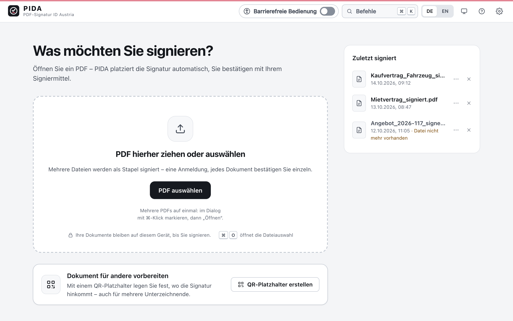
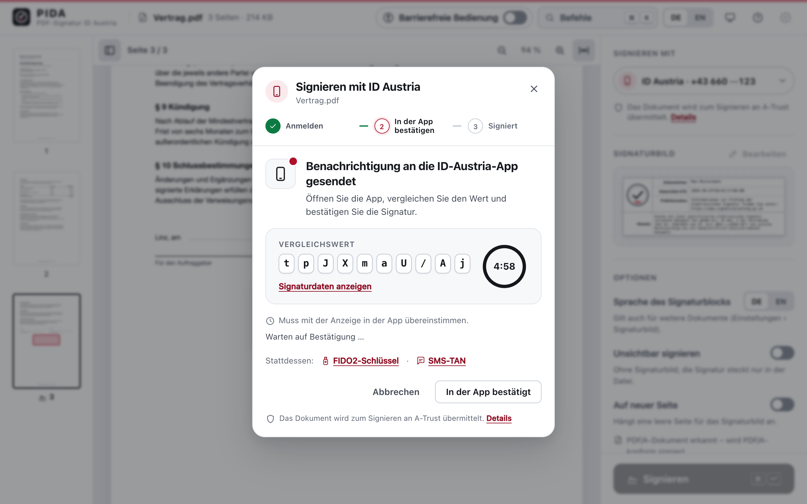
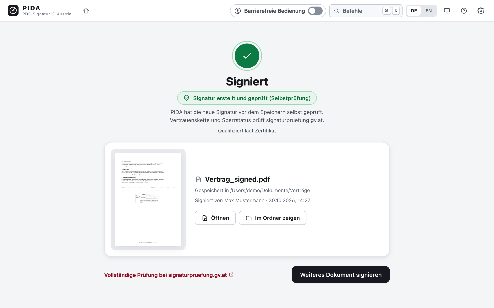
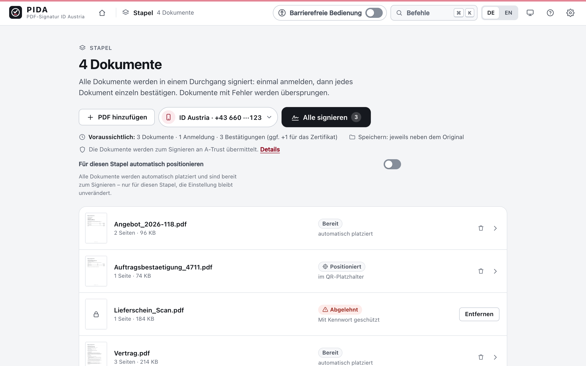
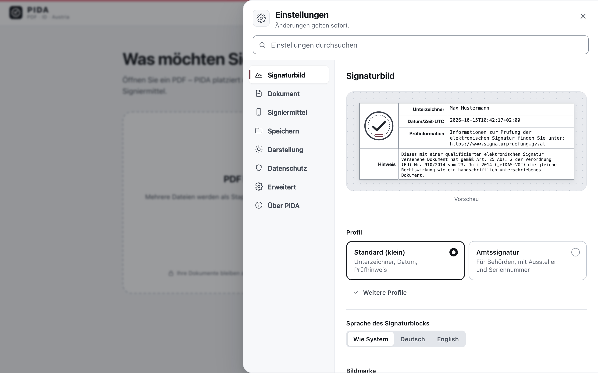
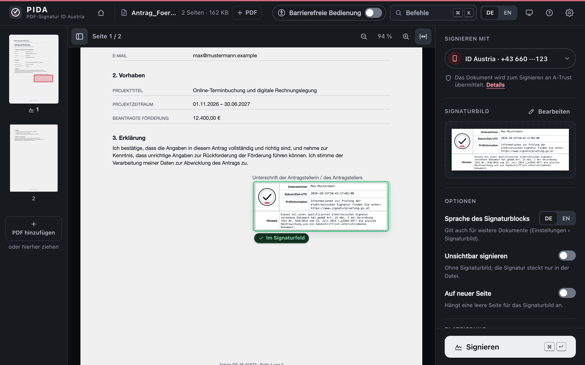
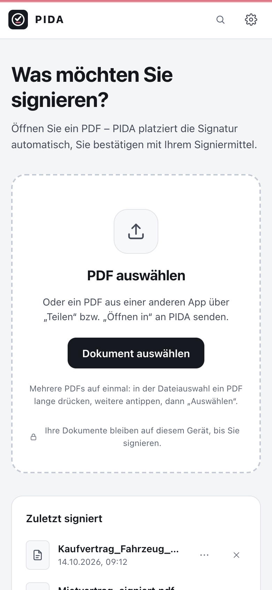
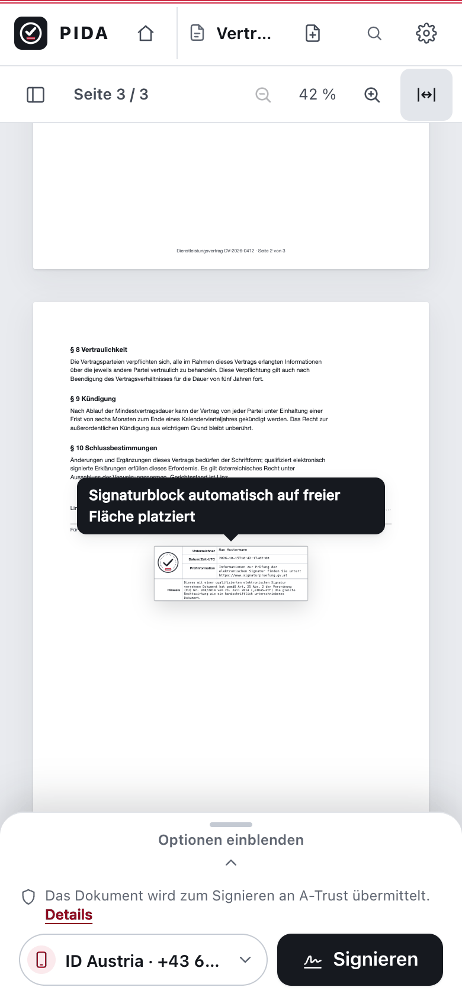

# PIDA

**PDF-Signatur mit ID Austria** · PDF · ID · Austria

[**Download 0.2.2**](https://github.com/ataub1/pida/releases/tag/v0.2.2) ·
[Alle Versionen](https://github.com/ataub1/pida/releases) ·
[Installation](#installation) ·
[In English](#in-english)

PIDA signiert PDF-Dokumente elektronisch – mit **ID Austria**, am Desktop auch mit einer **Chipkarte** oder
einem **Keystore** (PKCS#12). PIDA ist ein funktional gleichwertiger Nachbau von
[PDF-Over](https://technology.a-sit.at/pdf-over/), dem PDF-Signaturwerkzeug von A-SIT – aber **ohne Java**:
ein Rust-Kern mit einer schlanken Oberfläche (Tauri 2) für **Windows, macOS, Linux und Android**. Die
Signaturen entstehen wie bei PDF-Over nach dem **PDF-AS-Verfahren** (Signaturblock und Profile aus PDF-AS).
PIDA ist freie Software unter der **EUPL-1.2**.


> [!NOTE]
> **Testversion.** 0.2.2 ist ein Pre-Release. Die Pakete sind nicht code-signiert bzw. notarisiert und
> aktualisieren sich nicht selbst. Windows und macOS warnen deshalb beim ersten Start, Android verlangt die
> Installation aus unbekannten Quellen – siehe [Installation](#installation).

## Funktionen

- **Ein Arbeitsbereich:** PDF hineinziehen oder auswählen – PIDA platziert den Signaturblock automatisch auf
  freier Fläche. Verschieben mit Maus, Finger oder Pfeiltasten; der Block rastet an Rändern, unter dem Text und
  in leere Signaturfelder ein. Seitenminiaturen, Zoom, Signatur auf einer neuen Seite oder unsichtbar.
- **Signaturfelder und QR-Platzhalter** im Dokument werden erkannt und als Ziel angeboten; auf Wunsch
  positioniert PIDA immer automatisch (Einstellungen › Dokument).
- **Stapel:** mehrere PDFs auf einmal – einmal bei ID Austria anmelden, jedes Dokument einzeln bestätigen.
  Geschützte oder fehlerhafte Dateien werden übersprungen, einzelne Dokumente lassen sich entfernen.
- **Signieren mit ID Austria:** Statuskarte mit Fortschritt und Vergleichswert zum Abgleich mit der App
  „ID Austria“; alternativ SMS-TAN oder – am Desktop – ein FIDO2-Sicherheitsschlüssel.
- **Fertig und „Zuletzt signiert“:** signiertes Dokument öffnen, im Ordner zeigen (Desktop) bzw. teilen
  (Android), erneut signieren. Offene Arbeit bleibt als „In Bearbeitung“ auf der Startseite erhalten.
- **Signaturbild nach Wunsch:** Profile „Standard (klein)“, „Amtssignatur“ und weitere aus PDF-AS, Sprache des
  Signaturblocks, eigene Bildmarke (Standard: PIDA-Siegel), Hinweistext – mit Vorschau. PDF/A-Dokumente werden
  PDF/A-konform signiert.
- **Bedienung:** Deutsch und Englisch, helles und dunkles Design, Befehlspalette (⌘K bzw. Strg+K),
  vollständig per Tastatur bedienbar, ausgerichtet an WCAG 2.2 AA.
- **Umstieg von PDF-Over:** Beim ersten Start bietet PIDA an, die Einstellungen aus PDF-Over (`~/.pdf-over`)
  zu übernehmen. Die Startargumente von PDF-Over funktionieren weiter, dazu gibt es die Kommandozeile
  [`pida-cli`](#kommandozeile-pida-cli).

## Screenshots

<table>
  <tr>
    <td width="50%" valign="top">
      
      <br><b>Startseite</b> – PDF hineinziehen oder auswählen, mehrere Dateien werden zum Stapel. Daneben
      „Zuletzt signiert“.
    </td>
    <td width="50%" valign="top">
      
      <br><b>Signieren mit ID Austria</b> – Statuskarte mit Vergleichswert und Restzeit; bestätigt wird in der
      App „ID Austria“.
    </td>
  </tr>
  <tr>
    <td width="50%" valign="top">
      
      <br><b>Fertig</b> – PIDA prüft die neue Signatur vor dem Speichern selbst; die vollständige Prüfung
      verlinkt signaturpruefung.gv.at.
    </td>
    <td width="50%" valign="top">
      
      <br><b>Stapel</b> – eine Anmeldung für alle Dokumente; Zustand und Platzierung je Dokument auf einen
      Blick.
    </td>
  </tr>
  <tr>
    <td width="50%" valign="top">
      
      <br><b>Einstellungen › Signaturbild</b> – Profil, Sprache und Bildmarke mit Vorschau; Änderungen gelten
      sofort.
    </td>
    <td width="50%" valign="top">
      
      <br><b>Dunkles Design</b> – der Signaturblock rastet in ein leeres Signaturfeld des Formulars ein.
    </td>
  </tr>
</table>

<p align="center">
  
  &nbsp;&nbsp;
  
  <br><b>Android</b> – Startseite und Arbeitsbereich mit ausklappbarem Bedienfeld; auf dem Smartphone wird
  mit ID Austria signiert. PDFs kommen auch über „Teilen“ aus anderen Apps.
</p>

<sub>Aufnahmen der Oberfläche von 0.2.0 mit Beispieldaten (fiktive Person „Max Mustermann“, frei erfundene
Dokumente).</sub>

## Download

Alle Pakete stehen auf der Release-Seite: **[PIDA 0.2.2](https://github.com/ataub1/pida/releases/tag/v0.2.2)**
(ältere Versionen: [Releases](https://github.com/ataub1/pida/releases)).

| System | Paket (direkter Download) | Größe | Voraussetzung |
|---|---|---|---|
| Windows | [`PIDA_0.2.2_windows_x64-setup.exe`](https://github.com/ataub1/pida/releases/download/v0.2.2/PIDA_0.2.2_windows_x64-setup.exe) (empfohlen) | 10,7 MiB | Windows 10 oder 11, x64 |
| Windows | [`PIDA_0.2.2_windows_x64.msi`](https://github.com/ataub1/pida/releases/download/v0.2.2/PIDA_0.2.2_windows_x64.msi) | 14,6 MiB | Windows 10 oder 11, x64 |
| macOS | [`PIDA_0.2.2_macos_arm64.dmg`](https://github.com/ataub1/pida/releases/download/v0.2.2/PIDA_0.2.2_macos_arm64.dmg) | 12,8 MiB | macOS 11 oder neuer, Apple Silicon |
| Linux (Debian, Ubuntu) | [`PIDA_0.2.2_linux_amd64.deb`](https://github.com/ataub1/pida/releases/download/v0.2.2/PIDA_0.2.2_linux_amd64.deb) | 15,2 MiB | x86_64 |
| Linux (Fedora, RHEL) | [`PIDA_0.2.2_linux_x86_64.rpm`](https://github.com/ataub1/pida/releases/download/v0.2.2/PIDA_0.2.2_linux_x86_64.rpm) | 15,2 MiB | x86_64 |
| Android | [`PIDA_0.2.2_android_arm64.apk`](https://github.com/ataub1/pida/releases/download/v0.2.2/PIDA_0.2.2_android_arm64.apk) | 26,8 MiB | Android 9 oder neuer, arm64 |
| Kommandozeile (macOS) | [`pida-cli_0.2.2_macos_arm64`](https://github.com/ataub1/pida/releases/download/v0.2.2/pida-cli_0.2.2_macos_arm64) | 15,0 MiB | macOS 11 oder neuer, Apple Silicon |

Prüfsummen stehen in [`SHA256SUMS.txt`](https://github.com/ataub1/pida/releases/download/v0.2.2/SHA256SUMS.txt)
(prüfen mit `shasum -a 256 -c SHA256SUMS.txt` unter macOS, `sha256sum -c SHA256SUMS.txt` unter Linux bzw.
`Get-FileHash <Datei> -Algorithm SHA256` in der Windows PowerShell). Eine iOS-Version ist nicht Teil des
Releases.

## Installation

### Windows

1. Den Installer `…-setup.exe` herunterladen und starten (die `.msi` ist für verteilte Installationen gedacht).
2. Microsoft Defender SmartScreen meldet „Der Computer wurde durch Windows geschützt“, weil der Installer nicht
   code-signiert ist: **„Weitere Informationen“ › „Trotzdem ausführen“**.
3. Fehlt die WebView2-Laufzeit von Microsoft (unter Windows 11 vorinstalliert), lädt der Installer sie nach –
   dafür ist eine Internetverbindung nötig.

### macOS

1. Die `.dmg` öffnen und **PIDA** in den Ordner „Programme“ ziehen.
2. Die App ist nicht notarisiert, deshalb blockiert macOS den ersten Start. Bis macOS 14: **Rechtsklick (bzw.
   Ctrl-Klick) auf PIDA › „Öffnen“** und im Dialog nochmals „Öffnen“. Ab macOS 15: PIDA einmal starten,
   dann **Systemeinstellungen › Datenschutz & Sicherheit › „Dennoch öffnen“** und bestätigen.
3. Nur bei der älteren Version 0.2.0: Meldet macOS, „PIDA“ sei **beschädigt**, nach Kontrolle der Prüfsumme
   im Terminal `xattr -dr com.apple.quarantine /Applications/PIDA.app` ausführen. Ab 0.2.1 ist die App ad hoc
   signiert, dann genügt Schritt 2.

### Linux

```sh
sudo apt install ./PIDA_*.deb      # Debian, Ubuntu
sudo dnf install ./PIDA_*.rpm      # Fedora, RHEL
```

Die Paketverwaltung installiert die nötigen Bibliotheken (u. a. WebKitGTK) mit. PIDA erscheint danach im
Anwendungsmenü.

### Android

1. Die `.apk` auf dem Smartphone herunterladen (z. B. im Browser von der Release-Seite) und öffnen.
2. Android fragt, ob der Browser bzw. Dateimanager **unbekannte Apps installieren** darf: in den Einstellungen
   erlauben, zurück und **„Installieren“** wählen.
3. Warnt Google Play Protect vor einer unbekannten App, **„Trotzdem installieren“** wählen (je nach
   Android-Version erst nach dem Aufklappen der Details).

Die APK ist mit einem eigenen Schlüssel des Projekts signiert. Ist bereits ein PIDA-Build anderer Herkunft
installiert (andere Signatur), muss dieser vorher deinstalliert werden.

## Signiermittel

| Signiermittel | Desktop | Android |
|---|:---:|:---:|
| **ID Austria** (Signatur über A-Trust) | ✓ | ✓ |
| **Chipkarte** über eine lokal installierte Chipkarten-Software | ✓ | – |
| **Keystore** (PKCS#12, `.p12`/`.pfx`) | ✓ | – |

- **ID Austria:** Anmeldung mit Telefonnummer oder Benutzername und Signatur-Passwort; bestätigt wird in der
  App „ID Austria“ (Vergleichswert prüfen), per SMS-TAN oder am Desktop mit einem FIDO2-Sicherheitsschlüssel.
  Im Stapel genügt eine Anmeldung für alle Dokumente.
- **Chipkarte:** Karte ins Lesegerät stecken; PIDA spricht wie PDF-Over die Chipkarten-Software auf diesem
  Rechner an, die PIN geben Sie dort ein.
- **Keystore:** Datei unter Einstellungen › Signiermittel wählen. PIDA erkennt das Format am Inhalt und zeigt
  die enthaltenen Schlüssel zur Auswahl; JKS/JCEKS-Dateien bitte vorher nach PKCS#12 umwandeln. Das Passwort
  kann auf Wunsch im Schlüsselspeicher des Systems gemerkt werden.

## Datenschutz

- **ID Austria:** Zum Signieren wird das PDF-Dokument an **A-Trust** übermittelt. PIDA zeigt das als kurzen
  Hinweis direkt beim Signiermittel; den vollständigen Text finden Sie unter Einstellungen › Datenschutz,
  Speicherdauer und weitere Angaben in der
  [Datenschutzerklärung von A-Trust](https://www.a-trust.at/downloads/documents/datenschutzerklaerung.pdf).
  Eine Verbindung zu ID Austria entsteht erst, wenn Sie das Signieren ausdrücklich starten.
- **Chipkarte und Keystore:** Signiert wird auf dem eigenen Gerät; das Dokument wird nicht hochgeladen.
- Einstellungen, die abschaltbare Liste „Zuletzt signiert“ und Protokolle bleiben auf dem Gerät. Protokolle
  enthalten keine Passwörter, TANs oder Dokumentinhalte.
- **Update-Prüfung (Desktop):** PIDA fragt höchstens einmal am Tag beim Start und beim Öffnen von „Über PIDA“
  bei GitHub (`api.github.com`) nach der neuesten Version. Dabei sieht GitHub die IP-Adresse des Geräts; Kennungen
  werden nicht übertragen, heruntergeladen wird nichts. Abschaltbar unter Einstellungen › Erweitert
  („Automatisch nach Updates suchen“) bzw. per Richtlinie `update_check = false`.

## Signaturen prüfen

PIDA prüft jede neue Signatur vor dem Speichern selbst (Dokument unverändert, Signatur kryptografisch intakt)
und speichert nur, wenn diese Selbstprüfung gelingt. Vertrauenskette und Sperrstatus des Zertifikats prüft
PIDA nicht – dafür gibt es die Signaturprüfung unter
**[www.signaturpruefung.gv.at](https://www.signaturpruefung.gv.at)**; die Fertig-Ansicht verlinkt dorthin.

## Kommandozeile `pida-cli`

`pida-cli` versteht die Startargumente von PDF-Over (`-i -o -b -n -p -ks -kspass -ksalias -a -s -c -v` …) und
ergänzt Befehle, `--headless` (ohne Rückfragen) und `--json`. Die Desktop-App wertet dieselben Argumente aus.

```sh
pida-cli vertrag.pdf -b MOBILE                  # mit ID Austria, Rückfragen im Terminal
pida-cli sign ./rechnungen -b KS -ks zertifikat.p12 --kspass-env PIDA_KSPASS -a -o ./signiert --headless
pida-cli verify vertrag_signed.pdf              # Selbstprüfung (ohne Vertrauenskette und Sperrstatus)
pida-cli profiles                               # Signaturprofile auflisten
pida-cli migrate --dry-run                      # Übernahme der PDF-Over-Einstellungen nur anzeigen
pida-cli --help                                 # alle Optionen und Exit-Codes
```

Für macOS (Apple Silicon) liegt dem Release die fertige Datei
[`pida-cli_0.2.2_macos_arm64`](https://github.com/ataub1/pida/releases/download/v0.2.2/pida-cli_0.2.2_macos_arm64)
bei: ausführbar machen mit `chmod +x pida-cli_0.2.2_macos_arm64`, gegebenenfalls zuerst
`xattr -d com.apple.quarantine pida-cli_0.2.2_macos_arm64`. Für andere Systeme lässt sich `pida-cli` aus dem
Quellcode bauen (`cargo build --release -p pida-cli`, siehe [Entwicklung](#entwicklung)).

## Entwicklung

PIDA besteht aus einem UI-unabhängigen Rust-Kern (PAdES-Engine, Signatur-Backends, Workflow) und zwei dünnen
Oberflächen darüber: der App (Tauri 2 mit React 19 und React Aria, Desktop und Mobile) und der Kommandozeile.
Die Fachlogik liegt ausschließlich im Kern; die Oberfläche zeigt dessen Zustand an und meldet Eingaben zurück.

### Bauen

```sh
source tools/env.sh            # rustup (keg-only), .venv, PIDA_REFERENCE (auch in git worktrees)
cargo check --workspace --all-targets
cargo test --workspace
cargo run -p pida-cli -- --help
tools/make-testdata.sh         # Testdaten erzeugen/aktualisieren (openssl, qpdf, python3)

cd apps/app && npm ci && npm run build && npm test        # Oberfläche
npm run dev:mock                                          # Oberfläche mit Mock-Kern im Browser
eval "$(tools/fetch-pdfium.sh --print-env)"               # PDFium (im Repo-Wurzelordner)
npm run notices && npm run bundle:mac:debug               # macOS-App mit PDFium und Drittlizenzen
```

Werkzeuge: Rust 1.99 stable (Edition 2024), Node.js ≥ 22.12, PDFium chromium/8100. Abhängigkeiten sind in
`[workspace.dependencies]` gepinnt. Release-Pakete für Windows, macOS und Linux baut die CI
(`.github/workflows/release-bundles.yml`); Android und iOS beschreibt
[docs/integration/mobile.md](docs/integration/mobile.md).

### Struktur

```
crates/
  java-properties   Java-Properties-Parser/-Writer (PDF-Over.config, PDF-AS-Profile, messages*.properties)
  i18n              Fluent-Kataloge de/en (eine Textquelle für Kern, CLI und Oberfläche)
  pdf-cos           lopdf-Fassade: SourcePdf, Revisionen, Verschlüsselung, Seiten, Felder
  pdf-incremental   Append-only-Writer, ByteRange/Contents-Platzhalter
  cades             CMS/CAdES, Zertifikate, Verifier
  sigblock          PDF-AS-Profile, Layout, Fonts, Bildmarke, Appearance
  placement         Positionierung, Auto-Position, QR-Platzhalter, Signaturfelder
  render            Renderer-Trait, PDFium-Implementierung hinter Feature `pdfium`
  backend-api       Backend-Traits, Capabilities, InteractionBroker
  sl12              Security Layer 1.2 (XML)
  net               HTTP-Client (Cookies, Redirects, Proxy, OS-Truststore)
  backend-atrust    ID Austria / A-Trust
  backend-localbku  Chipkarten-Software (lokale BKU, 127.0.0.1:3495)
  backend-keystore  PKCS#12
  pades             Analyse, Prepared (Zweiphasenmodell), Invarianten I1–I6
  workflow          Reducer (State/Event/Effect), Ausgaberegeln
  config            Settings (TOML), Übernahme aus PDF-Over, Overlay, Richtlinien, Secrets
  core-api          Fassade für App und CLI (dispatch/subscribe)
apps/
  cli               pida-cli (kompatibel zu den PDF-Over-Argumenten; Parser auch für die App)
  app               Oberfläche (React 19, React Aria) + Tauri-2-Shell (src-tauri, inkl. iOS/Android-Projekte)
                    und Plugin pida-mobile (plugins/)
design/             Marke: PIDA-Siegel, App-Symbol
docs/               Plan, Analysen, Recherchen, ADRs, Abnahmen
testdata/           gemeinsame Testdaten (Test-Keystores NUR TEST, PDF-AS-PDFs, qpdf-Varianten)
tools/              env.sh, fetch-pdfium.*, third-party-notices.sh, npm-licenses.mjs, make-testdata.sh …
```

### Dokumentation

- [docs/entwicklung.md](docs/entwicklung.md) – Einrichtung, Tests, CI, Lizenzen, Releases
- [docs/00-architektur-und-umsetzungsplan.md](docs/00-architektur-und-umsetzungsplan.md) – Architektur und
  Umsetzungsplan
- [docs/adr/](docs/adr/) – Architekturentscheidungen, u. a.
  [0001 Workspace und Schnittstellen](docs/adr/0001-workspace-und-schnittstellen.md),
  [0002 Name PIDA](docs/adr/0002-name-pida.md),
  [0003 Datenschutzhinweis ohne Dialog](docs/adr/0003-datenschutzhinweis-ohne-dialog.md),
  [0004 neue Oberfläche](docs/adr/0004-neue-oberflaeche.md)
- [apps/app/README.md](apps/app/README.md) – App, Mock-Vorschau, Shell
- [docs/integration/app-abnahme.md](docs/integration/app-abnahme.md) – Abnahme der App,
  [docs/integration/mobile.md](docs/integration/mobile.md) – iOS und Android

## Mitarbeit und Sicherheit

Beiträge derzeit nur auf Einladung – siehe [CONTRIBUTING.md](CONTRIBUTING.md). Sicherheitslücken bitte
vertraulich melden, wie in [SECURITY.md](SECURITY.md) beschrieben (nicht als öffentliches Issue).

## Lizenz

Urheberrecht © 2026 A-SIT (Zentrum für sichere Informationstechnologie – Austria) · [EUPL-1.2](LICENSE).
Profile, Texte und Testdokumente stammen aus PDF-Over/PDF-AS (EUPL). Drittlizenzen: Allowlist in `deny.toml`;
`tools/third-party-notices.sh` erzeugt die THIRD-PARTY-NOTICES, die jedem App-Paket beiliegen. Herausgeber in
den Installern und Paketen (Windows, macOS, Linux, iOS) ist A-SIT.

---

## In English

**PIDA – PDF signing with ID Austria.** PIDA signs PDF documents with **ID Austria** and, on the desktop, also
with a **smart card** (via locally installed smart-card software) or a **PKCS#12 keystore**. It is a
functionally equivalent re-implementation of [PDF-Over](https://technology.a-sit.at/pdf-over/) by A-SIT –
**without Java**: a Rust core with a thin Tauri 2 interface for **Windows, macOS, Linux and Android**.
Signatures follow the **PDF-AS method**, just like PDF-Over. Licensed under the **EUPL-1.2**.

- **Features:** one workspace with page thumbnails and automatic placement of the signature block (drag to
  move, snaps to empty signature fields and QR placeholders), batches with a single ID Austria login, a signing
  status card with the comparison value, a “Done” view and “Recently signed”, customisable signature block
  with preview, PDF/A support, German and English, light and dark mode, command palette (⌘K / Ctrl+K). PDF-Over
  settings can be imported on first start; PDF-Over command-line arguments keep working (`pida-cli`).
- **Download:** [PIDA 0.2.2](https://github.com/ataub1/pida/releases/tag/v0.2.2) (pre-release) – Windows 10/11
  x64 (`-setup.exe` or `.msi`), macOS 11+ on Apple Silicon (`.dmg`), Linux x86_64 (`.deb`/`.rpm`), Android 9+
  arm64 (`.apk`), plus the command-line tool `pida-cli` for macOS on Apple Silicon. Checksums are in
  `SHA256SUMS.txt`. iOS is not included.
- **Installation:** packages are not code-signed or notarised and do not update themselves. Windows SmartScreen:
  “More info” › “Run anyway”. macOS: right-click › “Open” (macOS 15 and later: System Settings › Privacy &
  Security › “Open Anyway”; only for the older 0.2.0, if macOS reports PIDA as “damaged”, run
  `xattr -dr com.apple.quarantine /Applications/PIDA.app` after checking the checksum – 0.2.1 is ad-hoc signed). Android: allow
  “Install unknown apps” for your browser or file manager.
- **Privacy:** with ID Austria the document is sent to A-Trust for signing; with a smart card or keystore it
  never leaves your device. On Android, PIDA signs with ID Austria only. On the desktop, the update check asks
  GitHub (`api.github.com`) for the latest version at most once a day at startup and when “About PIDA” is
  opened; GitHub sees the device's IP address, no identifiers are sent and nothing is downloaded. Turn it off
  under Settings › Advanced or by policy (`update_check = false`).
- **Copyright:** © 2026 A-SIT (Secure Information Technology Center – Austria), EUPL-1.2.
- **Verification:** PIDA checks every new signature before saving it (document unchanged, signature
  cryptographically intact). For a full check including the certificate chain and revocation status use
  [www.signaturpruefung.gv.at](https://www.signaturpruefung.gv.at).
- **Development and contributions:** see [docs/entwicklung.md](docs/entwicklung.md) (German),
  [CONTRIBUTING.md](CONTRIBUTING.md) and [SECURITY.md](SECURITY.md); both contain an English summary.
