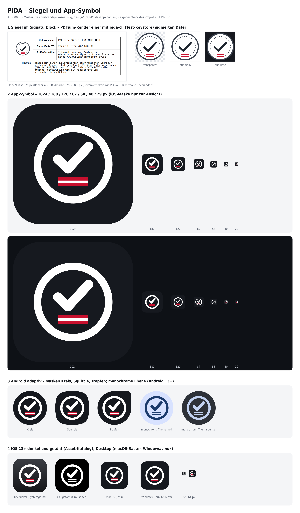

# PIDA – Siegel und App-Symbol

Entscheidung, Herleitung und Abgrenzung: [ADR 0005](../../docs/adr/0005-bildmarke-und-app-symbol.md).
Eigene Werke des Projekts, EUPL-1.2.



## Master (von Hand)

- `pida-seal.svg` – Siegel, Standard-Bildmarke der kleinen Signaturblöcke und von „nur Bildmarke“ (exakt
  `DefaultEmblem` aus `prototypes/pida-workspace/src/ui/Logo.tsx`; Rasterfassung 652 × 684 px).
- `pida-app-icon.svg` – App-Symbol; das Zeichen steht zwischen `<!-- glyph:start -->` und `<!-- glyph:end -->`
  und wird für alle Varianten übernommen (die IDs `accent-red-*`, `accent-white` steuern die monochrome Fassung).

## Erzeugt (nicht von Hand ändern)

`variants/*.svg`, `favicon.svg` (auch als `apps/app/public/app-icon.svg`), `*.png` hier sowie die Plattform-Symbole unter `apps/app/src-tauri/icons/**`,
`apps/app/src-tauri/gen/apple/Assets.xcassets/AppIcon.appiconset/`, `apps/app/src-tauri/gen/android/app/src/main/res/`
und `crates/sigblock/assets/images/pida-seal.png`.

```sh
npm --prefix design/brand/tools ci         # @resvg/resvg-js, pngjs (nur hier, keine App-Abhängigkeit)
design/brand/tools/render-block.sh         # alles + Vorschaubogen (pida-cli, Test-Keystore, PDFium)
node design/brand/tools/build.mjs          # alles ohne Vorschaubogen
```

`build.mjs` nutzt für `icon.icns`/`icon.ico` die Tauri-CLI aus `apps/app/node_modules` (sonst `--tauri <tauri.js>`).
`tauri icon` nicht direkt auf die App anwenden – es ersetzt die Android- und iOS-Fassungen durch Tauri-Vorgaben.
