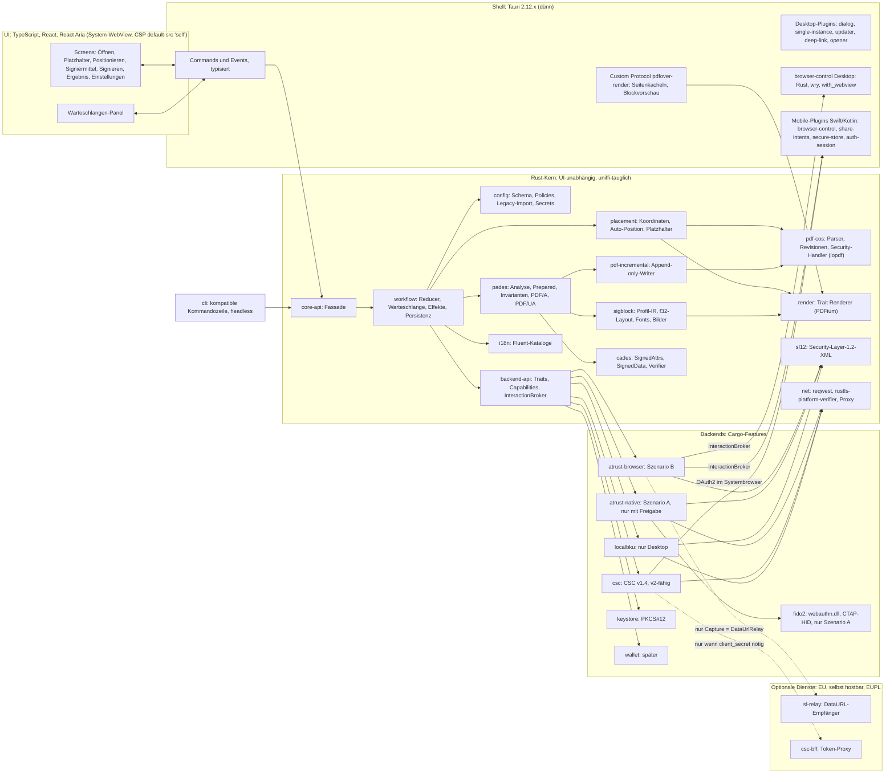
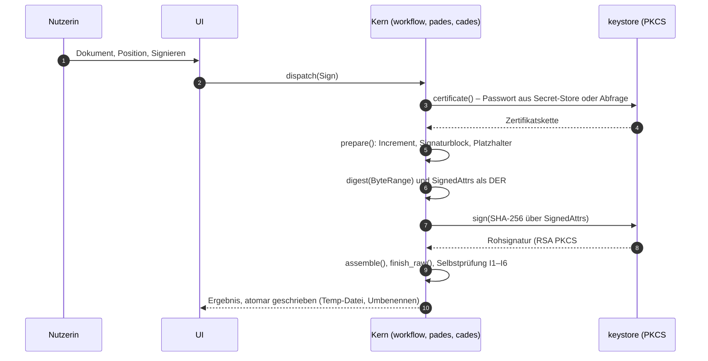
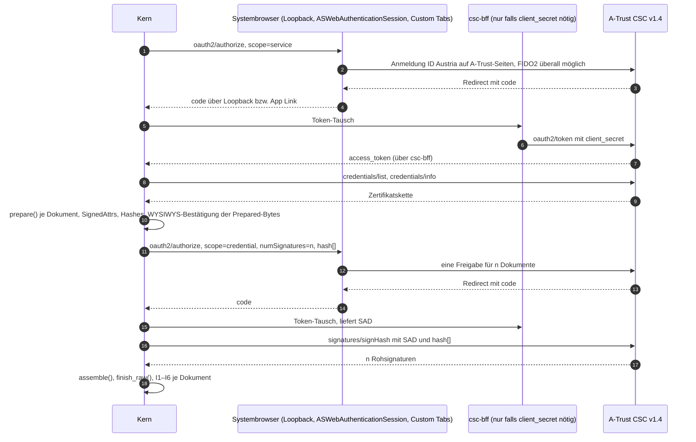
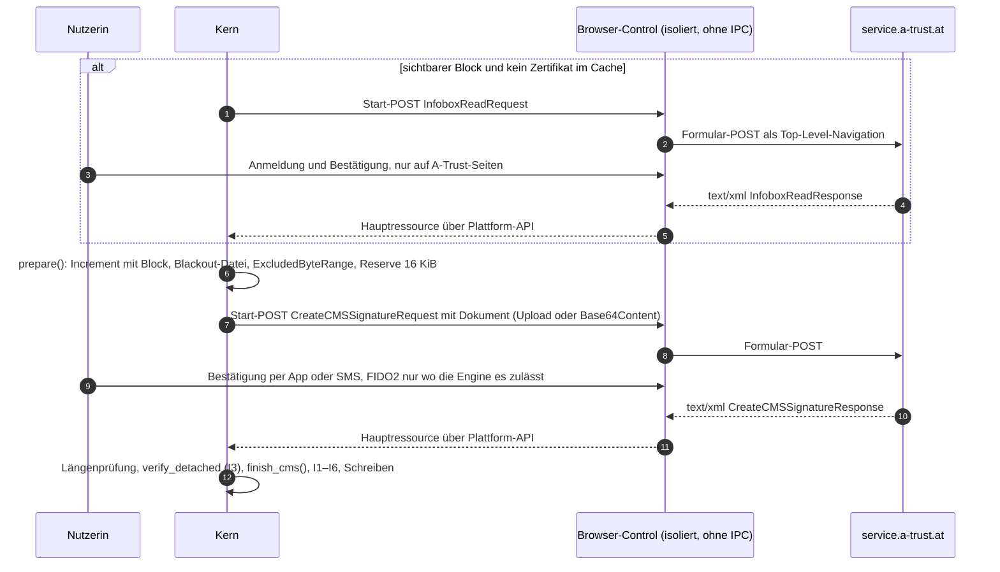
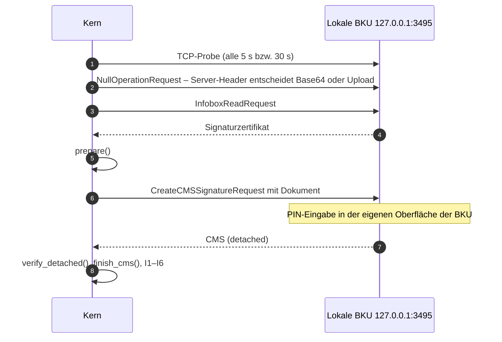
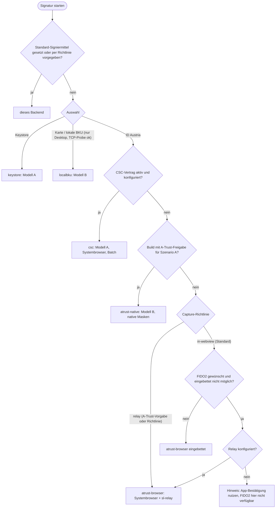
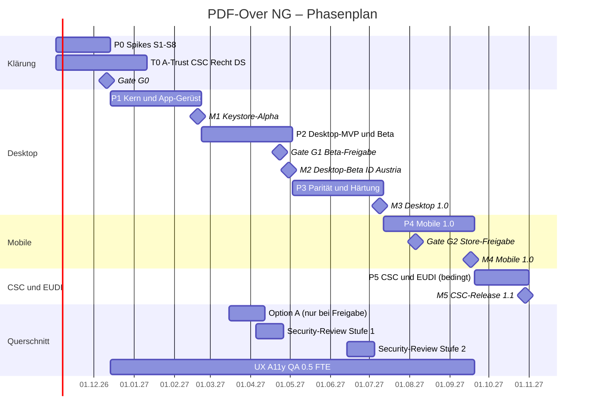

# PDF-Over NG – Architektur- und Umsetzungsplan

> **Hinweis (15.10.2026): Arbeitstitel PDF-Over NG heißt seit 15.10.2026 PIDA** (PDF · ID · Austria),
> siehe [ADR 0002](adr/0002-name-pida.md). Dieser Plan ist ein historisches Dokument und bleibt sonst
> unverändert: Namen wie `pdfover-<crate>`, `pdfover-cli`, `pdf-over-ng`, `at.pdf-over-ng` und
> `PDFOVER_*` lauten heute `pida-<crate>`, `pida-cli`, `pida`, `at.pida` und `PIDA_*`.

| | |
|---|---|
| **Stand** | 14.10.2026, Version 1.0 (final zur Entscheidung) |
| **Leserkreis** | technische Projektleitung des Auftraggebers |
| **Gegenstand** | funktional gleichwertiger Klon von PDF-Over (A-SIT, EUPL-1.2) ohne Java/JVM für Windows, macOS, Linux, iOS und Android |
| **Grundlagen** | Analysen [`analyse/01–05`](analyse/), Recherchen [`recherche/01–03`](recherche/), drei Entwürfe [`entwurf/`](entwurf/) (bleiben als Anhang bestehen), drei Gutachten (Technik, Nutzer, Projekt) und der Faktencheck vom 14.10.2026; Vollständigkeitsreview mit Nachträgen in §16 |
| **Basis** | Entwurf „Risiko zuerst“ (Gutachten-Sieger), ergänzt um die UX-, Barrierefreiheits- und Plattformarbeit aus „Plattform & Nutzererlebnis“ und die vertikalen Inkremente aus „Time-to-Value“; alle Faktenfehler der Entwürfe sind korrigiert (Anhang B) |

**Kennzeichnung:**
- **[B]** belegt in Analyse, Recherche oder Faktencheck (mit Verweis)
- **[A]** Annahme, die im genannten Spike geprüft wird
- **[E]** Entscheidung bzw. Empfehlung dieses Plans
- **[S]** Schätzung

Verweise auf den Faktencheck nennen dessen Prüfpunkt (1a … 14b, Zusatz A/B). Der Faktencheck und die drei Gutachten lagen als Bewertungsunterlagen vom 14.10.2026 vor. Ihre Ergebnisse sind hier eingearbeitet; Anhang B zeigt, welche Aussagen der Entwürfe dadurch korrigiert wurden.

Arbeitstitel ist **„PDF-Over NG“**. Der endgültige Name hängt von der Markenklärung ab (Entscheidung E-05).

---

## 0. Management-Zusammenfassung

**Empfehlung.** Der Klon entsteht als UI-unabhängiger **Rust-Kern** mit PAdES-Signatur-Engine, Signatur-Backends und Workflow. Ausgeliefert wird er mit **Tauri 2** (auf 2.12.x gepinnt) als dünner Shell auf allen fünf Plattformen. Die Oberfläche ist in TypeScript/React mit React Aria geschrieben (Barrierefreiheit), **PDFium** ist der einzige Renderer. Im Produkt läuft kein Java. Java dient nur in der CI als Prüfwerkzeug (PDF-AS-Orakel, veraPDF, EU DSS).

**A-Trust/ID Austria: vier Wege hinter einer Backend-Schnittstelle.**
1. **Szenario B, Standard:** Die unveränderte A-Trust-Seite läuft in einem isolierten Browser-Control. Der Klon liest nur die abschließende SL-1.2-Antwort aus. A-Trust schreibt für lokale Anwendungen „a local web browser or a browser control“ vor und verbietet das Parsen und automatische Befüllen der Seiten [B recherche/03 §3.2]. Ob das Auslesen der XML-Antwort zulässig ist, ist rechtlich offen [B Faktencheck 14a]. Deshalb lässt der Auftraggeber die Leitplanken (§4.2) von A-Trust **schriftlich bestätigen**, und der Abgriff ist austauschbar: Lehnt A-Trust ihn ab, geht die Antwort über den dokumentierten DataURL-Mechanismus an einen kleinen Relay-Dienst (Szenario B-Relay).
2. **Szenario A:** Der native Ablauf wie in PDF-Over ist fertig konzipiert, wird aber **nur mit schriftlicher Freigabe** ausgeliefert (Cargo-Feature).
3. **Szenario C:** **CSC-Hash-Signing** ist der strategische Zielpfad (Partnervertrag): FIDO2 und Batch auf allen Plattformen, und nur der Hash verlässt das Gerät.
4. **Szenario D:** Die **EUDI-Wallet** wird zuerst über die vorhandenen A-Trust-Parameter `showwallet`/`usewallet` angebunden, ohne neuen Code.

**Warum dieser Weg.**
- Nur Tauri bringt auf allen fünf Plattformen ein steuerbares WebView mit nativem Zugriff mit. Ohne A-Trust-Freigabe ist das der Pflichtpfad.
- Die Installer schrumpfen von heute 80–95 MiB auf 8–25 MB [S].
- Die Signatur-Engine ist Eigenbau. Sie hängt aber nur neue Bytes an (Append-only), prüft vor jedem Speichern maschinell sechs Invarianten und lehnt unsichere Eingaben ab, statt zu raten. Vorhandene Signaturen bleiben dadurch nachweislich intakt.
- Jede riskante Wahl hat einen Rückfall: Flutter-Shell für Mobile (+6–8 PW), PoDoFo als Writer, hayro als Renderer, 12 fest kodierte Profile.

**Was es kostet** (2 Entwickler:innen plus Nebenrollen; Details in §11.5):

| Ausbaustufe | Zeitpunkt | Aufwand (Erwartung) |
|---|---|---|
| Klärung und Spikes (P0), separat freizugeben | Woche 6 (Gate G0) | ≈ 3,5 PM |
| Desktop 1.0 (Windows, macOS, Linux) | Woche 36 | ≈ 22 PM |
| Mobile 1.0 (iOS, Android) | Woche 46 | ≈ 29 PM |
| CSC-Release 1.1 (vertragsabhängig) | Woche 52 | ≈ 32 PM (Bandbreite 28–37 PM) |
| **Budgetrahmen mit 20 % Puffer** | | **≈ 38 PM**; Szenario A bei Freigabe +1 PM |

Dazu kommen laufende Kosten: Store-Konten, Code-Signing und Relay-Betrieb im niedrigen vierstelligen Euro-Bereich pro Jahr. Einmalig fallen ein externes Security-Review und ein Rechtsgutachten an, jeweils fünfstellig. Nach 1.0 sind für die Wartung 0,5–1 FTE pro Jahr nötig (A-Trust-Drift, Store-Pflichten, PDFium-Updates, Migration auf Tauri 3) [S].

**Zeitplan.**

| Woche | Meilenstein |
|---|---|
| W6 | Gate G0 mit Neuplanung |
| W16 | interne Keystore-Alpha |
| W26 | Desktop-Beta mit ID Austria. Öffentlich nur mit A-Trust-Bestätigung und Security-Review Stufe 1, sonst geschlossener Pilot |
| W36 | Desktop 1.0 |
| W46 | Mobile 1.0 |
| W52 | CSC 1.1 (bedingt) |

> **Review-Hinweis (Kapazität je Phase):** In der Summe passt die Komponentenschätzung zum Team (≈ +6 %), in der zeitlichen Verteilung nicht. Bis W36 fallen ≈ 70–100 PW Desktop-Arbeit an, verfügbar sind ≈ 65 PW. P4 ist dagegen unterausgelastet.
>
> - Selbst am unteren Schätzende fehlen bis W36 ≈ 2–3 Wochen.
> - Beim Erwartungswert läge Desktop 1.0 bei ≈ W45 und Mobile 1.0 bei ≈ W50.
> - Das ändert sich nur, wenn eine dritte Person W7–36 die Kernentwicklung verstärkt oder Kürzungen vorgezogen werden.
>
> Die Entscheidung fällt in G0 (E-19, §11.5) [S].

**Sofort zu entscheiden** (vollständige Liste in §14):
1. A-Trust-Anfrage in Woche 1: Freigabe von A, Bestätigung von B, CSC/PKCE, gewerbliche Nutzung, Testkonten.
2. Stufenweise Budgetfreigabe, zuerst nur P0.
3. Ob ein kleiner Relay-Dienst in der EU betrieben werden darf. Ohne ihn gibt es kein FIDO2 außerhalb von Windows und keinen Rückfall, falls A-Trust das Auslesen im WebView ablehnt.
4. Start der CSC-Verhandlung.
5. Lizenz, Name, Marken und Store-Strategie.

---

## 1. Ziele, Vorgaben, Nicht-Ziele

### 1.1 Ziele

| # | Ziel | Messbar über |
|---|---|---|
| Z1 | **Funktionale Gleichwertigkeit** mit PDF-Over 4.4.x | Alle Punkte „Kern“ und „Desktop“ des Feature-Inventars ([analyse/01 §2](analyse/01-funktionsumfang-und-ablauf.md)) sind umgesetzt oder bewusst gestrichen (Entscheidungslog); Mobile nach §5.2 |
| Z2 | **Signaturen strukturgleich zu PDF-AS 4.4.2**, gültig in EU DSS, Adobe und RTR | Golden-Files und Validatorkette (§8). Byte-Gleichheit ist weder erreichbar noch nötig [B analyse/03] |
| Z3 | **Vorhandene Signaturen nie beschädigen** | Invarianten I1–I6 vor jedem Speichern (§3.6) |
| Z4 | **Eine Codebasis für fünf Plattformen** mit kleiner Installation | Größen-Gate ≤ 25 MB je Desktop-Installer, AppImage ausgenommen (§9) |
| Z5 | **Konform zu den A-Trust-Nutzungsregeln** | Szenario B mit schriftlich bestätigten Leitplanken (§4.2) |
| Z6 | **Migration für Bestandsnutzer:innen** | Import aller 31 Konfigurations-Keys mit exakter Semantik und Ablösung der Alt-Installation (§7.2) |
| Z7 | **Barrierefreiheit** der eigenen Oberfläche | WCAG 2.2 AA in den Kernabläufen (§7.6) |
| Z8 | **Wartbarkeit und Austauschbarkeit** | Fassaden um Fremdbibliotheken, Kern ohne Tauri-Abhängigkeit, gepinnte Generationen (§2.5) |

### 1.2 Harte Vorgaben des Auftraggebers

- **V1:** Kein Java/JVM im Produkt. Java ist nur als Testwerkzeug in der CI zulässig.
- **V2:** Plattformunabhängig, mit einer gemeinsamen Codebasis.
- **V3:** Keine große Installation. Heute liefert PDF-Over 80,9–95,2 MiB je Installer [B analyse/05 §5.4].
- **V4:** Läuft auf Windows, macOS, Linux, iOS und Android.

**Abgeleitete Rahmenbedingungen:**
- A-Trust-Nutzungsregeln: kein Parsen oder Befüllen der Seiten
- EUPL-1.2, weil Profile, Texte und Verhalten übernommen werden [B analyse/05 §6.3]
- DSGVO
- gegebenenfalls das Web-Zugänglichkeits-Gesetz (Anwendbarkeit wird in T0 geprüft)
- App-Store-Bedingungen

### 1.3 Nicht-Ziele der Version 1

| Nicht-Ziel | Begründung / Ersatz |
|---|---|
| Web/PWA-Variante | Kein CORS bei A-Trust in Produktion, WebAuthn an die eigene RP gebunden, keine lokale BKU [B recherche/01, analyse/02] |
| PAdES-B-T/-LT/-LTA | PDF-AS liefert sie ebenfalls nicht. Vorbereitet über `x509-tsp`/`x509-ocsp` und eine ausreichende Reserve; ein TSA-Vertrag ist offen |
| PDF/A-Preflight im Produkt | PDF-AS protokolliert den Preflight nur [B analyse/03]. Ersatz: Increment-Preflight im Kern und veraPDF in der CI |
| Eigener JCEKS-Reader | Konvertierungsassistent statt Reader (§4.9). Ein eigener Reader käme nur als Clean-Room-Implementierung |
| PKCS#11/Smartcard direkt | Kein PDF-Over-Feature; die Karte läuft über die lokale BKU [B analyse/02] |
| Natives FIDO2 auf iOS/Android | Über die Plattform-APIs nicht möglich ohne Associated Domains bzw. Asset Links von A-Trust [B Faktencheck 8a/8b]. Ersatz: CSC oder B-Relay. Rohes CTAP2 über NFC/USB (CoreNFC, yubikit) wäre nur in Szenario A denkbar, ist auf bestimmte Token beschränkt und bleibt eine spätere Option [B analyse/02 §7.2] |
| SL 2.0 | Für Dritt-Clients nicht verfügbar [B recherche/03 §3.3] |
| Signaturprüfung als Produktfunktion | Nur die Selbstprüfung nach dem Signieren, wie PDF-AS. Prüfen bleibt Aufgabe von RTR/DSS (signaturpruefung.gv.at). `verify` gibt es in der CLI als QA- bzw. Entwickler-Werkzeug („intakt“, nie „gültig“). Der zwischenzeitlich gebaute Prüfmodus der App (ADR 0004 §3.9) ist mit ADR 0004 Nachtrag 15 (17.10.2026) wieder entfernt; die Online-Prüfung (ADR 0006) ist zurückgestellt |
| Telemetrie | Keine. Absturzberichte nur lokal bzw. per Opt-in-Export |
| GEMPLUSH-Theme, CRASH-Schalter, Mac-Java-Workarounds | Entfallen ersatzlos [B analyse/01 §9] |

---

## 2. Stack-Entscheidung

### 2.1 Wahl je Schicht

| Schicht | Wahl [E] | Begründung |
|---|---|---|
| Kernsprache | **Rust** (stable, Edition 2024, MSRV gepinnt) | Speichersicher bei feindlichen PDFs. Läuft auf allen fünf Zielen, optional als WASM für Werkzeuge. Direkter FFI-Zugang zu `webauthn.dll` und libfido2. Platz 1 der Bibliotheksanalyse [B recherche/02] |
| PDF-Objektmodell | `lopdf` 0.45 (MIT) **nur als Parser und Objektmodell**, gekapselt in `pdf-cos`; **eigener Append-only-Writer** | lopdf liest xref-Streams, Hybrid-Dateien und Object Streams und entschlüsselt. `IncrementalDocument` bietet aber keine Byte-Offset-Hooks für ByteRange und `/Contents` [B Faktencheck 3a]. Ein eigener Writer ist deshalb Pflicht, keine Option |
| CMS/X.509 | RustCrypto `cms` 0.2.3, `der` 0.7, `x509-cert` 0.2, `spki` 0.7, `const-oid`, **eine Generation gepinnt**, gekapselt in `cades` | Externer Message-Digest und beliebige Signed Attributes sind möglich. ESS signing-certificate-v2 und eine Prüf-API fehlen [B Faktencheck 4a]. Deshalb werden SignedAttributes DER-genau selbst gebaut und SignedData über `Builder::finalize()`/`assemble()` montiert. Der eigene Verifier wird differentiell gegen openssl getestet. cms 0.3-rc (13.10.2026) bringt Breaking Changes und ist ein späteres Migrationsfenster |
| Primitive | `rsa`, `p256`/`p384`/`p521`, `ecdsa`, `sha2`; optional `ring` für RSA | Das Marvin-Advisory betrifft das RSA-Entschlüsseln, nicht das lokale Signieren [B recherche/02] |
| Keystore | `p12-keystore` 0.4.1 (MIT/Apache) | PKCS#12 inkl. Legacy-Verfahren. Es gibt nur **ein** Passwort für Store und Schlüssel, und JKS/JCEKS werden nicht unterstützt [B Faktencheck 4b]. Zur Behandlung siehe §4.9 |
| Renderer | **PDFium** über `pdfium-render` 0.9.4 und `pdfium-binaries` | Vorschau, Blockvorschau, Rasterscan, QR-Bilddekodierung und WYSIWYS-Ansicht laufen über **einen** Renderer und verhalten sich damit überall gleich. Desktop und Android nutzen dynamische Bibliotheken; **unter iOS wird die dylib in ein xcframework verpackt**, denn statische Builds gibt es nicht [B Faktencheck 5]. Die Bindings-Version wird auf den PDFium-Build gepinnt (`pdfium_latest` = 7881, Binaries 8100) |
| Fonts, Bilder, QR | `skrifa` + `subsetter`; AFM-Daten der Standard-14-Fonts; `png`, `zune-jpeg`, `gif`, `kamadak-exif`; `rxing` (ZXing-Port mit HybridBinarizer) | Alle permissiv lizenziert, reines Rust [B recherche/02 §6] |
| Netz | `reqwest` 0.13 mit `rustls` (Provider `ring`) und **`rustls-platform-verifier`** | Nutzt den OS-Truststore; das ist in Behördennetzen mit TLS-Inspektion nötig. System-Proxy unter Windows und macOS [B recherche/02]. `ring` statt `aws-lc-rs` vermeidet Build-Aufwand für iOS, Android und WASM |
| FIDO2 (nur Szenario A) | Windows: `webauthn.dll` über das `windows`-Crate. macOS/Linux: libfido2 (BSD-2) **mitgeliefert** oder `ctap-hid-fido2` (MIT); Entscheidung in S4 | Die Origin wird selbst gesetzt [B Faktencheck 9a/9b]. Kein Code aus `webauthn-client-java`, das unter „A-SIT license“ steht |
| Desktop-Shell | **Tauri 2.12.x** (WebView2/WKWebView/WebKitGTK 4.1 über wry), gepinnt | Siehe §2.2 |
| Mobile-Shell | Tauri 2 Mobile plus **eigene Swift/Kotlin-Plugins**: `browser-control`, `share-intents`, `secure-store`, `auth-session` | Mobile-Multiwebview gibt es nicht, und Mobile-Multiwindow ist ungeeignet [B Faktencheck 13b]. Share- und Keychain-Plugins fehlen offiziell [B recherche/01] |
| UI | **TypeScript + React 19 + React Aria Components**, Vite | React Aria normalisiert Maus, Touch und Tastatur, bietet barrierefreies Drag & Drop, Fokusmanagement und i18n-Formatierung. Das UI-Bundle ist gegenüber PDFium vernachlässigbar |
| Typen UI↔Kern | `tauri-specta` [A, Reife in S8 prüfen], Rückfall `ts-rs` | Eine Typquelle verhindert Drift |
| i18n | **Fluent** (`fluent-rs` im Kern und in der CLI, `@fluent/bundle` in der UI), gemeinsame `.ftl`-Kataloge | Eine Quelle für UI, CLI und Fehlermeldungen |
| Secrets | `keyring` auf dem Desktop (Credential Manager, Keychain, Secret Service), Plugin `secure-store` auf Mobile (Keychain, Android Keystore) | Keine Klartext-Passwörter mehr [B analyse/05] |
| Optionale Dienste | Rust/axum: `sl-relay` (DataURL-Empfänger) und `csc-bff` (Token-Proxy) | Nur dort, wo es keinen Weg ohne Server gibt (§4.3, §4.5). Selbst hostbar, EUPL |

### 2.2 Begründung gegenüber Bewertungsmatrix und Bibliotheksanalyse

Die gewichtete Matrix sieht Tauri 2 (84,2) knapp vor Flutter mit Rust-Kern (83,0), Flutter (82,0) und Avalonia 12 (81,3). Im Szenario „Mobile-first“ gewinnt Flutter (84,0 zu 82,8), im Szenario „Klein“ Tauri (85,3) [B recherche/01 §6]. Den Ausschlag geben vier Punkte, die die Matrix nur indirekt gewichtet:

1. **Das Browser-Control ist Teil des Stacks.** Szenario B ist ohne Freigabe der Pflichtpfad und braucht auf **allen fünf** Plattformen ein steuerbares WebView mit nativem Zugriff. Auf dem Desktop bringt wry WebView2, WKWebView und WebKitGTK mit; `with_webview` gibt Zugriff auf die nativen Handles, `on_navigation` liefert die Navigations-Allowlist [B Faktencheck 13a]. Auf Mobile sind WKWebView und Android-WebView in jedem Stack nativer Plugin-Code. Flutter hat kein offizielles Linux-WebView; dort wäre es Eigenbau.
2. **Kleinste Installation.** Minimal unter 600 KB, mit PDFium 3,4–3,9 MB komprimiert je Plattform [B Faktencheck 2]. Für Flutter-Desktop ist die Installergröße unbelegt [B Faktencheck 7b].
3. **Eine Toolchain** für signierten Updater, NSIS/MSI, DMG, deb/rpm, Flatpak sowie die App- und Play-Stores [B recherche/01].
4. **Barrierefreiheit über Web-Semantik.** Sie wird auf UIA (WebView2), AX (WKWebView), TalkBack (Android) und AT-SPI (WebKitGTK) abgebildet. React Aria liefert die Komponenten dafür.

Flutters Stärke ist die Reife auf Mobile. Dieses Risiko sichert der Kern-Schnitt ab: Fällt Spike S5 negativ aus, wird **nur die Mobile-Shell** auf Flutter mit `flutter_rust_bridge` 2.13 umgestellt [B Faktencheck 6]. Kern und Desktop bleiben. Deshalb liegt **keine Fachlogik in TypeScript**.

### 2.3 Verworfene Alternativen

| Alternative | Grund |
|---|---|
| Flutter-UI + Rust-Kern (83,0) | Knapp hinter Tauri. Kein offizielles Linux-WebView für Szenario B, Desktop-Packaging und Updates muss man selbst zusammenstellen, die Installergröße ist unbelegt. **Bleibt Plan B für Mobile** |
| Flutter mit Dart-Kern (82,0) | Dart-CMS/PAdES ist zu jung (pdf_cos, nkpdfsign) [B recherche/02] |
| Avalonia 12 (81,3) | Mobile laut NuGet „experimental“, größere Installer, kein Brainpool auf Apple. Nach dem Wechsel von PDFsharp auf AGPL (ab 6.5) wäre die PDF-Schicht ohnehin Eigenbau [B recherche/02] |
| Qt 6.12 | LGPL bei statischem iOS-Linken, kommerziell priorisierte LTS-Patches, C++ [B recherche/01] |
| Compose Multiplatform | Desktop bleibt JVM (K.O. nach V1) |
| .NET MAUI, React Native | kein Linux (K.O. nach V4) |
| Electron (+ Capacitor) | 80–150 MB, verfehlt V3; zwei Shells |
| Reine PWA | CORS, WebAuthn-RP-Bindung, Local Network Access, keine lokale BKU (K.O.) |
| Wails v3, Dioxus, Slint | Beta bzw. auf Mobile experimentell; Slint ohne WebView und Datei-Dialoge |
| Go-Kern (`digitorus/pdfsign`) | Modell B fehlt, dritter Sprachstack, Mobile nur über gomobile |
| TS-Kern (`@libpdf/core`, `@signpdf`) | Beta, keine Appearances, Platzhaltersuche per String, Krypto im WebView |
| PoDoFo (C++) als Kern | Ein C++-Parser für feindliche Eingaben ist ein Risiko, der Build für 5 Plattformen teuer. **Bleibt Rückfall für den Writer** (MPL-Option) |
| pdf.js als Vorschau | Zweiter Renderer neben dem Rasterscan, dann wäre Vorschau ≠ Positionierung. Unter WKWebView und WebKitGTK unbelegt [B Faktencheck 10] |
| `underskrift` als Abhängigkeit | Version 0.1, hängt an lopdf 0.39, schreibt nur xref-Tabellen, behandelt keine Verschlüsselung [B Faktencheck 11a]. Dient **als Vorlage** (BSD-2, EUPL-verträglich) |

### 2.4 Plan B und Rückfallebenen

| Auslöser | Rückfall | Mehraufwand [S] |
|---|---|---|
| S5 No-Go: Tauri Mobile unreif | Flutter-Shell **nur für Mobile** über `flutter_rust_bridge` auf `core-api`; die Swift/Kotlin-Plugins bleiben | +6–8 PW |
| S1 No-Go auf einer Desktop-Engine | Dort Systembrowser + `sl-relay` als Standard; mittelfristig die CEF-Runtime aus Tauri 3 prüfen | +2 PW, Relay-Betrieb |
| S2 No-Go: Writer | PoDoFo 1.1 (MPL-2.0) über FFI als Writer-Backend hinter `pdf-incremental` | +4–6 PW |
| S6 No-Go: Profiltreue | Die **12 von PDF-Over erzeugbaren Profil-IDs** werden fest kodiert, ohne Import fremder Profile (§6.5) | spart 2–3 PW |
| S7 No-Go: Rasterscan bzw. iOS-PDFium | Verfahren über Objekt-Bounding-Boxes; `hayro` als Renderer evaluieren | +1–3 PW |
| A-Trust lehnt den Abgriff im WebView ab | Abgriff auf allen Plattformen über `DataUrlRelay` (§4.3); CSC beschleunigen | +2–3 PW, Relay-Betrieb |
| A-Trust lehnt die SL-Nutzung durch den Klon generell ab | ID Austria nur über CSC (Vertrag); bis dahin Keystore und lokale BKU | vertragsabhängig |

### 2.5 Reversibilitäts- und Pinning-Regeln [E]

- **Kein Kern-Crate hängt von Tauri ab.** Die Fassade `core-api` ist `uniffi`-tauglich. Sie dient dem Flutter-Plan-B, der CLI und den Testwerkzeugen.
- **Fremdbibliotheken stehen hinter eigenen Grenzen:**
  - lopdf hinter `pdf-cos`
  - RustCrypto hinter `cades`
  - PDFium hinter dem Trait `Renderer` (Ersatz: `hayro`)
  - der Writer hinter `pdf-incremental` (Ersatz: PoDoFo)
- **Gepinnt werden:**
  - Tauri 2.12.x
  - die RustCrypto-Generation (cms 0.2/der 0.7)
  - lopdf 0.45.x
  - `pdfium-render` zusammen mit dem passenden PDFium-Build
  - die Node-Abhängigkeiten per Lockfile
- **Migrationen sind budgetiert, nicht verdrängt:**
  - Tauri 3 (Alpha seit 01.10.2026 [B Faktencheck 1a]): Migrationsfenster 3–6 Monate nach 3.0 stable, 3–5 PW im Wartungsbudget (§11.7)
  - cms 0.3: 1–2 PW
- **Lizenz-Gate:** `cargo-deny` erlaubt nur MIT, Apache-2.0, BSD-2/3, ISC, Zlib, MPL-2.0, Unicode-3.0, BSL-1.0 sowie OFL/Bitstream-Vera für Fonts. Eine GPL/AGPL-Abhängigkeit bricht den Build. Dieselbe Allowlist gilt für die npm-Abhängigkeiten der UI (Lizenzprüfung über das Lockfile) und für die Swift/Kotlin-Plugins. `cargo-vet` und `cargo-audit` laufen in jeder Pipeline, dazu eine SBOM (CycloneDX). Aus denselben Daten entstehen je Build die **Drittlizenz-Hinweise** (`cargo-about` plus npm-Bericht, inklusive der PDFium-Lizenzen und der NOTICE-Dateien von Apache-2.0-Abhängigkeiten). Sie stehen im Über-Dialog und liegen dem Paket bei, denn MIT, BSD und Apache-2.0 verlangen das bei Binärweitergabe, auch in den Stores.
- **Architekturentscheidungen** stehen als ADRs im Repository. Jede Abweichung von PDF-AS kommt in ein **Kompatibilitätsregister** mit Test (§6.5).

---
## 3. Zielarchitektur

### 3.1 Komponenten



Das Diagramm zeigt die Bauteile, nicht den Ablauf; den zeigen §3.7 und §3.8. Die Plugins der Shell und die Backends stehen hinter Cargo-Features. Ein Release-Build ohne Freigabe enthält `atrust-native` und `fido2` nicht.

### 3.2 Module und Verantwortlichkeiten

| Crate/Paket | Verantwortung | Wichtigste Schnittstelle |
|---|---|---|
| `pdf-cos` | Lenientes Lesen über lopdf. Revisionen und xref-Typ (Tabelle, Stream, Hybrid), Object Streams, Standard-Security-Handler RC4/AES R2–R6, Rechteprüfung wie `PdfBoxUtils`, Grenzen gegen Dekompressionsbomben | `SourcePdf::open(file) -> DocReport` |
| `pdf-incremental` | Append-only-Writer: neue und geänderte Objekte, xref im Format der Vorrevision, `/Prev`, `/Size`, `/ID[1]`. Verschlüsselt neue Objekte **außer `/Contents`**, protokolliert Offsets, patcht die ByteRange | `IncrementBuilder` → `Increment { file, contents_range, byte_range }` |
| `pades` | Analyse (Signaturen, DocMDP, Felder, `/Lock`, Seed Values, PDF/A, PDF/UA, Annahmeklasse K1–K5). Signaturdictionary, Feld, Widget, AcroForm, neue Seite, Zweiphasenmodell, Selbstprüfung I1–I6 | `analyze()`, `prepare()`, `Prepared::finish_*()`, `SignedPdf::self_check()` |
| `cades` | SignedAttributes (Profile `pdfas-compat`, `pades-b-b`), SignedData-Montage (Modell A), Verifier für fremde CMS (Modell B, Vorsignaturen), Algorithmus-Politik | `SignedAttrsBuilder`, `assemble()`, `verify_detached()` |
| `sigblock` | Profil-IR, Java-Properties-Parser mit Includes und Vererbung, OGNL-Teilmenge, Tabellenlayout in `f32`, AFM/TTF-Metriken, Subsetting, Emblem-Pipeline, Appearance-XObjects | `Appearance::build(profile, cert, opts)` |
| `placement` | Koordinatenräume (PAGE_ABS/REL, IMAGE, SCREEN), Rotation, Box-Logik, Klemmung. Auto-Positionierung per Rasterscan, QR-Platzhalter, leere Signaturfelder | `Placement`, `auto_place()`, `find_placeholders()` |
| `render` | PDFium: Seitenkacheln, Forced-Color-Raster, Bildobjekte mit Matrix, Mini-PDF der Blockvorschau. Auf dem Desktop optional in einem Hilfsprozess | `trait Renderer` |
| `backend-api` | Traits, Capabilities, `InteractionBroker`, Fehlertaxonomie, Capture-Varianten | §3.4 |
| `sl12` | SL-1.2-XML (InfoboxRead, CreateCMSSignature, NullOperation), ErrorResponse, Codes 6000/6001 als Abbruch | gemeinsam für `atrust-*` und `localbku` |
| `workflow` | Expliziter Reducer statt impliziter Re-Entry-Semantik [B analyse/01 §3], Warteschlange, Ausgaberegeln, Abbruchsemantik, Persistenz des vorbereiteten Zustands | `reduce(state, event) -> (state, effects)` |
| `config` | Versioniertes Schema (TOML), Policies, Import aus `~/.pdf-over`, Secrets, Profil-Store, Zertifikats-Cache (Opt-in) | §7.1 |
| `net` | HTTP-Client, Proxy (System, PAC nach Bedarf, manuell, Authentifizierung), Plattform-Truststore, Zeitabgleich mit HTTP-`Date` | `Net::client(purpose)` |
| `i18n` | Fluent-Kataloge, Fehlercodes mit Parametern | `t!(id, args)` |
| `core-api` | Stabile Fassade für Shell, CLI und Plan B | `Core::dispatch()`, `Core::subscribe()` |
| `apps/desktop`, `apps/mobile` | Tauri-Projekte, Plugins, Paketierung | – |
| `apps/cli` | Konsolen-Binary (unter Windows eigenes Subsystem bzw. Shim); nutzt `workflow` headless | §7.4 |
| `services/sl-relay`, `services/csc-bff` | Optionale Dienste ohne Persistenz | §4.3, §4.5 |
| `tools/golden`, `tools/corpus`, `tools/profile-convert`, `fuzz/` | Golden-Generator (PDF-AS im Container), Normalisierer und Diff, Profilkonverter, Fuzz-Targets | §8 |

### 3.3 Capability-Modell der Backends

| Backend | Eingabe | Ausgabe | Zertifikat vorab | Interaktion | Server | Batch | Dokument verlässt Gerät | Plattformen |
|---|---|---|---|---|---|---|---|---|
| `atrust-browser`, eingebettet (B) | Dokument mit geschwärztem `/Contents` + ExcludedByteRange | CMS | nur für sichtbaren Block (InfoboxRead oder Cache) | `EmbeddedWeb` | keiner | nein, je Dokument eine Freigabe | ja, an A-Trust | alle 5 |
| `atrust-browser`, Relay (B-Relay) | wie oben | CMS | wie oben | `SystemBrowser` | `sl-relay` | nein | ja, an A-Trust; Relay erhält nur die Antwort | Desktop; Mobile nach S5 |
| `atrust-native` (A) | Dokument | CMS | ja | `NativeForms`, FIDO2 nativ auf dem Desktop | keiner | nein, aber nur eine Anmeldung je Batch | ja | alle; FIDO2 nur Desktop |
| `csc` (C) | Hash über SignedAttributes | Rohsignatur | ja (`credentials/info`) | `SystemBrowser` (OAuth2) | `csc-bff`, entfällt bei PKCE | **ja** (`numSignatures`) | nein, nur Hashes | alle 5 |
| `localbku` | Dokument | CMS | ja | `External` (eigene Oberfläche der BKU) | keiner | nein | nein, bleibt lokal | Desktop |
| `keystore` | Hash | Rohsignatur | ja (lokal) | `Secret` (Passwort) | keiner | ja | nein | alle 5 (Mobile per Import) |
| `wallet` (später) | Dokument oder Hash | CMS oder Rohsignatur | modellabhängig | `ExternalApp` | QTSP | offen | modellabhängig | Mobile zuerst |

Aus den Capabilities leitet der Workflow ab:
- Pipeline-Modell A oder B
- den Pflicht-Datenschutzhinweis bei `document_leaves_device`
- die WYSIWYS-Bestätigung (Pflicht bei Hash-Eingabe)
- die Batch-Strategie und den Text „n Dokumente = n Bestätigungen“
- die Anzeige von Serverbedarf und Faktoren

Die PAdES-Vorbereitung hängt **nie** am Backend.

### 3.4 Zentrale Schnittstellen (Skizzen)

```rust
// backend-api
pub enum SignInput   { Document, Digest { algs: &'static [DigestAlg] } }
pub enum SignOutput  { Cms, RawSignature }
pub enum CertNeed    { Required, OnlyForVisibleBlock, No }
pub enum Interaction { None, Secret, EmbeddedWeb, SystemBrowser, NativeForms, External, ExternalApp }
pub enum ServerNeed  { None, DataUrlRelay, TokenProxy }
pub enum Capture     { InWebView, DataUrlRelay }   // austauschbar je Plattform, Richtlinie, A-Trust-Antwort

pub struct Capabilities {
    pub input: SignInput,
    pub output: SignOutput,
    pub certificate: CertNeed,
    pub interaction: Interaction,
    pub server: ServerNeed,
    pub max_batch: u16,                 // 1 = je Dokument eine Freigabe
    pub document_leaves_device: bool,   // erzwingt den Datenschutzhinweis vor dem ersten Upload
    pub qualification: Qualification,   // Qes | AdES | Unknown
    pub factors: FactorSet,             // App, Sms, Qr, Fido2, Card – zur Anzeige
}

#[async_trait]
pub trait SignatureBackend: Send + Sync {
    fn id(&self) -> BackendId;
    /// None = auf dieser Plattform, in dieser Konfiguration oder per Richtlinie nicht verfügbar
    fn capabilities(&self, env: &Environment) -> Option<Capabilities>;
    async fn open(&self, ctx: SessionContext, ui: Arc<dyn InteractionBroker>)
        -> Result<Box<dyn BackendSession>, BackendError>;
}

#[async_trait]
pub trait BackendSession: Send {
    async fn certificate(&mut self) -> Result<CertChain, BackendError>;
    async fn sign(&mut self, jobs: &[SignJob<'_>]) -> Result<Vec<SignResult>, BackendError>;
    async fn cancel(&mut self);
}

pub enum SignJob<'a> {
    Document { prepared: &'a PreparedHandle },        // Modell B: Blackout-Stream + ExcludedByteRange
    Digest   { alg: DigestAlg, value: &'a [u8] },     // Modell A
}
pub enum SignResult { Cms(Vec<u8>), Raw { alg: SignatureAlg, value: Vec<u8>, chain: CertChain } }

#[async_trait]
pub trait InteractionBroker: Send + Sync {
    async fn embedded_web(&self, req: WebRequest) -> Result<WebOutcome, Cancelled>;
    async fn system_browser(&self, start: StartPage, cb: CallbackSpec) -> Result<CallbackData, Cancelled>;
    async fn secret(&self, p: SecretPrompt) -> Result<Zeroizing<String>, Cancelled>;
    async fn native_form(&self, f: NativeForm) -> Result<FormAnswer, Cancelled>; // nur Szenario A
    fn progress(&self, p: Progress);
}

pub struct WebRequest {
    pub bootstrap: SlBootstrap,      // Endpunkt, XMLRequest, Dokument (Upload | Base64Content),
                                     // dokumentierte Parameter: telephonenumber, lang, showwallet, usewallet
    pub allow_hosts: HostAllowlist,  // nur A-Trust-Hosts; alles andere öffnet der Systembrowser
    pub capture: CaptureRule,        // nur text/xml am SL-Endpunkt mit Wurzel sl:*Response
    pub storage: StoragePolicy,      // Ephemeral { scope: Signature | Batch }, Autofill aus
    pub header: HeaderInfo,          // Dokumentname, Abbrechen; Herkunft zeigt die Shell
}
```

```rust
// pades – Zweiphasenmodell nach dem Vorbild der ungenutzten PDF-AS-API startSign/finishSign [B analyse/03]
pub fn analyze(src: &SourcePdf) -> Result<DocReport, PdfError>;       // inkl. Annahmeklasse K1–K5
pub fn prepare(src: &SourcePdf, plan: &SignPlan, cert: Option<&CertChain>) -> Result<Prepared, PdfError>;

impl Prepared {                                        // nach prepare() unveränderlich (WYSIWYS)
    pub fn byte_range(&self) -> [u64; 4];
    pub fn excluded_range(&self) -> ExcludedRange;     // From/To inklusive, für SL
    pub fn blacked_out(&self) -> impl Read + '_;       // Modell B, gestreamt
    pub fn digest(&self, alg: DigestAlg) -> Digest;    // Modell A, gestreamt
    pub fn reserve(&self) -> usize;                    // Bytes für das CMS
    pub fn persist(&self, dir: &Path) -> Result<PreparedHandle, IoError>;   // Mobile-Lebenszyklus
    pub fn finish_cms(self, cms: &[u8], expect: Expect) -> Result<SignedPdf, FinishError>;
    pub fn finish_raw(self, attrs: SignedAttrs, sig: RawSig, chain: &CertChain) -> Result<SignedPdf, FinishError>;
}
impl SignedPdf {
    pub fn self_check(&self, src: &SourcePdf) -> Result<CheckReport, InvariantViolation>; // I1–I6
    pub fn write_atomically(self, target: &OutputTarget) -> Result<OutputInfo, IoError>;
}
```

```rust
// cades
pub enum CmsProfile { PdfasCompat, PadesBB }
impl SignedAttrsBuilder {
    pub fn new(p: CmsProfile, message_digest: &Digest, signer: &Certificate, now: SigningTime) -> Self;
    pub fn to_der(&self) -> Vec<u8>;   // DER, SET OF sortiert – genau diese Bytes werden signiert
}
pub fn assemble(attrs: &SignedAttrs, sig: RawSig, certs: &[Certificate]) -> Result<Vec<u8>, CmsError>;
pub fn verify_detached(cms: &[u8], content: impl Read, expect: Expect) -> Result<CmsReport, CmsError>;
// prüft wie PDF-AS: genau ein SignerInfo, message-digest, Signaturwert, ESS signing-certificate(-v2),
// Fingerprint gleich dem erwarteten Zertifikat (InfoboxRead, Cache, Keystore, CSC credentials/info)
```

```ts
// UI ↔ Kern: Die UI hält keinen Fachzustand, sie projiziert nur den ViewState.
export interface CoreBridge {
  dispatch(e: UiEvent): Promise<void>;
  onState(cb: (s: ViewState) => void): () => void;
  pageTileUrl(doc: DocId, page: number, scale: number): string;     // pdfover-render://…
  blockPreviewUrl(plan: BlockPlanId, scale: number): string;        // echtes Appearance-Objekt als Mini-PDF
}
export type ViewState =
  | { step: 'open'; queue: QueueItem[] }
  | { step: 'placeholder'; doc: DocInfo; fields: FieldInfo[]; qr: QrInfo[] }
  | { step: 'position'; doc: DocInfo; page: number; block: BlockInfo; placement: Placement; notice?: Notice }
  | { step: 'backend'; options: BackendOption[]; privacyNotice?: PrivacyNotice }
  | { step: 'signing'; interaction: InteractionView; queue: QueueItem[] }
  | { step: 'output'; result: OutputInfo; next?: DocInfo }
  | { step: 'error'; code: ErrorCode; params: Record<string, string>; retry: boolean };
// Einstellungen sind ein Overlay über jedem Schritt und kein eigener Zustand.
```

Die Mobile-Plugins in Swift/Kotlin implementieren dieselbe Semantik für `embedded_web` und `system_browser`. Auf dem Desktop übernimmt das `browser-control` in Rust auf Basis von wry und den nativen Handles.

### 3.5 Workflow und Zustandsmodell

- **Expliziter Reducer.** PDF-Over arbeitet implizit: verzögertes `cleanUp`, Rückkehr zum selben State-Objekt, verschachtelte Event-Loop für die ID-Austria-Dialoge [B analyse/01 §3.1]. Im Klon werden daraus explizite Zustände: `Idle → Loaded{queue} → Placeholder? → Positioning → ChoosingBackend → Signing{backend, phase} → Output → (nächstes Dokument | Idle)`.
- **Einstellungen als Overlay.** Ändert sich das Profil während der Positionierung, wird nur die Blockvorschau neu berechnet.
- **Effekte als Tasks.** Rendern, HTTP und Dateioperationen laufen als `Effect` in Tokio-Tasks und melden sich als `Event` zurück.
- **Tabellentests.** Die Übergangstabelle aus [analyse/01 §3.4](analyse/01-funktionsumfang-und-ablauf.md) wird direkt in Tabellentests übertragen. Dabei werden B-03 (INVISIBLE beim ersten Dokument), B-04 (nicht zurückgesetzte Platzhalter-Flags), B-14 (Batch nach Speicherfehler), B-06 und B-15 behoben.
- **Mobile-Lebenszyklus.** Ein App-Wechsel (etwa zur App „ID Austria“) ist ein Lebenszyklus-Ereignis und **kein Abbruch**.
  - Der vorbereitete Zustand wird beim Übergang in `Signing` persistiert: `Prepared` als Temp-Datei in der App-Sandbox, Position, Backend und Warteschlange.
  - Beendet das System die App oder bricht der WebContent-Prozess von WKWebView ab (`webViewWebContentProcessDidTerminate`), geht nur die laufende A-Trust-Sitzung verloren. Die App bietet „Signatur fortsetzen“ an und startet den SL-Request mit demselben `Prepared` neu.
  - Der persistierte Zustand wird nach Erfolg oder Abbruch gelöscht.
- **Single-Instance.** Auf dem Desktop übernimmt eine laufende Instanz Dateien aus „Öffnen mit“, „Senden an“ und Apple-Events in ihre Warteschlange.

### 3.6 Signierablauf und Invarianten

Ablauf: `analyze` → Annahmeklasse → `SignPlan` (Profil, Position, Feld) → ggf. `certificate()` → `prepare` → `sign` → `finish_*` → **Selbstprüfung** → atomares Schreiben.

Vor dem Speichern erzwingt der Kern maschinell sechs Invarianten:

| # | Invariante | Prüfung |
|---|---|---|
| I1 | Das Original ist **byte-identischer Präfix** der Ausgabe | Byte-Vergleich (gestreamt) |
| I2 | Die ByteRange `[0 a b c]` deckt die ganze Datei ab, außer dem `/Contents`-Hex-String samt Klammern; `b + c` = Dateilänge | Offset-Prüfung auf der geschriebenen Datei |
| I3 | Das neue CMS hat genau einen SignerInfo; message-digest = Hash der ByteRange-Daten; der Signaturwert ist gültig; signing-certificate(-v2) passt zum Signer; der Fingerprint ist gleich dem erwarteten Zertifikat. Das entspricht der Prüfung in PDF-AS [B analyse/03] | `cades::verify_detached` |
| I4 | Der **Validierungsstatus jeder Vorsignatur ist unverändert**: Gültige bleiben gültig. Bereits ungültige oder vom eigenen Verifier nicht prüfbare Signaturen (etwa `adbe.pkcs7.sha1` oder RSASSA-PSS mit exotischen Parametern) blockieren nicht; ihr Status wird vorher und nachher gleich ermittelt. Die ByteRange jeder Vorsignatur endet unverändert im Präfix | eigener Verifier + I1 |
| I5 | Die Ausgabe ist mit `pdf-cos` **und** PDFium erneut parsebar; Seitenzahl gleich bzw. +1 bei neuer Seite; die neue Signatur wird gefunden | Re-Parse |
| I6 | Das Increment enthält **nur erlaubte Änderungen**: Katalog/AcroForm, Seite bzw. `/Annots`, neues oder befülltes Signaturfeld, Widget, Signaturdictionary, Fonts/XObjects, optional neue Seite und StructTree-Objekte | Whitelist über die Objektmenge des Increments |

Verletzt die Ausgabe eine Invariante, wird **nichts gespeichert**. Die Nutzerin sieht einen Fehlercode; optional lässt sich ein Diagnosepaket ohne Dokumentinhalt exportieren. In der CI ergänzt die pyHanko-Änderungsanalyse diese Prüfung. Ziel ist, dass jede Vorsignatur höchstens das Änderungsniveau `FORM_FILLING` erreicht (§8.3).

> **Korrektur gegenüber dem Entwurf „Risiko“:** I4 lautete dort „alle vorhandenen Signaturen verifizieren weiterhin“. Das hätte das Signieren von Dokumenten mit bereits ungültigen oder exotischen Vorsignaturen blockiert. Maßgeblich ist der **unveränderte Status** zusammen mit der Präfix-Invariante.

### 3.7 Datenfluss Modell A (Raw-Signatur über den Hash): Keystore und CSC





Der Ablauf folgt dem A-Trust-Beispielclient [B recherche/03 §3.4]. Ob beide Browser-Interaktionen jeweils eine volle Anmeldung erfordern, ist offen (Q5).

### 3.8 Datenfluss Modell B (fertiges CMS über das ganze PDF): A-Trust per SL 1.2 und lokale BKU





Gemeinsam für Modell B [B analyse/02, analyse/03]:
- Zum Gerät geht **kein Hash**, sondern das komplette vorbereitete PDF, dessen `/Contents`-Lücke mit `0x00` gefüllt ist.
- Dazu kommt die ExcludedByteRange: From = Offset von `<`, To = Offset von `>`, beide inklusive.
- Zwischen den beiden SL-Requests darf sich das PDF nicht mehr ändern. Deshalb entsteht `Prepared` erst nach dem Zertifikat und bleibt danach unverändert.

---
## 4. Signatur-Backends und A-Trust-Strategie

### 4.1 Ausgangslage

- **Wie PDF-Over arbeitet.** PDF-Over bedient die ASP.NET-Seiten von `service.a-trust.at` automatisch [B analyse/02]:
  - je SL-Request ein neuer HTTP-Client
  - acht Blocktypen, erkannt über Element-IDs und URL-Muster
  - Long-Poll
  - Login, TAN und FIDO2 in eigenen Dialogen
- **Was A-Trust verlangt.** Die Developer-Doku verbietet Drittanwendungen, die Seiten zu parsen oder automatisch zu befüllen. Zugangsdaten und TAN sind auf A-Trust-Seiten einzugeben. Lokale Anwendungen müssen einen lokalen Browser oder ein Browser-Control verwenden [B recherche/03 §3.2].
- **Was offen ist:**
  - Ob A-SIT eine Sonderregelung hat (Q1).
  - Ob ein unabhängiger Klon dieselbe Freigabe bekäme (Q1).
  - Ob das technisch mögliche Auslesen der finalen XML-Antwort aus dem Browser-Control unter „parse the web page“ fällt. Das ist eine Rechts- bzw. Vertragsfrage [B Faktencheck 14a].

**Konsequenz [E].** Das Design funktioniert in jeder Antwortlage. Alle Szenarien teilen `sl12`, das Capability-Modell und den PAdES-Kern. Der **Capture-Mechanismus ist austauschbar** (`Capture::InWebView | Capture::DataUrlRelay`).

| Szenario | Voraussetzung | Rolle im Plan |
|---|---|---|
| **B** Browser-Control, Abgriff im WebView | schriftliche Bestätigung der Leitplanken (§4.2) durch A-Trust in T0 | **Standard** ab der Beta |
| **B-Relay** Systembrowser + DataURL | Betrieb eines `sl-relay` in der EU, DSFA | für FIDO2 außerhalb von Windows; **Rückfall**, falls A-Trust den Abgriff im WebView ablehnt |
| **A** nativer Ablauf wie PDF-Over | schriftliche Freigabe (Q1) | Cargo-Feature, +4 PW, nur mit Freigabe ausgeliefert |
| **C** CSC-Hash-Signing | Partnervertrag, gegebenenfalls `csc-bff` | strategischer Zielpfad, P5 (vorziehbar) |
| **D** EUDI-Wallet | A-Trust bzw. Wallet produktiv | Stufe 1 ohne Code, danach CSC/Wallet-Backend |

### 4.2 Szenario B (Standard): A-Trust-Seite im Browser-Control

**Ablauf:**
1. Der Kern erzeugt den SL-Request.
2. Das Browser-Control startet ihn als **Top-Level-POST** an `https://service.a-trust.at/mobile/https-security-layer-request/default.aspx`. Das ist kein `fetch` und deshalb kein CORS-Problem.
3. Die Nutzerin bedient ausschließlich die A-Trust-Seiten: Anmeldung, App-Bestätigung, SMS, QR, auf Windows gegebenenfalls FIDO2.
4. Antwortet der SL-Endpunkt mit `text/xml`, übernimmt die Shell **nur diese Hauptressource** über eine Plattform-API und übergibt sie an den Kern.

**Start-POST je Engine** [A, S1/S5]:

| Engine | Start-POST | Dokument |
|---|---|---|
| WebView2 (Windows) | `NavigateWithWebResourceRequest` mit POST-Body über `with_webview`; Rückfall: lokale Auto-Submit-Seite | multipart `fileupload` |
| WKWebView (macOS, iOS) | `load(URLRequest)` mit `httpBody` | multipart `fileupload` |
| WebKitGTK (Linux) | lokale Auto-Submit-Seite über das Custom Protocol der App (beim Laden lässt sich kein POST-Body mitgeben [A]) | Upload über `DataTransfer` in der **eigenen** Startseite oder `Base64Content` |
| Android-WebView | lokale Auto-Submit-Seite per `loadDataWithBaseURL`, oder `postUrl` mit urlencodiertem `XMLRequest` (`postUrl` sendet nur `application/x-www-form-urlencoded` [B Faktencheck 14b]) | `Base64Content` im XMLRequest; bei großen PDFs multipart `fileupload` über die eigene Startseite (siehe unten) |

Die lokale Startseite ist **eigener** Inhalt der App, keine A-Trust-Seite. Skript dort ist unproblematisch. Sobald zu A-Trust navigiert wurde, läuft kein App-Skript mehr. S1 klärt, ob A-Trust Upload und `Base64Content` gleichermaßen annimmt, wo das Größenlimit (HTTP 413) liegt und ob A-Trust Referer bzw. Origin prüft.

**Große Dokumente unter Android [A, S5].** `Base64Content` bläht das PDF um ein Drittel auf, und als String in `loadDataWithBaseURL` liegt es mehrfach im Speicher der WebView. Für große PDFs liefert das Plugin die Datei daher über `shouldInterceptRequest` unter einer app-eigenen URL aus. Die eigene Startseite holt sie als Blob, setzt sie per `DataTransfer` ins File-Input und sendet multipart `fileupload`. S5 misst die Obergrenze ohne OOM (Ziel ≥ 20 MB).

**HTTP-Fehler und Proxy im Control.**
- Statuscodes der Hauptressource kommen aus den Navigations-Callbacks, ohne den Seiteninhalt zu lesen: WebView2 `NavigationCompleted`, WKWebView `navigationResponse`, WebKitGTK `WebKitURIResponse`, Android `onReceivedHttpError`. Daraus werden Fehlercodes, etwa 413 → „Dokument zu groß für A-Trust“, 407 → Proxy-Anmeldung, 5xx → „A-Trust nicht erreichbar“.
- Der A-Trust-Verkehr läuft in Szenario B über die WebView-Engine, nicht über `net`. Der manuelle Proxy (`PROXY_HOST/PORT`, `-proxy*`) muss deshalb ins Control übernommen werden: `WebviewBuilder::proxy_url` (wry `ProxyConfig`). Unter macOS geht das erst ab macOS 14 bzw. iOS 17 (`WKWebsiteDataStore.proxyConfigurations`, Tauri-Feature `macos-proxy`), darunter gilt der System-Proxy [A, S1/S8].
- Die Proxy-Authentifizierung läuft über die Auth-Callbacks der Engine. Die TLS-Prüfung nutzt den OS-Truststore der Engine, was zu R14 passt.
- Der Test im Behördennetz (P3) deckt das Control ausdrücklich mit ab.

**Abgriff der Antwort, ohne in A-Trust-Seiten einzugreifen:**

| Engine | Bevorzugt (ohne Skript) | Rückfall | Skript am A-Trust-Dokument |
|---|---|---|---|
| WebView2 | `WebResourceResponseReceived`, dann `GetContentAsync` der Hauptressource am SL-Endpunkt mit `Content-Type` XML [B Faktencheck 13a] | – | nein |
| WebKitGTK | `webkit_web_view_get_main_resource` und `webkit_web_resource_get_data` [B Faktencheck 13a] | – | nein |
| WKWebView | MIME-Typ aus `decidePolicyFor navigationResponse`, dann `createWebArchiveData` (macOS 11, iOS 14) und Hauptressource aus dem Archiv [B Faktencheck 14a] | `evaluateJavaScript` in einer eigenen `WKContentWorld`, nur bei XML | nur im Rückfall |
| Android-WebView | `saveWebArchive` (MHTML) nach `onPageFinished` [A, S5] | `evaluateJavascript` nach `onPageFinished`: ein lesender Ausdruck, der außerhalb eines XML-Dokuments `null` liefert [B Faktencheck 14b] | ja, offengelegt |

Android liefert im Navigations-Callback keinen MIME-Typ der Antwort [B Faktencheck 14b]. Gelesen wird ausschließlich ein Dokument mit Wurzel `sl:*Response` im SL-Namespace. HTML-Seiten werden nie ausgewertet.

**Compliance-Leitplanken.** Der Auftraggeber legt sie A-Trust in T0 vor und lässt sie **schriftlich als konform bestätigen** [E]:

| # | Leitplanke |
|---|---|
| L1 | Keine Eingriffe in A-Trust-HTML-Seiten: kein Lesen, Parsen, Befüllen oder Klicken; keine Skripte, kein CSS, keine Overlays über dem Seiteninhalt |
| L2 | Einziger Lesezugriff ist die finale SL-Antwort (`text/xml`, Wurzel `sl:*Response`) am SL-Endpunkt. Bevorzugt wird über Plattform-APIs ohne Skript gelesen. Wo die Plattform nur JavaScript bietet (Android, Rückfall unter iOS), ist es **genau ein lesender Ausdruck**, der außerhalb eines XML-Dokuments nichts liefert. Dieser Mechanismus wird A-Trust **offengelegt** |
| L3 | Gestartet wird nur mit dokumentierten Parametern: `XMLRequest`, `telephonenumber`, `lang`, `showwallet`/`usewallet` und Darstellungsparameter [B recherche/03 §3.2]. Die Nummer wird nur über `telephonenumber` vorbelegt |
| L4 | Navigations-Allowlist: `https://service.a-trust.at/*` und `https://www.a-trust.at/*`, weitere A-Trust-Hosts nur nach Abstimmung. Fremde Links öffnet der Systembrowser. Neue Fenster bzw. `target=_blank` auf A-Trust-Hosts (etwa „Signaturdaten anzeigen“, F-68) öffnen ein zweites Control mit demselben flüchtigen Speicher. Downloads (`on_download`, `DownloadStarting`) werden nur am SL-Endpunkt als Antwort akzeptiert, sonst an den Systembrowser übergeben |
| L5 | Isolation: Remote-Origins bekommen weder IPC noch Tauri-Capabilities; keine Bridge im Control (`addJavascriptInterface`, `WKScriptMessageHandler`); keine DevTools im Release. **Zu prüfen in S1 [A]:** Tauri injiziert seine Initialisierungsskripte (IPC-Brücke, Plugin-Init) über wry in jede geladene Seite, möglicherweise auch in A-Trust-Seiten. Das widerspräche L1. Ist das so, entsteht das Desktop-Control als eigenes wry-WebView ohne Tauri-Initialisierungsskripte, oder die Injektion wird A-Trust offengelegt |
| L6 | Flüchtiger Datenspeicher je Signaturvorgang bzw. Batch (WebView2 InPrivate, `WKWebsiteDataStore.nonPersistent()`, ephemerer WebKitGTK-Datenmanager, Android-Profil bzw. Löschen nach Abschluss) [A, S1/S5]. Autofill und Passwortspeicher sind aus |
| L7 | Eine eigene Kopfzeile **außerhalb** der Webfläche zeigt Dokumentname, verifizierte Herkunft (Host und TLS-Status) und „Abbrechen“. Kein App-Element überdeckt die A-Trust-Seite. Auf dem Desktop braucht das zwei WebViews in einem Fenster. Tauri-Multiwebview (`add_child`) gibt es aber nur hinter dem Feature `unstable` [B Faktencheck 13b]. S1 entscheidet daher zwischen `unstable` (gepinnt, mit ADR), einem eigenen wry/tao-Fenster (siehe L5) und einem separaten Signierfenster, das Kopfzeile und Abbrechen im Hauptfenster daneben führt |
| L8 | Der Link „Signaturdaten anzeigen“ (WYSIWYS-Anzeige von A-Trust) und alle A-Trust-Hinweise bleiben unangetastet |
| L9 | Batch heißt nacheinander, mit je eigener Freigabe; nichts wird automatisiert durchgeklickt. Für echte Batches verweist A-Trust auf die Signatur-Box [B] bzw. auf CSC |
| L10 | Eine Kennung der Anwendung (User-Agent-Zusatz `PDF-Over-NG/<Version>`) nur nach Abstimmung mit A-Trust, weil ein veränderter User-Agent die Seitenauslieferung beeinflussen kann |

> **Korrektur gegenüber den Entwürfen „Risiko“ und „Plattform“:** Die Leitplanke „keine Skriptinjektion“ ist mit Android unvereinbar, weil dort nur `evaluateJavascript` den Inhalt liefert [B Faktencheck 14b]. Sie ist deshalb als L1 + L2 präzisiert und wird A-Trust offengelegt. So kann die Bestätigung das Mobile-Szenario B nicht nachträglich ausschließen.

**Zwei SL-Requests und Anzahl der Anmeldungen.** PDF-AS braucht das Zertifikat vor dem Aufbau des sichtbaren Blocks, also zuerst InfoboxRead und dann CreateCMS [B analyse/02]. PDF-Over meldet sich beim zweiten Request automatisch neu an. Im Browser-Control müsste die Nutzerin zweimal interagieren. Gegenmaßnahmen:

1. **Sitzung weiterverwenden.** Derselbe flüchtige Speicher gilt für beide Requests eines Signaturvorgangs. S1 misst, ob A-Trust dann den ersten Faktor erneut verlangt.
2. **Zertifikats-Cache** (Opt-in, nur das öffentliche Zertifikat, in den Einstellungen löschbar, Schalter „Anderes Konto“):
   - Ab der zweiten Signatur entfällt InfoboxRead.
   - I3 erzwingt danach die Übereinstimmung mit dem Cache.
   - Weicht das Zertifikat ab (Erneuerung, anderes Konto), wird das Ergebnis verworfen, der Block mit dem neuen Zertifikat neu gebaut und ein zweites Mal bestätigt. Die UI begründet das, denn Name, Seriennummer und Aussteller stehen sichtbar im Block.
3. **Unsichtbare Signatur ohne InfoboxRead:** ein einziger SL-Durchlauf. `/Name` entfällt, weil vorab kein Zertifikat bekannt ist; der Fingerprint wird gegen den Cache geprüft, falls einer vorhanden ist.

**Batch.** Jedes Dokument braucht eine Bestätigung. Die UI sagt das ehrlich an („5 Dokumente = 5 Bestätigungen“). Das Warteschlangen-Panel führt von Dokument zu Dokument; der flüchtige Speicher darf für die Dauer eines Batches bestehen bleiben. Echten Batch mit einer Freigabe bringt CSC.

**Datenschutzhinweis.** `document_leaves_device = true` erzwingt vor dem ersten Upload einen Hinweis: Das PDF geht zur Signatur an A-Trust. Laut A-Trust löscht der Signaturdienst es spätestens nach 24 h; ob das auch für SL-Uploads gilt, klärt Q14 [B recherche/03 §9.2]. Den Hinweis gibt es einmal je Backend und erneut nach einer Textänderung.

**Mobile.** Das Plugin zeigt ein modales WKWebView bzw. eine Android-WebView-Activity mit der Kopfzeile nach L7.
- Wechselt die Nutzerin in die App „ID Austria“, gilt das nicht als Abbruch. Das Control bleibt erhalten, den Long-Poll übernimmt der Skriptcode der A-Trust-Seite selbst.
- Für Signaturen gibt es keinen dokumentierten App2App-Einsprung [B recherche/03 §6.1]. Die UI weist deshalb nur darauf hin, die App zu öffnen. Ein URL-Schema der App wird nicht verwendet.
- Lebenszyklus und WebContent-Abbruch: siehe §3.5.

### 4.3 Szenario B-Relay: Systembrowser + DataURL

**Einsatz.**
- FIDO2 auf Plattformen ohne WebAuthn im eingebetteten Control: macOS, Linux, iOS, Android; Windows nur, falls S4 negativ ausfällt.
- Rückfall für **alle** Plattformen, falls A-Trust den Abgriff im WebView ablehnt.

Der Relay nutzt den dokumentierten SL-Mechanismus `DataURL`/`RedirectURL` [B recherche/03 §3.2]. Er liest nichts aus dem Browser und ist deshalb die eindeutig konforme Variante von B. Ein Proxy für A-Trust-Seiten ist er nicht; der wäre unzulässig [B].

**Ablauf (Desktop):**
1. Ein Loopback-Server der App liefert unter einer zufälligen Portnummer mit Einmal-Token die Startseite aus: Auto-Submit-Formular mit `XMLRequest`, Dokument, `DataURL=https://<relay>/sl/<nonce>` und `RedirectURL=http://127.0.0.1:<port>/done`.
2. Der Systembrowser sendet das Formular direkt an A-Trust. **Das PDF läuft nicht über den Relay.**
3. A-Trust sendet die `XMLResponse` serverseitig an die DataURL. Der Relay hält sie höchstens 10 min im RAM und antwortet nach SL-Binding.
4. Nach der Weiterleitung auf `RedirectURL` holt die App die Antwort per Long-Poll mit einem 128-Bit-Einmal-Token ab. Der Relay löscht sie beim Abruf.

**Datenschutz.**
> **Korrektur gegenüber dem Entwurf „Plattform“:** Der Relay sieht die SL-Antwort **im Klartext**. Sie enthält das CMS mit dem Signerzertifikat und damit den Namen. A-Trust sendet die `XMLResponse` unverschlüsselt (nur TLS) an die DataURL, verschlüsseln kann der Relay erst nach dem Empfang.

Daraus folgen:
- eine Datenschutz-Folgenabschätzung (DSFA)
- ein Verarbeitungsverzeichnis
- eine Datenschutzerklärung
- Hosting in der EU mit Auftragsverarbeitungsvertrag
- keine Protokollierung von Nutzdaten
- Ratenbegrenzung
- Veröffentlichung des Quellcodes (EUPL-Netzklausel, §10.1)
- Selbsthosting durch Behörden über Richtlinie

**Startseite auf Mobile.** `ASWebAuthenticationSession` und Custom Tabs/Auth Tab brauchen eine http(s)-Start-URL (GET) und geben keinen Seiteninhalt zurück [B Faktencheck 8c]. Eine Startseite „in der App“ ist so nicht umsetzbar.

> **Korrektur gegenüber dem Entwurf „Risiko“.**

Optionen, die S5 bewertet:
1. **Loopback-Server in der App** [A]: unter iOS mit `NSAllowsLocalNetworking`, unter Android mit Cleartext-Freigabe nur für `127.0.0.1`. Offen ist, ob der Prozess während des Custom Tabs zuverlässig weiterläuft.
2. **Startseite vom Relay mit clientseitig verschlüsseltem Dokument**: Der Schlüssel steht nur im URL-Fragment, das Browser nicht an den Server senden. Der Relay hält dann nur Chiffrat, liefert aber das Skript der Seite aus; Betreiber und Code müssen daher vertrauenswürdig sein.
3. **Kein FIDO2 auf Mobile bis CSC.**

Plan: Option 1, wenn S5 positiv ausfällt, sonst Option 3. Option 2 nur nach ausdrücklicher Entscheidung des Auftraggebers (E-03).

### 4.4 Szenario A (nur mit schriftlicher Freigabe): nativer Ablauf

- `atrust-native` portiert die Spezifikation aus [analyse/02](analyse/02-signatur-backends-protokolle.md):
  - je SL-Request ein neuer Client mit leerem Cookie-Jar
  - nur 301/302, immer als GET; Refresh-Header und meta refresh
  - genau ein Formular, acht Blocktypen in der Dispatcher-Reihenfolge (FIDO2-Default, AutoSkip, Interstitial, Fehler, Login, SMS-TAN, QR, App-2FA, FIDO2)
  - Long-Poll `qrpoll` (Bearer, 300 s, Backoff 10 s)
  - Loop-Guard
- **Selektoren, URL-Muster und Button-Zuordnungen** liegen als **versionierte Datendatei** vor. Seitenänderungen lassen sich damit ohne Code-Release beheben; die Datei ist signiert und kommt mit dem Update-Manifest.
- **Unbekannte Seite:** Der Connector bricht mit Diagnosecode ab und bietet Szenario B an. Er rät nie.
- **Kein automatisches Neusenden von Zugangsdaten:** PDF-Over wertet Fehlermeldungen auf der Login-Seite nicht aus und würde bei einer erneut gelieferten Login-Seite dieselben Daten sofort wieder senden; nur der Loop-Guard bremst [B analyse/02 §3.7a]. Der Klon erkennt die erneute Login-Seite, löscht das Passwort aus dem RAM und fragt nach. So entsteht keine Kontosperre durch Wiederholversuche.
- **Masken** sind nativ in der UI: Anmeldung mit „Nummer merken“ (das Passwort liegt nur als `Zeroizing` im RAM), SMS-TAN mit Vergleichswert, QR groß und kontrastreich, App-Warten mit Countdown, FIDO2. Batch läuft mit **einer** Anmeldung wie im Original.
- **FIDO2 nativ, nur auf dem Desktop:**
  - Windows: `webauthn.dll`, die Origin `https://service.a-trust.at` wird über `WEBAUTHN_CLIENT_DATA` gesetzt [B Faktencheck 9a].
  - macOS/Linux: libfido2 mitgeliefert oder `ctap-hid-fido2`. Unter Linux ist eine udev/uaccess-Regel nötig, unter Flatpak `--device=all` [B Faktencheck 9b].
  - Format und Rückgabe (`clientDataJson`, Standard-Base64, `#FidoContinue`) folgen analyse/02.
- **Inhalt der Freigabe:** Client-Name, User-Agent, Plattformen, Vorab-Information bei Seitenänderungen, Testkonten. Contract-Tests laufen gegen aufgezeichnete Fixtures, nächtliche Drift-Tests gegen `hs-abnahme` nur in Abstimmung mit A-Trust.
- **Ohne Freigabe** bleibt das Feature im Release-Build abgeschaltet. Der Aufwand von ≈ 4 PW entfällt dann.

### 4.5 Szenario C: CSC v1.4 (Zielpfad, Partnervertrag)

- **Ablauf** wie in §3.7: OAuth2 im Systembrowser, unter Desktop nach RFC 8252 mit Loopback, unter Mobile über `ASWebAuthenticationSession` mit https-Callback bzw. Auth Tab und App Link. FIDO2 funktioniert damit **auf allen Plattformen**, weil die A-Trust-Seite im echten Browser läuft [B Faktencheck 8c].
- **Batch mit einer Freigabe** über `numSignatures`. Nur Hashes verlassen das Gerät; datenschutzrechtlich ist das der beste Pfad.
- **`csc-bff`** hält `client_secret` und stellt `account_token` aus (HS256 mit SHA-256(client_secret) [B recherche/03 §3.4]). Er sieht **weder Dokumente noch Hashes**; `signHash` ruft die App mit dem Access-Token direkt auf. Erlaubt A-Trust Public Clients mit PKCE (Q4), entfällt der Dienst.
- **WYSIWYS:** Die Anzeigeverantwortung wandert zum Klon [B recherche/03 §9.1]. Vor der Freigabe rendert eine Bestätigungsansicht mit PDFium **genau die Bytes von `Prepared`**, einschließlich Signaturblock, und zeigt Dateiname, Seitenzahl und SHA-256. `Prepared` ist nach `prepare()` per Typsystem unveränderlich. Bei Batch gibt es eine Liste mit Vorschau je Dokument.
- **Generischer Client** für CSC v1 und v2, weil der EU-Wallet-Rahmen auf die CSC-API verweist [B recherche/03 §3.4]. Aufwand 6–8 PW plus ≈ 1 PW für `csc-bff`.

### 4.6 Szenario D: EUDI-Wallet

1. **Stufe 1:** Die SL-Parameter `showwallet`/`usewallet` laufen durch Szenario B [B recherche/03 §3.2]. Dafür ist nur ein Feature-Flag nötig, sobald A-Trust den Fluss produktiv anbietet.
2. **Stufe 2:** `csc` gegen QTSPs, bei denen die Wallet autorisiert (QTSP-getriebenes Modell aus dem Pilot POTENTIAL [B]).
3. **Stufe 3:** Wallet-getriebene QES über das Backend `wallet` mit `Interaction::ExternalApp` (App-to-App auf Mobile, QR über Geräte hinweg). Die Capabilities decken beide Ausgaben ab, CMS und Rohsignatur. Als Sandbox-Gegenstelle dient Valera.

### 4.7 FIDO2 je Plattform

| Plattform | B eingebettet | B-Relay (Systembrowser) | A nativ | C CSC |
|---|---|---|---|---|
| Windows | WebView2: **nur sekundär belegt [A, S4]** [B Faktencheck Zusatz B] | ja (Loopback-Startseite) | `webauthn.dll` [B] | ja |
| macOS | nein: WKWebView nur für Associated Domains [B Faktencheck 8a] | ja, Systembrowser bzw. `ASWebAuthenticationSession` | libfido2 bzw. CTAP-HID [B] | ja |
| Linux | **nein: WebKitGTK unterstützt kein WebAuthn** [B Faktencheck Zusatz A] | ja | libfido2/hidraw mit udev [B] | ja |
| iOS | nein [B] | `ASWebAuthenticationSession`; Startseite offen (§4.3, S5) | nein (keine Associated Domains) | ja |
| Android | nein [B Faktencheck 8b] | Custom Tabs bzw. Auth Tab; Startseite offen | nein (keine Asset Links) | ja |

**Zusage für 1.0:**
- Windows über WebView2, falls S4 positiv ausfällt, sonst über den Relay.
- macOS und Linux über den Relay, falls der Auftraggeber ihn betreibt.
- Mobile über CSC oder den Relay, falls S5 positiv ausfällt.

Ohne einen dieser Wege zeigt der Klon FIDO2 als „auf diesem Gerät nicht verfügbar“ an und verweist auf die App-Bestätigung. Auch in PDF-Over ist FIDO2 nur eine Option [B recherche/03 §6.2]. In der Kopfzeile des Browser-Controls gibt es den Knopf „Mit Sicherheitsschlüssel im Browser fortfahren“, in den Einstellungen den Schalter „Ich verwende einen FIDO2-Sicherheitsschlüssel“. Der Alt-Key `FIDO2_DEFAULT=true` wird auf diesen Schalter migriert.

**Signaturkarte als ID-Austria-Zweitfaktor (Q8):** Wie die A-Trust-Seite die Karte im Browser anspricht, ist unbelegt [B recherche/03 §4]. S1 prüft das im Control. Scheitert es, gilt derselbe Weg wie bei FIDO2 (Systembrowser bzw. B-Relay).

### 4.8 Entscheidungsbaum und Auswahl-Logik



**Regeln:**
- Gibt es weder lokale BKU noch Keystore, wird automatisch ID Austria gewählt (wie PDF-Over [B analyse/01]).
- Die lokale BKU erscheint nur, wenn die TCP-Probe auf `127.0.0.1:3495` erfolgreich ist.
- Richtlinien können Backends sperren oder vorgeben, etwa „nur Keystore“ oder „Capture = relay“.

### 4.9 Lokale BKU und Keystore

**Lokale BKU** (optionales Desktop-Plugin, Kürzungskandidat Nr. 2):
- Endpunkt `http://127.0.0.1:3495/http-security-layer-request`; TCP-Probe alle 5 bzw. 30 s.
- `NullOperationRequest` vorab: Enthält der Server-Header `trustDeskbasic` oder `asignSecurityLayer`, wird Base64 gesendet, sonst Upload.
- Kein Proxy.
- Bedeutung für die Zielgruppe: MOCCA ist seit Ende 2021 eingestellt, a.sign Client und trustDesk sind noch gelistet [B recherche/03 §5].

**PKCS#12-Keystore:**
- **Ein Passwort** für Store und Schlüssel [B Faktencheck 4b]. Ist `-kskeypass`/`KEYSTORE_KEYPASS` leer oder gleich dem Store-Passwort, gibt es kein Problem.
- Weicht es ab, bricht der Klon mit klarer Meldung ab und erklärt, wie man das PKCS#12 mit einheitlichem Passwort neu exportiert. Das Passwort wird nicht stillschweigend ignoriert.
- Ein Low-Level-Pfad für getrennte Passwörter (RustCrypto `pkcs12`/`pkcs8`) wird nur gebaut, wenn S2 ihn mit < 1 PW belegt [A].
- Von `p12-keystore` nicht lesbare Varianten (MD5-basierte PBE-Schemata, unverschlüsselte Stores [B Faktencheck 4b]) ergeben einen eigenen Fehlercode mit Hinweis auf einen Neu-Export.

**Passwortspeicherung:**
- Die Modi `none`/`memory`/`disk` bleiben.
- `disk` bedeutet jetzt OS-Schlüsselbund statt Klartext.
- Das ID-Austria-Passwort wird **nie** persistiert, auch auf Mobile nicht [B recherche/03 §9.1]. In Szenario B sieht der Klon es ohnehin nicht.

**Algorithmen** wie PDF-AS [B analyse/03]:
- RSA → sha256WithRSA (PKCS#1 v1.5)
- EC mit Feldgröße ≥ 512 → SHA-512, ≥ 256 (auch P-384) → SHA-256
- **Bewusste Abweichung:** EC < 256 Bit (bei PDF-AS SHA-1) und DSA werden abgelehnt (Eintrag im Kompatibilitätsregister).
- Brainpool (`bp256`/`bp384`) nur, wenn Korpus oder Nutzerbefragung Bedarf zeigen [A].

**JCEKS/JKS-Assistent** (nur Desktop):
1. Er erkennt das Format an der Magic-Nummer (JKS `0xFEEDFEED`, JCEKS `0xCECECECE`).
2. Ist eine PDF-Over-Installation vorhanden, bietet er **einmalig** an, mit deren gebündeltem `keytool` nach PKCS#12 zu konvertieren (`keytool -importkeystore … -deststoretype PKCS12`) [A: `keytool` im gebündelten JRE]. Das geschieht nur nach Bestätigung. Das Produkt selbst bleibt ohne JVM.
3. Sonst zeigt er eine Anleitung.

Einen eigenen Reader gibt es frühestens später und nur als Clean-Room-Implementierung: OpenJDK-Code zu portieren wäre ein GPL-Risiko.

---

## 5. Plattform-Matrix und Mobile-Umfang

### 5.1 Feature × Plattform

| Funktion | Windows | macOS | Linux | iOS | Android |
|---|---|---|---|---|---|
| Dokument öffnen | Drag & Drop, Dialog, CLI, „Öffnen mit“ (HKCU-ProgID), „Senden an“ | Drag & Drop (auch aufs Dock-Symbol), Dialog, UTI `com.adobe.pdf`, Apple-Events über `RunEvent::Opened` [B Faktencheck 1c], CLI | Drag & Drop (über das Portal in Flatpak), Dialog, `.desktop` mit `MimeType=application/pdf` und `%F` (neu), CLI | Document Picker, „Öffnen in“/Share (`CFBundleDocumentTypes`), Dateien-App | SAF-Picker, Intents VIEW/SEND/SEND_MULTIPLE (`content://`) |
| Single-Instance und Warteschlange | Plugin | Apple-Events | Plugin (D-Bus) | App-intern | App-intern |
| Ausgabe | Regeln wie PDF-Over: Postfix `_signed`, Ordner bzw. Pfad, Überschreib-Rückfrage, Wiederholen | wie Windows | wie Windows | „In Dateien sichern“, Teilen, in-place bei Security-Scoped URL | SAF `CREATE_DOCUMENT`, Teilen |
| Ergebnis öffnen | `opener` | `opener` | `xdg-open` | QuickLook | `ACTION_VIEW` |
| Vorschau | PDFium-Kacheln, HiDPI, virtualisiert | wie Windows | wie Windows | wie Windows, Pinch-Zoom | wie iOS |
| Positionieren | Maus, Pfeile 15 pt, Shift = 1 pt, Strg = 50 pt, Bild↑/↓, Pos1/Ende, Mausrad (Shift: 5 Seiten), Zahlenfelder in mm/pt | wie Windows (⌘) | wie Windows | Ziehen mit Fingerversatz, Lupe, Haptik, Zahlenfelder, VoiceOver „anpassbar“ | wie iOS, TalkBack-Aktionen |
| Auto-Position, neue Seite, unsichtbar | ja | ja | ja | ja | ja |
| QR- und Feld-Platzhalter | ja | ja | ja | ja | ja |
| ID Austria B eingebettet | WebView2 | WKWebView | WebKitGTK | WKWebView-Sheet (Plugin) | WebView-Activity (Plugin) |
| ID Austria B-Relay | ja | ja | ja | nach S5 | nach S5 |
| ID Austria A (Freigabe) | ja, mit FIDO2 | ja, mit FIDO2 | ja, mit FIDO2 | ja, ohne FIDO2 | ja, ohne FIDO2 |
| CSC (Vertrag) | ja | ja | ja | ja | ja |
| FIDO2 | §4.7 | §4.7 | §4.7 | §4.7 | §4.7 |
| Lokale BKU | Plugin | Plugin | Plugin | – | – |
| PKCS#12 | Datei | Datei | Datei | Import in die Sandbox | Import in die Sandbox |
| JCEKS/JKS | Assistent | Assistent | Assistent | – | – |
| CLI | ja, mit Konsolen-Shim | ja | ja | – | – |
| Secrets | Credential Manager | Keychain | Secret Service, sonst nur im RAM | Keychain | Android Keystore |
| Proxy | System, manuell, Authentifizierung | wie Windows | Umgebungsvariablen, manuell; PAC nach Bedarf | System | System |
| TLS-Truststore | OS-Speicher (`rustls-platform-verifier`) | OS | OS | OS | OS |
| Updates | Tauri-Updater (signiert), winget/Store | Tauri-Updater | Paketquelle, Flathub | App Store | Google Play |
| Verwaltete Richtlinien | Registry-Policy, `%ProgramData%` | Configuration Profiles (Managed Preferences) | `/etc/pdf-over-ng/policy.toml` | Managed App Configuration | Managed Configurations (App Restrictions) |
| Screenreader | NVDA, Narrator (JAWS optional) | VoiceOver | Orca | VoiceOver | TalkBack |
| Mindest-OS [E] | Windows 10 1809 (x64, arm64) | macOS 11 (`createWebArchiveData`) | Ubuntu 22.04, Debian 12, Fedora 40 (webkit2gtk-4.1) | iOS 16 (wie die App „ID Austria“) | Android 9 (API 28) |

Zur Mindest-OS-Zeile: Die App „ID Austria“ verlangt iOS 16 bzw. Android 12 [B recherche/03]. Unter Android geht der Klon bewusst tiefer, weil die Bestätigung auch auf einem Zweitgerät erfolgen kann.

### 5.2 Mobile 1.0: Umfang

**Enthalten:**
- Öffnen per Share, „Öffnen in“ und Picker. Mehrfach-Share wird zur Warteschlange; das ist Kürzungskandidat Nr. 3.
- Vorschau, Touch-Positionierung mit Lupe, Haptik und Zahlenfeldern
- Auto-Position, neue Seite, unsichtbare Signatur, QR- und Feld-Platzhalter
- alle Profile, Signaturhinweis
- Bildmarke aus der Fotomediathek: HEIC über den Plattform-Decoder, EXIF für alle Formate. Das ist eine bewusste Erweiterung; das Original wertet EXIF nur bei JPEG aus.
- ID Austria in Szenario B mit App-Bestätigung bzw. SMS. Der QR-Faktor bleibt auf der A-Trust-Seite verfügbar, die UI empfiehlt auf demselben Gerät aber die App-Bestätigung.
- PKCS#12-Import, Sichern und Teilen
- Persistenz im Lebenszyklus, Tablets

**Nicht enthalten:**
- lokale BKU (gibt es mobil nicht)
- CLI, JCEKS
- Proxy-UI (es gilt der System-Proxy)
- Update-Check (übernehmen die Stores)
- natives FIDO2

FIDO2 gibt es mobil nur über CSC oder über den Relay nach S5.

### 5.3 Plattformspezifika

- **Windows:**
  - WebView2 Evergreen ist ab Windows 10 1803 bzw. auf Windows 11 vorinstalliert [B Faktencheck 2].
  - Installer-Modus: NSIS mit `downloadBootstrapper` (0 MB Zuschlag), MSI für Unternehmen mit `embedBootstrapper` (+1,8 MB) und dokumentierter Voraussetzung. `offlineInstaller` (127 MB) bzw. `fixedVersion` (180 MB) nur auf ausdrücklichen Wunsch.
  - Per-user-Installation unter HKCU ohne Adminrechte; arm64-Build.
  - Ein Windows-11-Kontextmenü „Signieren“ (IExplorerCommand, Package Identity) ist eine spätere Option.
- **macOS:**
  - Universal-Binary; PDFium universal ≈ 7,1 MB [B Faktencheck 2].
  - Natives App-Menü, Hardened Runtime, Notarisierung in der CI.
  - Der Mac App Store ist eine spätere Option. Offene Sandbox-Fragen: USB-Entitlement für FIDO2 (A), Security-Scoped Bookmarks für den Ausgabeordner.
- **Linux:**
  - webkit2gtk-4.1 vom System.
  - **Wayland früh auf echten Distributionen testen** (GNOME/KDE auf Ubuntu, Fedora, Debian): DMABUF-Renderer und Drag & Drop. Rückfall über Umgebungsvariablen (`WEBKIT_DISABLE_DMABUF_RENDERER=1`, als letzte Stufe `GDK_BACKEND=x11`). Das Original erzwingt nicht ohne Grund XWayland [B analyse/05].
  - Ohne Secret Service werden Secrets nur im RAM gehalten.
  - Flatpak über Portale.
- **iOS:**
  - PDFium als dylib in einem **xcframework**, eingebettet und mitsigniert (S7) [B Faktencheck 5].
  - Security-Scoped URLs, ATS, Keychain, Exportkontroll-Angabe.
  - Behandlung des WebContent-Abbruchs (§3.5).
- **Android:**
  - PDFium-`.so` je ABI (arm64, armv7, x86_64). Eine System-PDFium darf eine App nicht laden [B recherche/02].
  - `content://`-URIs liest das Plugin über `ContentResolver` und reicht Dateideskriptor bzw. Bytes an den Kern. Das fs-Plugin ist für Mobile nur mit „?“ markiert [B Faktencheck 1b].
  - Android Keystore.
  - Die WebView-Activity übersteht Konfigurationswechsel (Drehen, Dark Mode, Fenstergröße) ohne Neuaufbau (`configChanges` bzw. eine zurückbehaltene WebView). Sonst ginge die A-Trust-Sitzung mitten in der Bestätigung verloren.
  - Jährliche Anhebung der Play-Target-API (Wartung).

---
## 6. PDF-Engine

Die normative Grundlage sind [analyse/03](analyse/03-pades-signatur-engine.md) (was PDF-AS ins PDF schreibt) und [analyse/04](analyse/04-signaturblock-layout-positionierung.md) (Signaturblock und Positionierung). Ziel ist **Strukturgleichheit** mit PDF-AS 4.4.2. Byte-Gleichheit ist nicht erreichbar: Zeitstempel, `/ID`, der ECDSA-Zufall und das CMS der BKU unterscheiden sich zwangsläufig [B analyse/03].

### 6.1 Eingangsanalyse und Annahmepolitik

`pades::analyze` ordnet jede Eingabe einer Klasse zu. Was nicht sicher behandelbar ist, wird **abgelehnt statt geraten**.

| Klasse | Beispiele | Verhalten [E] |
|---|---|---|
| **K1** regulär | xref-Tabelle, xref-Stream, Hybrid, Object Streams, linearisiert, bereits signiert | Increment im Format der letzten Revision: Tabelle → Tabelle; Stream → xref-Stream (Flate, Feldbreiten nach Bedarf: die PDF-AS-Proben zeigen `/W [1 3 0]`, ab 16 MiB Offset ist ein breiteres Feld nötig); Hybrid → Tabelle und xref-Stream mit `/XRefStm`. Die Wirkung in Adobe und DSS prüft S2 (offene Frage in analyse/03). Object Streams werden nie geschrieben |
| **K2** reparierbar | falsche xref-Offsets, Müll nach `%%EOF`, fehlendes EOL | **Nur wenn keine Signatur vorhanden ist:** Reparatur-Increment mit vollständigem xref-Abschnitt über alle Objekte, Präfix unverändert, nur nach Zustimmung. Freigeschaltet wird es erst, wenn DSS, Adobe und pyHanko diese Form im Korpus akzeptieren, sonst gilt K5. **Mit Vorsignaturen: Ablehnung** |
| **K3** verschlüsselt | Standard-Security-Handler RC4/AES R2–R6 ohne User-Passwort | Rechte wie PDF-AS: `(canModify && canModifyAnnotations) || canFillInForm` [B analyse/03]. Neue Objekte werden mit dem vorhandenen Handler verschlüsselt, `/Contents` des Signaturdictionarys **nicht** (§6.3). Public-Key-Handler: K5 [B Faktencheck 3b] |
| **K4** eingeschränkt | DocMDP P=2/P=3, `/Lock` am Feld, Seed Values | **P=2:** keine neue Seite; nur vorhandene leere Felder signieren oder ein neues Signaturfeld anlegen, wenn die Änderungsanalyse das als `FORM_FILLING` einstuft (im Korpus belegt). **P=3:** zusätzlich Annotationen. **`/Lock`:** wird respektiert; ein gesperrtes Zielfeld ist nicht wählbar. **Seed Values:** sind SubFilter und DigestMethod kompatibel, wird signiert, sonst gibt es eine Warnung mit Abbruchmöglichkeit. PDF-AS prüft all das nicht [B analyse/03] |
| **K5** abgelehnt | DocMDP P=1, User-Passwort, Public-Key-Security, zerstörte Objekte im benötigten Pfad, 0 Seiten, **dynamisches XFA** (ohne AcroForm-Seiteninhalt; PDFium kann es weder darstellen noch positionieren) | Klare Meldung mit Fehlercode. „Neu schreiben“ gibt es nicht als Ausweg, denn ein Neuschreiben ist kein Incremental Update und würde Vorsignaturen zerstören |

**Weitere Sonderfälle [E]** (nicht in PDF-AS geprüft, häufig bei Behördenformularen; Korpusklasse C2):
- **Hybrid-XFA** (AcroForm und `/XFA`): Signiert wird über das AcroForm. Es gibt einen Hinweis, dass XFA-Viewer den Block eventuell nicht zeigen.
- **Usage Rights** (`/Perms /UR3`): Jede Änderung macht die Reader-Erweiterungen ungültig, Adobe Reader warnt dann. Der Klon zeigt vorher eine Warnung mit Abbruchmöglichkeit.
- **Leerzeichen, Zeilenumbrüche oder Nullbytes nach dem letzten `%%EOF`** sind K1, nicht K2. Das Increment wird dahinter angehängt, der Präfix bleibt unverändert. Erst echter Fremdinhalt dort gilt als K2.

**Neue Seite:** Auf bereits signierten Dokumenten wird keine Seite angehängt. Anders als PDF-AS, das stillschweigend auf die letzte Seite ausweicht [B analyse/04], zeigt der Klon einen **sichtbaren Hinweis** und bietet „Letzte Seite“ oder „Position wählen“ an. Überlappt der Block vorhandene Widgets oder Seiteninhalt, warnt er ebenfalls. Der Seiteninhalt wird per Rasterscan der Blockfläche geprüft, weil Prüfdienste überdeckende Signaturblöcke melden (RTR 8852 [B recherche/03 §8.2]). Beim QR-Platzhalter, wo die Überdeckung beabsichtigt ist, entfällt die Warnung.

### 6.2 Incremental Writer (`pdf-incremental`)

- **Append-only.** lopdf parst nur. Originalbytes werden nie neu serialisiert. Der Writer schreibt ausschließlich neue bzw. geänderte Objekte: Katalog, AcroForm, Seite bzw. `/Annots`-Array (ist es indirekt, wird das Array-Objekt fortgeschrieben, nicht die Seite), Feld, Widget, Signaturdictionary, Fonts, XObjects, gegebenenfalls neue Seite und StructTree. Objekte, die im Original in Object Streams lagen, werden als normale Objekte fortgeschrieben.
- **Formalia.** Wie bei PDF-AS beginnt das Increment mit CRLF [B analyse/03]. `/ID[0]` bleibt, `/ID[1]` wird neu berechnet; `/Size`, `/Prev`, `/Root`, `/Info` und `/Encrypt` werden korrekt fortgeschrieben.
- **Platzhalter.** Das Signaturdictionary serialisiert der Writer selbst, in PDF-AS-Reihenfolge (§6.4):
  - `/Contents <00…>` mit fester Hex-Länge
  - `/ByteRange [0 1000000000 1000000000 1000000000]`, mit Leerzeichen auf 36 Zeichen aufgefüllt
  - Die Offsets werden beim Schreiben protokolliert und die ByteRange danach gepatcht.
  - Das CMS wird in Großbuchstaben-Hex eingesetzt, der Rest mit `0` aufgefüllt [B analyse/03].
- **Reserve:**
  - **Modell B (SL, A-Trust, BKU):** **16 KiB** (32 768 Hex-Ziffern), bis S1/S3 reale A-Trust-CMS gemessen haben. Danach gilt `max(16 KiB, 2 × größtes gemessenes CMS)`. Eine zu kleine Reserve fällt erst **nach** der Nutzerinteraktion auf und lässt sich dann nicht mehr wiederholen [B analyse/03]. Die größere Reserve kostet nur einige KB Dateigröße.
  - **Plausibilitätsprüfung vor dem Upload:** Das Zertifikat ist aus InfoboxRead bzw. dem Cache bekannt. Daraus wird die erwartete CMS-Größe geschätzt (Kette + Attribute + Signatur + Sicherheitszuschlag). Liegt die Schätzung über 50 % der Reserve, wird vor `prepare` vergrößert. Eine echte Längenprüfung ist in Modell B erst nach der Antwort möglich.
  - **Harte Längenprüfung vor dem Schreiben:** Ist das CMS zu groß, wird nichts geschrieben. Der Klon erklärt den Fehler und bereitet mit größerer Reserve neu vor; dafür ist eine zweite Bestätigung nötig.
  - **Modell A:** exakt berechnet plus 1 KiB Zuschlag, mindestens 4 KiB wie PDF-AS. Der Profil-Key `signatureSize` wird respektiert.
- **Ausgabe.** Geschrieben wird in eine Temp-Datei im Zielordner, dann `fsync`, dann atomares Umbenennen. Das Original wird nie überschrieben, außer nach ausdrücklicher Überschreib-Rückfrage wie in PDF-AS.
- **Speicher.** Das Original wird per Memory-Map bzw. dateibasiert gelesen, das Increment in eine Temp-Datei geschrieben, Digest und Upload werden gestreamt. Ziel: RAM ≤ 3 × Dokumentgröße, auf Mobile ein 50-MB-PDF ohne OOM. PDF-AS hält das Dokument bis zu viermal im RAM [B analyse/03].

### 6.3 Verschlüsselte PDFs

- Unterstützt wird nur der Standard-Security-Handler (RC4-40/128, AES-128, AES-256 R6) ohne User-Passwort. Die Rechte werden wie in `PdfBoxUtils` geprüft.
- Neue Strings und Streams verschlüsselt der Writer mit dem objektspezifischen Schlüssel des vorhandenen Handlers.
- **`/Contents` des Signaturdictionarys wird ausdrücklich ausgenommen.** lopdfs `encrypt_object` würde es mitverschlüsseln, weil es nur XRef-Streams und Metadata ausnimmt [B Faktencheck 3b]. Poppler und Adobe erwarten `/Contents` unverschlüsselt. Da der Writer das Signaturdictionary selbst serialisiert, ist die Ausnahme strukturell sichergestellt.
- **Pflichttests:** Korpusklasse C4 mit Gegenprüfung in Adobe, DSS, `pdfsig` und qpdf. Bestehen Zweifel, wird abgelehnt, nicht defekt signiert. Wie sich PDF-AS hier verhält, ist unklar und womöglich fehlerhaft [B analyse/03].

### 6.4 Signaturdictionary, Feld, Widget, AcroForm

Die Strukturen folgen analyse/03 [B]:
- **Signaturdictionary** in dieser Reihenfolge: `/Type /Sig`, `/Filter /Adobe.PPKLite`, `/SubFilter /ETSI.CAdES.detached`, `/M` (lokale Zeit mit Offset), `/Location` (nur bei QR-Platzhalter), `/Name` (Subject-CN, entfällt bei unsichtbarer Signatur ohne Zertifikat), `/Reason` (`adobeSignReasonValue` oder „PAdES Signature“), `/Contents`, `/ByteRange`.
- **Neues AcroForm:** direkt im Katalog, `/Fields`, `/SigFlags 3`, `/DR` mit Helv/ZaDb, `/DA`.
- **Neues Feld und Widget** in einem Dictionary: `/FT /Sig`, `/F 132`, `/T`, `/TU` (Blocktext), `/Rect`, direktes `/AP`, `/P`, gegebenenfalls `/StructParent`. Die Seite bekommt direkte `/Annots`.
- **Feldname:** **`PDF-AS Signatur<n>`** als Default, wegen der Erwartungen von Validatoren und Bestandsnutzer:innen (E-07).
- **Vorhandenes leeres Feld:** Rect bleibt, AP wird ersetzt, `/F 4`, kein Umbenennen, `/V` wird angehängt. Ein bereits signiertes Zielfeld wird abgelehnt.
  - Ist das Widget ein eigenes Kind-Dictionary (Feld mit `/Kids`), schreibt der Writer **das Widget** mit der neuen `/AP` fort, nicht nur das Feld. PDF-AS markiert hier vermutlich nur das Feld als geändert, dann fehlt die Appearance im Increment [B analyse/03 §4.5].
  - Felder unterhalb der obersten `/Fields`-Ebene (hierarchische Namen) werden ebenfalls angeboten. Der voll qualifizierte Name wird angezeigt. Das ist eine Abweichung, weil PDF-AS nur die oberste Ebene durchsucht; sie kommt ins Register.
  - Korpusfälle: Feld direkt, Feld mit `/Kids`, hierarchisch.
- **Unsichtbare Signatur:** Rect `[0 0 0 0]`, erste Seite, leeres AP.

**Bewusste Abweichungen** (Einträge im Kompatibilitätsregister):
- **Feldwahl je Signatur.** Der Name wird nicht in die Konfiguration geschrieben (B-05).
- **Kein pauschaler PDFBox-Fixup.** PDF-AS setzt `NeedAppearances` auf false und regeneriert dabei die Appearances fremder Felder. Der Klon lässt fremde Felder unverändert, damit die Änderungsanalyse stabil bleibt (I6). Bei PDF/A-Eingaben mit `NeedAppearances=true` weist er darauf hin, dass die Eingabe bereits nicht konform ist.

### 6.5 Signaturblock (`sigblock`): PDF-AS-Profile kompatibel

**Profile wiederverwenden [E].**
- `PDFASConfig.zip` (EUPL) enthält 20 Profildateien: Basisprofile wie `BASE_SMALL` und `BASE_NORMAL` sowie konkrete Profile.
- PDF-Over erzeugt daraus **12 Profil-IDs** [B analyse/05 §1.6, Archivinhalt geprüft]:
  - `SIGNATURBLOCK_SMALL_{DE|EN}[_NOTE][_PDFA]` (8 Varianten)
  - `AMTSSIGNATURBLOCK_{DE|EN}_RECOMMENDED`
  - `BASE_LOGO`
  - `INVISIBLE`
- Ein Build-Zeit-Konverter (`tools/profile-convert`) liest das Archiv: Java-Properties in ISO-8859-1 mit `\u`-Escapes, Wildcard-Includes, schlüsselweise Vererbung über `parent`/`augments`, nur aktive `sig_obj.types.X=on`. Daraus entsteht eine **typisierte Profil-IR** (JSON, in die Binary eingebettet, schreibgeschützt).
- **Eigene Profile** aus `~/.pdf-over/cfg/` erkennt der Klon per Prüfsumme gegenüber den Auslieferungsständen und führt sie zur Laufzeit durch denselben Konverter.
- **Ausdrücke `${…}`** wertet ein kleiner Interpreter für genau die belegte OGNL-Teilmenge aus: `subject.X`, `issuer.X`, `sn` (dezimal), `sbp`, `iui`, Ternary, Null-Vergleich, Map-Zugriff, Listen-Literal-Trick. **Unbekannte Ausdrücke werden abgelehnt**, nicht geraten.
- **Laufzeit-Overlays wie PDF-Over:** `SIG_LABEL` (Emblem), `SIG_NOTE` sowie bei `BASE_LOGO` `padding`, `pos` und `imagescaletofit`. `SIG_DATE` ist ein `SimpleDateFormat`-Muster, umgesetzt als Teilmenge. Die lokale Zeitzone trotz der Beschriftung „UTC“ ist ein Registereintrag (E-07).

**Layout in `f32` mit Java-Semantik** [B analyse/04]:
- Spaltenbreite = Blockbreite / Σ Gewichte × Gewicht.
- Gieriger Zeilenumbruch mit strikt-größer-Vergleich, ohne Silbentrennung; Java-`split`/`trim`-Semantik; `\n\n` ergibt eine Leerzeile.
- Zeilenhöhe = Schriftgröße × Zeilenzahl + 2·padding.
- Die erste Grundlinie liegt bei `top − p − size + |descent|`.
- Bildbox `floor(colW) − 2p × floor(rowH + 2p) − 2p`, Bild ohne Padding platziert, `imagehalign=left` verhält sich wie center.
- Rahmenlinien einzeln, schwarz, 0,1 pt. Zeichenreihenfolge: Hintergrund, Rahmen, Inhalt; Untertabellen rekursiv.
- **Zielwerte:** SMALL_DE 230×49 pt (mit Hinweis 230×82), Standardlogo 33×34 pt, AMTS auf A4 495×120 pt, Demo-Logo 61×61 pt (float32), BASE_LOGO bei 23 mm 62,118×65,167 pt.
- Das Python-float32-Modell aus analyse/04 dient als zweites Orakel.

**PDF-Objekte:**
- Holder-Form `q 1.0 0.0 0.0 1.0 0.0 0.0 cm /FRM1 Do Q`, `/Matrix` = Rotation.
- Inner-Form mit der Tabelle bei y = 1, beide unkomprimiert.
- BBox `[W+1 H+1]`: Die leichte Stauchung von PDF-AS wird bewusst übernommen, für optische Gleichheit.
- Widget-Rect `[x, y−H, x+W, y]`; Rotation 90/180/270 nachgerechnet.

**Fonts:**
- Standard-14 nicht eingebettet (WinAnsi, AFM-Breiten; Helvetica-Bold mit descender −207).
- DejaVuSansMono und DejaVuSansCondensed-Bold als Type0/CIDFontType2-Subset mit `/W` (gerundete Breiten, DejaVuSansMono 602), ToUnicode und CIDToGIDMap; CIDSet bei PDF/A-1.
- `arial.ttf` wird nicht ausgeliefert [B analyse/05 §6.3].

**Bilder:**
- PNG mit Predictor 15, verlustfrei, Transparenz als SMask.
- Bei PDF/A-1 wird der Alphakanal entfernt: Komposition auf Weiß. Was Java2D bei voll transparenten Pixeln macht, ist offen; das ist ein Registereintrag.
- Eingabeformate wie in PDF-Over: PNG, JPEG und GIF (Dateifilter `*.jpg;*.png;*.gif`, analyse/04 §7). Dafür kommt zusätzlich das Crate `gif` (MIT/Apache) hinzu.
- EXIF-Ausrichtung **für alle Formate**, HEIC über den Plattform-Decoder (bewusste Erweiterung).
- Verkleinerung auf ≤ 480×600 px; Cache im Konfigurationsordner.

**Farben:**
- Text, Linien und Hintergrund in DeviceGray. Bei PDF/A ist das mit OutputIntent zulässig, ohne OutputIntent kommen Default-Farbräume dazu.
- Logos als ICCBased (sRGB).
- **Vorhandene OutputIntents bleiben.** Ein sRGB-Intent wird nur ergänzt, wenn keiner vorhanden ist. Die PDF-AS-Praxis, sie zu **ersetzen** [B analyse/03], kann CMYK-PDF/A-Dokumente beschädigen und entfällt.

**Kompatibilitätsregister.** Jede Abweichung von PDF-AS hat eine ID, eine Entscheidung, eine Begründung und einen Golden-Test. Vorschlag: korrigieren, damit Vorschau = Ergebnis. Betroffen sind:
- Die AMTS-Breite hängt bei manueller Position nicht mehr von x ab.
- Der CropBox-Offset wird berücksichtigt.
- Platzhalter-IDs > 127 funktionieren (der Integer-`==`-Fehler entfällt).
- Die Logo-Grenze von 120 mm gilt in Vorschau **und** Signatur.
- Das leere `/TU` bei SMALL ohne Hinweis.
- Kein URL-Encoding von Text, der in CP1252 nicht darstellbar ist (Q11 in analyse/04 §3.9). Zeichen ohne Glyph im Font werden ersetzt und gemeldet.
- DN-Auflösung: Die Titel-RDN (OID 2.5.4.12) ist unter `title` **und** `T` verfügbar, damit `subject.title` in `SIG_SUBJECT` wirkt. Kommt ein Typ mehrfach vor, gewinnt wie in Java der linkeste Eintrag. Ein Golden-Test mit Titel-Zertifikat sichert das ab (offene Frage 1 in analyse/04 §9).

Der Schalter `compat.pdfas_quirks` reproduziert das Originalverhalten **nur für Golden-Tests**.

**Rückfall (S6 No-Go):** Die 12 Profil-IDs werden fest kodiert nachgebaut, ohne Import fremder Profile. Die Wirtschaftlichkeit entscheidet G0.

### 6.6 Vorschau

- **Seiten:** PDFium rendert im Kern mit Geräte-DPI, zuerst grob, dann scharf. LRU-Cache (mobil ≈ 64 MB), die Nachbarseiten werden vorab gerendert. Auslieferung über das Custom Protocol. Auf dem Desktop läuft PDFium optional in einem Hilfsprozess, damit ein Absturz des Renderers bei feindlichen PDFs die App nicht mitreißt.
- **Signaturblock:** gerendert aus dem **echten Appearance-Objekt** als Mini-PDF, mit demselben Code wie beim Signieren. Die Maße kommen in pt direkt aus dem Layout. Der Umweg über 288 dpi und Pixel/4 aus PDF-Over entfällt.
  - Vor bekanntem Zertifikat dient ein Beispielzertifikat als Platzhalter, wie `example.cer` bei PDF-AS.
  - Mit Zertifikat (Cache, Keystore) zeigt die Vorschau den echten Inhalt.
- **WYSIWYS im CSC-Pfad:** Die Bestätigungsansicht rendert die Bytes von `Prepared` (§4.5).

### 6.7 Positionierung und Auto-Positionierung

**Koordinatenmodell.** Es liegt ausschließlich in `placement`:
- PAGE_ABS/REL, IMAGE, SCREEN
- linke obere Ecke als Bezug, y von unten gemessen
- Rotation 0/90/180/270
- konsistente Box-Logik (MediaBox/CropBox), Klemmung auf die Seite

Die UI meldet nur Zeigerereignisse. Startposition und Startseite (letzte Seite, 50 %/25 %) bleiben wie im Original [B analyse/01].

**Bedienung:**

| Plattform | Bedienung |
|---|---|
| Desktop | Ziehen; Pfeiltasten 15 pt (Original), **Shift = 1 pt, Strg/⌘ = 50 pt**; Bild↑/↓, Pos1/Ende; Mausrad (Shift: 5 Seiten); Enter bestätigt |
| Alle | **Zahlenfelder in mm/pt** als vollwertige Alternative zum Ziehen; eine **Live-Region** meldet z. B. „Seite 3 von 5, 20 mm von links, 35 mm von unten“; „Automatisch platzieren“ steht immer bereit |
| Mobile | Ziehen mit Fingerversatz, Lupe, Haptik an Kanten und am Vorschlag, Pinch-Zoom, Seitenwischen; VoiceOver „anpassbar“ (adjustable) bzw. TalkBack-Aktionen |

**Auto-Positionierung nach PDF-AS-Semantik** [B analyse/04]:
- Raster mit 72 dpi (1 px = 1 pt), Hintergrund in der Signalfarbe RGB(152, 254, 52).
- Alle Füll-, Strich- und Textfarben werden über PDFiums Forced-Color-Rendering ersetzt (`FPDF_RenderPageBitmapWithColorScheme_Start`) [A, S7]; Bilder bleiben unverändert.
- Gesucht wird die unterste belegte Pixelzeile oberhalb der Fußzeile (f:80); der Block kommt 20 pt darunter.
- Passt er nicht, wird eine neue Seite angehängt (gleiche MediaBox und Rotation), aber nur bei unsignierten Dokumenten.
- Gegenprobe über die Bounding-Boxes der PDFium-Objekte.
- **Gedrehte Seiten:** Der Klon rechnet konsistent im gedrehten Raum. Das Original ist hier vermutlich ungenau; das ist ein Registereintrag.

### 6.8 Platzhalter

- **QR-Platzhalter:**
  - Bildobjekte werden mit Matrix (CTM) über PDFium ermittelt, mit Dekodierung aller Filter (`FPDFImageObj_GetBitmap`/`GetRenderedBitmap`). `rxing` erkennt den QR-Code mit HybridBinarizer, wie ZXing.
  - Durchsucht werden nur Bild-XObjects, die per `Do` gezeichnet werden, wie bei PDF-AS. Form-XObjects nur hinter einem Flag.
  - Payload `PDF-AS-POS;id=…;profile=…;type=…;key=…` [B recherche/03 §8.1]; Position x = floor, y = ceil(Oberkante), w = ceil, die Höhe wird ignoriert.
  - Modi STRICT/MODERATE/LENIENT/SORTED; PDF-Over sucht mit id 1 im Modus SORTED und signiert im Modus MODERATE. Belegte Platzhalter werden über `/Location` markiert. `profile=` im QR-Code überschreibt das Profil.
  - Der Block wird über den Platzhalter gelegt; nichts wird entfernt.
- **Leere Signaturfelder:** Auswahlliste, nativ bzw. als Sheet auf Mobile. Sie gilt **je Signatur** (B-05). Der Block steht im vorhandenen Rect proportional, höchstens in natürlicher Größe und mittig (KR-P10, ADR 0004 Nachtrag 16). Gesperrte und bereits signierte Felder werden nicht angeboten.
- **Vorrang:** `USE_FIELDS` vor `USE_MARKER`, wie im Original [B analyse/05].

### 6.9 PDF/A und PDF/UA

- **PDF/A:**
  - Erkennung über XMP `pdfaid:part`/`conformance`.
  - **Teile 1, 2 und 3 werden gleich behandelt.** Damit schließt der Klon die Lücke von PDF-AS bei PDF/A-2 [B analyse/03]. Anforderungen: alle Fonts eingebettet, also das `_PDFA`-Profil mit DejaVu-Caption; kein Alpha bei Teil 1; Widget mit Print-Flag; keine `NeedAppearances`.
  - **Profilwahl folgt dem Dokument [E]:** In PDF-Over muss die Nutzerin `SIGNATURE_PDFA_COMPAT` von Hand setzen. Ohne den Schalter landet in einem PDF/A-Dokument eine nicht eingebettete Helvetica, das widerspräche G3. Der Klon wählt deshalb bei erkannter PDF/A-Kennung automatisch die `_PDFA`-Variante. `AMTSSIGNATURBLOCK` hat keine `_PDFA`-Variante. Dort ersetzt der Klon die Caption-Schrift (Helvetica-Bold) durch eingebettetes DejaVuSansCondensed-Bold. `BASE_LOGO` enthält keinen Text; bei PDF/A-1 wird nur der Alphakanal entfernt. Beides kommt ins Register, mit Golden-Test. Der Schalter bleibt, um PDF/A-Konformität auch ohne XMP-Kennung zu erzwingen.
  - Ein OutputIntent wird nur ergänzt, wenn keiner vorhanden ist (sRGB, frei lizenziertes ICC-Profil).
  - Ein Laufzeit-Preflight entfällt; PDF-AS protokolliert ihn nur. Stattdessen prüft ein **Increment-Preflight** im Kern die selbst erzeugten Objekte (Fonts, Transparenz, Farbräume, Aktionen). veraPDF läuft in der CI; Java ist dort nur Testwerkzeug.
- **PDF/UA:** Ist ein StructTreeRoot vorhanden, werden `StructParent`, das Form-Element mit OBJR, der ParentTree (`/Nums` oder `/Kids`), `ParentTreeNextKey` und `/Tabs /S` fortgeschrieben. `/TU` erhält den Blocktext. Feinheiten wie Rollen-Mapping und Alt-Texte für Logos sind Kürzungskandidat Nr. 4.

### 6.10 CMS-Profile und Verifikation

| Profil | Signierte Attribute | Einsatz |
|---|---|---|
| `pdfas-compat` | content-type, ETSI mime-type `application/pdf`, signing-time (UTCTime), message-digest, signing-certificate-v2 (issuerSerial, ohne hashAlgorithm bei SHA-256); ECDSA-AlgorithmIdentifier mit NULL-Parametern wie in den Proben [B analyse/03] | verhaltensgleich zu PDF-AS |
| `pades-b-b` | content-type, message-digest, signing-certificate-v2; **ohne** signing-time und mime-type (entspricht `PAdESCompatibility=true` [B]); ECDSA-Parameter fehlen | baseline-konform nach ETSI EN 319 142-1 |

- **Default [E]:** Entscheidung in G0 nach S3. **Empfehlung:** `pades-b-b`, wenn DSS die Signatur als PAdES-BASELINE-B einstuft und RTR sowie Adobe keine Hinweise zeigen; sonst `pdfas-compat`. Bestandsnutzer:innen und Prüfstellen (RTR, Amtssignatur-Erwartungen) sehen eine Änderung; der Auftraggeber nimmt sie deshalb ab.
- **SL-Pfad:** Das CMS baut A-Trust bzw. die BKU. S3 testet, ob `PAdESCompatibility="true"` am CreateCMS-Request wirkt.
- **Konstruktion:**
  - SignedAttributes **DER-genau selbst gebaut** (SET OF sortiert).
  - SignedData v1, detached, SignerInfo v1 mit IssuerAndSerialNumber, montiert über das `finalize()`/`assemble()`-Muster bzw. eigenes DER [B Faktencheck 4a].
  - Wie PDF-AS kommt nur das Signerzertifikat hinein. Ob die Kette über Profil hinzukommt, entscheidet S3 nach dem Validatorverhalten.
  - Keine unsignierten Attribute, kein CMSAlgorithmProtection.
- **Verifier** (Modell B, I3, I4):
  - eigene Implementierung für RSA PKCS#1 v1.5, RSASSA-PSS (nur Prüfung von Vorsignaturen), ECDSA P-256/384/521, SHA-1/2 (nur Prüfung)
  - differentiell gegen `openssl cms -verify` getestet
- **Was nicht geprüft wird:** Ketten und Sperrstatus prüft der Klon nicht, wie PDF-AS. Den QES-Status bewerten RTR und DSS. Vor dem Signieren prüft er aber den Gültigkeitszeitraum des Zertifikats, wie PDF-AS.
- **Zeit:** `/M` und signing-time werden gegen das HTTP-`Date` der A-Trust-Antwort plausibilisiert; ab 5 min Abweichung gibt es eine Warnung.
- **Ausblick B-T/-LT/-LTA:** vorbereitet über `x509-tsp`/`x509-ocsp` und die Reserve von 16 KiB; kein v1-Umfang, ein TSA-Vertrag ist offen.

---

## 7. Konfiguration, Migration, CLI, i18n, Sicherheit, Datenschutz

### 7.1 Konfiguration und Richtlinien

- **Neues, versioniertes Schema** (TOML mit `schema_version`) an plattformüblichen Orten: `%APPDATA%`, `~/Library/Application Support`, `$XDG_CONFIG_HOME`, App-Sandbox. PDF-Over nutzt dagegen überall `~/.pdf-over` [B analyse/05 §1.1].
- **Profile** sind schreibgeschützt eingebettet; eigene Profile liegen als Overlay daneben.
- **Secrets** liegen nur im OS-Schlüsselbund. Fehlt der Secret Service, werden sie nur im RAM gehalten, und die App weist darauf hin.
- **Verwaltete Richtlinien (nur lesend)** für Unternehmen und Behörden:
  - Windows: `HKLM\Software\Policies\…` bzw. `%ProgramData%`
  - macOS: Managed Preferences über Configuration Profiles
  - Linux: `/etc/pdf-over-ng/policy.toml`
  - iOS: Managed App Configuration
  - Android: Managed Configurations
  - Regelbare Punkte: Standard-Backend, erlaubte Backends, Capture-Modus (`in-webview`/`relay`), Relay-URL (Selbsthosting), CSC-Endpunkt, Update-Check, Proxy, Profil, Text des Datenschutzhinweises.
- **Zurücksetzen und Diagnose** (F-05, F-109, „Über“-Tab):
  - „Einstellungen zurücksetzen“ verschiebt die Konfiguration nach `<Konfigurationsordner>.old`, statt sie zu löschen.
  - Das Zurücksetzen wird auch angeboten, wenn das Schema beim Start nicht lesbar ist. Unbekannte Keys bleiben beim Speichern erhalten.
  - Das Log rotiert (≤ 2 MB, ohne Secrets und Dokumentinhalte) und liegt im plattformüblichen Log-Ordner. Ein Knopf „Logs anzeigen“ öffnet ihn, die Detailstufe ist per Einstellung erhöhbar.

### 7.2 Migration aus `~/.pdf-over` und Ablösung der Alt-Installation

**Import-Assistent** (Desktop, einmalig, mit Dialog; folgt dem Migrationsalgorithmus aus [analyse/05 §1.9](analyse/05-konfiguration-plattform-betrieb.md)):
1. Er liest `PDF-Over.config` mit einem bit-kompatiblen Java-Properties-Parser: ISO-8859-1, `\u`-Escapes, Fortsetzungszeilen. Er toleriert Dateien, die von Hand als UTF-8 gespeichert wurden (Heuristik).
2. **Alle 31 Keys mit exakter Lese-Semantik** [B analyse/05 §1.5], jede Regel als Tabellentest:
   - `UPDATE_CHECK` ist nur bei `false` aus.
   - `MOBILE_REMEMBER_PASSWORD` wird case-sensitiv gelesen.
   - `USE_FIELDS` hat Vorrang vor `USE_MARKER`.
   - Bei `SIGNATURE_NOTE` unterscheiden sich „fehlt“ (Profil-Default) und „leer“ (kein Hinweis).
   - `KEYSTORE_PASS_STORE_TYPE` wird automatisch migriert.
   - Ein ungültiger `PROXY_PORT` erzeugt eine Warnung statt eines blockierten Starts.
3. **Klartext-Secrets** (`KEYSTORE_STOREPASS`/`KEYPASS`, `PROXY_PASS`) wandern nach Zustimmung in den Schlüsselbund. Die Altdatei bleibt **unverändert**; „Klartext entfernen“ wird nur angeboten.
4. **Profile in `cfg/`** werden per Prüfsumme gegen die Stände von PDF-AS 4.4.x geprüft; abweichende kommen als „Eigene Profile“ über den Konverter. Bildmarke und `.emblem.png` werden übernommen. `signature_field_name` aus `advancedconfig.properties` wird **verworfen und protokolliert** (B-05). Pfade (`EMBLEM`, `KEYSTORE_FILE`, `OUTPUT_FOLDER`, `LAST_SOURCE_DIRECTORY`) werden auf Existenz geprüft.
5. Am Ende stehen ein **Bericht** (was übernommen wurde und was nicht) und eine **Rückgängig-Option**; sie ist möglich, weil nur neue Dateien entstehen. Der Import ist idempotent und schreibt ein Protokoll.

**Ablösung der Alt-Installation** [E]:
- **Windows:** Ein installiertes PDF-Over-MSI wird über den Uninstall-Registry-Eintrag erkannt; die Deinstallation wird angeboten (`msiexec`, nur nach Bestätigung). Die Dateizuordnung (OpenWithProgids) und „Senden an“ übernimmt der Nachfolger per-user. Koexistenz ist möglich.
- **macOS:** Das Bundle `at.a-sit.PDF-Over` (Platypus) wird erkannt; es lässt sich auf Wunsch in den Papierkorb verschieben. Der Nachfolger registriert sich für `com.adobe.pdf`.
- **Linux:** Hinweis auf den IzPack-Uninstaller bzw. das Entfernen des `.deb`.
- **Hinweis an Alt-Installationen:** PDF-Over fragt `https://updates.a-sit.at/pdf-over/Release.txt` ab und zeigt bei neuerer Version einen Hinweis [B analyse/05 §3.3]. Kontrolliert der Auftraggeber diesen Endpunkt bzw. stimmt er sich mit A-SIT ab, kann eine höhere Versionsnummer zusammen mit einer angepassten Download-Seite die Bestandsinstallationen auf den Nachfolger hinweisen (E-12).

### 7.3 Kommunikation an Bestandsnutzer:innen

Diese Änderungen kündigen der Klon und die Release-Notes offen an, zusätzlich in einem „Was ist neu“-Dialog nach dem Import:
- In Szenario B wird das Passwort **auf der A-Trust-Seite** eingegeben. „Passwort merken“ und CLI `-p` entfallen; die Nummer lässt sich weiter vorbelegen.
- Bei der ersten Signatur sind eventuell zwei Bestätigungen nötig, danach greift der Zertifikats-Cache (Opt-in).
- Batch mit ID Austria heißt eine Bestätigung je Dokument, bis CSC verfügbar ist.
- FIDO2 hängt von Plattform und Relay ab (§4.7).
- Die Konfiguration liegt an einem neuen Ort. JCEKS-Keystores müssen konvertiert werden.
- Das Erscheinungsbild des Signaturblocks bleibt gleich.

### 7.4 CLI

- **Kompatibel** zu `-h/-?/--help -i -o -b -n -p -ks -kstype -kspass -ksalias -kskeypass -proxy -proxyport -proxyuser -proxypass -e -a -s -c -v` [B analyse/01 §5]:
  - zwei Durchläufe, `-c` zuerst und relativ zum Konfigurationsordner
  - `-c <name>` findet auch Alt-Dateien: Gibt es `<name>` im neuen Ordner nicht als TOML, wird `~/.pdf-over/<name>` als Java-Properties gelesen, mit derselben Lese-Semantik wie beim Import und ohne zurückzuschreiben. So laufen bestehende Skripte mit eigenen Konfigurationsdateien weiter [B analyse/05 §1.3]
  - ein unbekanntes Token gilt als Eingabedatei; davon leben „Öffnen mit“ und „Senden an“
  - `-o` als Datei oder Ordner
  - Overlays werden nie persistiert
- **Korrekturen:**
  - `-v` wertet `true`/`false` aus, konsumiert den Wert aber weiter (B-07).
  - Die Hilfetexte sind korrigiert (B-08).
  - Eine fehlende `-c`-Datei ergibt eine Fehlermeldung statt des Factory-Resets.
  - `-p` wird in Szenario B mit Warnung ignoriert; `-n` belegt `telephonenumber` vor (Normalisierung auf +43 wie bisher).
  - Weichen `-kskeypass` und `-kspass` voneinander ab, gibt es einen klaren Fehler (§4.9).
- **Neu:**
  - Subcommands `sign | verify | profiles | migrate | render-block`
  - `--headless` für Keystore und lokale BKU
  - `--json` für maschinenlesbare Ausgabe
  - `--kspass-stdin`/`--kspass-env`, damit keine Passwörter in der Prozessliste stehen
  - Globs und Ordner
- **Interaktive Backends** (ID Austria, CSC) übergibt die CLI an eine laufende GUI-Instanz (Single-Instance) oder öffnet das Signierfenster.
- **Windows:** Ein Konsolen-Shim liefert die Ausgabe von `-h` [B analyse/01 §5.4].
- **Exit-Codes:**

| Code | Bedeutung |
|---|---|
| 0 | erfolgreich |
| 1 | allgemeiner Fehler |
| 2 | Aufruf-/Syntaxfehler |
| 3 | Eingabe abgelehnt (K5, Rechte) |
| 4 | Abbruch durch Nutzerin (u. a. SL 6000/6001) |
| 5 | Backend-/Netzfehler |
| 6 | Invariantenverletzung (nichts geschrieben) |
| 7 | Schreibfehler Ausgabe |

### 7.5 i18n

- Ein Konverter übersetzt `messages*.properties` nach Fluent:
  - EN 272 Keys, DE 268 [B analyse/01 §6]
  - Escapes werden aufgelöst
  - `&`-Mnemonics werden zu Access-Keys
  - `%s`/`%d` werden zu benannten Argumenten
  - `<a>` wird zu Markup-Token
  - Die Key-Namen bleiben für die Nachverfolgbarkeit erhalten
- B-09 (DE-Duplikat, fehlender Key) wird behoben; ungenutzte Keys werden markiert.
- Sprachen sind DE und EN. Die Fallback-Kette lautet UI-Sprache → System → DE, wie im Original.
- Die Sprache des Signaturblocks (`SIGNLOCALE`) bleibt von der UI-Sprache getrennt.
- Der Kern liefert Fehlercodes mit Parametern; übersetzt wird über dieselben Kataloge in UI und CLI.

### 7.6 Barrierefreiheit

- **Ziel [E]:** WCAG 2.2 AA bzw. EN 301 549 Kap. 11 für die **eigene** Oberfläche. Für die A-Trust-Seiten im Browser-Control ist A-Trust verantwortlich, in Szenario A der Klon. Bei öffentlichen Stellen ist das nach Web-Zugänglichkeits-Gesetz bzw. RL (EU) 2016/2102 (gilt auch für mobile Apps) voraussichtlich Pflicht; die Anwendbarkeit wird in T0 geprüft.
- **Mittel:**
  - React Aria Components für Fokus, Tastatur, Rollen und Live-Regionen
  - vollständige Tastaturbedienung, Access-Keys aus den `&`-Mnemonics
  - Forced Colors (Windows-Kontrastdesigns), reduzierte Bewegung, Dark Mode, 200 % Text
  - Zielgrößen 44 pt bzw. 48 dp
  - barrierefreie Positionierung (§6.7)
  - die Browser-Control-Kopfzeile ist per Tastatur erreichbar
- **Pflicht für 1.0:**
  - Kernabläufe (Öffnen, Platzhalter, Positionieren, Signiermittel, Signieren, Ergebnis, Einstellungen) ohne A/AA-Fehler
  - axe-core in der CI
  - Screenreader-Protokoll mit NVDA, VoiceOver (macOS) und Orca auf dem Desktop sowie VoiceOver (iOS) und TalkBack auf Mobile
- **Priorisierte Optionen:** JAWS-Protokoll, Usability-Tests mit 5–8 Personen je Beta (Ziel SUS ≥ 75), externes Audit mit Erklärung zur Barrierefreiheit.

### 7.7 Sicherheit

| Bedrohung | Maßnahme |
|---|---|
| Feindliche PDFs (Parser-Exploits, Dekompressionsbomben, Endlosschleifen) | Rust; Grenzen für Rekursionstiefe, Objektanzahl und Dekompressionsrate; Timeouts; Fuzzing (§8.4); PDFium auf dem Desktop optional im Hilfsprozess |
| Missbrauch des Browser-Controls (Fremdseite, MITM, Skript im Control) | L4 Allowlist, L5 ohne IPC und Capabilities, TLS-Prüfung durch die Engine, Herkunftsanzeige (L7), keine DevTools; Security-Review Stufe 1 und Pentest des SL-Fensters |
| XSS in der eigenen UI | strikte CSP `default-src 'self'`, keine Remote-Inhalte, minimale Tauri-Capabilities je Fenster, Tauri-Isolation-Pattern; die UI hält keinen Fachzustand |
| Abfluss von Secrets | OS-Schlüsselbund, `Zeroizing`, das ID-Austria-Passwort wird nie persistiert, CLI-Passwort über stdin/env, Logs ohne Secrets und ohne Dokumentinhalte, Debug-Logging nur per Opt-in |
| Manipulierte Updates | Tauri-Updater mit erzwungener Ed25519-Signatur; Schlüssel offline gesichert, Rotationskonzept (§9.4); Store-Kanäle signieren selbst |
| Lieferkette | `cargo-deny` (Lizenzen und Advisories), `cargo-vet`, `cargo-audit`, npm-Lockfile mit Audit, CycloneDX-SBOM, gepinnte Versionen, reproduzierbare Builds als Ziel, möglichst wenige JS-Abhängigkeiten |
| TLS-Inspektion in Behördennetzen | `rustls-platform-verifier` (OS-Truststore); kein Pinning (wie PDF-AS), sonst scheitert die Inspektion |
| Beschädigte oder untergeschobene Signaturen | Invarianten I1–I6, Selbstprüfung, unveränderliches `Prepared` (WYSIWYS), Zeit-Plausibilisierung |
| Temp-Dateien und persistierter Zustand | App-privates Temp-Verzeichnis, Rechte 0600, Löschen nach Abschluss; Mobile-Zustand nur in der Sandbox |
| Relay bzw. BFF | keine Persistenz, 128-Bit-Einmal-Token, TLS, Ratenbegrenzung, minimale Logs ohne Nutzdaten, EU-Hosting, Quellcode offen |

**Security-Review in zwei Stufen:**
- **Stufe 1** in W23–25, vor einer öffentlichen Beta: Architektur, Grenze Browser-Control/IPC, Update-Pfad, Secret-Handling.
- **Stufe 2** in W33–35, vor 1.0: Pentest der Desktop-Builds inklusive SL-Fenster und Relay.
- Für Mobile folgt vor der Store-Einreichung ein Nachtrag (Plugins).
- Abnahme: keine offenen Critical- oder High-Befunde.

### 7.8 Datenschutz

| Backend | Was verlässt das Gerät | Empfänger | Pflichten |
|---|---|---|---|
| `atrust-browser` / `atrust-native` | ganzes PDF (Blackout), Zugangsdaten auf A-Trust-Seiten | A-Trust | Hinweis vor dem ersten Upload (Capability), Hinweis in der Datenschutzerklärung wie bei PDF-Over [B analyse/05 §3.4] |
| B-Relay | PDF an A-Trust; die **SL-Antwort im Klartext** (CMS mit Zertifikat, also Name) und IP-Daten an den Relay | A-Trust, Relay-Betreiber | DSFA, Verarbeitungsverzeichnis, AVV mit dem Hoster, Löschkonzept (≤ 10 min, Löschen beim Abruf), keine Nutzdaten-Logs |
| `csc` | nur Hashes und Tokens | A-Trust; `csc-bff` sieht nur Tokens | Datenschutzerklärung, Betrieb des BFF wie beim Relay |
| `keystore`, `localbku` | nichts | – | – |
| Update-Check | eine Abfrage des Manifests ohne Kennungen | Update-Endpunkt | abschaltbar, keine Telemetrie |

Der Klon selbst ist kein Auftragsverarbeiter, solange er nur lokal arbeitet. Mit einem eigenen Dienst wird der Betreiber datenschutzrechtlich verantwortlich [B recherche/03 §9.2]. Absturzberichte gibt es nur lokal bzw. per Opt-in-Export.

---
## 8. Qualitätssicherung und Abnahme

### 8.1 Testkorpus

Der Korpus umfasst ≥ 450 Dateien, nur mit öffentlichen oder synthetischen Inhalten und ohne Personendaten. Die Lizenz jeder Datei wird geprüft.

| Klasse | Inhalt | Anzahl [S] |
|---|---|---|
| C1 PDF-AS | 55 PDFs aus dem Referenzbaum, darunter 30 Test-Suites in `pdf-as-tests/.../public_pdfbox2` (Positionierung, Profile, PDF/A, „bereits signiert“) mit `config.properties`; 26 davon mit Referenzbild `example_ref.png`; dazu die Proben P1–P3 aus analyse/03 | 55 |
| C2 Behörde | öffentlich abrufbare Behörden-PDFs: Formulare (auch XFA-Hybrid, dynamisches XFA und `/Perms /UR3`), Kundmachungen, amtssignierte Musterbescheide | 100 |
| C3 Struktur | generiert mit qpdf, pikepdf und pyHanko: PDF 1.3–2.0, Tabelle/Stream/Hybrid, Object Streams, linearisiert, Revisionshistorie, Dateien > 16 MiB | 80 |
| C4 Verschlüsselung | RC4-40/128, AES-128, AES-256 (R6), Rechtekombinationen, mit und ohne User-Passwort, Public-Key-Handler | 30 |
| C5 Signiert | 1–5 Signaturen (PDF-AS, Adobe, DSS, pyHanko), DocMDP P1/P2/P3, `/Lock`, Seed Values, DSS/VRI, `adbe.pkcs7.sha1`, PSS; leere Signaturfelder direkt, mit `/Kids`-Widget und hierarchisch | 50 |
| C6 PDF/A, PDF/UA | 1b, 2b, 2u, 3b, 3u, CMYK-OutputIntent, PDF/UA mit `/Nums` bzw. `/Kids` | 40 |
| C7 Geometrie | Rotation 0/90/180/270, CropBox ≠ MediaBox, UserUnit, Sonderformate, Inhalt bis zum Rand | 40 |
| C8 Defekt | Defekt-Suites von pdf.js, PDFium und qpdf, abgeschnittene Dateien, falsche Offsets | 50+ |
| C9 Groß | 100–500 MB, 2000 Seiten, bildlastig, JBIG2/JPX-Scans | 10 |

Ausbaustufen: v0 mit ≥ 100 Dateien in W4, v1 mit ≥ 300 in W16, vollständig in W30.

### 8.2 Golden Files gegen PDF-AS

PDF-AS 4.4.2 läuft im CI-Container (`pdf-as-cli`, Java nur im Test), mit fester Uhr und Test-PKCS#12. Es signiert alle Kombinationen aus Profil-ID × Sprache × Hinweis × PDF/A × Rotation × Platzhalter.

Verglichen wird **normalisiert und strukturgleich** [B analyse/03]:
- Präfix-Invariante sowie ByteRange- und Contents-Regeln
- Objektmengen, Keys und Reihenfolge im Signaturdictionary
- Appearance-Tokenstrom mit Zahlentoleranz 1e-3; Rect und BBox exakt
- ASN.1-Dump des CMS mit Maskierung von Zeit und Signaturwert; message-digest-Orakel
- Pixel-Diff des Blocks mit PDFium bei 288 dpi
- Auto-Position: gleiche Seite, |Δy| ≤ 1 pt

Die 26 `example_ref.png` sind ein zusätzliches visuelles Orakel. Jeder Eintrag im Kompatibilitätsregister hat einen eigenen Golden-Test, der die Abweichung dokumentiert.

### 8.3 Validatoren und Orakel

| Orakel | Prüft | Einsatz |
|---|---|---|
| EU DSS (gepinnte Version, REST, LOTL-Cache) | Integrität, Format (PAdES-BASELINE-B?), Kette und QES-Status | CI, jede Ausgabe |
| pyHanko `validate` + Diff-Analyse | Integrität und **Änderungsniveau** früherer Signaturen (Ziel ≤ `FORM_FILLING`) | CI, jede Ausgabe |
| qpdf `--check`, poppler `pdfsig` | Struktur; zweiter und dritter Parser | CI |
| `openssl cms -verify` über die ByteRange-Daten | CMS unabhängig vom eigenen Verifier | CI |
| veraPDF (PDF/A-1/2/3, PDF/UA) | kein Konformitätsverlust gegenüber der Eingabe | CI, Klasse C6 |
| PDF-AS `verify` | Gegenprobe mit der Referenzimplementierung | CI |
| Adobe Acrobat Reader (Windows, macOS) | „Unterschrift gültig“, keine Änderungswarnungen, Darstellung | manuell je Release, 20 Referenzdokumente |
| RTR signaturpruefung.gv.at | Gültigkeit, keine Hinweise 8850–8852 zu visuellen Änderungen [B recherche/03 §8.2] | manuell je Release; SOAP, sobald der Zugang geklärt ist (Q11) |
| Eigene Invarianten I1–I6 | §3.6 | Property-Tests, jede Ausgabe |

### 8.4 Fuzzing, Property- und Differentialtests

- **`cargo-fuzz`-Targets:** COS-Parser, xref-Reparatur, Writer-Roundtrip (signieren, neu parsen, I1–I5), CMS-Parser, SL-XML, Properties-Parser, Profilausdrücke, QR-Dekodierung und A-Trust-HTML (nur Szenario A). Die Seeds stammen aus C1–C8. Nächtlich laufen kurze Läufe, vor einem Release 24 h je Target. Eine Bewerbung bei OSS-Fuzz ist optional.
- **`proptest`:** Layout-Arithmetik gegen das float32-Orakel, Koordinatentransformationen, ByteRange-Patch.
- **Differentialtests:** eigener CMS-Verifier gegen openssl; Seitenzahl und Objekte gegen qpdf und PDFium; SignedAttributes-DER gegen eine Referenzkodierung.

### 8.5 Ende-zu-Ende und Backends

- **Desktop-UI:** `tauri-driver`/WebDriver unter Windows und Linux; unter macOS Smoke-Tests über XCUITest bzw. manuelle Checkliste [A: `tauri-driver` unterstützt macOS nicht].
- **Mobile:** XCUITest und Espresso für die Plugins.
- **Reducer:** Tabellentests gegen die Übergangstabelle aus analyse/01 §3.4.
- **SL-XML:** gegen das Schema; lokale BKU gegen einen Mock-Server.
- **A-Trust (Szenario B):**
  - nächtlich gegen `hs-abnahme.a-trust.at` mit Testkonten des Auftraggebers
  - Testsystem und Produktion unterscheiden sich (z. B. CORS) [B recherche/03 §7.1]. Deshalb gibt es **vor jedem Release einen manuellen Produktionslauf** mit echten Konten des Teams, dazu Pilot-Signaturen ab der Beta.
- **Szenario A:** Contract-Tests mit aufgezeichneten Fixtures; Drift-Tests nur in Abstimmung mit A-Trust.

### 8.6 UI und Barrierefreiheit

- Komponenten-Tests mit Playwright und axe-core.
- Manuelles Screenreader-Protokoll je Beta (§7.6).
- Kontrast- und Forced-Colors-Snapshots.
- Usability-Tests als priorisierte Option.

### 8.7 CI-Matrix

| Plattform | Varianten |
|---|---|
| Windows | windows-2022: x64 und arm64 (Cross); NSIS und MSI |
| macOS | macos-14: arm64 und x64 (Universal), Notarisierung |
| Linux | Ubuntu 22.04/24.04 (x64, arm64), Fedora-Container für rpm, Flatpak-Builder; Wayland-Smoke auf GNOME und KDE |
| iOS | Simulator- und Gerätebuild, TestFlight (iOS 16/18) |
| Android | Emulator API 28/31/35 (arm64, x86_64), Play Internal Testing |

Querschnitt: Kern-Tests auf allen Targets; Korpus, Golden-Tests und Validator-Container (DSS, pyHanko, veraPDF, PDF-AS) nächtlich; `cargo-deny`, `cargo-vet`, `cargo-audit` und SBOM in jeder Pipeline; reproduzierbare Release-Builds als Ziel.

### 8.8 Definition of Done je Phase

| Phase | Definition of Done |
|---|---|
| P0 | Alle Spikes mit Go/No-Go als ADR dokumentiert; Golden-Pipeline läuft; Korpus v0 (≥ 100); CI baut alle 5 Ziele; T0-Anfragen versandt; G0-Entscheidungsvorlage |
| P1 | Korpus ≥ 300; I1–I6 bei 100 % der akzeptierten Dateien; DSS und pyHanko „gültig“ für alle Keystore-Signaturen, Rest mit Fehlercode abgelehnt; dreifache Mehrfachsignatur intakt; Blockmaße der 4 SMALL-Profil-IDs (DE/EN ± NOTE) exakt (±0,01 pt), die übrigen 8 bis M2; 8 h Fuzzing je Target ohne Befund; 31-Key-Migrationstests grün; interne Alpha installierbar |
| P2 | ID-Austria-Signatur über Szenario B in Produktion auf 3 Desktop-OS; ≥ 50 Pilot-Signaturen, geprüft mit RTR und DSS; ≥ 90 % des Feature-Inventars (Kern + Desktop); Security-Review Stufe 1 ohne offene Critical/High; Kern-A11y-Protokoll ohne Blocker; signierte Installer mit Beta-Kanal |
| P3 | Abnahmekriterien Desktop 1.0 (§8.9) vollständig erfüllt; Feature-Inventar 100 % umgesetzt oder bewusst gestrichen; Pentest ohne offene Critical/High; Datenschutzerklärung und gegebenenfalls DSFA für den Relay |
| P4 | Store-Freigabe iOS und Android; E2E auf demselben Gerät mit der App „ID Austria“ ≥ 95 % in 20 Läufen; 50-MB-PDF ohne OOM auf einem Mittelklassegerät; VoiceOver und TalkBack in den Kernabläufen bedienbar; Lebenszyklus-Test (App-Kill während der Bestätigung) bestanden |
| P5 | CSC-Signatur in Test und Produktion gültig (DSS, RTR); Batch mit 10 Dokumenten bei einer Freigabe auf 5 Plattformen; WYSIWYS-Ansicht abgenommen; FIDO2 mobil über CSC |

### 8.9 Abnahmekriterien Desktop 1.0 und Mobile 1.0

**Gültigkeit:** Diese Kriterien werden **nie gekürzt**.

| # | Kriterium |
|---|---|
| G1 | 100 % der akzeptierten Korpusdateien erfüllen I1–I6. DSS und pyHanko melden „intakt und gültig“, frühere Signaturen erreichen höchstens `FORM_FILLING` |
| G2 | 0 Abstürze oder Hänger im Korpus; jede Ablehnung trägt einen dokumentierten Fehlercode |
| G3 | veraPDF: keine Regression bei PDF/A- und PDF/UA-Eingaben |
| G4 | RTR und Adobe: 20 Referenzdokumente gültig, auch bei Mehrfachsignatur, ohne Hinweise 8850–8852 |
| G5 | ID Austria Ende-zu-Ende in Produktion auf allen drei Desktop-OS: ≥ 95 % Erfolg in 30 Läufen. Fehlschläge mit Ursache bei A-Trust (Ausfall, Wartung) werden dokumentiert und nicht gezählt |
| G6 | Security-Review ohne offene Critical- oder High-Befunde |
| G7 | Datenschutzhinweis vor dem ersten Upload; Passwörter nie im Klartext gespeichert |

**Treue:** Abnahme mit dokumentierten, vom Auftraggeber bestätigten Abweichungen möglich.

| # | Kriterium |
|---|---|
| T1 | Blockmaße exakt wie PDF-AS (±0,01 pt) für die **12 von PDF-Over erzeugbaren Profil-IDs**; eigene Profile ±0,5 pt oder Eintrag im Register |
| T2 | Pixel-Diff des Blocks ≤ 0,5 % für die 12 Profil-IDs (Zielwert); Ausnahmen im Register |
| T3 | Auto-Position: ≥ 95 % der Seiten mit |Δy| ≤ 1 pt, 100 % mit ≤ 5 pt |

**Leistung und Bedienung:**

| # | Kriterium |
|---|---|
| L1 | 10-MB-PDF vorbereitet in < 3 s auf Referenzhardware (ohne A-Trust-Interaktion); RAM ≤ 3 × Dokumentgröße |
| L2 | WCAG 2.2 AA in den Kernabläufen ohne A/AA-Fehler (axe + Screenreader-Protokoll) |
| L3 | Installer ≤ 25 MB (Windows, macOS, deb/rpm) |

**Mobile 1.0** übernimmt G1–G4, G6, G7, T1–T3 und L2 sowie die P4-Kriterien aus §8.8.

---

## 9. Distribution, Signierung, Updates, Größen

### 9.1 Kanäle und Größen

| Plattform | Format (primär fett) | Signierung | Update | Größe [S] |
|---|---|---|---|---|
| Windows x64/arm64 | **NSIS per-user** (ohne Admin, `downloadBootstrapper`); MSI per-machine für Unternehmen und GPO (`embedBootstrapper`); winget; optional MS Store | Microsoft Artifact Signing (Organisationen in der EU zulässig [B recherche/01]) oder OV/EV-Zertifikat im HSM | Tauri-Updater (Ed25519), winget/Store | 8–14 MB |
| macOS | **DMG Universal**; Mac App Store später | Developer ID, Hardened Runtime, `notarytool` in der CI | Tauri-Updater | 15–22 MB (PDFium universal ≈ 7,1 MB) |
| Linux | **Flathub** und **deb/rpm** (signiertes Repo); AppImage nur, wenn das Größen-Gate es zulässt bzw. als sekundärer Kanal | GPG, Flathub/OSTree | Paketmanager bzw. Flatpak | deb/rpm 8–12 MB (+ webkit2gtk-4.1 vom System); Flatpak 10–14 MB + geteilte GNOME-Runtime; AppImage ≥ 70 MB [B Faktencheck 2] |
| iOS | **App Store**, TestFlight | Apple | Store | 12–20 MB Download |
| Android | **Google Play** (AAB, ABI-Splits); APK-Direktdownload optional | Play App Signing | Store | 10–16 MB je ABI |

**Vergleich mit heute:** MSI 90,4 MiB, DMG 80,9/86,8 MiB, Linux-JAR 95,2 MiB [B analyse/05 §5.4].

**Größentreiber:**
- PDFium mit 3,4–3,9 MB komprimiert je Plattform [B Faktencheck 2]
- das Rust-Binary
- Ressourcen von ≈ 1 MB (Profile, DejaVu, AFM, Logos)

Das Größen-Gate (≤ 25 MB je Desktop-Installer, AppImage ausgenommen) ist ein Exit-Kriterium von S8.

**F-Droid ist nicht geplant:** Vorkompilierte PDFium-Binaries vertragen sich kaum mit der Build-from-Source-Politik von F-Droid [A].

### 9.2 WebView2-Einbindung (Windows)

- WebView2 Evergreen ist ab Windows 10 1803 und auf Windows 11 vorinstalliert.
- **NSIS** nutzt `downloadBootstrapper`: 0 MB Zuschlag; installiert WebView2 bei Bedarf nach.
- **MSI** für Unternehmen nutzt `embedBootstrapper`: +1,8 MB, für Netze mit eingeschränktem Internet. WebView2 wird als Voraussetzung dokumentiert und per Launch-Condition geprüft.
- `offlineInstaller` (127 MB) und `fixedVersion` (180 MB) nur auf ausdrückliche Anforderung, weil beide V3 verletzen [B Faktencheck 2].

### 9.3 Signierung in der CI

- **Signiert wird ausschließlich in der CI**, mit Secrets im Cloud-HSM bzw. in Artifact Signing. Heute läuft das manuell [B analyse/05 §5.5].
- **Apple:** `notarytool` und `stapler`; PDFium-dylib und -xcframework werden mitsigniert.
- **Linux:** Repository-Schlüssel offline gesichert.
- **Mobile:** Store-Signierung über App Store Connect bzw. Play App Signing.
- **Identitäten:** Die Signier-Identitäten gehören dem Auftraggeber (Organisationskonten, E-13).

### 9.4 Updates

- **Desktop:**
  - Tauri-Updater mit erzwungener Signatur und eigenem statischen, signierten Manifest-Endpunkt.
  - Es werden **keine Kennungen** übertragen, der Start wird nie blockiert, der Check nutzt den Proxy.
  - Abschaltbar per Richtlinie bzw. `UPDATE_CHECK` (gleiche Semantik).
  - Unter Linux kommen die Updates aus Paketquelle bzw. Flathub; der Tauri-Updater gilt nur für ein eventuelles AppImage.
- **Mobile:** über die Stores; single-instance und updater gibt es dort nicht [B Faktencheck 1b].
- **Rotation des Updater-Schlüssels:** Der Schlüssel liegt offline gesichert. Ein mit dem alten Schlüssel signiertes Update liefert den neuen Public Key aus. Eine Notfallprozedur ist dokumentiert.
- **Alt-Installationen:** Hinweis über `Release.txt` (§7.2, E-12).
- **Store-Pflichten** (Wartungsbudget): jährlich die Play-Target-API anheben und das Xcode-SDK aktualisieren; Datenschutzangaben in den Stores; Exportkontrolle.

### 9.5 Laufende und einmalige Kosten

Die Beträge sind eine Schätzung [S] und stammen nicht aus den Analysedokumenten.

| Posten | Größenordnung | Budgetposten |
|---|---|---|
| Apple Developer Program | 99 USD/Jahr | Betrieb |
| Google Play Console | 25 USD einmalig | Betrieb |
| Microsoft Artifact Signing | ≈ 10 USD/Monat (alternativ OV/EV-Zertifikat, mehrere hundert EUR/Jahr) | Betrieb |
| CI (macOS-Runner, Speicher), Update- und Paket-Hosting | ≈ 50–200 EUR/Monat | Betrieb |
| Hosting `sl-relay`/`csc-bff` in der EU | ≈ 10–50 EUR/Monat; Betrieb (Monitoring, Patching, DSFA-Pflege) ≈ 1–2 PT/Monat | Betrieb, Wartungs-FTE |
| Externes Security-Review (2 Stufen + Mobile-Nachtrag) | einmalig, fünfstellig EUR | Projekt |
| Rechtsgutachten EUPL/App Store/Marken, Barrierefreiheit | einmalig, niedrig fünfstellig EUR | Projekt |
| CSC-Partnervertrag, später TSA | unbekannt (Verhandlung, Q6) | Projekt/Betrieb |

---

## 10. Lizenz und Recht

Dieser Abschnitt ist keine Rechtsberatung. Die markierten Punkte prüft das Gutachten in T0.

### 10.1 Lizenz des Klons

- **EUPL-1.2 [E].** Der Klon übernimmt Profile (`cfg/profiles/*.properties`), Texte (`messages*.properties`), Ressourcen und Verhalten. Er ist damit sehr wahrscheinlich ein abgeleitetes Werk [B analyse/05 §6.3]. Die Herkunft der PDF-AS-Artefakte (EUPL-1.1-Lizenzdatei) wird geprüft.
- **Beiträge:** CLA bzw. DCO mit Lizenzgewährung. Ist der Auftraggeber Rechteinhaber von PDF-Over, kann er Store-Builds doppelt lizenzieren.
- **Netzklausel:** Die EUPL zählt auch das Bereitstellen über ein Netz zur Weitergabe. Der Quellcode von `sl-relay` und `csc-bff` wird deshalb veröffentlicht; das ist ohnehin vorgesehen.

### 10.2 Abhängigkeiten

- **Erlaubt** sind nur permissive bzw. schwach-copyleft Lizenzen (Allowlist §2.5). MPL-2.0 und LGPL sind tragbar; LGPL wird wegen des statischen Linkens unter iOS gemieden. PoDoFo nur mit der MPL-Option.
- **Verboten (Build-Bruch):** GPL und AGPL, darunter MuPDF, iText, PDFsharp ≥ 6.5, `pdf_signer`, das GPL-Crate `pdfium` und pdfluent [B recherche/02]. Bei kompatiblen Copyleft-Lizenzen gingen deren Pflichten vor, und das Gesamtwerk würde GPL/AGPL.
- **PDFium:** BSD-3; die Lizenzen der Dritt-Bibliotheken (FreeType, ICU, libjpeg-turbo, lcms, OpenJPEG, zlib) werden mitgeliefert [B Faktencheck 5].
- **Nicht verwendet:**
  - `webauthn-client-java` steht unter „A-SIT license“, nicht EUPL [B Faktencheck 9a]. Die FFI-Anbindung ist Eigenbau.
  - IAIK-Bibliotheken sind proprietär und für einen Klon ohne Java irrelevant.
- **Vorlagen:** Code aus `underskrift` (BSD-2) darf mit Attribution als Vorlage dienen.

### 10.3 Assets

- **Fonts:**
  - DejaVu mit Bitstream-Vera-Lizenzdatei: übernehmbar.
  - `arial.ttf`: wird **nicht** ausgeliefert [B analyse/05 §6.3].
  - AFM-Metriken der Standard-14-Fonts (Adobe Core14 AFM) mit Lizenzhinweis.
- **Bildmarken:** `signatur-logo_de/en.png`, `amtsignatur-logo_demo.png`, `id_austria.png` und die A-SIT-Logos nur nach Klärung (Q12, E-05), sonst neutrale Grafiken.
- **Name:** „PDF-Over“ nur, wenn der Klon vom Rechteinhaber stammt.
- **Rechtsbelehrungen:** Die Texte der Standard-Signaturhinweise (eIDAS Art. 25, § 20 E-GovG) sind Gesetzeszitate und frei verwendbar.

### 10.4 App Stores

- Ob EUPL-1.2 mit den Bedingungen von Apple App Store und Google Play vereinbar ist, ist offen [B analyse/05 §6.3]. **Das Gutachten muss vor der Store-Einreichung vorliegen** (Gate G2 in W40). Optionen sind eine Doppellizenz oder eine eigene EULA in App Store Connect, wenn der Auftraggeber Rechteinhaber ist.
- **Exportkontrolle:** Apple-Angabe zur Verschlüsselung; Kryptografie dient hier nur Authentifizierung und Signatur [A].
- **Store-Review-Risiken:** ein WebView mit Fremd-Login, Kryptografie. Gegenmaßnahme: frühe TestFlight- und Internal-Testing-Einreichung in P4.

### 10.5 A-Trust-Nutzungsbedingungen und Verträge

| Punkt | Behandlung |
|---|---|
| Parsen bzw. automatisches Befüllen verboten | Szenario B mit Leitplanken L1–L10, **schriftliche Bestätigung** (T0); Szenario A nur mit schriftlicher Freigabe (Q1) |
| Nutzung des SL-Endpunkts durch Dritt-Clients, Ratenbegrenzung | Q2 in T0 |
| Proxy für A-Trust-Seiten | unzulässig [B recherche/03 §7]; der Relay ist kein Proxy, sondern nutzt die dokumentierte DataURL |
| CSC-Hash-Signing | Partnervertrag (client_id, client_secret, subscriber_id); PKCE und Redirect-Regeln klären (Q4, Q5) |
| Gewerbliche Nutzung der kostenlosen ID-Austria-QES über Dritt-Software | Q6 („Paket gewerbliche Nutzung“) |
| Testkonten | nur auf Testsystemen; der Auftraggeber stellt sie |
| Marken „ID Austria“, A-Trust | Q12 |

### 10.6 Weitere Rechtsrahmen

- **QES:** Die Client-Software braucht keine Zertifizierung; zertifiziert ist die QSCD (das HSM bei A-Trust) [B recherche/03 §9.1].
  - Im SL-Pfad stellt A-Trust die vertrauenswürdige Anzeige bereit.
  - Im CSC-Pfad übernimmt der Klon die WYSIWYS-Verantwortung (§4.5).
  - Das Signaturpasswort wird nicht persistiert.
- **DSGVO:** Für Relay und BFF gelten die Pflichten aus §7.8; dazu gegebenenfalls ein Rollenvertrag mit A-Trust.
- **Barrierefreiheit:** Ob WZG bzw. RL (EU) 2016/2102 anwendbar sind, wird in T0 geprüft (§7.6). Ebenso das Barrierefreiheitsgesetz (BaFG, Umsetzung des European Accessibility Act).
- **Cyber Resilience Act** (VO (EU) 2024/2847) [A]:
  - Die Meldepflichten für aktiv ausgenutzte Schwachstellen gelten ab 11.09.2026, die übrigen Pflichten ab 11.12.2027, also kurz nach CSC 1.1.
  - T0 prüft, ob der Vertrieb durch den Auftraggeber als „kommerzielle Tätigkeit“ gilt und welche Pflichten folgen: Konformität, Schwachstellenprozess, Supportzeitraum, Meldewege.
  - Freie Software ohne Monetarisierung ist ausgenommen; für Steward-Rollen gelten erleichterte Pflichten.
  - SBOM, signierte Updates und das Security-Review sind ohnehin vorgesehen. Der Wartungsplan (§11.7) braucht bei Anwendbarkeit eine CVD-Policy und einen Meldeprozess.
- **Amtssignatur:** Das Profil `AMTSSIGNATURBLOCK` ist Auftraggebern des öffentlichen Bereichs mit Amtssignatur-Zertifikat vorbehalten (E-GovG § 19) [B recherche/03 §9.1]. Der Klon bietet es wie PDF-Over an, zeigt aber bei der Auswahl einen Hinweis. Per Richtlinie lässt es sich ausblenden oder vorgeben.

---
## 11. Phasen- und Meilensteinplan

### 11.1 Team-Annahme

| Rolle | Umfang | Schwerpunkt |
|---|---|---|
| **Dev A**, technische Leitung Kern | 1 FTE, W1–52 | Rust, PDF-Interna (ISO 32000), CMS/ASN.1/PKI: `pdf-cos`, `pdf-incremental`, `pades`, `cades`, `sigblock`, `placement`, `render`, später `csc` |
| **Dev B**, technische Leitung Plattform | 1 FTE, W1–52 | Rust und TypeScript, Tauri, FFI zu COM/ObjC/GObject: Shell, `workflow`, UI, `browser-control`, `config`, CLI, CI, Desktop-Integration |
| Mobile-Spezialist:in | ≈ 1 PM punktuell (S5, P4) | Swift/Kotlin: Plugins `browser-control`, `share-intents`, `secure-store`, `auth-session`, Lebenszyklus |
| UX/Barrierefreiheit/QA | 0,5 FTE, W7–46 | Designsystem, A11y, Screenreader-Protokolle, Korpuspflege, manuelle Validator- und Release-Läufe |
| Release/DevOps | ≈ 1 PM | Signier-Pipeline, Notarisierung, Stores, Repos, Update-Endpunkt |
| Recht/Datenschutz (intern) | ≈ 0,5 PM, dazu externes Gutachten | T0, DSFA, Datenschutzerklärung, Lizenz- und Store-Fragen |
| Externes Security-Review | 2 Stufen + Mobile-Nachtrag (≈ 0,7 PM-Äquivalent) | Architektur, Browser-Control, Update-Pfad, Pentest |

**Der Auftraggeber stellt:** Product Ownership, Kontakt zu A-Trust und RTR, Testkonten, Pilotnutzer:innen (auch aus einem Behördennetz), Code-Signing-Identitäten und Store-Konten (Organisation).

**Voraussetzungen und Annahmen:**
- **Rust-Erfahrung** im Team ist Voraussetzung, sonst kommen +20–30 % auf den Entwicklungsaufwand [S].
- **Bus-Faktor:** Pairing an den Kernstellen (Writer, CMS, Browser-Control), Querreviews, ADRs. Die Analysedokumente dienen als lebende Spezifikation, deren Aussagen als Tests umgesetzt werden.
- 1 PM ≈ 4,33 Wochen. Urlaubs- und Feiertagszeiten (z. B. Jahreswechsel) deckt der Puffer.

### 11.2 Phasen

| Phase | Wochen | Inhalt | Deliverable | Exit-Kriterium (Details §8.8) |
|---|---|---|---|---|
| **P0** Klärung & Spikes | W1–6 (6) | Spikes S1–S8 (§12); T0 (A-Trust, CSC, RTR, Recht, Datenschutz); Workspace und Fassaden; CI-Grundgerüst für 5 Ziele; Korpus v0; Golden-Container | Spike-Berichte, ADRs, G0-Vorlage | **Gate G0**: Go/No-Go je Spike; Default-Szenario, Stack oder Plan B, Mobile-Umfang, CMS-Profil, Relay-Betrieb entschieden; Neuplanung |
| **P1** Kern & App-Gerüst | W7–16 (10) | **A:** `pdf-cos`, `pdf-incremental`, `pades` (I1–I6, K1/K3/K5), `cades` (Modell A + Verifier), `keystore`, `sigblock` (zuerst die 4 SMALL-IDs DE/EN ± NOTE, die übrigen 8 Profil-IDs bis M2, siehe Lastausgleich §11.5), Golden- und Validator-CI, Fuzzing. **B:** Tauri-Desktop-Shell, `workflow`, `render` (Kacheln, Blockvorschau), Öffnen/Drag & Drop/Ausgaberegeln, `config` + Legacy-Import, `sl12`, Härtung von `browser-control` aus S1, Signier-Pipeline. **UX:** Designsystem, A11y-Grundlagen | **M1 (W16): interne Keystore-Alpha** auf 3 Desktop-OS | Korpus ≥ 300; I1–I6 100 %; DSS/pyHanko gültig; Dreifachsignatur intakt; Blockmaße der 4 SMALL-IDs exakt; 8 h Fuzzing ohne Befund; 31-Key-Tests grün |
| **P2** Desktop-MVP & Beta | W17–26 (10) | **A:** übrige 8 Profil-IDs, Modell-B-Pipeline (`finish_cms`, Reserve, Plausibilität), Zertifikats-Cache, unsichtbare Signatur ohne InfoboxRead, `placement` (Auto-Position, QR- und Feld-Platzhalter), verschlüsselte PDFs (K3), K4, CMS-Profil nach G0. **B:** `atrust-browser` auf 3 Desktop-OS (Kopfzeile, Allowlist, flüchtiger Speicher, Abgriff), Positionier-UI (Tastatur, Zahlenfelder, Live-Region), Warteschlangen-Panel, CLI-Kompatibilität, Fluent, Proxy/TLS, Basis-Richtlinien, signierte Installer, Beta-Kanal. **Neben:** Security-Review Stufe 1 (W23–25), Pilotrekrutierung, Datenschutzhinweis | **M2 (W26): Desktop-Beta mit ID Austria**. Öffentlich nur bei bestandenem **Gate G1**, sonst geschlossener Pilot | ≥ 50 echte ID-Austria-Signaturen von Pilotnutzer:innen auf 3 OS, geprüft mit RTR und DSS; ≥ 90 % Feature-Inventar; keine Blocker |
| *Option A* | +4 PW, eine Person, eingeschoben in P2/P3 | `atrust-native` mit Selektor-Datendatei, nativer FIDO2-Weg, Contract-Tests | Szenario A im Release-Build | Parität zu den PDF-Over-Dialogen; Rückfall auf B bei unbekannter Seite getestet |
| **P3** Parität & Desktop 1.0 | W27–36 (10) | **A:** PDF/A 1–3 vollständig, PDF/UA, Emblem-Pipeline, K2 (falls Validatoren zustimmen), Kompatibilitätsregister, Leistung und Streaming, Härtung. **B:** alle Einstellungs-Tabs, Dateizuordnung, Single-Instance, Ablösung der Alt-Installation, `localbku`, FIDO2-Weg nach S4 (inkl. `sl-relay`, falls E-03 positiv), Richtlinien aller Desktops, Updater mit Schlüsselrotation, alle Desktop-Kanäle, Wayland-Matrix. **Neben:** A11y-Audit, Security-Review Stufe 2 (W33–35), DSFA Relay, Datenschutzerklärung, Beta im Behördennetz | **M3 (W36): Desktop 1.0** | Abnahme §8.9 vollständig |
| **P4** Mobile 1.0 | W37–46 (10) | **B + Mobile-Spezialist:in:** Plugins `browser-control`, `share-intents`, `secure-store` (und `auth-session`, falls Mobile-Relay nach S5), Lebenszyklus-Persistenz, Touch-UI, PDFium-xcframework und `.so`. **A:** Streaming für große PDFs, Speicherprofil, HEIC/EXIF, Mobile-Leistung, CSC-Vorbereitung (WYSIWYS-Ansicht im Kern). **Neben:** Store-Gate G2 (W40), TestFlight/Internal Testing ab W41, Security-Nachtrag Mobile, Einreichung W44 | **M4 (W46): Mobile 1.0** | Store-Freigabe; E2E auf demselben Gerät ≥ 95 % in 20 Läufen; 50-MB-PDF ohne OOM; VoiceOver/TalkBack |
| **P5** CSC & EUDI (bedingt) | W47–52 (6) | `csc` (v1.4, v2-fähig), `csc-bff` (falls kein PKCE), WYSIWYS-Ansicht, Batch über `numSignatures`, Redirects (Loopback, Universal/App Links), Flag `usewallet`. **Vorziehbar**, sobald der Vertrag steht; B arbeitet dann parallel zu P3/P4 | **M5 (W52): CSC-Release 1.1** | CSC in Test und Produktion gültig; Batch mit 10 Dokumenten bei einer Freigabe; FIDO2 mobil über CSC |

### 11.3 Gantt

Der nominale Start am 02.11.2026 dient nur der Darstellung; es gelten die Wochenangaben.



### 11.4 Meilensteine und Gates

| ID | Woche | Art | Bedingung |
|---|---|---|---|
| **G0** | W6 | Gate | Spike-Ergebnisse liegen vor. Der Auftraggeber entscheidet E-03, E-06–E-09, E-11, E-13, E-15 und E-19 und gibt das Budget für P1–P4 frei; der Plan wird neu aufgesetzt. Hat A-Trust bis dahin nicht geantwortet, wird B weiterentwickelt, aber ohne öffentliche Beta |
| M1 | W16 | Lieferung | interne Keystore-Alpha |
| **G1** | W25 | Gate | Öffentliche Beta nur, wenn **(a)** die schriftliche Bestätigung der Leitplanken durch A-Trust vorliegt und **(b)** Security-Review Stufe 1 keine offenen Critical/High-Befunde zeigt. Sonst geschlossener Pilot mit einem namentlich bekannten Kreis |
| M2 | W26 | Lieferung | Desktop-Beta mit ID Austria |
| M3 | W36 | Lieferung | Desktop 1.0 (Abnahme §8.9) |
| **G2** | W40 | Gate | Gutachten EUPL/App Store liegt vor, Store-Konten und Datenschutzangaben sind bereit; sonst wird die Store-Einreichung verschoben |
| M4 | W46 | Lieferung | Mobile 1.0 |
| M5 | W52 | Lieferung | CSC-Release 1.1 (vertragsabhängig) |

### 11.5 Aufwand

**Komponentenschätzung** zur Plausibilisierung der Kapazität [S]:

| Komponente | PW (von–bis) |
|---|---|
| `pdf-cos` (Parser-Fassade, Revisionen, Security-Handler, Rechte) | 4–6 |
| `pdf-incremental` (Writer, xref-Varianten, Verschlüsselung, Patch, Reparatur) | 6–9 |
| `pades` (Analyse, Strukturen, Zweiphasenmodell, Invarianten, K1–K5) | 6–8 |
| `cades` (SignedAttrs, Montage, Verifier, Profile) | 4–5 |
| `keystore` und Secret-Stores | 1–2 |
| `sigblock` (Profil-Engine, f32-Layout, Fonts, Bilder, Appearance) | 8–11 |
| `placement` (Koordinaten, Rasterscan, QR, Felder) | 4–6 |
| `render` (PDFium-Fassade, Builds inkl. iOS-xcframework) | 2–3 |
| PDF/A, PDF/UA | 3–4 |
| `workflow` (Reducer, Warteschlange, Ausgabe, Persistenz) | 3–4 |
| `config`, Migration, Richtlinien, Ablösung der Alt-Installation | 4–5 |
| CLI, i18n | 3 |
| `sl12`, `atrust-browser` Desktop (3 Engines), Zertifikats-Cache | 5–7 |
| `localbku` | 1–2 |
| B-Relay: Dienst `sl-relay` und Systembrowser-Modus auf dem Desktop | 2–3 |
| UI (Screens, Positionier-Canvas, Warteschlange, Einstellungen, A11y) | 8–10 |
| Shell und OS-Integration (Dateizuordnung, Single-Instance, Drag & Drop, Updater) | 3–4 |
| Mobile-Plugins, Mobile-UI, Lebenszyklus | 8–10 |
| Release-Pipeline (Entwickleranteil) | 2–3 |
| Korpus, Golden-Pipeline, Validator-CI, Fuzzing (Entwickleranteil) | 4–5 |
| Härtung, Beta-Betreuung, Fehlerbehebung | 6–8 |
| Spikes P0 | 12 |
| **Summe P0–P4** | **99–130** (Mittel ≈ 114) |
| CSC, `csc-bff`, WYSIWYS (P5) | 6–8 |

**Kapazität P0–P4:**
- 2 Entwickler:innen × 46 W = 92 PW
- Mobile-Spezialist:in ≈ 4 PW
- Korpus- und Golden-Anteil der QA-Rolle ≈ 6 PW
- **zusammen ≈ 102 PW**

**Abgleich:** Weiterverwendbare Spike-Prototypen (S1, S2, S6, S7) bringen ≈ 6 PW ein. Das Mittel liegt damit bei ≈ 108 PW und ist ≈ 6 % über der Kapazität. Den Rest decken der Puffer bzw. die Kürzungsreihenfolge; das obere Ende (≈ 124 PW) deckt der 20-%-Puffer. Der Plan ist **knapp, aber ehrlich**. G0 plant mit den Spike-Ergebnissen neu.

**Phasenlast (Review-Ergänzung) [S].** Die Summe stimmt, die Verteilung auf die Phasen nicht. Die Tabelle ordnet die Komponenten so zu, wie §11.2 sie den Phasen zuweist. Mitgezählt ist das Modul `net` (Proxy inklusive PAC, Truststore, Proxy im Browser-Control), das in der Komponentenliste fehlt (≈ 1–2 PW).

| Phase | Last (PW) | Kapazität (PW) | Auslastung |
|---|---|---|---|
| P1 (W7–16) | ≈ 36–51 | 20 Dev + ≈ 1,5 QA + ≈ 6 Spike-Prototypen | ≈ 1,3–1,9 |
| P2 (W17–26) | ≈ 24–31 | 20 + ≈ 2,5 | ≈ 1,1–1,4 |
| P3 (W27–36) | ≈ 19–24 | 20 + ≈ 2,5 | ≈ 0,85–1,05 |
| P4 (W37–46) | ≈ 13–18 | 20 + 4 Mobile + ≈ 1,5 | ≈ 0,5–0,7 |

- **Folge.** Bis W36 stehen ≈ 70–100 PW Desktop-Arbeit (nach Abzug der Spike-Prototypen) gegen ≈ 65 PW Kapazität.
  - Selbst am unteren Ende fehlen ≈ 2–3 Wochen.
  - Beim Erwartungswert fehlen ≈ 20 PW. Desktop 1.0 läge dann bei ≈ W45. Mobile 1.0 läge bei ≈ W50, weil die Unterlast in P4 einen Teil auffängt und die Mobile-Spezialist:in ab W37 parallel arbeitet. CSC 1.1 läge bei ≈ W56.
  - M1 und M2 sind in der beschriebenen Tiefe am stärksten gefährdet. Deshalb liefert M1 zuerst die 4 SMALL-Profil-IDs, die übrigen 8 folgen bis M2 (§11.2, §8.8).
- **Weitere Kapazitätslücken.**
  - **P0:** Korpus v0 (W4), Workspace und Fassaden haben keine freie Kapazität, denn A und B sind mit S1–S8 je 6 W voll belegt. Abhilfe: QA-Rolle ab W1 mit 0,25 FTE (≈ +0,35 PM).
  - **Option A** (+4 PW) und ein **vorgezogenes P5** treffen auf das überbuchte P2/P3. Ohne zusätzliche Kapazität verschieben sie M3 um ≈ 2 bzw. 3 Wochen.
  - Die **Mobile-Spezialist:in** ist mit ≈ 1 PM für vier Plugins auf zwei Plattformen knapp bemessen; realistisch sind 1,5–2 PM.
- **Optionen für G0 (E-19) [E]:**
  - **(a)** Eine dritte Person in der Kernentwicklung (Rust/PDF) für W7–36. Nach Einarbeitung bringt sie ≈ 24 PW und kostet ≈ +7 PM. Damit halten W36 und W46 beim Erwartungswert, der 20-%-Puffer ist aber praktisch aufgebraucht (Budgetrahmen sonst ≈ 46 PM).
  - **(b)** Die Termine an den Erwartungswert anpassen: Desktop 1.0 ≈ W45, Mobile 1.0 ≈ W50, CSC ≈ W56. Das kostet ≈ +2,5 PM Teamzeit aus dem Puffer.
  - **(c)** Die Kürzungspositionen 1, 2, 5 und 9 (§11.6) hinter M3 legen (spart ≈ 4–6 PW) und die Mobile-Spezialist:in ab W33 einsetzen. Dann liegt Desktop 1.0 bei ≈ W43 und Mobile 1.0 bei ≈ W48.
  - **Empfehlung:** (c) als Basis. (a) nur, wenn W36 politisch fix ist. Die Werte werden in G0 mit den Spike-Ergebnissen neu gerechnet.

**Personenmonate:**

| Posten | PW | PM |
|---|---|---|
| Entwicklung P0–P4 (2 FTE × 46 W) | 92 | 21,2 |
| Entwicklung P5 CSC (2 FTE × 6 W, **bedingt**) | 12 | 2,8 |
| Mobile-Spezialist:in (S5, P4) | ≈ 4,5 | 1,0 |
| UX/Barrierefreiheit/QA (0,5 FTE, W7–46) | 20 | 4,6 |
| Release/DevOps | ≈ 4,5 | 1,0 |
| Recht/Datenschutz intern (ohne externes Gutachten) | ≈ 2 | 0,5 |
| Externes Security-Review (PM-Äquivalent) | ≈ 3 | 0,7 |
| **Summe (Erwartung)** | **≈ 138** | **≈ 32** |

| Ausbaustufe | Erwartung | Bandbreite [S] |
|---|---|---|
| P0 allein (Gate G0) | ≈ 3,5 PM | 3–4 PM |
| Desktop 1.0 (W1–36) | ≈ 22 PM | 20–25 PM |
| Mobile 1.0 (W1–46), ohne CSC | ≈ 29 PM | 26–33 PM |
| inkl. CSC (W1–52) | ≈ 32 PM | 28–37 PM |
| **Budgetrahmen** (Erwartung + 20 % Puffer) | **≈ 38 PM** | – |
| Option A (bei Freigabe) | +1 PM | – |
| Plan B Mobile (Flutter-Shell), falls S5 No-Go | +1,5–2 PM | – |
| Ohne Rust-Erfahrung im Team | +20–30 % auf die Entwicklung | – |

Die Bandbreite ergibt sich so:
- **Unten:** alle Spikes grün, untere Komponentenschätzung, kleiner CSC-Umfang.
- **Oben:** Plan B Mobile, PoDoFo-Rückfall für den Writer, obere Komponentenschätzung.

Externe Kosten (Gutachten, Review, Konten) stehen in §9.5.

### 11.6 Kürzungsreihenfolge bei Verzug

1. JCEKS-Assistent → nur Anleitung
2. Lokale BKU → Version 1.1
3. Mobile-Warteschlange (Mehrfach-Share) → Version 1.1
4. PDF/UA-Feinheiten → nur Basis (StructParent, OBJR, ParentTree)
5. K2-Reparatur-Increment → Ablehnung statt Reparatur
6. B-Relay auf Mobile → FIDO2 mobil erst mit CSC
7. Erweiterte A11y-Optionen (JAWS-Protokoll, SUS-Tests, externes Audit)
8. Zusatzkanäle (MS Store, winget, Mac App Store, AppImage)
9. Import eigener PDF-AS-Profile → nur die 12 Profil-IDs

**Nie gekürzt** werden G1–G7 (Gültigkeit, Invarianten, Security-Review, Datenschutz), die Leitplanken L1–L10 und die Kern-Barrierefreiheit nach §7.6.

### 11.7 Wartung nach 1.0

**Budget: 0,5–1 FTE/Jahr** (≈ 6–12 PM/Jahr) [S]. Es deckt:
- **A-Trust-Drift:** In B gering, weil nur das SL-XML maßgeblich ist; in A höher (Selektor-Datei).
- **Store-Pflichten:** jährlich Play-Target-API und Xcode-SDK; Datenschutz- und Exportangaben.
- **Updates:** PDFium-Sicherheitsupdates (mindestens quartalsweise, gepinnt mit `pdfium-render`), Änderungen an WebView2, WKWebView und WebKitGTK, Abhängigkeits-Advisories.
- **Tauri-3-Migration:** 3–5 PW, Fenster 3–6 Monate nach 3.0 stable und Verfügbarkeit der benötigten Plugins [B Faktencheck 1a].
- **RustCrypto-Generation** (cms 0.3, der 0.8): 1–2 PW. lopdf-Updates hinter `pdf-cos`.
- **Betrieb:** Relay bzw. BFF, Update-Endpunkt, Erneuerung der Zertifikate (Apple, Microsoft, GPG), DSFA-Pflege.
- **Validator-Kampagne** je Release (RTR, Adobe, DSS).
- **Schwachstellenprozess:** CVD-Policy, `security.txt`, Meldeweg und zugesagter Supportzeitraum. Gilt der CRA (§10.6), ist das Pflicht, einschließlich der Meldefristen.

---

## 12. Spikes (W1–6) und Klärungspfad T0

Dev A und Dev B belegen je genau 6 Wochen. Jeder Spike endet mit einem ADR und einer Go/No-Go-Empfehlung für G0.

| Spike | Dauer, Person | Go/No-Go-Frage | Messgröße | Bei No-Go |
|---|---|---|---|---|
| **S1** A-Trust im Browser-Control (Desktop) | 2 W, B | Lässt sich eine ID-Austria-Signatur (InfoboxRead + CreateCMS) in WebView2, WKWebView und WebKitGTK über die **unveränderte** A-Trust-Seite durchführen und die SL-Antwort über Plattform-APIs ohne Eingriff in HTML-Seiten abgreifen? Zu klären: Start-POST-Varianten, Upload oder `Base64Content`, Größenlimit (Ziel ≥ 20 MB), flüchtiger Speicher, Kopfzeile, Sitzungserhalt zwischen den Requests, Zahl der Interaktionen (Ziel ≤ 2 bei der ersten, 1 bei Folgesignaturen), **reale CMS-Größe**. Neu aus dem Review: Injiziert Tauri Skripte in A-Trust-Seiten (L5)? Welche Kopfzeilen-Variante wird gewählt (L7, `unstable`-Multiwebview oder eigenes Fenster)? Greift der manuelle Proxy im Control? Werden HTTP-Status und Downloads erkannt? Funktioniert die Signaturkarte als Zweitfaktor? | Erfolg je Engine, Interaktionen, CMS-Bytes, Limit | Systembrowser + `sl-relay` als Standard auf der betroffenen Engine; CSC priorisieren |
| **S2** Incremental Writer | 2 W, A | Erzeugt der Append-only-Writer auf ≥ 150 Korpusdateien (Stream/Hybrid, RC4/AES, dreifach signiert, > 16 MiB) Ausgaben, die DSS, pyHanko (≤ `FORM_FILLING`), qpdf und Adobe zu ≥ 98 % akzeptieren, wobei der Rest sauber abgelehnt wird? Bleibt `/Contents` bei Verschlüsselung unverschlüsselt? Wie verhalten sich Hybrid-Increments? | Akzeptanzquote, Ablehnungscodes | PoDoFo (MPL) über FFI als Writer; Problemklassen ablehnen |
| **S3** CMS & Validierung | 1 W, A (Daten aus S1) | Größe und Attribute eines realen A-Trust-CMS? Wirkt `PAdESCompatibility="true"`? Wie stufen DSS, RTR und Adobe `pdfas-compat` und `pades-b-b` ein? Stimmt der eigene Verifier auf 100 CMS mit openssl überein? | Bytes, Einstufung, Übereinstimmung | `pdfas-compat` als Default; Reserve anpassen |
| **S4** FIDO2 | 1 W, B | Funktioniert WebAuthn der A-Trust-Seite in WebView2 (nur sekundär belegt)? Trägt der Prototyp „Systembrowser + Loopback-Startseite + DataURL-Relay“ unter macOS und Linux? Nur bei Aussicht auf A: Wird eine Assertion über `webauthn.dll` bzw. CTAP-HID mit Origin `service.a-trust.at` im Testsystem akzeptiert? | ≥ 1 zulässiger Weg je Desktop-OS ohne Adminrechte | FIDO2 nur unter Windows bzw. über CSC; App-Bestätigung empfehlen |
| **S5** Mobile | 2 W, B + Mobile-Spezialist:in | Schließt eine Signatur unter iOS und Android im modalen WebView-Plugin ab? Zu prüfen: Start-POST (`load` mit Body, Auto-Submit, Base64); Abgriff (Webarchiv bzw. `saveWebArchive` gegenüber `evaluateJavascript`); Wechsel zur App „ID Austria“ und zurück; App-Kill mit Fortsetzen aus persistiertem `Prepared`; WebContent-Abbruch. Läuft die Tauri-Mobile-UI flüssig (60 fps Kacheln auf Mittelklassegeräten), funktionieren Share-In und „Öffnen in“, VoiceOver und TalkBack in den Grundzügen? Ist eine Loopback-Startseite in der App für B-Relay tragfähig? Wie groß darf das PDF unter Android werden (Base64 gegenüber `shouldInterceptRequest` + multipart, Ziel ≥ 20 MB ohne OOM)? Übersteht die Activity Konfigurationswechsel? | Erfolg, fps, Lebenszyklus, max. PDF-Größe | Mobile-Shell auf Flutter + `flutter_rust_bridge` (Plan B); FIDO2 mobil erst mit CSC |
| **S6** Signaturblock-Golden | 2 W, A | Reproduziert die Profil-Engine `SIGNATURBLOCK_SMALL_DE/EN` (+NOTE, +PDFA) und `AMTSSIGNATURBLOCK_DE_RECOMMENDED` maßgleich (±0,01 pt, Pixel-Diff ≤ 0,5 %) gegenüber PDF-AS 4.4.2 und den `example_ref.png`? | Maße, Pixel-Diff, Aufwandsprognose | 12 Profil-IDs fest kodiert; Abweichungen dokumentieren und abnehmen lassen |
| **S7** Rendering & Auto-Position | 1 W, A | Läuft PDFium mit gepinnter Version (`pdfium-render` ↔ Build) auf allen 5 Zielen, unter iOS als **dylib im xcframework** store-tauglich signiert? Trifft das Forced-Color-Raster die PDF-AS-Position auf ≥ 95 % der Korpusseiten auf ±1 pt? Größe je Plattform? | Quote, MB | Bounding-Box-Verfahren; `hayro` evaluieren; gegebenenfalls eigener PDFium-Build für iOS |
| **S8** Release-Pipeline & Größe | 1 W, B (+ DevOps) | Entstehen signierte bzw. notarisierte Builds für alle 5 Ziele aus der CI, mit Desktop-Installern ≤ 25 MB (ohne AppImage)? Funktionieren der WebView2-Bootstrapper-Modus und der Wayland-Smoke (DMABUF, Drag & Drop) auf Ubuntu und Fedora? Ist `tauri-specta` reif genug? | MB, Automatisierungsgrad | manuelle Signierung als Übergang; AppImage aufgeben; `ts-rs` statt `tauri-specta` |

**Klärungspfad T0** (parallel ab W1):

| Thema | Inhalt | Verantwortlich | Ziel |
|---|---|---|---|
| A-Trust: Integration | Q1 (Freigabe Szenario A); Q2 (Nutzung des SL-Endpunkts durch Dritt-Clients, Ratenbegrenzung); **Bestätigung der Leitplanken L1–L10 einschließlich Offenlegung des Abgriffs** (Plattform-APIs, Android-JS); Upload-Limit, `Base64Content`; Q14 (Löschfrist); Q8 (Signaturkarte als Zweitfaktor im Browser-Control); falls Tauri injiziert: Offenlegung der Framework-Skripte (L5); Testkonten | Projektleitung Auftraggeber | Anfrage W1; Antwort bis G0, spätestens vor G1 (W25) |
| A-Trust: CSC | Partnerschaft, Konditionen für ein Open-Source-Projekt; ausdrückliche Bestätigung, dass **ID-Austria-Zertifikate** über CSC nutzbar sind (bisher nur indirekt belegt [B Faktencheck 12]); Q4 (Public Client, PKCE, Loopback- und App-Link-Redirects); Q5 (Interaktionen); Q6 (gewerbliche Nutzung) | Projektleitung Auftraggeber | Verhandlung ab W1 |
| A-Trust: Mobile/FIDO2 | Bereitschaft zu Associated Domains, Digital Asset Links bzw. `/.well-known/webauthn` (langfristig) | Projektleitung Auftraggeber | informativ |
| RTR | Zugang zur SOAP-Prüfschnittstelle (Q11) | Projektleitung Auftraggeber | bis P2 |
| Recht | Gutachten EUPL/App Store/Marken (Q12); Herkunft der PDF-AS-Artefakte; Anwendbarkeit von WZG bzw. RL 2016/2102 und BaFG; **Cyber Resilience Act** (Rolle des Auftraggebers, Pflichten ab 11.09.2026/11.12.2027, §10.6) | Recht | Lizenz und CRA bis G0, Stores bis G2 |
| BKA | Q13 (Zeitplan und Schnittstellen der österreichischen EUDI-Wallet für QES); Q9 (App2App-Rücksprung bei Signaturen) | Projektleitung Auftraggeber | informativ, bis P4 |
| Datenschutz | Grundsatzprüfung Relay/BFF (Rollen, DSFA-Entwurf), Text des Datenschutzhinweises | Datenschutz | Grundsatz bis G0, final in P3 |
| A-SIT/EGIZ (falls nicht selbst Auftraggeber) | `Release.txt`-Hinweis, Profile, Marken, Koexistenz | Projektleitung Auftraggeber | bis P3 |

---

## 13. Risiko-Register

W = Wahrscheinlichkeit, A = Auswirkung (n = niedrig, m = mittel, h = hoch, sh = sehr hoch).

| # | Risiko | W | A | Gegenmaßnahme | Owner-Rolle |
|---|---|---|---|---|---|
| R1 | Keine Freigabe für Szenario A; A-Trust legt auch B anders aus und lehnt den Abgriff im WebView ab | m | h | B mit Leitplanken L1–L10 und schriftlicher Bestätigung (T0); Capture austauschbar → B-Relay; CSC früh verhandeln; G1 sichert die öffentliche Beta ab | Projektleitung |
| R2 | A-Trust ändert Seiten oder Endpunkt, schränkt Dritt-Clients ein oder kündigt SL 1.2 | m | h | B hängt nur am SL-XML; nächtlicher E2E-Lauf gegen `hs-abnahme`; Produktionslauf je Release; CSC und Wallet als strategischer Ausweg | Dev B |
| R3 | DSS, Adobe oder RTR beanstanden Signaturen (Format, signing-time, Änderungsniveau) | n–m | h | S3; Validatorkette bei jedem Build; CMS-Profil umschaltbar; manuelle Abnahme je Release | Dev A |
| R4 | Das Increment beschädigt Vorsignaturen oder scheitert an realen Behörden-PDFs | m | sh | Append-only, I1–I6, pyHanko-Änderungsanalyse, K1–K5, Fuzzing, Korpus ≥ 450; PoDoFo als Rückfall (S2) | Dev A |
| R5 | Verschlüsselte PDFs: `/Contents` wird mitverschlüsselt oder der Handler weicht ab | m | h | Writer serialisiert das Signaturdictionary selbst; Korpusklasse C4 mit Adobe-/DSS-Gegenprobe; im Zweifel ablehnen | Dev A |
| R6 | FIDO2 nicht überall möglich (WebView2 unsicher, WebKitGTK/WKWebView/Mobile nicht) | h | m | Wege je Plattform (§4.7), Relay optional, CSC; App-Bestätigung als Standardfaktor; ehrliche Anzeige | Dev B |
| R7 | Tauri Mobile ist unreif (Plugins, Lebenszyklus, Leistung) | m | h | S5; eigene Plugins; Persistenz von `Prepared`; Plan B Flutter-Shell (+6–8 PW) | Dev B, Mobile-Spezialist:in |
| R8 | UX-Rückschritt in B (Passwort je Signatur, doppelter Erst-Login, n Bestätigungen) kostet Akzeptanz | h | m | Sitzung weiterverwenden, Zertifikats-Cache, `telephonenumber`, Warteschlangen-Panel, offene Kommunikation (§7.3), CSC als Ziel | UX |
| R9 | CMS größer als die Reserve | n | m | 16 KiB, Messung in S1/S3, Plausibilitätsprüfung vor dem Upload, harte Prüfung vor dem Schreiben | Dev A |
| R10 | WYSIWYS-Verantwortung im CSC-Pfad | n | h | Unveränderliches `Prepared`, Rendern genau der signierten Bytes, Hash-Anzeige, ausdrückliche Bestätigung | Dev A |
| R11 | Datenschutz: ganzes PDF an A-Trust; der Relay verarbeitet die SL-Antwort im Klartext | m | m | Pflichthinweis (Capability), DSFA, minimaler Relay, Selbsthosting per Richtlinie, keine Telemetrie | Recht/Datenschutz |
| R12 | EUPL kollidiert mit App-Store-Bedingungen; Marken- und Logo-Rechte | m | h | Gutachten vor G2; Doppellizenz bzw. EULA; neutrales Branding bis zur Klärung | Recht |
| R13 | Lieferkette, Update-Kanal und WebView-Angriffsfläche eines Signaturwerkzeugs | n–m | sh | Signierte Updates mit Rotation, `cargo-vet`/`cargo-deny`, SBOM, strikte CSP, kein IPC im Browser-Control, PDFium im Hilfsprozess, Security-Review in 2 Stufen | Security, DevOps |
| R14 | Unternehmensnetze (PAC, Proxy-Authentifizierung, TLS-Inspektion), auch im Browser-Control, wo der A-Trust-Verkehr über die WebView-Engine läuft | m | m | `rustls-platform-verifier`, System- und manueller Proxy, PAC bei Bedarf, Proxy-Konfiguration des Controls (§4.2; macOS < 14 nur System-Proxy), Beta in einem Behördennetz | Dev B |
| R15 | Aufwand unterschätzt (PDF-AS-Äquivalent); Phasenlast P1/P2 1,1–1,9-fach überbucht (§11.5) | **h** | h | Spikes zuerst, G0 mit Neuplanung und Entscheidung E-19 (dritte Person, Terminanpassung oder vorgezogene Kürzungen), 20 % Puffer, feste Kürzungsreihenfolge, vertikale Inkremente | Projektleitung |
| R16 | Bus-Faktor bei 2 Personen; seltenes Teamprofil | m | h | Pairing an den Kernstellen, ADRs, Querreviews, Mobile-Spezialist:in, Analysen als lebende Spezifikation | Projektleitung |
| R17 | Generationswechsel der Abhängigkeiten (Tauri 3, cms 0.3, lopdf 0.x, PDFium-Versionen) | h | m | Pinning, Fassaden, budgetierte Migrationsfenster (§11.7) | Dev A, Dev B |
| R18 | Linux-WebView (WebKitGTK, Wayland) instabil | m | m | Frühe Matrix-Tests (S8), Umgebungs-Rückfälle, Systembrowser-Modus, langfristig CEF-Runtime (Tauri 3) | Dev B |
| R19 | Barrierefreiheit gesetzlich gefordert, aber unvollständig | m | m–h | Kern-A11y als Pflicht, React Aria, axe-core in der CI, Screenreader-Protokolle, Audit | UX |
| R20 | Testsystem verhält sich anders als die Produktion (CORS, Seiten, Faktoren) | h | m | Manueller Produktionslauf je Release, Pilot-Signaturen ab der Beta, Fixtures aus beiden Umgebungen | UX/QA |
| R21 | Ablehnung im Store-Review (Fremd-Login im WebView, Kryptografie) | n–m | m | Frühe TestFlight-/Internal-Testing-Einreichung, Exportangaben, klare Review-Notizen | DevOps |
| R22 | PDFium-Paketierung (iOS-xcframework, Versionsabgleich mit `pdfium-render`) | m | m | S7, Version pinnen, eigener Build als Rückfall | Dev A |

---

## 14. Offene Entscheidungen für den Auftraggeber

Die Entscheidungen sind nach Frist und Tragweite priorisiert; jede hat eine Empfehlung.

| # | Frist | Entscheidung | Empfehlung |
|---|---|---|---|
| **E-01** | **sofort (W1)** | Wer stellt bis wann die schriftliche Anfrage an A-Trust (Q1, Q2 mit Leitplanken L1–L10 und Offenlegung des Abgriffs, Q4–Q6, Q14, Testkonten)? | Projektleitung des Auftraggebers in W1; Antwort bis G0 erbitten. Ohne Bestätigung keine öffentliche Beta (G1) |
| **E-02** | **sofort (W1)** | Budgetfreigabe | Stufenweise: P0 (≈ 3,5 PM) sofort; P1–P4 nach G0 mit Neuplanung; P5 nach CSC-Vertrag. Budgetrahmen gesamt ≈ 38 PM |
| **E-03** | bis G0 | Darf ein `sl-relay` (und später `csc-bff`) in der EU betrieben werden? Wer betreibt ihn und trägt die datenschutzrechtliche Verantwortung? Ist Option 2 (Relay-Startseite mit Chiffrat) zulässig? | Ja, vom Auftraggeber betrieben, quelloffen, mit DSFA; Selbsthosting per Richtlinie erlauben. Option 2 nur, falls S5 Option 1 verwirft. Ohne Relay kein FIDO2 außerhalb von Windows und kein Rückfall für R1 |
| **E-04** | sofort (W1) | CSC-Partnerschaft mit A-Trust anstreben? | Ja, sofort verhandeln; strategischer Zielpfad (FIDO2 und Batch überall, nur Hash) |
| **E-05** | bis G0 | Lizenz, Produktname, Marken, Logos | EUPL-1.2; eigener Name und neutrale Logos bis zur Klärung (Q12); CLA/DCO; Doppellizenz für Stores, falls Rechteinhaber |
| **E-06** | G0 (nach S3) | Default-CMS-Profil | `pades-b-b`, wenn DSS, RTR und Adobe zustimmen; sonst `pdfas-compat`. Umschaltbar per Einstellung und Richtlinie |
| **E-07** | G0 | Umgang mit PDF-AS-Eigenheiten | Ausgaberelevante Fehler korrigieren (Kompatibilitätsregister); BBox +1 und Feldname `PDF-AS Signatur<n>` beibehalten; Quirk-Modus nur für Golden-Tests |
| **E-08** | G0 | Mobile-Umfang 1.0 | Kernumfang nach §5.2 (nicht volle Parität) |
| **E-09** | G0 | Barrierefreiheit | Kern-WCAG-2.2-AA ist Pflicht für 1.0; Anwendbarkeit des WZG prüfen; erweiterte Optionen priorisiert |
| **E-10** | G1 (W25) | Öffentliche Beta oder geschlossener Pilot | Öffentlich nur mit A-Trust-Bestätigung und Security-Review Stufe 1 ohne Critical/High |
| **E-11** | G0 | Prioritäten für JCEKS und lokale BKU | JCEKS nur über den Konvertierungsassistenten; lokale BKU als optionales Desktop-Plugin (Kürzungskandidat Nr. 2) |
| **E-12** | P3 | Ablösung von PDF-Over: Hinweis über `Release.txt`, Koexistenz, Deinstallationsangebot | Mit dem Betreiber von `updates.a-sit.at` abstimmen; Hinweis ab Desktop 1.0 |
| **E-13** | G0 | Vertriebskanäle und Signier-Identität | Organisationskonten (Apple, Google, Microsoft Artifact Signing); Kanäle nach §9.1; Mac App Store und MS Store später |
| **E-14** | vor M3 | Wartungsbudget nach 1.0 | 0,5–1 FTE/Jahr inklusive Tauri-3-Migration |
| **E-15** | G0 | Mindest-OS | Windows 10 1809, macOS 11, Ubuntu 22.04/Debian 12/Fedora 40, iOS 16, Android 9 |
| **E-16** | G0 | Persistenz von Zugangsdaten | ID-Austria-Passwort nie persistieren, auch nicht auf Mobile; Zertifikats-Cache als Opt-in; Keystore-Passwort nur im OS-Schlüsselbund |
| **E-17** | G0 | Teambesetzung | 2 Rust-erfahrene Entwickler:innen, Mobile-Spezialist:in auf Abruf, 0,5 FTE UX/A11y/QA ab W7 |
| **E-18** | G0 | Telemetrie und Single-Instance | Keine Telemetrie; Single-Instance mit Warteschlange auf dem Desktop |
| **E-19** | G0 | Kapazität gegenüber Terminen (Phasenlast §11.5) | Option (c): Kürzungspositionen 1, 2, 5, 9 hinter M3, Mobile-Spezialist:in ab W33 (1,5–2 PM), Desktop 1.0 ≈ W43, Mobile 1.0 ≈ W48. Option (a) mit einer dritten Person für die Kernentwicklung (≈ +7 PM) nur, wenn W36 fix ist. QA-Rolle ab W1 mit 0,25 FTE für Korpus v0 |

---

## 15. Anhang

### A. Verweise

**Analysen** (Code-Befund PDF-Over/PDF-AS mit Fundstellen):
- [analyse/01-funktionsumfang-und-ablauf.md](analyse/01-funktionsumfang-und-ablauf.md): Feature-Inventar, Zustandsmaschine, Screens, CLI, i18n, Bugs B-01 bis B-16
- [analyse/02-signatur-backends-protokolle.md](analyse/02-signatur-backends-protokolle.md): A-Trust/ID Austria, lokale BKU, Keystore, SL 1.2
- [analyse/03-pades-signatur-engine.md](analyse/03-pades-signatur-engine.md): Signaturdictionary, CMS, Incremental Update, PDF/A, Teststrategie
- [analyse/04-signaturblock-layout-positionierung.md](analyse/04-signaturblock-layout-positionierung.md): Profile, float32-Layout, Positionierung, Platzhalter
- [analyse/05-konfiguration-plattform-betrieb.md](analyse/05-konfiguration-plattform-betrieb.md): Konfigurations-Keys, Migration, Plattformintegration, Build, Lizenzen

**Recherchen:**
- [recherche/01-cross-platform-frameworks.md](recherche/01-cross-platform-frameworks.md): gewichtete Matrix (Tauri 2 84,2 / Flutter+Rust 83,0 / Flutter 82,0 / Avalonia 81,3)
- [recherche/02-pdf-krypto-bibliotheken.md](recherche/02-pdf-krypto-bibliotheken.md): Rust-Bibliotheken, Modell A/B, Lizenzlage
- [recherche/03-signatur-oekosystem-at.md](recherche/03-signatur-oekosystem-at.md): A-Trust-Schnittstellen, CSC, Mobile, EUDI, Recht, offene Fragen Q1–Q14

**Entwürfe** (bleiben als Anhang bestehen):
- [entwurf/vorschlag-risiko.md](entwurf/vorschlag-risiko.md): Basis dieses Plans
- [entwurf/vorschlag-plattform.md](entwurf/vorschlag-plattform.md): UX, Barrierefreiheit, Plattform-APIs
- [entwurf/vorschlag-mvp.md](entwurf/vorschlag-mvp.md): vertikale Inkremente, pragmatische Rückfälle

**Referenzcode** (nur lesend): PDF-Over (Commit c07c5ec, 4.4.10-SNAPSHOT) und PDF-AS 4.4.2.

### B. Korrekturen gegenüber den Entwürfen

| # | Entwurf | Ursprüngliche Aussage | Korrektur in diesem Plan | Beleg |
|---|---|---|---|---|
| 1 | Risiko | PDFium unter iOS statisch gelinkt | dylib in einem xcframework (§2.1, S7) | Faktencheck 5 |
| 2 | Risiko | Systembrowser-Startseite „in der App“ auf Mobile | `ASWebAuthenticationSession` bzw. Custom Tabs brauchen eine http(s)-Start-URL: Loopback in der App [A], Relay-Startseite mit Chiffrat oder kein Mobile-FIDO2 (§4.3) | Faktencheck 8c, recherche/03 §6.2 |
| 3 | Risiko | I4: „alle Vorsignaturen verifizieren weiterhin“ | Status der Vorsignaturen unverändert, plus Präfix-Invariante (§3.6) | Gutachten Technik |
| 4 | Risiko, Plattform | WebKitGTK-WebAuthn „unsicher“ bzw. „vermutlich nicht“ | nicht unterstützt (§4.7) | Faktencheck Zusatz A |
| 5 | Plattform | FIDO2 in WebView2 „belegt, S4 verifiziert“ | nur sekundär belegt, Annahme bis S4 | Faktencheck Zusatz B |
| 6 | Plattform | Der Relay sieht nur eine verschlüsselte SL-Antwort | Der Relay sieht sie im Klartext; DSFA nötig (§4.3, §7.8) | SL-Bindings (recherche/03 §3.2) |
| 7 | Plattform | Längenprüfung des CMS vor dem Upload | In Modell B nicht möglich: Plausibilitätsschätzung vor dem Upload, harte Prüfung vor dem Schreiben, 16 KiB Reserve (§6.2) | Gutachten Technik |
| 8 | Plattform | App-Start über `at.gv.id-austria://` | unbelegt, wird nicht verwendet (§4.2) | recherche/03 §6.1 |
| 9 | Plattform | PDFium komprimiert ≈ 2–3 MB | 3,4–3,9 MB je Plattform, Universal 7,1 MB (§9.1) | Faktencheck 2 |
| 10 | Risiko, Plattform | „Keine Skriptinjektion“ als Leitplanke | Präzisiert als L1 + L2 mit Offenlegung des Android-Wegs (§4.2) | Faktencheck 14b |
| 11 | MVP | Szenario (b) sei „ohne Freigabe zulässig“ | offen; schriftliche Bestätigung, G1, B-Relay als Rückfall (§4.1, §11.4) | Faktencheck 14a |
| 12 | MVP | „Modell B ist trivial“ | eigener Verifier nötig, differentiell gegen openssl getestet (§6.10) | Faktencheck 4a |
| 13 | MVP | lopdf-`IncrementalDocument` als Option für die xref-Sektion | eigener Writer ist Pflicht (§6.2) | Faktencheck 3a |
| 14 | MVP | MIME-Prüfung im Navigations-Delegate auch unter Android | Android liefert dort keinen MIME-Typ; Prüfung im lesenden Ausdruck (§4.2) | Faktencheck 14b |
| 15 | MVP | /Contents-Reserve 4 KiB als Default, Anhebung erst nach Messung | 16 KiB in Modell B ab Beginn (§6.2) | Gutachten Technik, analyse/03 |
| 16 | MVP, Gutachten | Rückfall: „die 8 von PDF-Over genutzten Profile“ | PDF-Over erzeugt 12 Profil-IDs (8 SMALL-Varianten, 2 AMTS, BASE_LOGO, INVISIBLE) aus 20 Profildateien (§6.5) | analyse/05 §1.6; Inhalt von `PDFASConfig.zip` |
| 17 | Plattform | Alle 20 Profile golden-gleich in P2 | Die 12 Profil-IDs exakt (T1); eigene Profile ±0,5 pt oder Registereintrag (§8.9) | Gutachten Technik/Projekt |
| 18 | alle | keine Tauri-3-Migration eingeplant | gepinnt auf 2.12.x, Migrationsfenster budgetiert (§2.5, §11.7) | Faktencheck 1a |
| 19 | alle | Einschränkung von p12-keystore auf ein Passwort nicht behandelt | `-kskeypass` gleich `-kspass` oder klarer Fehler mit Konvertierungshinweis (§4.9) | Faktencheck 4b |
| 20 | alle | WebView2-Installer-Modus offen | NSIS `downloadBootstrapper`, MSI `embedBootstrapper` (§9.2) | Faktencheck 2 |
| 21 | alle | F-Droid erwogen | nicht geplant (vorkompiliertes PDFium) (§9.1) | Gutachten Nutzer/Projekt |
| 22 | alle | Dateizugriff auf Mobile über das fs-Plugin | Lesen über das eigene Plugin (`ContentResolver`, Security-Scoped URLs), weil fs mobil nur „?“ hat (§5.3) | Faktencheck 1b |
| 23 | MVP | 20 PM bis Mobile 1.0 | ≈ 29 PM bis Mobile 1.0, ≈ 32 PM inkl. CSC, Budget ≈ 38 PM (§11.5) | Gutachten Projekt |
| 24 | MVP | öffentliche Beta ohne Security-Review | Security-Review Stufe 1 vor öffentlicher Beta (G1) | Gutachten Technik |
| 25 | Risiko | Dev B in P1 ohne Aufgaben, kein frühes Inkrement | P1 parallelisiert; Keystore-Alpha W16, Desktop-Beta W26 (§11.2) | Gutachten Projekt/Nutzer |
| 26 | Risiko | Reparatur-Increment allgemein | nur ohne Vorsignaturen und nach Validator-Bestätigung (K2) | Gutachten Technik/Projekt |
| 27 | Plattform | eigener JKS/JCEKS-Import ohne Lizenzbetrachtung | Konvertierungsassistent; eigener Reader nur clean-room (§4.9) | Gutachten Technik |
| 28 | Risiko, MVP | Barrierefreiheit als Einzeiler bzw. fehlend | Kern-WCAG-2.2-AA als Pflicht, Optionen priorisiert (§7.6) | Gutachten Nutzer |

### C. Glossar

| Begriff | Bedeutung |
|---|---|
| SL 1.2 | Security Layer 1.2, XML-Protokoll der österreichischen Bürgerkartenumgebung, HTTPS-Binding bei A-Trust |
| BKU | Bürgerkartenumgebung, lokal (127.0.0.1:3495) oder serverbasiert (A-Trust) |
| Modell A / Modell B | A: Der Klon baut das CMS, ein Signer signiert nur den Hash. B: Das Backend liefert ein fertiges CMS über das ganze PDF mit ausgeschwärztem `/Contents` |
| ByteRange / ExcludedByteRange | signierte bzw. ausgesparte Bereiche des PDFs; die Lücke ist der `/Contents`-Hex-String |
| DataURL / RedirectURL | SL-Parameter: A-Trust sendet die Antwort serverseitig an die DataURL und leitet den Browser auf die RedirectURL weiter |
| CSC / SAD | Cloud Signature Consortium API (Hash-Signing); Signature Activation Data für `signHash` |
| WYSIWYS | „What you see is what you sign“, vertrauenswürdige Anzeige vor der Freigabe |
| QSCD | qualifizierte Signaturerstellungseinheit (bei A-Trust: HSM) |
| DocMDP | Zertifizierungssignatur mit erlaubten Änderungen (P=1/2/3) |
| Increment | angehängter Teil eines Incremental Updates; das Original bleibt Präfix |
| Capability | vom Backend deklarierte Eigenschaft, aus der der Workflow Pipeline, Hinweise und Batch ableitet |
| ADR | Architecture Decision Record |
| DSFA | Datenschutz-Folgenabschätzung |
| WZG | Web-Zugänglichkeits-Gesetz (Umsetzung der RL (EU) 2016/2102) |
| CRA | Cyber Resilience Act, VO (EU) 2024/2847 (Cybersicherheitsanforderungen an Produkte mit digitalen Elementen) |
| CVD | Coordinated Vulnerability Disclosure, geregelter Meldeweg für Schwachstellen |

---

## 16. Review-Protokoll

**Vollständigkeitsprüfung vom 14.10.2026.** Der Plan wurde Abschnitt für Abschnitt gegen die Volltexte von analyse/01–05 und recherche/01–03 sowie gegen den Faktencheck abgeglichen. Lücken mit Schweregrad mittel oder hoch sind direkt eingearbeitet, triviale niedrige ebenfalls. Alle neuen Aussagen tragen die Kennzeichnung des Plans ([B]/[A]/[E]/[S]).

**Eingearbeitet:**

| # | Befund | Schwere | Quelle | Eingearbeitet in |
|---|---|---|---|---|
| R-01 | Phasenlast: Die Summe passt (≈ +6 %), die Verteilung nicht. P1 ist ≈ 1,3–1,9-fach, P2 ≈ 1,1–1,4-fach überbucht, P4 nur zu ≈ 50–70 % ausgelastet. Desktop 1.0 in W36 hält auch am unteren Schätzende nicht ganz; beim Erwartungswert liegt es bei ≈ W45. P0 hat für Korpus v0 keine freie Kapazität. Option A, ein vorgezogenes P5 und die Mobile-Spezialist:in (1 PM) sind knapp | hoch | §11.2 und §11.5 gegeneinander | §0 Review-Hinweis; §11.5 „Phasenlast“ mit Optionen (a)–(c); P1-Umfang und DoD auf 4 SMALL-IDs, übrige 8 in P2 (§11.2, §8.8); G0 um E-19 ergänzt (§11.4); E-19 (§14); R15 auf W = h |
| R-02 | Proxy im Browser-Control: In Szenario B läuft der A-Trust-Verkehr über die WebView-Engine, nicht über `net`. Manueller Proxy, Proxy-Authentifizierung und macOS < 14 waren nicht behandelt | mittel | analyse/02 §3.2/§6, analyse/05 §3.1 | §4.2 „HTTP-Fehler und Proxy im Control“, S1, R14, Komponentenhinweis `net` (§11.5) |
| R-03 | L1/L5: Tauri injiziert möglicherweise Initialisierungsskripte in jede Seite, auch in A-Trust-Seiten | mittel | Faktencheck 13a/13b, recherche/01 §4.1 | L5 [A] mit Ausweg eigenes wry-WebView bzw. Offenlegung; S1; T0 |
| R-04 | L7 Kopfzeile außerhalb der Webfläche: Auf dem Desktop braucht sie zwei WebViews je Fenster, Multiwebview gibt es nur mit Feature `unstable` | mittel | Faktencheck 13b | L7 mit drei Varianten und Entscheidung in S1 |
| R-05 | HTTP-Fehler (413, 407, 5xx), Popups („Signaturdaten anzeigen“) und Downloads im Control waren nicht behandelt | mittel | analyse/02 §3.11, analyse/01 F-68/F-69, Faktencheck 13a | §4.2, L4 |
| R-06 | Android: Große PDFs als `Base64Content` per `loadDataWithBaseURL` riskieren OOM; Activity-Neuaufbau bei Konfigurationswechsel bricht die Sitzung ab | mittel | Faktencheck 14b/25, analyse/03 §10.1 | §4.2 (Tabelle und Absatz), §5.3 Android, S5 |
| R-07 | PDF/A: Mit dem Handschalter `SIGNATURE_PDFA_COMPAT` landet bei PDF/A-Eingaben eine nicht eingebettete Helvetica im Dokument (Widerspruch zu G3). AMTS hat keine `_PDFA`-Variante | mittel | analyse/04 §2.7, analyse/05 §1.5 | §6.9 automatische Profilwahl mit Font-Ersatz und Registereintrag |
| R-08 | Vorhandene Signaturfelder mit `/Kids`-Widget und hierarchische Felder | mittel | analyse/03 §4.5 und offene Frage 11 | §6.4, Korpus C5 |
| R-09 | XFA (dynamisch und hybrid) und `/Perms /UR3` sind nicht klassifiziert; Leerraum nach `%%EOF` wäre fälschlich K2 | mittel | analyse/03 §4.14 (Lücke in PDF-AS), Korpus C2 | §6.1 (K5 und „Weitere Sonderfälle“), Korpus C2 |
| R-10 | Drittlizenz-Hinweise (MIT/BSD/Apache-NOTICE, PDFium) und Lizenzprüfung der npm- und Plugin-Abhängigkeiten fehlten | mittel | recherche/02 §3, analyse/05 §6 | §2.5 Lizenz-Gate |
| R-11 | Cyber Resilience Act: Meldepflichten ab 11.09.2026, volle Pflichten ab 11.12.2027, Anwendbarkeit offen | mittel | Rechtsrahmen, nicht in den Analysen | §10.6 [A], T0 Recht, §11.7 Schwachstellenprozess, Glossar |
| R-12 | CSC mit ID-Austria-Zertifikaten ist nur indirekt belegt | mittel | Faktencheck 12 | T0 „A-Trust: CSC“ |
| R-13 | Szenario A: PDF-Over sendet Zugangsdaten bei erneuter Login-Seite automatisch neu (Gefahr einer Kontosperre) | mittel | analyse/02 §3.7a | §4.4 |
| R-14 | „Einstellungen zurücksetzen“ (F-05, Kern) sowie Log und „Logs anzeigen“ (F-109, Über-Tab) fehlten | mittel | analyse/01 §2.1, analyse/05 §1.8/§3.2 | §7.1 |
| R-15 | CLI `-c` mit Alt-Konfigurationsdateien (Skripte) | mittel | analyse/05 §1.3/§1.9 | §7.4 |
| R-16 | GIF als Emblem-Format fehlte (PDF-Over-Dateifilter `*.gif`) | niedrig | analyse/04 §7 | §2.1, §6.5 Bilder |
| R-17 | DN-Mapping `title`/`T` und URL-Encoding-Fallback (Q11) nicht entschieden | niedrig | analyse/04 §2.5, §3.9, §9 | §6.5 Kompatibilitätsregister |
| R-18 | Warnung bei Überdeckung von Seiteninhalt (RTR 8852) | niedrig | recherche/03 §8.2 | §6.1 „Neue Seite“ |
| R-19 | Signaturkarte als ID-Austria-Zweitfaktor im Control unbelegt (Q8); Migration von `FIDO2_DEFAULT` | niedrig | recherche/03 §4, analyse/05 §1.5 | §4.7, S1, T0 |
| R-20 | Rohes CTAP2 über NFC/USB als Option für Szenario A auf Mobile war zu absolut ausgeschlossen | niedrig | analyse/02 §7.2 | §1.3 |
| R-21 | Amtssignatur-Profil nur für den öffentlichen Bereich; BaFG; Q9/Q13 (BKA) fehlten in T0 | niedrig | recherche/03 §9.1, §12 | §10.6, T0 (Recht, BKA) |
| R-22 | PKCS#12-Varianten, die `p12-keystore` nicht liest (MD5-PBE, unverschlüsselt) | niedrig | Faktencheck 4b | §4.9 |

**Geprüft, ohne Änderung (niedrig bzw. durch vorhandene Mechanismen abgedeckt):**
- **Feature-Details** F-07 (Fenstergröße), F-12 (fehlende Dateien ignorieren), F-22 (Fehler der Platzhaltersuche still ignorieren), F-91 (Original erneut signieren) und F-102 (Validierungsdialog der Einstellungen). Sie fallen unter das DoD-Kriterium „Feature-Inventar 100 % umgesetzt oder bewusst gestrichen“ (P3).
- **Bugs** B-01, B-02, B-10, B-11, B-12, B-13 und B-16 sind nicht einzeln genannt. Sie werden über die Tabellentests gegen analyse/01 §3.4/§8 abgedeckt. Empfehlung: B-10 (Dateiname ohne Endung) und B-13 (Konfiguration bei `-s` nicht gespeichert) ausdrücklich korrigieren.
- **PDF/UA mit defektem ParentTree** (weder `/Nums` noch `/Kids`): Nur die UA-Ergänzung entfällt, mit Hinweis; signiert wird trotzdem (wie PDF-AS ohne `SIG_PDFUA_FORCE`).
- **Gleiche Ressourcennamen von QR-Platzhaltern auf verschiedenen Seiten** können als „benutzt“ gelten (analyse/04 §5.2). Golden-Test vorsehen; ein Fix wäre ein Registereintrag.
- **`cargo-deny`:** Prüfen, ob `rustls-platform-verifier` je Plattform `webpki-root-certs` (CDLA-Permissive-2.0) zieht. Dann gehört die Lizenz auf die Allowlist.
- **Bewusst nicht vorgesehen:** PDF-AS-Web (EGIZ) als Rückfall, weil es Fair Use ohne SLA ist und das PDF an EGIZ geht. Optional, aber nicht eingeplant: ein Link „Im Browser prüfen“ (signaturpruefung.gv.at) im Ergebnis-Screen.

**Widerspruchsprüfung Stack gegen Faktencheck:** Keine Widersprüche zu den Punkten 1a–14b und Zusatz A/B. Die Faktencheck-Implikationen zu Pinning, eigenem Writer, `/Contents`-Ausnahme, `p12-keystore`, PDFium-xcframework, WebView2-Bootstrapper, deb/rpm statt AppImage und zur Lizenz von `webauthn-client-java` sind vollständig umgesetzt.
