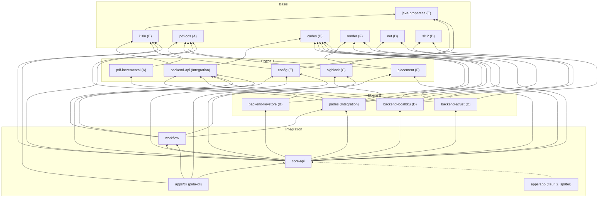

# ADR 0001 – Cargo-Workspace, Crate-Schnitt und verbindliche Schnittstellen

| | |
|---|---|
| **Status** | angenommen (14.10.2026); präzisiert durch den Schnittstellen-Review vor der parallelen Umsetzung (§8) |
| **Kontext** | Fundament für die parallele Umsetzung durch sechs Pakete (A–F) und die anschließende Integration |
| **Grundlage** | [Plan](../00-architektur-und-umsetzungsplan.md) §2 (Stack/Pinning), §3 (Architektur, Schnittstellen), §4 (Backends), §6 (PDF-Engine), §7 (Config/CLI/i18n), §8 (QA); Analysen [01–05](../analyse/), Recherchen [01–03](../recherche/) |

## 1. Entscheidung in Kürze

- Ein Cargo-Workspace (Edition 2024, `resolver = "3"`, Lizenz `EUPL-1.2`, `rust-version = "1.99"`) mit 18
  Bibliotheks-Crates unter `crates/` und der CLI unter `apps/cli` (Binary `pida-cli`). Die Tauri-2-Shell
  `apps/app` legt erst die Integration an (in `Cargo.toml` als Kommentar vorgesehen).
- Alle Crates heißen `pida-<name>`. Der Abhängigkeitsgraph ist azyklisch (§3).
- Die öffentlichen APIs aller Crates sind **jetzt** als Typen, Traits und Signaturen festgelegt und
  kompilieren (`cargo check --workspace --all-targets`). Bodies sind `todo!()`, außer den in §5.1 genannten
  Querschnittsteilen, die bereits implementiert und getestet sind.
- Fremdbibliotheken stehen hinter eigenen Grenzen (Plan §2.5): lopdf hinter `pdf-cos`, RustCrypto hinter
  `cades`, PDFium hinter `render::Renderer` (Feature `pdfium`), der Writer hinter `pdf-incremental`.
- Die verbindlichen Präzisierungen aus dem Schnittstellen-Review (Verträge, die zwei Pakete gleich
  auslegen müssen) stehen in §8; sie gehen den Doc-Kommentaren im Zweifel vor.

## 2. Entscheidung des Auftraggebers: Szenario A ist Standard

A-Trust hat den **nativen Ablauf** (Szenario A wie PDF-Over: SL-1.2-HTTPS-Endpunkt, HTML-Seiten parsen,
Formulare nativ befüllen, natives FIDO2 auf dem Desktop) freigegeben. Damit gilt **abweichend vom Plan**
(dort §0, §4.1–§4.4, §4.8: B als Standard, A nur per Cargo-Feature):

| Thema | Plan | jetzt verbindlich |
|---|---|---|
| ID Austria Standard | B (Browser-Control) | **A** (`pida-backend-atrust`, `BackendId::AtrustNative`, `Interaction::NativeForms`) |
| Szenario B/B-Relay | Standard bzw. Rückfall | **nicht in v1**; Enum-Varianten (`BackendId::AtrustBrowser`, `Interaction::EmbeddedWeb/SystemBrowser`, `Capture`, `ServerNeed::DataUrlRelay`) und Broker-Methoden `embedded_web`/`system_browser` (Default `Unsupported`) bleiben reserviert |
| CSC (C), EUDI-Wallet (D) | Zielpfad bzw. später | im Capability-Modell vorgesehen (`BackendId::Csc`, `BackendId::Wallet`, `ServerNeed::TokenProxy`, `Interaction::ExternalApp`), **keine Implementierung** |
| `atrust-native` als Feature | nur mit Freigabe | reguläres Crate, immer gebaut |
| FIDO2 | B-abhängig | nativ auf dem Desktop über `backend_atrust::Fido2Provider` (Windows `webauthn.dll`, sonst CTAP-HID/libfido2; Features `fido2-windows`, `fido2-hid`); Mobile ohne natives FIDO2 |
| CLI `-p` | in B ignoriert | wieder wirksam (nur RAM, 5–200 Zeichen) |
| ID-Austria-Passwort | nie persistiert | **nie persistiert** – strukturell: `config::SecretId` hat keine Variante dafür |
| Mobile 1.0 | Kernumfang | Kernumfang (Plan §5.2), ID Austria über Szenario A mit App-Bestätigung/SMS |

Weitere Defaults: Lizenz EUPL-1.2, Arbeitstitel „PDF-Over NG“, seit 15.10.2026 **PIDA** ([ADR 0002](0002-name-pida.md)).

## 3. Crate-Graph

Pfeil = „hängt ab von“. Kein Kern-Crate hängt von Tauri ab (Plan §2.5). `core-api` ist die einzige Stelle,
die konkrete Backends kennt; `workflow` arbeitet nur gegen `backend-api`.

### Crate-Übersicht

| Crate | Verantwortung (Spezifikation) |
|---|---|
| `pida-java-properties` | bit-kompatibles `java.util.Properties` load/store (analyse/05 §1.3, analyse/04 §2.1) – **implementiert** |
| `pida-i18n` | Fluent-Kataloge de/en, `t!`, Konverter `messages*.properties` → FTL (Plan §7.5, analyse/01 §6) |
| `pida-pdf-cos` | lopdf-Fassade: `SourcePdf`, Revisionen, xref-Art, Security-Handler, Rechte, `PageInfo`, `SigField`, `ImageInvocation`, `Limits` (Plan §6.1, §6.3) |
| `pida-pdf-incremental` | Append-only-Writer: `IncrementBuilder`, `Increment`, `ByteRange`, `patch_byte_range`, `embed_contents` (Plan §6.2, analyse/03 §4.1–§4.2) |
| `pida-cades` | `Certificate`, `CertChain`, `DigestAlg`, `SignatureAlg`, `SignedAttrsBuilder` (`PdfasCompat`/`PadesBB`), `assemble`, `verify_detached`, `RawSigner` (Plan §6.10, analyse/03 §5) |
| `pida-sigblock` | Profil-IR, `ProfileStore`, Ausdrücke, Fonts, Emblem, `layout`, `Appearance::build` (Plan §6.5, analyse/04 §2–§3, §7) |
| `pida-placement` | `TablePos`, `Placement`, `resolve_width`/`resolve_position`/`auto_place`, `widget_rect`, QR-Platzhalter, leere Felder, Koordinatenräume (Plan §6.7–§6.8, analyse/04 §4–§5) |
| `pida-render` | `Renderer`/`RenderBackend`, `PdfiumBackend` (Feature `pdfium`, Default; Abhängige binden ohne Default-Features, §8.1), `RgbaImage`, Forced-Color-Raster, Bildobjekte (Plan §6.6–§6.8) |
| `pida-backend-api` | `SignatureBackend`, `BackendSession`, `Capabilities`, `SignJob`/`SignResult`, `DocumentSource`, `InteractionBroker` mit allen Dialogtypen, `BackendError`, `CancelToken` (Plan §3.3–§3.4, analyse/01 §4.6, analyse/02 §3) |
| `pida-sl12` | SL-1.2-XML (InfoboxRead, CreateCMSSignature detached mit ExcludedByteRange, NullOperation), Antworten, HTTP-Bindings (analyse/02 §2) |
| `pida-net` | `HttpClient` je Sitzung (Cookies, keine Auto-Redirects), Proxy, rustls+ring, `parse_refresh`, `tcp_probe` (analyse/02 §3.2–§3.4, §6) |
| `pida-backend-atrust` | Szenario A: Seitenklassifikation (8 Blöcke), Long-Poll, Loop-Guard, Selektor-Datei, Validierung, `Fido2Provider` (analyse/02 §3) |
| `pida-backend-localbku` | lokale BKU 127.0.0.1:3495, Probe, NullOperation, Upload/Base64 (analyse/02 §4) |
| `pida-backend-keystore` | PKCS#12 (Modell A), JKS/JCEKS-Erkennung, `PasswordCache` (none/memory/Schlüsselbund) (Plan §4.9, analyse/02 §5) |
| `pida-config` | `Settings` (TOML, versioniert), `LegacyConfig` (33 Keys, 31 migriert), `migrate`, `Overlay`/`Effective`, `Policy`, `Paths`, `SecretStore` (Plan §7.1–§7.4, analyse/05 §1) |
| `pida-pades` | `analyze` (K1–K5), `SignPlan`, `prepare` → `Prepared`, `finish_cms`/`finish_raw`, `SignedPdf::self_check` (I1–I6), `write_atomically` (Plan §3.6, §6) |
| `pida-workflow` | reiner Reducer `reduce(State, Event, &Context) -> Transition{State, Vec<Effect>}`, `Queue`, Ausgaberegeln, `ExitCode` (Plan §3.5, analyse/01 §3) |
| `pida-core-api` | `Core::{new, dispatch, subscribe, view, page_tile, block_preview}`, serde-Typen `ViewState`/`UiEvent` für die Tauri-Bridge |
| `pida-cli` | clap-Definition aller PDF-Over-Argumente inkl. Quirks (unbekanntes Token = Datei, zweiphasiges `-c`) – Parser **implementiert**, Ausführung `todo!()` |

## 4. Ownership und Regeln für die parallele Arbeit

| Paket | Crates (Verzeichnisse) | eigene Testdaten | ADR-Nummern |
|---|---|---|---|
| **A** | `crates/pdf-cos`, `crates/pdf-incremental` | `testdata/pdf-cos/`, `testdata/pdf-incremental/` | 0010–0019 |
| **B** | `crates/cades`, `crates/backend-keystore` | `testdata/cades/`, `testdata/backend-keystore/` | 0020–0029 |
| **C** | `crates/sigblock` (inkl. `crates/sigblock/assets/` für Profile, DejaVu-Fonts, Logos aus `reference/pdfas-config`) | `testdata/sigblock/` | 0030–0039 |
| **D** | `crates/sl12`, `crates/backend-atrust`, `crates/backend-localbku`, `crates/net` | `testdata/sl12/`, `testdata/backend-atrust/`, `testdata/backend-localbku/`, `testdata/net/` | 0040–0049 |
| **E** | `crates/config`, `crates/i18n` (inkl. `locales/`), `crates/java-properties` | `testdata/config/`, `testdata/i18n/` | 0050–0059 |
| **F** | `crates/render`, `crates/placement` | `testdata/render/`, `testdata/placement/` | 0060–0069 |
| **Integration** | `crates/backend-api`, `crates/pades`, `crates/workflow`, `crates/core-api`, `apps/cli`, `apps/app`, Root-Dateien, `testdata/` (gemeinsam), CI | – | 0100 ff. |

**Verbindliche Regeln:**

1. **Nur eigene Verzeichnisse ändern.** Jedes Paket ändert ausschließlich seine Crate-Verzeichnisse und
   `testdata/<crate>/`. Root-`Cargo.toml`, `rustfmt.toml`, `clippy.toml`, `deny.toml`, `.github/`,
   `docs/adr/0001-*`, gemeinsame `testdata/`-Ordner und fremde Crates bleiben unverändert.
2. **Neue Abhängigkeiten nur im eigenen `Cargo.toml`.** Steht die Abhängigkeit in
   `[workspace.dependencies]`, wird sie mit `workspace = true` eingebunden (zusätzliche `features = [...]`
   sind erlaubt). Sonst mit **exakter, auf crates.io geprüfter Version** und einem Kommentar; die
   Integration hebt sie später in den Workspace. Lizenz-Allowlist aus Plan §2.5 bzw. `deny.toml` beachten
   (kein GPL/AGPL). **Die Root-`Cargo.toml` wird nicht geändert.**
3. **Öffentliche Signaturen anderer Crates nicht ändern.** Fehlt etwas, wird im eigenen Crate adaptiert
   (Wrapper, Konvertierung) und im Abschlussbericht gemeldet. Die eigene öffentliche API wird nur
   **additiv** erweitert; Änderungen an bestehenden Signaturen, die andere Crates nutzen (Graph §3), sind
   zu begründen und im Abschlussbericht zu melden.
4. **Bereits implementierte Teile** (§5.1) dürfen intern umgebaut werden, Verhalten und Tests bleiben.
5. **Cargo.lock:** Bei Merge-Konflikten die Fassung aus `main` übernehmen und `cargo check --workspace`
   ausführen (ergänzt fehlende Einträge minimal). Kein `cargo update` ohne Absprache.
6. **Tests:** Unit-Tests im Crate, Integrationstests unter `crates/<crate>/tests/`. Testdaten über
   `concat!(env!("CARGO_MANIFEST_DIR"), "/../../testdata/…")`. Kein Netzverkehr in Tests, keine echten
   Zugangsdaten; A-Trust nur gegen aufgezeichnete, anonymisierte HTML-Fixtures. Tests, die PDFium
   brauchen, prüfen die Umgebungsvariable `PIDA_PDFIUM_DIR` und werden sonst übersprungen
   (CI hat vorerst keine PDFium-Binaries).
7. **Qualität je Paket:** `cargo fmt -p <eigene Crates>` (nicht `--all`, damit keine fremden Dateien
   angefasst werden), `cargo check --workspace --all-targets` (ergänzt `Cargo.lock` bei neuen
   Abhängigkeiten minimal; die Datei wird mit committet, danach muss `--locked` wie in der CI grün sein),
   `cargo test -p <eigene Crates>`,
   `cargo clippy -p <eigene Crates>` ohne neue Warnungen in eigenen Crates; keine `todo!()` mehr in den
   eigenen öffentlichen Funktionen (oder begründet im Bericht).
8. **unsafe:** workspaceweit `deny`. FFI (z. B. `webauthn.dll` in `backend-atrust`) nur in einem eigenen
   Modul mit lokalem `#[allow(unsafe_code)]` und Begründung.
9. **Logs** enthalten nie Passwörter, TANs, Tokens, Dokumentinhalte oder Zertifikats-Personendaten im
   Klartext. Das gilt auch für `Debug`: Typen, die solche Daten tragen, haben eine **eigene**
   `Debug`-Implementierung (Längen, Namen, gekürzter Fingerprint) statt `#[derive(Debug)]` – im
   Fundament bereits umgesetzt für `SourcePdf`, `Increment`, `IncrementBuilder`, `Prepared`,
   `SignedPdf`, `Certificate`, `CertFields`, `net::{Request, Response, Body, FormPart}`,
   `sl12::{Part, HttpBody, DocumentContent, InfoboxReadResponse, CreateCmsSignatureResponse}`,
   `PollInfo`, `ParsedPage`, `MemoryDocument` (Regressionstests in `net` und `cades`). Neue Typen
   folgen dem Muster.
10. **Abschlussbericht** je Paket: umgesetzte API, Abweichungen, neue Abhängigkeiten (Name, Version,
    Lizenz), Änderungsbedarf an fremden Schnittstellen, **neue Meldungs-/Fehler-IDs** (Regel 11),
    offene Punkte.
11. **i18n-IDs:** Die Kataloge `crates/i18n/locales/` ändert nur Paket E (Konvertierung der PDF-Over-Keys).
    Andere Pakete führen ihre neuen stabilen Codes (z. B. `BackendError::code`, `Finding::code`,
    `NoticeCode`, `FormProblem`, `PlacementError`) samt deutschem und englischem Text im
    Abschlussbericht auf; die Integration trägt sie ein. Bis dahin liefert `Catalog::format` `!id!`.
12. **Worktrees:** Jedes Paket arbeitet in einem eigenen `git worktree`/Branch. `reference/` und `.venv/`
    sind nicht versioniert und fehlen dort; `source tools/env.sh` setzt `PIDA_MAIN`,
    `PIDA_REFERENCE` (Referenzquellen, nur lesen) und nimmt die `.venv` (pyHanko) des Hauptcheckouts in
    den `PATH`. Tests lesen nie aus `reference/`, sondern nur aus `testdata/` bzw. Crate-Assets.

## 5. Schnittstellenprinzipien

### 5.1 Im Fundament bereits implementiert

Damit kein Paket auf die Implementierung eines anderen warten muss:

| Teil | Crate | genutzt von |
|---|---|---|
| Java-Properties `load_latin1`/`load_str`/`load_auto`/`store_latin1`/`store_string` (JDK-21-Semantik, 14 Tests) | `java-properties` | C, E |
| `DigestAlg`/`Hasher` (SHA-1/256/384/512), `Certificate::from_der`, Getter (Subject/Issuer-AVAs, Seriennummer dezimal, Gültigkeit, Fingerprint) | `cades` | B, D, Integration |
| `ByteRange::for_contents`/`excluded`/`is_consistent_with`, `format_pdf_date` | `pdf-incremental` | A, Integration |
| `CancelToken`, `BackendError::code`, `Environment`, `BackendId::from_legacy_bku` | `backend-api` | B, D |
| Test-Hilfen `testing::ScriptedBroker` (skriptgesteuerte Masken/Passwörter/Meldungen, Aufrufprotokoll; `ScriptedReply::Pending` hält eine Maske offen, bis das Backend sie droppt → `BrokerCall::FormClosed`, für den Long-Poll-Pfad R7) und `testing::MemoryDocument` – Feature `testing` als dev-dependency | `backend-api` | B, D |
| Redigierende `Debug`-Implementierungen (Regel 9) | mehrere | alle |
| Hybrid-xref-Testdokument `testdata/pdf/generated/simple-xref-hybrid.pdf` (`tools/make-hybrid-xref.py`) | `testdata/` | A |
| `SignatureProfile::pdfas_profile_id` (die 12 PDF-Over-Profil-IDs) | `config` | Integration |
| `mode_from_server_header` | `backend-localbku` | D |
| CLI-Normalisierung und Parser (7 Tests) | `apps/cli` | Integration |
| `Queue` | `workflow` | Integration |

### 5.2 RustCrypto-Generation und `p12-keystore`

Gepinnt ist **eine** Generation: `cms` 0.2.3, `der` 0.7.10, `x509-cert` 0.2.5, `spki` 0.7.3, `const-oid` 0.9.6,
`pkcs8` 0.10.2, `sha1` 0.10, `sha2` 0.10.9, `rsa` 0.9.10, `p256`/`p384` 0.13, `p521` 0.13.3, `ecdsa` 0.16.9,
`signature` 2.2 (Plan §2.5). `p12-keystore` 0.4.1 (Plan §2.1) zieht intern die **Folgegeneration**
(`der` 0.8, `cms` 0.3-pre, `x509-cert` 0.3, `sha2` 0.11). Die Grenze sind **DER-Bytes**:
`p12_keystore::Certificate::as_der()` → `pida_cades::Certificate::from_der`, Privatschlüssel als
PKCS#8-DER → `rsa`/`p256`/`p384`/`p521` der gepinnten Generation. Typen der Folgegeneration erscheinen in
keiner öffentlichen API. Migration auf `cms` 0.3 ist ein eigenes Fenster (Plan §2.5).

### 5.3 Datenschnittstellen statt Implementierungsabhängigkeiten

Paketübergreifende Funktionen nehmen **reine Datenstrukturen**, die Tests selbst bauen können:
`placement` arbeitet auf `PageInfo`, `SigField` und `ImageInvocation` (aus `pdf-cos`) sowie auf
`&dyn Renderer`; `sigblock` bekommt `CertFields` (nicht das Zertifikat); `backend-api::DocumentSource` ist
ein Trait, den der Workflow als Adapter um `pades::Prepared` implementiert. `ExcludedByteRange` existiert
bewusst dreimal (`pdf-incremental`, `backend-api`, `sl12`) mit identischer Semantik (From/To inklusive),
damit `sl12`/`backend-api` nicht von der PDF-Engine abhängen.

### 5.4 PDF-Objekte

Alle Crates verwenden lopdf über `pida_pdf_cos::lopdf` bzw. die Re-Exporte `Object`, `Dictionary`,
`Stream`, `ObjectId`. `sigblock::Appearance` liefert einen Objektgraphen mit **lokalen Referenzen**
(`Object::Reference((i, LOCAL_GENERATION))`), `Appearance::materialize` vergibt echte IDs aus dem
`IncrementBuilder`. Das Signaturdictionary serialisiert ausschließlich `pdf-incremental` (Reihenfolge,
Platzhalter, `/Contents` nie verschlüsselt).

### 5.5 Backends und Interaktion

- Backends sind `async` (`async-trait`), Laufzeit Tokio. Ablauf: `open` → optional `certificate` →
  Kern-`prepare` → `sign(Vec<SignJob>)` → Kern-`finish_*`.
- Alle Dialoge aus analyse/01 §4.6/§4.7/§4.10 bildet `InteractionBroker` ab (Tabelle in der Doku von
  `pida-backend-api`): `native_form` (Login, SMS-TAN, QR, App-Warten, FIDO2), `secret` (Keystore),
  `notice` (Interstitial, A-Trust-Fehler, HTTP 407/413, Verbindungsfehler, Keystore-Fehler), `progress`,
  `event` (Benutzername merken), `open_external` („Signaturdaten anzeigen“), `parent_window` (FIDO2-Modalität).
- Long-Poll und Dialog laufen nebenläufig; meldet der Poll „fertig“, **droppt** das Backend das
  Dialog-Future, der Broker schließt den Dialog.
- Persistenz liegt nie im Backend: Benutzername über `BackendEvent::LoginSucceeded`, Keystore-Passwörter
  über `backend_keystore::PasswordCache` (Adapter auf `config::SecretStore` in `core-api`).

### 5.6 Fehler

Jedes Crate hat ein eigenes `thiserror`-Enum. Fehler an UI/CLI tragen stabile Codes (`BackendError::code`,
`pades::Finding::code`, `workflow::WorkflowError`) und werden über `i18n` übersetzt; CLI-Exit-Codes nach
Plan §7.4 (`workflow::ExitCode`).

## 6. Gepinnte Versionen (Auszug, vollständig in `Cargo.toml`/`Cargo.lock`)

| Bereich | Versionen |
|---|---|
| PDF | `lopdf ~0.45.0` (ohne Default-Features), `pdfium-render =0.9.4` (`pdfium_latest` = 7881) |
| Krypto | siehe §5.2; `p12-keystore =0.4.1` |
| Fonts/Bilder/QR | `skrifa 0.48.0`, `read-fonts 0.45.0`, `subsetter 0.2.6` (ohne `variable-fonts`, sonst zweite skrifa-Generation), `png 0.18.1`, `zune-jpeg 0.5.15`, `gif 0.14.2`, `image 0.25.10` (png/jpeg/gif), `kamadak-exif 0.6.1`, `flate2 1.1.10`, `rxing 0.9.3` (qrcode, decoders, encoding_rs) |
| Netz/HTML/XML | `reqwest 0.13.5` (`rustls-no-provider`, cookies, multipart, form, system-proxy), `rustls 0.23.46` (ring), `url 2.5.8`, `scraper 0.27.0`, `quick-xml 0.42.0` |
| Allgemein | `tokio 1.53.3`, `async-trait 0.1.92`, `futures 0.3.34`, `thiserror 2.0.21`, `serde 1.0.229`, `serde_json 1.0.154`, `tracing 0.1.44`, `zeroize 1.9.1`, `time 0.3.55`, `jiff 0.2.38` (Zeitzonen, §8.7; Unlicense/MIT), `base64 0.23.1`, `hex 0.4.3`, `toml 1.1.8`, `directories 6.0.0`, `keyring 4.2.0`, `clap 4.6.7`, `fluent-bundle 0.16.0`, `fluent-syntax 0.12.0`, `unic-langid 0.9.6` |
| Tests | `tempfile 3.27.0`, `proptest 1.12.0` |

## 7. Konsequenzen und offene Punkte

- **Abweichungen vom Plan:** Szenario A statt B als Standard (§2); zusätzliches Crate
  `pida-java-properties` (gemeinsamer Parser für C und E); `apps/desktop`+`apps/mobile` aus Plan §3.2
  werden zu einem Tauri-Projekt `apps/app`; `rust-version` = verifizierte Toolchain 1.99.
- **Lizenz-Gate:** `webpki-root-certs` (CDLA-Permissive-2.0, über `rustls-platform-verifier`) ist in
  `deny.toml` zugelassen (Plan §16 hatte das vorhergesehen); `scraper`/`selectors` bringen MPL-2.0.
- **Doppelte Generation** durch `p12-keystore` (§5.2) – akzeptiert, weil gekapselt.
- **MSRV:** Die Abhängigkeiten verlangen ≥ 1.88; eine Absenkung erfolgt erst nach CI-Nachweis.
- **PDFium-Binaries** (chromium/8100) sind noch nicht im Build; Paket F legt fest, wie sie in Tests und CI
  bereitgestellt werden.
- **Mobile-Integration** (nicht Teil der Pakete A–F): `rustls-platform-verifier` braucht unter Android eine
  JNI-Initialisierung durch die Shell; `keyring` 4 hat ohne Feature `android-native-keyring-store` unter
  Android keinen Standardspeicher (Mobile nutzt ohnehin das `secure-store`-Plugin, Plan §3.1).
- **Advisory RUSTSEC-2023-0071** (`rsa`, Marvin) ist in `deny.toml` begründet ignoriert (nur lokales
  Signieren); bei einer `rsa`-Version mit Fix wird gehoben.
- `lopdf` 0.45 bringt intern ebenfalls `sha2` 0.11 mit (wie `p12-keystore`); gekapselt in `pdf-cos`.

## 8. Präzisierungen aus dem Schnittstellen-Review (14.10.2026, vor der parallelen Umsetzung)

Adversarialer Review aller `lib.rs`/`Cargo.toml` gegen Plan §3 und analyse/01–05. Ergebnis: Die Pakete
A–F lassen sich unabhängig umsetzen; die folgenden Verträge sind **verbindlich**, weil sonst zwei Pakete
dieselbe Stelle unterschiedlich auslegen würden. Alle Punkte sind im Code (Stubs/Doc-Kommentare)
umgesetzt; `cargo check --workspace --all-targets --locked` und alle Tests sind grün.

### 8.1 PDFium als Feature

`pida-render` hat das Feature `pdfium` (Default, `dep:pdfium-render`) für `PdfiumBackend`/
`PdfiumRenderer`. Die Workspace-Dependency `pida-render` ist `default-features = false`; nur
`pida-core-api` (und später die Tauri-Shell) aktiviert `features = ["pdfium"]`. `placement` und
`pades` brauchen nur die Traits und lassen sich ohne `pdfium-render` bauen und mit eigenen
Test-Renderern prüfen (CI-Schritt „cargo check ohne PDFium“). Ein Rückfall-Renderer (hayro, Plan §2.4)
kommt als weiteres Feature dazu.

### 8.2 Zuordnung `ImageInvocation` ↔ `ImageObject` (A ↔ F)

`pdf-cos` zählt nur `Do`-Aufrufe von Bild-XObjects (`order` in Content-Stream-Reihenfolge, Tiefensuche
in Form-XObjects nur mit `descend_forms`, `ctm` im Seitenraum). PDFium zählt auch Inline-Bilder. Die
Zuordnung in `find_qr_placeholders` erfolgt daher **primär über die Matrix** (komponentenweise
Abweichung ≤ 0,01), `order` ist nur Tie-Breaker.

### 8.3 Modell A: Hashverfahren (B ↔ Integration)

Der Kern wählt das Hashverfahren mit `cades::select_algorithm(&chain.signer.key_type()?)`, hasht damit
ByteRange-Daten (message-digest) **und** SignedAttributes und schickt `DigestJob { alg, digest }`. Das
Backend bzw. `RawSigner::sign_digest` signiert genau mit `digest.alg` und liefert `RawSignature::alg`
mit `alg.digest() == job.alg`. Ablauf: `certificate()` → `prepare(Reserve::ModelA)` →
`Prepared::digest(alg)` → `SignedAttrsBuilder::new(profile, &digest, &chain.signer,
SigningTime(prepared.signing_time())).build()` → `attrs.digest(alg)` → `sign` → `finish_raw`.

### 8.4 `/Contents`-Reserve

| Fall | Reserve | Quelle |
|---|---|---|
| Writer-Default (`SignatureDictSpec::default`) | 4096 Bytes wie PDF-AS (`RESERVE_MIN_MODEL_A`) | `pdf-incremental` |
| Modell A (`Reserve::ModelA`) | `cades::estimate_cms_len(…)` + 1 KiB, mindestens 4096, Profil-Key `signatureSize` respektiert | `pades` |
| Modell B (`Reserve::ModelB`) | `Capabilities::cms_reserve` bzw. `RESERVE_MODEL_B` = 16 KiB; vor `prepare` vergrößert, wenn `estimate_cms_len` > 50 % | `pades` |
| nach `FinishError::CmsTooLarge` | `Reserve::Bytes(n)` über `RetryTarget::PrepareWithReserve(n)` (zweite Bestätigung) | `workflow` |

`cades::estimate_cms_len(chain, profile, alg, include_intermediates)` ist neu (Stub, Paket B);
`include_intermediates` kommt aus dem neuen Feld `SignPlan::include_intermediates` (PDF-AS: `false`,
Entscheidung S3), das auch `finish_raw` für `AssembleOptions` verwendet.

### 8.5 Abbruch, Drop-Sicherheit, Lebensdauer

- Während `certificate`/`sign` ist die Sitzung `&mut` geliehen; abgebrochen wird über
  `SessionContext::cancel` (`CancelToken`) oder durch Droppen des Futures. Beide Futures müssen
  drop-sicher sein; `BackendSession::cancel` räumt danach auf.
- Broker-Futures dürfen gedroppt werden (Long-Poll „fertig“ → Maske schließen); testbar mit
  `ScriptedReply::Pending`.
- Backends halten `DocumentJob::source` nicht über `sign` hinaus (der Kern braucht `Prepared` danach
  exklusiv für `finish_cms(self, …)`).

### 8.6 Masken und Bridge

- `NativeForm::QrCode`/`WaitForApp` tragen `timeout_secs` (Countdown „App-Warten“, Plan §4.4; Default
  300 s aus `PollConfig`).
- „Signaturdaten anzeigen“ (F-68): `UiEvent::OpenSignatureData { request }`; der Kern öffnet
  `FormContext::signature_data_url` (nur `https://`, A-Trust-Host), die Maske bleibt offen.
- `FormContext`, `NoticeCode`, `FormProblem` decken alle Dialoge aus analyse/01 §4.6/§4.10 und analyse/02
  §3.5–§3.11 ab: Login (inkl. erneuter Login-Seite → `FormProblem::LoginRejected`, kein automatisches
  Neusenden), SMS-TAN, QR, App, FIDO2, Methodenwechsel SMS/FIDO2, Interstitial, Fehlerseite mit
  Retry/Cancel, HTTP 407/413/sonstige, Verbindungsfehler; „Merken“ nur RAM (`AtrustNativeBackend`),
  Benutzername über `BackendEvent::LoginSucceeded`; Wiederverwendung der Credentials im zweiten
  SL-Request über `AtrustSession`.

### 8.7 Signaturblock: `/Name`, Fallbacks, Zeitzonen (C ↔ Integration)

- `sigblock::expr::signer_name(profile, input)` liefert `/Name` (aufgelöstes `SIG_SUBJECT`),
  `ExprContext::from_input` baut den Kontext mit den Alias-Regeln (`title`/`T`, linkester Eintrag) –
  die Integration baut nichts davon nach.
- `Profile` enthält bereits alle Fallbacks (`default.*`, eingebaute Caption-Defaults);
  `layout`/`Appearance::build` brauchen den `ProfileStore` nicht.
- Zeitzonen: `time::OffsetDateTime` bleibt der Schnittstellentyp. `time` ermittelt unter Unix in
  Mehrthread-Prozessen keinen lokalen Offset und kennt keine IANA-Namen; deshalb `jiff`
  (Workspace-Dependency): Die Integration bildet `/M`/`signing_time` als lokale Zeit mit Offset über
  `jiff`, `format_sig_date(…, timezone: None)` nutzt den Offset des übergebenen Werts,
  `Some("Europe/Vienna")` löst Paket C über `jiff` auf (unbekannt → `GMT` wie Java).

### 8.8 Workflow (Integration)

Ergänzt, damit die Übergangstabelle aus analyse/01 §3.4 und Plan §6.2/§7.1 vollständig abbildbar ist:
`Event::PreviewUnavailable` (→ Hinweis `error.PositioningNotPossible`, automatische Positionierung),
`Event::CmsTooLarge` + `WorkflowError::CmsTooLarge` + `RetryTarget::PrepareWithReserve`,
`Event::SettingsUnreadable` + `WorkflowError::Config` + `RetryTarget::ResetSettings` + `Effect::ResetSettings`
(F-05), `Effect::Notify`, `Effect::Prepare::min_reserve`, `Context::privacy_acknowledged`
(Datenschutzhinweis nur bis zur Bestätigung; seit ADR 0003 entfallen – kein Zustimmungsschritt, dafür
`State::ChoosingBackend::sign_requested`). Einstellungen bleiben ein Overlay in `core-api`.

### 8.9 CLI `-v`

`-v <wert>`: `false`/`0`/`no`/`nein`/`off` → sichtbar (Korrektur B-07), **jeder andere Wert** →
unsichtbar wie bei PDF-Over (Skripte mit `-v x` laufen weiter).

### 8.10 Lizenzen und Versionen

Geprüft über `cargo metadata` (alle 475 externen Crates im Graph, alle Ziele): keine Abhängigkeit ohne
zulässige Alternative der Allowlist; Copyleft nur als Option (`self_cell` Apache-2.0 OR GPL-2.0,
`r-efi` … OR LGPL-2.1) bzw. MPL-2.0 (`cssparser`, `selectors`, `dtoa-short`, `option-ext`, zulässig).
TLS über `rustls` + `ring` + `rustls-platform-verifier`, kein `aws-lc-rs`. Doppelte Generationen nur
wie in §5.2/§7 beschrieben.
