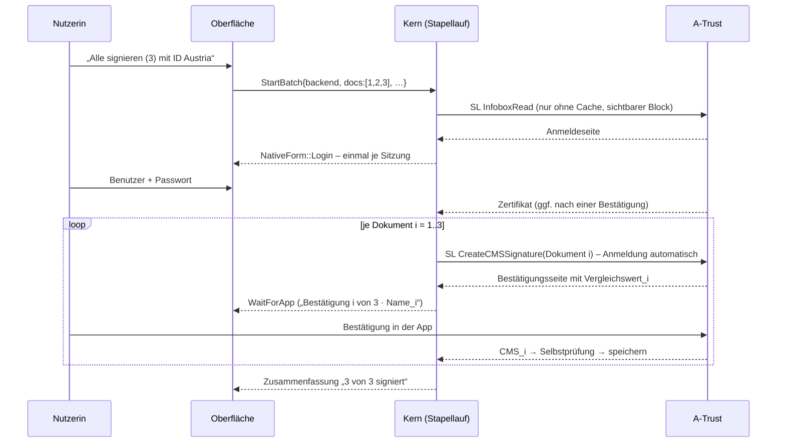

# ADR 0004 – Neue Oberfläche „Arbeitsbereich“ in `apps/app` (Lückenanalyse und Schnittstellenvertrag)

| | |
|---|---|
| **Status** | angenommen als **Umsetzungsvertrag** (15.10.2026), adversarial geprüft und berichtigt (15.10.2026). Offene Entscheidungen stehen in §8; bis zur Entscheidung gilt die dort genannte Empfehlung. |
| **Nummer** | **0004.** Die Nummer 0003 belegt das Datenschutz-ADR aus V0 (`docs/adr/0003-datenschutzhinweis-ohne-dialog.md`); auf dieses verweist der Code von V0 mit „ADR 0003“. Der Orchestrator legt diese Datei beim Commit als `docs/adr/0004-neue-oberflaeche.md` ab. Code und Kommentare der Pakete verweisen auf „ADR 0004“. |
| **Kontext** | Der Auftraggeber hat den klickbaren Prototyp `prototypes/pida-workspace` abgenommen (README, `docs/ux-konzept.md`, `docs/screenshots/`, `src/**`). Er wird in `apps/app` umgesetzt – Desktop **und** Mobile. |
| **Grundlage** | Prototyp; `apps/app/src/**` (Screens, `core/bridge.ts`, `core/generated.ts`, `core/mock.ts`); `crates/core-api` (`view.rs`, `runtime.rs`, `broker.rs`, `tools.rs`), `crates/workflow` (State/Event/Effect/Reducer, Queue), `crates/backend-api`, `crates/backend-atrust`, `crates/pades` (`analyze`, Vorsignaturen), `crates/cades` (`verify_detached`), `crates/config` (Settings, Zertifikats-Cache), `crates/placement`, `crates/render`; ADR 0001 (Regeln 1–12, §8), ADR 0002; `docs/analyse/02`; `docs/integration/{mobile,app-abnahme}.md` |
| **Ersetzt** | die Übertragungsskizze `ux-konzept.md` §11 (dort u. a. „Signieren = `confirm_position` + `choose_backend`“, „Datenschutzhinweis = `acknowledge_privacy`“, „Stapel = eine Bestätigung“) |
| **Ownership** | Integration (Orchestrator); Umsetzung durch die Pakete **K** (Kern), **UI-A**, **UI-B** (§6) |

## 0. Kurzfassung

1. **Ein Arbeitsbereich statt vier Schritten.** Der Rust-Kern bleibt die Zustandsmaschine; die UI projiziert nur den
   `ViewState` und sendet `UiEvent`s. Neu ist ein **Arbeitsbereich-Modus** des Kerns (`CoreOptions::workspace_ui`),
   der die modalen Zwischenschritte (Platzhalterfrage, Signiermittel-Auswahl) durch **Daten im ViewState** und
   eine **kombinierte Aktion** `SignWith { backend }` ersetzt. Der klassische Ablauf bleibt für CLI und Tests.
2. **Kein Signiervorgang ohne ausdrückliche Nutzeraktion** (Vorfall F-54): Eine Backend-Sitzung öffnet im
   Arbeitsbereich-Modus nur nach `SignWith`, `StartBatch`, `ChooseBackend` (Rückfall), `ResumeSignature`, „Erneut
   versuchen“ oder – nur für Signiermittel, bei denen das Dokument auf dem Gerät bleibt – der Startargument-Automatik
   (`-b … -a`) – Invariante **A1**, als Property-Test abgesichert (§3.2). Das gilt im Arbeitsbereich für **alle**
   Signiermittel, nicht nur für ID Austria (§8 F14).
3. **Stapel = eine Sitzung, eine Anmeldung, n Bestätigungen.** Je Dokument ein eigener SL-Request mit eigener
   Bestätigung und eigenem Vergleichswert; Fortschritt und Status je Dokument; „Dokument überspringen“ ≠
   „Stapel abbrechen“; Dokumentfehler halten den Stapel nicht auf (§3.8). Der Prototyp zeigt hier fälschlich
   eine einzige Bestätigung. „Eine Anmeldung“ gilt, solange A-Trust keine Fehlerseite zeigt (dort löscht das
   Backend das Passwort, §1.2) und keine Sitzung neu geöffnet werden muss.
4. **Neue Kernfunktionen:** Seitenlayout (Inhaltsrahmen, freie Flächen, Einrastlinien) und Live-Überdeckungsprüfung,
   Inline-Platzhalter (Felder/QR ohne Dialog), Signiermittel-Übersicht (Konto-Chip), Zusammenfassung „Fertig“,
   Prüfmodus (`pades::verify_document`, `cades::qc_statements`), „Zuletzt signiert“ (`config::RecentStore`),
   Einstellungen „sofort wirksam“ (`ApplySettings`), Ersteinrichtung, Freigaben (`ActionsView`).
5. **Vertrag additiv:** neue Felder mit `#[serde(default)]`, neue Varianten am Ende; nichts Bestehendes wird
   umgedeutet. Was die neue UI nicht mehr nutzt, bleibt mit Migrationsregel (§3.15).
6. **UI:** Design-Tokens und Bausteine des Prototyps werden übernommen, **nicht** sein Reducer, seine Mock-Dokumente
   und sein Geometriemodell (das ist Fachlogik und kommt aus dem Kern). Texte über Fluent (`crates/i18n/locales`).
   Die vorhandene Mobile-Logik (Teilen/Export, PKCS#12-Import, „Signatur fortsetzen“, Lebenszyklus) bleibt.
7. **Etappen** E0 (Vertrag als Code) → E1 Arbeitsbereich + Signieren → E2 Stapel → E3 Einstellungen/Datenschutz/
   Zuletzt signiert → E4 Prüfmodus/Palette/Ersteinrichtung. **Drei Pakete** (K, UI-A, UI-B) arbeiten parallel in
   getrennten Worktrees mit exakter Datei-Ownership; die Bridge-Typen entstehen in E0 aus Rust, die UI arbeitet
   bis zur Kern-Umsetzung gegen den Mock-Kern.

---

## 1. Feste Vorgaben und Ausgangslage

### 1.1 Entscheidungen des Auftraggebers (nicht verhandelbar)

| Nr. | Entscheidung | Folge für diesen Vertrag |
|---|---|---|
| **D1** | **Kein** Zahlenfeld-Abschnitt „Position“. Ziehen, Tastatur, Doppelklick und Live-Region bleiben. | Bereits umgesetzt (Commit `1623a72`). Der Inspektor zeigt nur eine sprechende Lage („Seite 3 · rechts unten“). `NudgeBlock`/`MoveBlock`/`ChangePage` bleiben die einzigen Positionsereignisse. |
| **D2** | **Kein** blockierender Datenschutzdialog. Stattdessen Kurzhinweis beim Signiermittel ID Austria und ein Abschnitt „Datenschutz“ in den Einstellungen. | Wird im **Paket „Datenschutz“** (Vorbedingung **V0**, eigener Worktree) umgesetzt; dieser Vertrag baut auf dessen Stand auf (§1.3). |
| **D3** | ID Austria startet **nie** ohne ausdrückliche Nutzeraktion (Vorfall F-54). | Invariante **A1** (§3.2); `SignWith` trägt das Signiermittel immer ausdrücklich; keine automatische Backend-Wahl im Arbeitsbereich (einzige Ausnahme: Startargument-Automatik `-b … -a` mit einem Signiermittel, bei dem das Dokument auf dem Gerät bleibt – nie ID Austria). |

### 1.2 Realität A-Trust (Szenario A, `crates/backend-atrust`, docs/analyse/02)

- Je Dokument **ein** SL-1.2-Request `CreateCMSSignature` (das ganze vorbereitete PDF wird hochgeladen) mit
  **eigener Bestätigung** (App/QR, SMS-TAN oder FIDO2) und **eigenem Vergleichswert**; `Capabilities::max_batch = 1`.
- Für den sichtbaren Block braucht der Kern das Zertifikat: `InfoboxRead` als eigener SL-Request. Er entfällt mit
  dem Zertifikats-Cache (Opt-in, `config::certcache`) und – neu – innerhalb **einer** Sitzung ab dem zweiten
  Dokument (die Kette bleibt in der Sitzung). Ob `InfoboxRead` selbst eine 2FA-Bestätigung verlangt, ist offen
  (analyse/02 §9 Frage 2); die UI sagt deshalb „ggf. eine weitere Bestätigung für das Zertifikat“.
- Jeder SL-Request nutzt einen neuen HTTP-Client mit leerem Cookie-Jar; A-Trust zeigt die Anmeldung erneut, und
  `AtrustSession` meldet **automatisch** mit den Zugangsdaten der Sitzung an (nur RAM, `Zeroizing`). Damit gilt:
  **eine Anmeldung je Sitzung**, mit diesen Ausnahmen aus `crates/backend-atrust/src/dialog.rs`: Jede A-Trust-
  **Fehlerseite** (`PageBlock::Error`, auch nach Ablauf der App-Bestätigung) löscht das Passwort der Sitzung
  (`clear_password`, wie PDF-Over `MobileBKUConnector`); ebenso eine abgelehnte Anmeldung (R-13, nie automatisch
  neu senden) und ein Abbruch in der QR-/App-Maske. Danach fragt die nächste Login-Seite wieder nach dem Passwort
  (Benutzername vorbelegt). Eine **neu geöffnete** Sitzung übernimmt Zugangsdaten nur aus dem „Merken“-Speicher
  des Backends (`AtrustNativeBackend::remembered`, nur bei „merken“).
- Läuft die App-Bestätigung ab (Long-Poll 300 s), lädt das Backend die Seite neu; A-Trust zeigt eine Fehlerseite →
  `InteractionView::Notice` (`AtrustError`, Wiederholen/Abbrechen) **innerhalb** desselben Requests (Passwort
  danach gelöscht, siehe oben).
- SL-`ErrorResponse` 6000 (Abbruch durch die Bürgerin) und 6001 (laut SL-Spezifikation Zeitablauf) bildet das
  Backend auf `BackendError::Cancelled` ab – ununterscheidbar vom Abbruch in PIDA. Unterscheiden kann nur der
  Kern: Er weiß, ob er selbst abgebrochen hat (§3.6 „Abgelehnt“).
- HTTP 407/413/sonstige zeigt das Backend heute selbst als Meldung und liefert danach `Cancelled` (`fatal`); für den
  Stapel ist das zu grob (§3.8 `sign_one`).
- Ein Abbruch des laufenden Requests (Überspringen, Stapelabbruch) droppt den Request; A-Trust erfährt davon nichts.
  Eine offene Anfrage kann deshalb in der App sichtbar bleiben, bis sie dort abläuft. Schutz vor Verwechslung ist
  der **eigene Vergleichswert je Dokument**; die Karte weist darauf hin (§4.4).
- Plan L9: Stapel heißt nacheinander, je Dokument eine eigene Freigabe, nichts wird automatisiert durchgeklickt.



### 1.3 Vorbedingung V0: Paket „Datenschutz“ (Worktree `wf_0459d20e-ff5-1`, Branch `worktree-wf_0459d20e-ff5-1`)

Stand der Prüfung: Commit `93dc558` plus nicht committete Ergänzungen im Worktree (`ResumeOfferView::
document_leaves_device`, Property-Test `id_austria_session_only_after_explicit_user_action`). V0 bringt sein
**eigenes** ADR `docs/adr/0003-datenschutzhinweis-ohne-dialog.md` mit; auf dieses verweist der V0-Code mit
„ADR 0003“ (deshalb trägt dieses ADR die Nummer 0004).

Dieser Vertrag setzt den **gemergten** Stand dieses Pakets voraus. Maßgeblich sind danach (Abweichungen meldet V0):

- `Settings::privacy` entfällt; `privacy.acknowledged` steht in `config::RETIRED_KEYS` (beim Lesen verworfen).
- `State::PrivacyNotice`, `Event::PrivacyAnswered`, `Effect::AcknowledgePrivacy`, `Context::privacy_acknowledged`,
  `PrivacyNoticeView` und `StepView::Backend::privacy_notice` entfallen.
- `UiEvent::AcknowledgePrivacy` bleibt nur lesbar und ohne Wirkung (`#[ts(skip)]`).
- `StepView::Signing::document_leaves_device: bool`, `ResumeOfferView::document_leaves_device: bool` und
  `ViewState::privacy_text: Option<String>` (eigener Text per Richtlinie `Policy::privacy_notice_text`) sind neu;
  CLI-Hinweis `ng-document-leaves-device`.
- `State::ChoosingBackend::sign_requested` und intern `Entry { Automatic, SignRequested, Ask }` im Reducer: die
  automatische Wahl startet ein Signiermittel mit `document_leaves_device` nur nach ausdrücklichem „Signieren“
  (F-54). Der Property-Test `id_austria_session_only_after_explicit_user_action` (`crates/workflow/tests/props.rs`)
  prüft das als Paare (Ereignis, Vorzustand); A1 (§3.2) erweitert ihn.
- Oberfläche: `components/Privacy.tsx` (`PrivacyNote`, `PrivacyInfo`), Einstellungen-Tab `privacy` mit
  Zertifikats-Cache; Kurzhinweis auch im Angebot „Signatur fortsetzen“; Texte `ng-ui-privacy-*`,
  `ng-ui-certcache-title` (in `pida.ftl`).

### 1.4 Was der Kern heute leistet (Kurzbefund)

| Bereich | heute | Lücke für den Prototyp |
|---|---|---|
| Ablauf | `Idle → Analyzing → AnalysisWarning? → PlaceholderQuestion? → Positioning? → ChoosingBackend → Signing → Output`, ein Dokument nach dem anderen, `Queue { current, pending, done }` | kein Arbeitsbereich-Modus, keine Stapelübersicht, kein Stapellauf mit **einer** Sitzung |
| Positionierung | `MoveBlock`/`NudgeBlock` (15/1/50 pt)/`ChangePage`/`ToggleNewPage`/`AutoPlace`; Startposition 50 %/25 % letzte Seite (F-33); `announce` | kein Layout (Inhaltsrahmen, freie Flächen, Einrastlinien), keine Live-Überdeckung, Felder ohne Rechteck, QR/Feld nur über modale Frage |
| Signiermittel | Optionen nur im Schritt `backend` (`BackendOptionView`) | kein Konto-Chip außerhalb des Schritts, keine Sitzungsauswahl |
| Signieren | `InteractionView` (Login, SMS-TAN, QR, App, FIDO2, Secret, Notice, Waiting), Sitzung je Dokument (`OpenSession` … `CloseSession`) | kein Fortschritt „Anmelden → Bestätigen k/n → Signiert“, Abbruch führt zur Auswahl statt zum Arbeitsbereich, „Wiederholen“ öffnet eine neue Sitzung (neue Anmeldung) |
| Ergebnis | `OutputView { path, save_pending, ask_overwrite, save_dialog }` | keine Zusammenfassung (Unterzeichner, Zeit, Selbstprüfung) |
| Prüfen | `tools::verify_file` (CLI: gültig/Fehlercode, CN, Zeit, `covers_whole_file`); `pades::analyze` prüft Vorsignaturen (`PriorStatus`) | keine Prüf-API für die UI, keine QES-Kennzeichnung (qcStatements), keine Zertifikatsdetails, keine Lage der Signaturbilder |
| Einstellungen | Overlay mit Arbeitskopie, `SaveSettings` (alles oder nichts) | kein „sofort wirksam“ mit Teilübernahme, keine Sprache außerhalb des Overlays |
| Sonstiges | Migrationsangebot (`MigrationOfferView`), `last_source_directory` | keine Ersteinrichtung, kein „Zuletzt signiert“, keine Freigaben für Palette/Kürzel |

---

## 2. Abbildung Prototyp → Kern

Legende: **✓** vorhanden · **◐** teilweise vorhanden · **✗** neu im Kern · **UI** reine Darstellung · **—** entfällt.
„§“ verweist auf den Vertrag in §3.

### 2.1 Start

| Prototyp-Element | Kern heute | Vertrag | Wer |
|---|---|---|---|
| Ablagefläche „PDF hierher ziehen oder auswählen“, ⌘/Strg+O | ✓ `open_files`; Drop über Tauri-Fensterereignisse (`bridge.onFileDrag`, Pfade), Dialog `pickFiles`, Mobile `pickMobileFiles` | Die React-Aria-`DropZone` des Prototyps liefert **keine Pfade** – sie wird nur optisch übernommen (`dragActive`), Dateien kommen weiter aus der Shell | UI-A |
| Mehrere Dateien → Stapel | ◐ Warteschlange (F-14, F-89) | ✗ Stapelübersicht §3.8 | K, UI-A |
| „Zuletzt signiert“ (öffnet Prüfmodus) | ✗ | §3.10 `ViewState::recent`, `VerifyRecent`; Metazeile nur mit Zeitpunkt (das Signiermittel des Prototyps wird nicht gespeichert, Datenschutz) | K, UI-B |
| Hinweis „Signatur prüfen“ | ✗ | §3.9 `OpenVerify` | K, UI-B |
| „Beispielvertrag öffnen“ | — | entfällt (Demo); Mock-Kern behält Szenarien (§4.8) | – |
| Nicht-PDF → Toast | ✓ Kern meldet `error-MayNotBeAPDF` | UI filtert **nicht** nach Endung; Einzeldokument → Zustandskarte, Stapel → Zeile „abgelehnt“ | UI-A |
| Mobile: Share-Sheet/„Öffnen in“ | ✓ Shell (`ingest_urls`, `take_pending_open_documents`) | unverändert; Ablagefläche entfällt auf Mobile, Knopf „Dokument auswählen“ | UI-A |
| „Signatur fortsetzen“ (Mobile, App-Kill) | ✓ `ViewState::resume`, `ResumeSignature`/`DiscardResume` | unverändert; Dialog neu gestaltet über der Startansicht | UI-A |

### 2.2 Ersteinrichtung

| Prototyp-Element | Kern heute | Vertrag | Wer |
|---|---|---|---|
| Schritt 1 „PDF-Over-Einstellungen übernehmen“ mit Liste | ◐ `ViewState::migration`, `AcceptMigration{store_secrets}`, `DeclineMigration`; keine Liste | ✗ `MigrationOfferView::items` §3.12 | K, UI-B |
| Schritt 2 Standard-Signiermittel | ◐ `settings.backend.default` (nur über Einstellungen) | ✗ `UpdateFirstRun` §3.12 | K, UI-B |
| Schritt 3 Signaturbild (Profil, Blocksprache) mit Vorschau | ◐ Profil/Sprache in Settings, Vorschau `block_preview` | ✗ `UpdateFirstRun` + `FirstRunView::preview_revision` | K, UI-B |
| „Überspringen“, „Fertig“, nur beim ersten Start | ✗ (Datei fehlt → nur Migrationsangebot) | ✗ `FinishFirstRun`, `GeneralSettings::first_run_completed` | K, UI-B |
| erneut aufrufbar (Einstellungen › Erweitert) | ✗ | ✗ `OfferMigration` | K, UI-B |

### 2.3 Arbeitsbereich: Seiten, Sticker, Einrasten, freie Flächen, Überdeckung, Feld-Markierungen

| Prototyp-Element | Kern heute | Vertrag | Wer |
|---|---|---|---|
| Kopfzeile: Name, Seiten, **Größe** | ◐ `DocInfo { name, page_count, page_sizes, signed }` | ✗ `DocumentView::size_bytes` | K |
| Miniaturen, durchgehende Seitenansicht, Zoom 50–200 %, „An Breite anpassen“, Seitenanzeige folgt dem Scrollen | ✓ Kacheln jeder Seite über `pida-render://page/<doc>/<page>?scale` | UI (Kacheln nur für sichtbare Seiten laden; Miniaturen mit kleinem `scale`) | UI-A |
| Sticker = echter Signaturblock | ✓ `block_preview` (PNG aus dem Appearance-Objekt, `preview_revision`), Blockgröße | Sticker zeigt **die Kern-Vorschau** (WYSIWYS), nicht das HTML-Modell `SignatureBlock.tsx` | UI-A |
| Automatisch auf freier Fläche der letzten Seite, Einblendung „automatisch platziert“ | ◐ `AutoPlace` (PDF-AS-Regel) nur auf Knopfdruck; Start = 50 %/25 % | ✗ Start im Arbeitsbereich-Modus = automatische Platzierung nach der PDF-AS-Regel (`PositionChoice::Auto`, wie `-a`): unter dem Inhalt der letzten Seite, bei zu wenig Platz auf einer neuen Seite, bei signierten Dokumenten auf der letzten Seite (dann ggf. mit Überdeckungswarnung); `PlacementOrigin::Auto` §3.3 | K (Einblendung: UI-A) |
| Ziehen (Maus/Touch/Stift) über Seitengrenzen | ✓ `MoveBlock { page, x, y }` (Kern klemmt) | unverändert; während des Ziehens nur UI-Entwurf, gesendet wird beim Loslassen | UI-A |
| **Einrastlinien** (Ränder, Mitte, „unter dem Text“) | ✗ | ✗ `PageLayoutView::guides` §3.3; die UI rastet beim Ziehen an diesen Linien ein | K (Daten), UI-A (Ziehen) |
| **Freie Flächen** (getönte Bänder beim Ziehen) | ✗ | ✗ `PageLayoutView::free` §3.3 | K, UI-A |
| **Überdeckung** (bernsteinfarbener Rahmen, Warnung über „Signieren“, „Freie Fläche suchen“) | ◐ `PlacementNotice::OverlapsContent`/`OverlapsWidget` erst beim Vorbereiten; `FreeSpaceScanner::region_occupied` | ✗ `PlacementCheckView` nach jeder Positionsänderung §3.3; „Freie Fläche suchen“ = `AutoPlace` | K, UI-A |
| **„Hier signieren“-Markierungen** leerer Signaturfelder, Hinweisleiste „Ins Feld setzen“, Einrasten im Feld, „Frei platzieren“ | ◐ `StepView::Placeholder` (modal Ja/Nein/Abbrechen), `FieldInfo` ohne Rechteck; Felder heute nur mit `placeholder.search` **und** `kind = fields` (die Suche liefert entweder Felder oder QR) | ✗ `DocumentView::fields`, `UseTarget` §3.3; im Arbeitsbereich-Modus **immer** angeboten (aus `DocReport::fields`, unabhängig von `placeholder.*`), nie automatisch benutzt (§8 F2); keine Platzhalterfrage | K, UI-A |
| QR-Platzhalter automatisch („Positioniert · im QR-Platzhalter“) | ◐ nur ohne Oberfläche automatisch; Suche nur mit `placeholder.search` (Standard aus, wie PDF-Over) | ✗ im Arbeitsbereich-Modus automatisch (`PlacementTarget::Qr`), umkehrbar – **nur mit eingeschalteter Platzhaltersuche** (`placeholder.search`, `kind = marker`; Standard siehe §8 F13) | K |
| Doppelklick setzt den Block | ✓ `MoveBlock` | UI rechnet Zeiger → linke obere Ecke | UI-A |
| Tastatur: Pfeile, Umschalt fein, Alt grob, Bild↑/↓ | ✓ `NudgeBlock { fine, coarse }` (**15/1/50 pt**, Kern), `ChangePage` | Schrittweiten des Kerns gelten (nicht 10 pt wie im Prototyp); `coarse` = Alt **oder** Strg/⌘ | UI-A |
| Live-Region „Seite 3 von 3, 112 mm von links, 38 mm von unten. Rastet ein: rechts unten. Freie Fläche.“ | ◐ `announce { page, pages, left, top }` | ✗ zusätzlich `bottom`, Prüfergebnis aus `check`; „Rastet ein“ kennt nur die UI (Ziehen) | K, UI-A |
| Zahlenfelder | — | entfallen (D1) | – |
| „Auf neuer Seite“ (bei signierten Dokumenten gesperrt mit Begründung) | ◐ `ToggleNewPage`, Hinweis `placement.notice.new_page_not_allowed`, `DocInfo::signed` | ✗ `DocConstraintsView` mit Begründung (auch DocMDP-zertifiziert, unsichtbares Profil) | K |
| Kennwortgeschütztes PDF: Kennwort eingeben | — Kern lehnt Benutzerpasswort ab (`error-PDFPwdProtected`, K5) | Zustandskarte **ohne** Kennwortfeld; Kennworteingabe ist Entscheidung §8 F1 | UI-A |
| Analysewarnung (`/Perms /UR3`, Hybrid-XFA, Seed Values) – im Prototyp nicht vorhanden | ✓ `StepView::Warning`, `AnswerWarning` | als Zustandskarte im Arbeitsbereich | UI-A |

### 2.4 Inspektor: Konto-Chip, Signaturbild, Optionen, Platzierung, vorhandene Signaturen, Signieren

| Prototyp-Element | Kern heute | Vertrag | Wer |
|---|---|---|---|
| **Konto-Chip** „ID Austria · +43 660 ···123“ mit Umschaltmenü, „Verwalten …“ | ◐ Optionen nur in `StepView::Backend`; Benutzername in Settings | ✗ `ViewState::signers` (immer befüllt, maskiertes Konto), `SelectSigner` §3.4; ohne Auswahl („Jedes Mal fragen“) öffnet „Signieren“ das Menü, die Wahl dort sendet `SignWith` (§8 F12) | K, UI-A |
| Kurzhinweis „Das Dokument wird zum Signieren an A-Trust übermittelt“ | ✓ nach V0 (`capabilities.document_leaves_device`, `PrivacyNote`) | `SignerView::capabilities` liefert das Flag auch außerhalb des Schritts `backend`; Hinweis am Konto-Chip, in der Signierkarte, im Startdialog des Stapels und im Angebot „Signatur fortsetzen“ – nie blockierend (D2) | K, UI-A |
| Signaturbild-Vorschau + „Bearbeiten“ (springt in die Einstellungen) | ✓ `block_preview` | UI öffnet Einstellungen › Signaturbild (`open_settings` + UI-Abschnitt) | UI-A |
| „Unsichtbar signieren“ als **Schalter** | ◐ `ChooseInvisible` ist eine Aktion (sofort weiter zur Auswahl) | ✗ `SetInvisible { invisible }` §3.3 | K, UI-A |
| „Auf neuer Seite“ | ✓ `ToggleNewPage` | + `DocConstraintsView` | K |
| Platzierung „Seite 3 · rechts unten“, „Neu platzieren“ | ✓ `AutoPlace`; Lage = Darstellung | Zonenbeschreibung rechnet die UI aus Rechteck und Seitengröße | UI-A |
| Vorhandene Signaturen (Name, Rolle, Zeit, Status) | ◐ `pades::ExistingSignature { status, … }` ohne Unterzeichner/Zeit; `DocInfo::signed` | ✗ `DocumentView::existing` §3.3 („Rolle“ entfällt – nicht ermittelbar) | K, UI-A |
| Primärer Knopf „Signieren ⌘↵“ | ◐ `ConfirmPosition` + `ChooseBackend` (+ früher Datenschutz) | ✗ **`SignWith { backend }`** §3.5 | K, UI-A |
| Sprunglink „Zum Inhalt springen“, Landmarken | UI | UI (Shell) | UI-A |
| „Zurück zum Stapel“ | ✗ | ✗ `BackToBatch` §3.8 | K, UI-A |
| Bottom-Sheet (< 760 px), eingeklappt: Chip + Signieren + Überdeckungswarnung | UI | UI | UI-A |

### 2.5 Signieren-Statuskarte mit allen Zweigen

| Zweig (Prototyp) | Kern heute | Vertrag | Wer |
|---|---|---|---|
| Karte über dem Dokument, Titel „Signieren mit ID Austria“, Untertitel Dateiname bzw. „3 Dokumente“ | ◐ `StepView::Signing { interaction, queue }` | ✗ `SigningProgressView` §3.6 (Signiermittel, Dokument k/n, Phase) | K, UI-A |
| Stepper Anmelden → Bestätigen (App/FIDO2/SMS) → Signiert | ✗ | ✗ `SigningProgressView::{stage, method, login_done}` | K, UI-A |
| Datenschutzhinweis beim ersten Mal | — | entfällt (D2/V0) | – |
| Anmelden (Benutzer vorbelegt, Fokus Passwort, „merken“) | ✓ `NativeForm::Login { prefill_username, remember, ctx }` → `FormAnswerView::Login` | unverändert | UI-A |
| Verbindungsaufbau | ✓ `InteractionView::Waiting { progress: Connecting }` | unverändert | UI-A |
| App-Bestätigung: Vergleichswert in Einzelzeichen, Countdown-Ring, Vorwarnung 1 min vor Ablauf | ✓ `NativeForm::WaitForApp { reference_value, timeout_secs, ctx }` | unverändert (Countdown rechnet die UI ab `timeout_secs`) | UI-A |
| „Signaturdaten anzeigen“ | ✓ `OpenSignatureData { request }` (nur wenn `ctx.signature_data_url`) | unverändert | UI-A |
| QR-Code (im Prototyp nicht gezeigt) | ✓ `NativeForm::QrCode { image, reference_value, timeout_secs }` | muss in der Karte erscheinen | UI-A |
| „Stattdessen: FIDO2-Schlüssel · SMS-TAN“ | ✓ `SwitchToFido2`/`SwitchToSms`, `ctx.can_switch_to_*`, `fido2_visible`; Mobile-Hinweis `ng-fido2-unavailable-mobile` | unverändert | UI-A |
| FIDO2: PIN → „Schlüssel berühren“ | ✓ `SecretKind::Fido2Pin` bzw. `NativeForm::Fido2 { in_progress }`, `FormProblem::Fido2Error` | unverändert | UI-A |
| SMS-TAN, Vergleichswert als TAN abgewiesen | ✓ `NativeForm::SmsTan`, `FormProblem::{EnteredReferenceValue, NoTan, TanTooLong}` (Kern prüft) | unverändert; „Code erneut senden“ entfällt, solange `FormContext` keinen solchen Knopf meldet (heute nicht modelliert) | UI-A |
| Keystore: Passwort (+ „merken“) | ✓ `SecretPrompt { KeystorePassword \| KeyPassword, retry }` | „merken“ entfällt in der Karte; Speicherart in Einstellungen › Signiermittel | UI-A |
| Bürgerkarte: „PIN in der Bürgerkartenumgebung“ | ✓ `Waiting` (Interaktion `External`) | unverändert | UI-A |
| Signiert (Häkchen) | ✓ Phase `Finishing` → `Output` | `SigningStage::Finishing/Saving` | K |
| Fehler „A-Trust nicht erreichbar“ + Details (Code, Zeitpunkt) + „Erneut versuchen“ | ◐ `StepView::Error { code: backend-network, retry }` ersetzt den Bildschirm | ✗ `ErrorContextView { origin: Signing, occurred_at }` §3.6; **gleiche Sitzung** beim Wiederholen | K, UI-A |
| Zeitablauf → „Neue Bestätigung anfordern“ | ✓ A-Trust-Fehlerseite als `Notice { AtrustError, RetryCancel }` | unverändert (Retry in der Notice); das Backend hat das Passwort bei der Fehlerseite gelöscht – zeigt A-Trust danach die Anmeldung, fragt die Karte erneut nach dem Passwort (Stepper zurück auf „Anmelden“) | UI-A |
| Ablehnung in der App | ◐ SL 6000/6001 → `BackendError::Cancelled` → **still** zurück zur Auswahl (wie ein Abbruch in PIDA), Passwort gelöscht | ✗ Arbeitsbereich-Modus: `Cancelled`, das der Kern **nicht** selbst ausgelöst hat, wird zu `Event::SigningDeclined` → Fehlerschritt `ng-signing-declined` mit „Erneut versuchen“ (gleiche Sitzung, Zugangsdaten bleiben bis zur Entscheidung, §8 F10) und „Schließen“ (§3.6) | K, UI-A |
| Signiermittel-Auswahl als Rückfall (nur nach „Signatur fortsetzen“ mit nicht mehr verfügbarem Signiermittel) | ✓ `StepView::Backend` | als Kartenschritt „Signiermittel wählen“ (Optionen wie im Konto-Chip-Menü) → `ChooseBackend` | UI-A |
| Abbrechen (Esc, ×) → Karte schließt, Toast „es wurde nichts signiert“ | ◐ Abbruch führt zur Signiermittel-Auswahl (F-55/F-72) | ✗ im Arbeitsbereich-Modus zurück zum Arbeitsbereich + Hinweis `ng-signing-cancelled` §3.6 | K |
| Stapel: „3 Dokumente – eine Anmeldung“ | ✗ | ✗ korrigiert: eine Anmeldung, **n** Bestätigungen §3.8 | K, UI-A |

### 2.6 Fertig

| Prototyp-Element | Kern heute | Vertrag | Wer |
|---|---|---|---|
| Prüfsiegel „Signatur gültig – geprüft“ | ◐ Selbstprüfung I1–I6 vor dem Schreiben (ohne Erfolg wird nichts gespeichert) | ✗ `SignedSummaryView::self_check`; Wortlaut §8 F3 | K |
| Vorschau der signierten Seite | ✓ Kachel + Blockvorschau + Lage | UI setzt Kachel und Sticker aus `DocumentView` zusammen (Phase `Done`) | UI-A |
| Dateiname nach Muster, Speicherort | ✓ `OutputView::path` | + `SignedSummaryView::{file_name, folder_display}` | K |
| „Signiert von … am …“ | ✗ | ✗ `SignedSummaryView::{signer, signing_time}` | K |
| Öffnen / Im Ordner zeigen / Teilen | ✓ `open_result`, Shell `reveal_output`, Mobile `share_result`/`export_result` | unverändert; Desktop ohne „Teilen“ (kein Share-Sheet), Mobile ohne „Im Ordner zeigen“ | UI-A |
| „Nächstes Dokument“, Link signaturpruefung.gv.at | ✓ `navigate{Open}`, `openUrl` (nur `https:`) | unverändert | UI-A |
| Überschreiben-Rückfrage, Speichern-Dialog (im Prototyp nicht vorhanden) | ✓ `ask_overwrite`, `save_dialog` | als Dialoge im neuen Stil | UI-A |

### 2.7 Stapel

| Prototyp-Element | Kern heute | Vertrag | Wer |
|---|---|---|---|
| Liste mit Miniatur, Seitenzahl, Größe, Status (Bereit/Positioniert/Wird signiert/Fertig/Fehler) | ◐ `QueueItemView { id, name, current }` | ✗ `BatchView::items` mit Voranalyse §3.8 | K, UI-A |
| „Alle signieren (n)“ mit **einer** Anmeldung | ✗ (je Dokument eine Sitzung) | ✗ `StartBatch` – eine Sitzung, eine Anmeldung, n Bestätigungen | K, UI-A |
| Fortschrittsbalken, aktuelles Dokument | ✗ | ✗ `SigningProgressView` (k/n) + `BatchItemStatusView::Active` | K, UI-A |
| Zusammenfassung „3 von 4 signiert, 1 übersprungen“, Speicherort, Toast | ✗ | ✗ `BatchSummaryView` über **alle** Einträge der Übersicht (vorher einzeln signierte zählen als signiert, abgelehnte eigens), Hinweis `ng-batch-done` | K, UI-A |
| Einzelnes Dokument öffnen, anpassen, einzeln signieren | ✗ | ✗ `OpenBatchItem`, `BackToBatch` | K, UI-A |
| Fehler (z. B. Kennwort) blockiert nicht | ✗ | ✗ `Rejected`/`Failed` überspringen; Pausen nur bei Verbindungs- und Sitzungsfehlern, Ablehnung in der App und wiederholbaren Dokumentfehlern §3.8 | K |
| „PDF hinzufügen“ | ✓ `open_files` | in der Übersicht erlaubt; während eines Laufs kommen neue Dateien nicht in den Lauf | K |
| Statusfarben grau/blau/grün/rot | UI | UI (Tokens) | UI-A |

### 2.8 Einstellungen inkl. Live-Editor und Datenschutz

| Prototyp-Element | Kern heute | Vertrag | Wer |
|---|---|---|---|
| Seitenleiste (schmal: Vollbild), Bereichsnavigation, **Suche mit Synonymen** | UI | UI; Synonyme als Fluent-Attribut `.keywords` | UI-B |
| **Sofort wirksam** (kein Speichern/Abbrechen) | ◐ `SaveSettings` mit Arbeitskopie, alles oder nichts | ✗ `ApplySettings { settings, revision }` mit Teilübernahme §3.11 | K, UI-B |
| **Live-Editor Signaturbild** (Vorschau bleibt oben sichtbar) | ✓ Vorschau (`SettingsView::preview_revision`) | Vorschau wird nach jedem `ApplySettings` neu gebaut | K, UI-B |
| Profil Standard/Amtssignatur, Blocksprache, Bildmarke (Drag & Drop, Datei), Hinweistext + „Standardtext wiederherstellen“ | ✓ `signature.{profile, block_language, emblem, note}` (`NoteSetting::Default/None/Custom`) | Abbildung §3.11; Bildmarke ist ein **Pfad** (Desktop: Dialog/`EMBLEM_DROP_EVENT`; Mobile: siehe §3.14) | UI-B |
| Signiermittel: Standard inkl. „Jedes Mal fragen“, ID-Austria-Benutzer + merken, Keystore-Datei + Alias, Bürgerkarte erkannt, FIDO2 bevorzugen | ✓ `backend.default`, `id_austria.*`, `keystore.*`, Verfügbarkeit (Optionen) | + `signers` für „erkannt“; Mobile: PKCS#12-Import-Assistent bleibt | K, UI-B |
| Speichern: neben dem Original / fester Ordner / jedes Mal fragen | ✓ `output.folder` (relativ zum Quellordner, F-82) | Abbildungsregel §3.11 (kein neues Feld); Standard „neben dem Original“ nur bei **Neuinstallation** über §3.12 (nicht über `OutputSettings::default()`, sonst wechselten Bestandsnutzer ohne Schlüssel still vom Speichern-Dialog weg, §8 F4) | UI-B (K: §3.12) |
| Namensmuster `{name}_signiert` mit `{datum}` | ◐ nur Postfix (`output.postfix`, Standard `_signed`) | Postfix mit Live-Beispiel; Muster und Standardtext: §8 F5 | UI-B |
| Darstellung: Farbschema, Oberflächensprache | ✓ Farbschema lokal (`pida.theme`), `general.ui_language` | + `SetUiLanguage` für Kopfzeile/Palette §3.11 | K, UI-B |
| Erweitert: Proxy (Port-Prüfung), Updates, Protokolle, Platzhaltersuche | ✓ `proxy.*` (Kern prüft → `problems`), `general.update_check`, Log-Ordner (Shell), `placeholder.{search, kind}` | „Ausführliche Protokolle“ entfällt (kein Settings-Feld; `--log-level`) | UI-B |
| „Datenschutzhinweis erneut zeigen“ | — | entfällt (D2); stattdessen Abschnitt **Datenschutz** (V0): Text, lokales Signieren, A-Trust-Link, Zertifikats-Cache – ergänzt um „Zuletzt signiert merken“ und „Liste leeren“ | UI-B |
| „PDF-Over-Einstellungen übernehmen“ | ◐ nur beim Start | ✗ `OfferMigration` | K, UI-B |
| Im Prototyp fehlend, in der App vorhanden: PDF/A erzwingen, CMS-Profil, Logo-Größe, Keystore-Speicherart, schreibgeschützte Einstellungen (`-c`), Zurücksetzen, Über (Version, Drittlizenzen, Log-Ordner) | ✓ | bleiben: Abschnitte „Erweitert“ und „Über“; Banner bei `read_only` | UI-B |

### 2.9 Prüfmodus

| Prototyp-Element | Kern heute | Vertrag | Wer |
|---|---|---|---|
| Signiertes PDF ablegen/auswählen, Seitenansicht | ◐ `tools::verify_file` (CLI) | ✗ `OpenVerify { path }`, `VerifyView` mit `DocInfo` für Kacheln §3.9 | K, UI-B |
| Zusammenfassung „Alle 2 Signaturen …“ / „Achtung: eine ist ungültig“ | ◐ `valid` je Signatur | ✗ `VerifySummaryView` (Wortlaut §8 F3) | K, UI-B |
| Karte je Signatur: Unterzeichner, Zeitpunkt, QES/AdES, Methode, Integrität, Zertifikatsdetails (Aussteller, Seriennummer, Gültigkeit, Algorithmus, Format) | ◐ CN, `signing-time`, `covers_whole_file` | ✗ `VerifiedSignatureView`; QES nur „laut Zertifikat“ (qcStatements); „Rolle“ und „Methode (App/SMS)“ sind nicht ermittelbar → entfallen | K, UI-B |
| „Auf der Seite zeigen“, Hervorheben beim Überfahren | ✗ (Lage der Widgets) | ✗ `AppearanceView { page, rect }`; Hervorheben ist UI | K, UI-B |
| „Dieses Dokument signieren“ (Gegenzeichnen) | ✗ | ✗ `SignVerified` | K, UI-B |
| „Prüfbericht speichern“ | ✗ | nicht in v1 (§8 F8) | – |

### 2.10 Befehlspalette, Tastenkürzel

| Prototyp-Element | Kern heute | Vertrag | Wer |
|---|---|---|---|
| ⌘/Strg+K Palette (Öffnen, Signieren, Prüfen, Einstellungen, Signaturbild, Start, Farbschema, Sprache, Kürzel) | ◐ Freigaben nur über `main_bar` | ✗ `ActionsView` §3.13; Befehle senden `UiEvent`s | K (Freigaben), UI-A (Befehlsliste), UI-B (Palette) |
| ⌘O, ⌘↵ (= `SignWith` mit gewähltem Signiermittel), ⌘, , ?, ⌘+/−/0 | ✓/✗ | Tastenkürzel sind ausdrückliche Nutzeraktionen (A1); ⌘+/−/0 zoomt nur die Seitenansicht | UI-A |
| Zugriffstasten Alt+Buchstabe (`&`-Mnemonics, heute in der App) | ✓ | bleiben (§8 F7) | UI-A |

### 2.11 Fehler und Rückmeldungen

| Prototyp-Element | Kern heute | Vertrag | Wer |
|---|---|---|---|
| Fehler in Alltagssprache mit einer Aktion, „Technische Details“ mit Code und Zeitpunkt | ◐ `StepView::Error { code, params, retry }` | ✗ `ErrorContextView`; freundliche Texte als Fluent-Attribute `.title`/`.action` der stabilen Codes in `pida.ftl` | K, UI-A |
| Toasts (Erfolg/Info 6 s, pausieren bei Fokus/Hover, Fehler bleiben) | ✓ `ViewState::notices` + UI-Toasts | Hinweise des Kerns erscheinen als Toast; Schließen → `dismiss_notice` | UI-A |
| Demo-Steuerung | — | entfällt; Mock-Szenarien über `?scenario=` (§4.8) | UI-A |

### 2.12 Mobile / Bottom-Sheet

| Element | heute | Vertrag | Wer |
|---|---|---|---|
| < 760 px: Inspektor als Bottom-Sheet, Miniaturen als Überlagerung, Signierkarte und Dialoge als Sheet, Einstellungen im Vollbild | UI | UI (§4.6) | UI-A, UI-B |
| Touch-Ziehen mit Fingerversatz, Haptik, Doppeltippen | ✓ in `PositionScreen` (`grabPoint`, `TOUCH_OFFSET_PT`, `haptic`) | Logik in den neuen Sticker übernehmen | UI-A |
| Safe Areas, Zielgrößen ≥ 44 px (`pointer: coarse`), `forced-colors` | ✓ in `styles.css` (im Prototyp **fehlend**) | in `base.css`/`components.css` ergänzen | UI-A |
| Teilen/Exportieren, PKCS#12-Import, FIDO2 ausgegraut, „Signatur fortsetzen“, Lebenszyklus | ✓ | bleiben (§4.6) | UI-A, UI-B |

---

## 3. Vertrag der Kern-Erweiterungen

### 3.0 Grundregeln (gelten für alle Unterabschnitte)

1. **Einzige Quelle** bleibt `crates/core-api/src/view.rs`; alle Bridge-Typen tragen
   `#[cfg_attr(feature = "ts", derive(ts_rs::TS))]` und `serde`; `generated.ts` wird mit
   `PIDA_BLESS=1 cargo test -p pida-core-api --test ts_bindings` erzeugt (nie von Hand).
2. **Additiv:** neue Felder in bestehenden Typen mit `#[serde(default)]`; neue Enum-Varianten **am Ende**;
   bestehende Felder und Varianten behalten Namen und Bedeutung. Typen aus anderen Crates bekommen einen Spiegel in
   `core-api/src/ts.rs` (wie `Settings`, `Placement`).
3. **Koordinaten:** pt, sichtbare Seite, `PAGE_ABS` – Ursprung **links unten**, y nach oben, wie
   `pida_placement::Placement` (x = linke Kante, y = Oberkante von unten). Rechtecke als
   `RectPt { left, bottom, right, top }`. Seiten 0-basiert; `page == page_count` ist die virtuelle neue Seite.
4. **Personendaten** (Unterzeichnername, Telefonnummer, Pfade, Dateinamen) dürfen im `ViewState` stehen, nie im Log;
   neue Typen mit solchen Feldern bekommen eine redigierende `Debug`-Implementierung (ADR 0001 Regel 9).
   **Neue** Anzeigefelder (Konto-Chip `SignerView::account`) zeigen Telefonnummern nur maskiert; bestehende Felder
   (`NativeForm::Login::prefill_username`, `SettingsView::settings`) bleiben unverändert.
5. **Größe des ViewState:** keine Bitmaps (Kacheln, Vorschauen und Miniaturen über `pida-render://`); Layoutdaten
   nur für angeforderte Seiten (§3.3). Ziel: typischer ViewState < 64 KiB.
6. **Neue Meldungs-IDs** trägt Paket K mit DE/EN in `crates/i18n/locales/<lang>/pida.ftl` ein (§3.16); der Test
   `code_catalog` muss grün sein.
7. **Klassischer Ablauf bleibt:** CLI (`--headless`), Tests und der klassische GUI-Pfad (`workspace = false`)
   verhalten sich unverändert; alle Tabellentests in `crates/workflow/tests/transitions.rs` bleiben grün
   (mechanische Anpassungen an additive Felder wie `Event::Analyzed::fields` sind erlaubt, das erwartete
   Verhalten nicht).
8. **Serde-Darstellung neuer Typen** (verbindlich, damit §3 ohne Rückfrage in Rust und notfalls in TS umsetzbar ist):
   Structs als Objekt mit **allen** Feldern (`Option` → `null`); Enums nur aus Einheitsvarianten mit
   `#[serde(rename_all = "snake_case")]` als String; Enums mit Daten intern getaggt mit dem in §3 genannten Tag
   (`kind`, bei Status-Enums `state`) und `rename_all = "snake_case"`; Zeitangaben als RFC-3339-String mit Offset;
   Kennungen (`DocId`, `u64`) als `number`. Was in §3 als `// …` ausgelassen ist, bleibt wie heute.
9. **Heimat der Typen:** Typen, die Reducer **und** Bridge brauchen, liegen in `pida_workflow` (mit
   `#[cfg_attr(feature = "ts", derive(ts_rs::TS))]` wie `PlaceholderAnswer`) und werden in `view.rs` nur benutzt:
   `PlacementOrigin`, `ExistingPolicy`, `BatchOutput`. Reine Anzeigetypen liegen in `view.rs`. Kein Typ wird doppelt
   definiert; Spiegel (§3.0 Regel 2) nur für Typen fremder Crates ohne ts-Derive.
10. **TypeScript-Welleneffekt:** ts-rs erzeugt auch für `#[serde(default)]`-Felder **Pflichtfelder** (Beispiel V0:
    `privacy_text` musste in `test/views.ts` und `core/mock.ts` nachgetragen werden; `StepView['step']` ist Schlüssel
    eines `Record` in `test/views.ts`). Jede Vertragsänderung bricht deshalb TS-Literale in UI-Dateien. Regel: In
    **E0** (sequenziell) ergänzt K0 die betroffenen Literale minimal mit Standardwerten in fremden Dateien
    (`test/views.ts`, `core/mock.ts`, Testdateien, `fixtures/ui-events.ts`) – die einzige erlaubte Ausnahme von §6.1.
    **Nach E0** ist der Vertrag eingefroren; Nachträge laufen nur über den Orchestrator (Nachtrag hier, Änderungsbitte
    an UI-A/UI-B, gemeinsamer Merge).

### 3.1 Übersicht: ViewState und StepView

```rust
// crates/core-api/src/view.rs – Ergänzungen (bestehende Felder unverändert; V0-Felder siehe §1.3)
pub struct ViewState {
    // … step, main_bar, settings, language, notices, migration, done, platform, resume,
    //   keystore_import, privacy_text (V0) …
    /// Aktuelles Dokument im Arbeitsbereich (Warnung, Positionieren, Signieren, Fertig); sonst `None` (§3.3)
    #[serde(default)]
    pub document: Option<DocumentView>,
    /// Signiermittel für Konto-Chip, Menü und Stapel – nach dem Start immer befüllt (§3.4)
    #[serde(default)]
    pub signers: SignersView,
    /// Stapel (nur mit `batch_overview`): gesetzt in `BatchOverview`/`BatchSigning` und in einem aus der Übersicht
    /// geöffneten Einzeldokument (`return_to_batch`); sonst `None` (§3.8)
    #[serde(default)]
    pub batch: Option<BatchView>,
    /// Prüfmodus – liegt über dem Workflow-Zustand, ändert ihn nicht (§3.9)
    #[serde(default)]
    pub verify: Option<VerifyView>,
    /// „Zuletzt signiert“; `None` = Funktion abgeschaltet (§3.10)
    #[serde(default)]
    pub recent: Option<Vec<RecentItemView>>,
    /// Ersteinrichtung, nur beim ersten Start (§3.12)
    #[serde(default)]
    pub first_run: Option<FirstRunView>,
    /// Freigaben für Knöpfe, Palette und Tastenkürzel (§3.13)
    #[serde(default)]
    pub actions: ActionsView,
}

pub enum StepView {
    // … Starting, Open, Loading, Warning, Placeholder, Position, Backend, Output, Finished unverändert …
    Signing {
        interaction: InteractionView,
        queue: Vec<QueueItemView>,
        #[serde(default)] document_leaves_device: bool, // V0
        /// NEU: Fortschritt für Stepper und Stapel (§3.6)
        #[serde(default)] progress: SigningProgressView,
    },
    Error {
        code: String,
        params: BTreeMap<String, String>,
        retry: bool,
        /// NEU: Herkunft, Zeitpunkt, Dokument (§3.6)
        #[serde(default)] context: ErrorContextView,
    },
    /// NEU (letzte Variante): Stapelübersicht; Inhalt in `ViewState::batch`
    Batch,
}

pub struct OutputView {
    // … path, save_pending, ask_overwrite, save_dialog …
    /// NEU: Zusammenfassung für „Fertig“, sobald gespeichert (§3.7)
    #[serde(default)] pub summary: Option<SignedSummaryView>,
}

/// Rechteck in pt (PAGE_ABS)
pub struct RectPt { pub left: f32, pub bottom: f32, pub right: f32, pub top: f32 }

/// Kurzverweis auf ein Dokument
pub struct DocRefView { pub id: DocId, pub name: String }
```

`StepView::Position` bleibt unverändert als **Phasenmarker** („Platzierung änderbar“); die neue UI liest die Inhalte
ausschließlich aus `ViewState::document`.

Wann `ViewState::document` gesetzt ist (verbindlich, Tabellentest in `core-api`):

| Zustand | `document` | `phase` |
|---|---|---|
| `AnalysisWarning` | gesetzt | `warning` |
| `Positioning` | gesetzt | `editing` |
| `Signing`, `ChoosingBackend` (Rückfall) | gesetzt | `signing` |
| `Output` | gesetzt | `done` |
| `Error` mit Ursprung `Positioning`/`Signing`/`ChoosingBackend`/`Output` | wie beim Ursprung | wie beim Ursprung |
| `Idle`, `Analyzing`, `Resuming`, `BatchOverview`, `BatchSigning`, `Error` mit Ursprung `Analyzing`/`Starting`, `Finished` | `None` | – |

Im Stapellauf liegt die Karte über der Stapelübersicht (`ViewState::batch`), nicht über einem Dokument.

### 3.2 Arbeitsbereich-Modus und Invariante A1

```rust
// crates/core-api/src/lib.rs
pub struct CoreOptions {
    // …
    /// Oberfläche „Arbeitsbereich“ (ADR 0004): keine Platzhalterfrage, keine automatische Backend-Wahl,
    /// Abbruch zurück zum Arbeitsbereich. `None` = `false` (CLI, Tests, klassische UI).
    pub workspace_ui: Option<bool>,
    /// Stapelübersicht bei ≥ 2 Dokumenten (nur mit `workspace_ui`). `None` = `false`: mehrere Dokumente
    /// laufen wie heute nacheinander (im Arbeitsbereich über „Fertig“ → „Nächstes Dokument“).
    pub batch_overview: Option<bool>,
}

// crates/workflow/src/state.rs
pub struct Context {
    // …
    /// Arbeitsbereich-Modus (aus `CoreOptions::workspace_ui`, nie zusammen mit `headless`)
    pub workspace: bool,
    /// Startargument-Automatik der GUI (D-06): Overlay mit `-b` **und** (`-a` oder `-v` unsichtbar), also
    /// `overlay.backend.is_some() && (overlay.auto_position || overlay.invisible == Some(true))` – **nicht**
    /// `signature.auto_position` aus den Einstellungen. Dann gilt im Arbeitsbereich-Modus für die ganze
    /// Programmsitzung der klassische automatische Weg (`Entry::Automatic` aus V0, F-88 „nächstes Dokument“,
    /// `-s`, keine Stapelübersicht) – aber nur für Signiermittel **ohne** `document_leaves_device`.
    pub cli_auto: bool,
    /// Stapelübersicht bei ≥ 2 Dokumenten (aus `CoreOptions::batch_overview`, nur mit `workspace`, nie mit
    /// `cli_auto`; §3.8, §3.14)
    pub batch_overview: bool,
}
```

Arbeitsbereich-Regeln für die bestehenden automatischen Wege (Reducer, Paket K):

- Jeder Weg, der klassisch über `to_backend_choice(…, Entry::Automatic | Entry::SignRequested)` zur
  automatischen Wahl führte (unsichtbares Profil, `auto_position`, Platzhalter, `PreviewUnavailable`, keine
  Startposition), führt im Arbeitsbereich-Modus nach `Positioning { edit }` (Konto-Chip statt Auswahl). Ausnahme:
  `cli_auto` mit einem Signiermittel ohne `document_leaves_device` (D-06).
- `cli_auto` mit `-b MOBILE` (ID Austria): Mit `cli_auto` geht der Reducer wie klassisch nach
  `ChoosingBackend { auto_choice }`; bei `BackendsProbed` öffnet er die Sitzung nur, wenn die automatische Wahl ein
  Signiermittel **ohne** `document_leaves_device` trifft. Sonst (ID Austria, Wahl nicht eindeutig, nicht verfügbar)
  wechselt er statt `ask_backend` nach `Positioning { edit }` (`document.phase == editing`) mit automatischer
  Platzierung als Startlage; signiert wird erst nach `SignWith`.
- Ohne Vorschau (kein PDFium, `PreviewUnavailable`, `DocFacts::start == None`): `Positioning { placement: None,
  edit }`, Hinweis `error-PositioningNotPossible`, `document.sticker = None`, Seiten als Platzhalter in Seitengröße;
  `SignWith` signiert dann mit `PositionChoice::Auto` (§3.5).
- `ConfirmPosition` und `ChooseInvisible` (Altereignisse) bildet core-api im Arbeitsbereich-Modus auf
  `SignRequested { backend: signers.selected }` bzw. `InvisibleSet(true)` + `SignRequested` ab; ohne Auswahl werden
  sie ignoriert. `Navigate { Positioning | Signing }` wird im Arbeitsbereich-Modus ignoriert (keine Hauptleiste).

**Invariante A1 (verbindlich, D3):** Mit `Context::workspace == true` erzeugt der Reducer `Effect::OpenSession`
(für **jedes** Signiermittel) ausschließlich in diesen Paaren aus Ereignis und Vorzustand:

| Ereignis | Vorzustand | Bedeutung |
|---|---|---|
| `Event::SignRequested` (`UiEvent::SignWith`) | `Positioning`, `ChoosingBackend` | „Signieren mit X“ (Knopf, ⌘↵, Palette, Menü) |
| `Event::BatchStarted` (`UiEvent::StartBatch`) | `BatchOverview` | „Alle signieren (n) mit X“ |
| `Event::BackendChosen` (`UiEvent::ChooseBackend`) | `ChoosingBackend` | Rückfall-Auswahl (nur nach `Resuming` mit nicht mehr verfügbarem Signiermittel) |
| `Event::BackendsProbed` | `Resuming` | Folge von `Event::ResumeRequested` (`UiEvent::ResumeSignature`, Mobile) – nur `Resuming` erreicht dieses Paar |
| `Event::Retry` | `Error` (Ursprung `Signing`), `BatchSigning` mit `pause` | ausdrückliches „Erneut versuchen“ |
| `Event::BackendsProbed` | `ChoosingBackend` mit `cli_auto` | Startargument-Automatik, nur wenn das gewählte Signiermittel `document_leaves_device == false` hat |

Tastenkürzel (⌘↵) und Palettenbefehle zählen als ausdrückliche Aktion, weil sie `SignWith` senden. Innerhalb eines
Stapellaufs öffnet der Kern nach dem Start keine weitere Sitzung außer nach `Retry` einer Sitzungspause.
**Test (K):** neuer Property-Test `workspace_session_only_after_explicit_action` in `crates/workflow/tests/props.rs`
nach dem Muster von V0 (`id_austria_session_only_after_explicit_user_action`): beliebige Ereignisfolgen inkl. der
neuen Ereignisse (§3.3–§3.8), beliebige Einstellungen (`auto_position`, `invisible`, Standard-Signiermittel,
Platzhaltersuche, `cli_auto`) – jedes `OpenSession` muss in einem Paar der Tabelle entstehen; zusätzlich: `Resuming`
nur nach `ResumeRequested`, `SignRequested` nur aus `UiEvent::SignWith` bzw. den Alias-Abbildungen. Dazu ein
Tabellentest je Zeile. In `core-api/tests/workspace.rs`: Start mit `-b MOBILE -a doc.pdf` bleibt im Arbeitsbereich
(`document.phase == editing`, kein `OpenSession`), `-b KS -ks … -a -s a.pdf b.pdf` signiert beide automatisch und
endet (D-06 bleibt grün, auch mit `batch_overview`).

### 3.3 Dokument im Arbeitsbereich: Ziele, Layout, Einrasten, freie Flächen, Überdeckung

**View-Typen**

```rust
pub struct DocumentView {
    pub doc: DocInfo,                     // id, name, page_count, page_sizes, signed (unverändert)
    pub size_bytes: u64,
    pub phase: DocumentPhase,
    /// Revision der Platzierung (steigt bei jeder Änderung); `check.for_revision` bezieht sich darauf
    pub revision: u64,
    pub block: BlockView,                 // Breite/Höhe in pt, `preview_revision` (wie StepView::Position)
    pub placement: Placement,             // maßgebliche Lage (Spiegel `ts::Placement`)
    pub origin: PlacementOrigin,
    pub target: PlacementTarget,
    pub invisible: bool,
    pub new_page: bool,
    /// tatsächliches Rechteck des Blocks auf `placement.page_index` (bei Feld/QR das Ziel-Rechteck);
    /// `None` = unsichtbar
    pub sticker: Option<RectPt>,
    /// leere, nicht gesperrte Signaturfelder – im Arbeitsbereich-Modus **immer** (aus `DocReport::fields` über
    /// `find_empty_sig_fields`, unabhängig von `placeholder.*`); nur angeboten, nie automatisch benutzt
    pub fields: Vec<FieldTargetView>,
    /// QR-Platzhalter – nur mit `placeholder.search` und `kind = marker` (Bildsuche wie heute)
    pub qr: Option<QrTargetView>,
    pub existing: Vec<ExistingSignatureView>,
    pub constraints: DocConstraintsView,
    /// Layout der Seiten des letzten `InspectPages` (≤ 8) und der Seite des Stickers, aufsteigend nach `page`,
    /// höchstens 9; Seiten, deren Raster noch berechnet wird, fehlen (die UI zieht dann ohne Einrasten)
    pub layout: Vec<PageLayoutView>,
    pub check: PlacementCheckView,
    /// Live-Region: `page`, `pages`, `left`, `top` (unverändert) und NEU `bottom` (mm der Unterkante von unten)
    pub announce: BTreeMap<String, String>,
}

#[serde(rename_all = "snake_case")]
pub enum DocumentPhase { Warning, Editing, Signing, Done }

#[serde(rename_all = "snake_case")]
pub enum PlacementOrigin { Auto, User, Field, Qr }

#[serde(tag = "kind", rename_all = "snake_case")]
pub enum PlacementTarget { Free, Field { index: u32 }, Qr }

pub struct FieldTargetView {
    pub index: u32,
    pub name: String,                     // qualifizierter Feldname
    pub page: Option<usize>,
    pub rect: Option<RectPt>,             // Widget-Rect, in PAGE_ABS umgerechnet
    pub selectable: bool,                 // gesperrt (/Lock, FieldMDP) → false
}
pub struct QrTargetView { pub page: usize, pub rect: RectPt, pub id: Option<String> }

pub struct ExistingSignatureView {
    pub field_name: String,
    pub signer: Option<String>,           // CN des Signerzertifikats
    pub signing_time: Option<String>,     // RFC 3339 (`signing-time` des CMS, keine Zeitstempelprüfung)
    pub status: PriorStatusView,          // aus `pades::PriorStatus`
    pub page: Option<usize>,
    pub rect: Option<RectPt>,             // None = unsichtbar
}
#[serde(rename_all = "snake_case")]
pub enum PriorStatusView { Valid, Invalid, NotVerifiable }

pub struct DocConstraintsView {
    pub new_page_allowed: bool,           // false bei bereits signierten Dokumenten
    pub visible_allowed: bool,            // false bei unsichtbarem Profil
    pub new_visible_field_allowed: bool,  // false bei DocMDP-Zertifizierung (nur vorhandene Felder/unsichtbar)
    /// Begründungen (i18n-IDs): `ng-constraint-signed`, `ng-constraint-certified`, `ng-constraint-invisible-profile`
    pub reasons: Vec<String>,
}

pub struct PageLayoutView {
    pub page: usize,
    /// Begrenzungsrahmen des Inhalts (`None` = leere Seite)
    pub content: Option<RectPt>,
    /// freie Rechtecke, in die der Block **in aktueller Größe** passt (6 pt Abstand zu Inhalt),
    /// absteigend nach Eignung sortiert (zuerst: rechts unten unter dem Inhalt), höchstens 16
    pub free: Vec<RectPt>,
    pub guides: Vec<GuideView>,
}
pub struct GuideView { pub axis: GuideAxis, pub at: f32, pub kind: GuideKind }
#[serde(rename_all = "snake_case")]
pub enum GuideAxis { X, Y }
#[serde(rename_all = "snake_case")]
pub enum GuideKind {
    ContentLeft, ContentRight, ContentTop, ContentBottom,   // Kanten des Inhaltsrahmens
    CenterX, CenterY,                                       // Seitenmitte
    BelowContent,                                           // Oberkante „unter dem Text“ (18 pt unter `content.bottom`)
    MarginLeft, MarginRight, MarginTop, MarginBottom,       // nur ohne Inhalt (leere/neue Seite): 36 pt vom Rand
}

pub struct PlacementCheckView {
    pub for_revision: u64,
    /// None = unbekannt (kein Renderer, Raster der Seite noch nicht berechnet, neue Seite)
    pub overlaps_content: Option<bool>,
    pub overlaps_widget: bool,
    pub clamped: bool,
}
```

Bei `target = Field | Qr` ist das Ziel-Rechteck selbst kein „Inhalt“: PDFium zeichnet Widgets im Forced-Color-Raster
in Originalfarben (KR-F06) und lässt Bilder unverändert (`keep_images`) – Feld und QR-Bild zählten sonst als
Überdeckung. Der Kern prüft dort `overlaps_content` nur außerhalb des Ziel-Rechtecks und `overlaps_widget` ohne das
Zielfeld.

Bedeutung der Einrastlinien: `X`-Linien gelten für die linke (`ContentLeft`, `MarginLeft`) bzw. rechte Blockkante
(`ContentRight`, `MarginRight`) bzw. die Blockmitte (`CenterX`); `Y`-Linien für die Ober- (`ContentTop`,
`BelowContent`, `MarginTop`) bzw. Unterkante (`ContentBottom`, `MarginBottom`) bzw. Mitte (`CenterY`). Die UI
rastet beim Ziehen mit 7 px Schwelle ein; das Ergebnis geht als `MoveBlock` an den Kern, der klemmt.

**Ereignisse**

```rust
pub enum UiEvent {
    // … bestehende …
    /// Schalter „Unsichtbar signieren“ (nur dieses Dokument, Profil unverändert)
    SetInvisible { invisible: bool },
    /// „Ins Feld setzen“ / QR-Platzhalter / „Frei platzieren“ (= automatische Platzierung auf freier Fläche)
    UseTarget { target: PlacementTarget },
    /// Sichtbare Seiten; der Kern berechnet deren Layout (Cache) – höchstens 8 je Ereignis, idempotent
    InspectPages { pages: Vec<usize> },
}
```

`MoveBlock`/`NudgeBlock` auf einem Feld- oder QR-Ziel setzen `target = Free`, `origin = User`. `AutoPlace` setzt
`target = Free`, `origin = Auto`.

**Workflow (Paket K, `crates/workflow`)**

```rust
pub enum State {
    Positioning {
        queue: Queue, page: usize, placement: Option<Placement>, new_page: bool, doc: DocFacts,
        /// NEU, nur im Arbeitsbereich-Modus
        #[serde(default)] edit: Option<WorkspaceEdit>,
    },
    // …
}
pub enum Target { Free, Field(usize), Qr }
pub struct WorkspaceEdit {
    pub target: Target,
    pub origin: PlacementOrigin,        // definiert in pida_workflow (§3.0 Regel 9): Auto, User, Field, Qr
    pub invisible: bool,
    pub fields: Vec<EmptyFieldCandidate>, // aus Event::Analyzed::fields
    pub qr: Option<QrPlaceholder>,      // aus Event::Analyzed::placeholder (nur mit Platzhaltersuche)
    pub return_to_batch: bool,          // geöffnet aus der Stapelübersicht (§3.8)
}
pub enum Event {
    // …
    InvisibleSet(bool),
    TargetChosen(Target),               // aus UiEvent::UseTarget (Index geprüft, gesperrte Felder abgelehnt)
    AutoPlaced(Placement),              // Ergebnis von Effect::AutoPlace → origin Auto (new_page = page_index == n)
    // additiv in Event::Analyzed (klassischer Ablauf ignoriert sie):
    //   fields: Vec<EmptyFieldCandidate>  – alle leeren, nicht gesperrten Felder unabhängig von placeholder.kind
    //   new_visible_field_allowed: bool    – aus DocReport::allows_new_visible_field (DocMDP P=2/3 → false)
}
// DocFacts (additiv, #[serde(default)]): new_visible_field_allowed: bool (Standard true)
// State::Signing, State::ChoosingBackend, State::Output (additiv): #[serde(default)] edit: Option<WorkspaceEdit>
//   – trägt den Bearbeitungszustand durch Signieren/Fehler/Fertig, damit Abbruch und Fehler-„Schließen“ ihn
//     unverändert wiederherstellen und `return_to_batch` nach `Saved` wirkt
pub enum Effect {
    // …
    /// automatische Platzierung (PDF-AS-Regel über `plan::build_plan` mit `PositionChoice::Auto`)
    AutoPlace(DocId),
}
```

Regeln im Arbeitsbereich-Modus:

- Nach der Analyse **keine** Platzhalterfrage: QR-Platzhalter (nur mit `placeholder.search`, `kind = marker`) →
  `target = Qr`, `origin = Qr`; leere Felder → angeboten (`fields`, immer), Start `Free` mit `Effect::AutoPlace`
  (§8 F2); sonst `Effect::AutoPlace`. Unsichtbares Profil (bzw. `-v`) → `invisible = true`,
  `constraints.visible_allowed = false`. `signature.auto_position` startet ebenfalls nur mit automatischer
  Platzierung (signiert nie selbst, außer `cli_auto`). Bis `AutoPlaced` eintrifft, steht der Sticker auf der
  bisherigen Startlage (`DocFacts::start`, 50 %/25 %), `origin = Auto`.
- `SettingsChanged` mit geänderter Blockgröße: bei `origin == Auto` erneut `AutoPlace`, sonst Position behalten
  und klemmen.
- Analysewarnung: `State::AnalysisWarning` → `DocumentView { phase: Warning }` (Seiten sichtbar, Inspektor gesperrt).
- `TargetChosen(Field(i))` mit `constraints` verletzt (gesperrtes Feld) → abgelehnt mit Hinweis; `NewPageToggled`
  bei `new_page_allowed == false` bleibt wie heute (`placement.notice.new_page_not_allowed`).

**core-api (Paket K)**

- `InspectPages`, Layout und Prüfung sind **Projektionsdaten** ohne Zustandswechsel im Reducer: Je Seite einmal
  Forced-Color-Raster (`render_forced_color`, 72 dpi, A4 ≈ 595 × 842 px RGBA ≈ 2 MB, sofort verworfen) →
  Belegungsraster (Bitset, Zellen 3 pt, A4 ≈ 7 KB) im `DocStore` (LRU, 24 Seiten je Dokument); daraus `content`,
  `free`, `guides` (neue Funktion `pida_placement::page_layout(grid, page, block, opts) -> PageLayout`, rein und ohne
  Renderer testbar) und nach jeder Positionsänderung `overlaps_content` (Belegung im Sticker-Rechteck) und
  `overlaps_widget` (`widget_overlaps`).
- **Leistung (verbindlich):** Das Raster entsteht **asynchron** (`spawn_blocking`) in einer eigenen Warteschlange
  je Dokument mit niedrigerer Priorität als Seitenkacheln und Blockvorschau: eine Seite je Schritt, danach dürfen
  wartende Kachelanfragen vor (der Renderer je Dokument ist ein `Mutex` in `DocData`); ein neues `InspectPages`
  ersetzt noch nicht begonnene Seiten (nur der letzte Wunsch zählt). Die Prüfung nach `MoveBlock`/`NudgeBlock`
  liest nur das Bitset – **nie** PDFium im Ereignispfad; fehlt das Raster der Seite, ist `overlaps_content = None`,
  bis es da ist (dann neue Projektion mit derselben `revision`). Ziele (Referenzrechner, Release-Build, A4-Seite mit
  Text): Raster ≤ 150 ms je Seite, Prüfung ≤ 2 ms, keine Kachel wartet länger als eine Rasterseite. Die automatische
  Platzierung bleibt der PDF-AS-Scan (`lowest_content`, pixelgenau, Golden-Tests `golden_pdfas442`); das 3-pt-Bitset
  ersetzt ihn nicht. Beide dürfen dasselbe RGBA-Rendering der Seite verwenden.
- Ohne PDFium: `layout` bleibt leer, `overlaps_content = None`, Ablauf nach §3.2 „Ohne Vorschau“ (bleibt im
  Arbeitsbereich, Hinweis `error-PositioningNotPossible`, signiert mit `PositionChoice::Auto`) – **nicht** wie heute
  über die automatische Backend-Wahl (A1).
- `existing`: `pades::ExistingSignature` additiv um `signer_cn: Option<String>` und
  `signing_time: Option<OffsetDateTime>` erweitern (aus dem bereits laufenden `verify_detached`; `Debug` redigiert).

### 3.4 Signiermittel und Konto-Chip

```rust
#[derive(Default)]
pub struct SignersView {
    pub options: Vec<SignerView>,
    /// Auswahl (Konto-Chip); Start = `settings.backend.default`, sofern verfügbar; bei Richtlinie
    /// `forced_backend` fest. Mit Standard „Jedes Mal fragen“ gilt eine Auswahl nur bis zum Ende des aktuellen
    /// Dokuments bzw. Stapellaufs (danach wieder `None`, §8 F12)
    pub selected: Option<BackendId>,
    /// Standard aus den Einstellungen (`None` = „Jedes Mal fragen“)
    pub default: Option<BackendId>,
}
pub struct SignerView {
    pub backend: BackendId,
    pub available: bool,
    /// Anzeige des Kontos: ID Austria „+43 660 ···123“ (nur bei gemerktem Benutzer, maskiert im Kern),
    /// Keystore „max.p12 · alias“; lokale BKU `None`
    pub account: Option<String>,
    pub capabilities: Option<Capabilities>, // u. a. document_leaves_device, factors, qualification, max_batch
    pub notes: Vec<String>,                 // wie BackendOptionView::notes (ng-fido2-unavailable-mobile …)
    /// Grund, falls nicht verfügbar (i18n-ID): ng-signer-localbku-not-running, ng-signer-keystore-missing,
    /// ng-signer-keystore-import (Mobile), ng-signer-policy
    pub unavailable_reason: Option<String>,
}

pub enum UiEvent {
    // …
    /// Konto-Chip: Signiermittel für diese Sitzung wählen; `make_default` speichert es als Standard
    SelectSigner { backend: Option<BackendId>, make_default: bool },
}
```

- Der Kern hält `signers` aktuell: beim Start, nach `SettingsChanged`, bei Änderungen der lokalen BKU (Polling
  5 s/30 s) und nach `Foregrounded`; die Optionen kommen aus `backends::Registry::options` (wie `ProbeBackends`).
- `SelectSigner` startet **nichts** (A1). `make_default` schreibt `settings.backend.default` (gespeichert, Abbildung
  `BackendId` → `BackendChoice`; `backend: None` + `make_default` = „Jedes Mal fragen“); mit `read_only` nur im
  Speicher.
- Ist `selected == None`, öffnet „Signieren“ (Knopf, ⌘↵, Palette) das Menü des Konto-Chips; die Wahl dort sendet
  direkt `SignWith` (ausdrückliche Aktion), ohne vorheriges `SelectSigner`.
- Reservierte Backends (Szenario B/C/D) erscheinen nicht.
- Das Backend-API bekommt dafür nichts Neues; für `BatchEstimateView::logins` braucht core-api lesend, ob
  `AtrustNativeBackend` ein Passwort im „Merken“-Speicher hält (neue Methode `has_remembered_password()`, additiv).

### 3.5 Kombinierte Aktion „Signieren mit X“

```rust
pub enum UiEvent {
    // …
    /// „Signieren“ im Arbeitsbereich mit ausdrücklichem Signiermittel (ersetzt confirm_position +
    /// choose_backend; im Zustand ChoosingBackend gleichbedeutend mit choose_backend)
    SignWith { backend: BackendId },
}
// workflow
pub enum Event { /* … */ SignRequested { backend: BackendId, options: Vec<BackendOption> } }
```

Reducer (`Positioning` mit `edit`):

1. Position aus dem Bearbeitungszustand: `invisible` → `PositionChoice::Invisible`; `Qr` →
   `PositionChoice::Placeholder(qr)`; `Field(i)` → `PositionChoice::Field(fields[i])`; `Free` →
   `PositionChoice::Manual(placement)` – **auch** bei `origin == Auto` (die angezeigte Lage wird signiert, WYSIWYS);
   `Free` ohne `placement` (keine Vorschau, §3.2) → `PositionChoice::Auto`. `new_page` wie bei `PositionConfirmed`
   heute (Lage auf der virtuellen Seite nur mit `new_page`). Der Bearbeitungszustand wandert als `edit` in
   `State::Signing` mit.
2. Fähigkeiten aus `options` (core-api reicht die aktuellen Optionen mit); nicht verfügbar → bleibt in
   `Positioning`, `Effect::Notify("ng-signer-unavailable")`.
3. Verfügbar → direkt `start_signing` (kein `ChoosingBackend`, kein Zustimmungsschritt); bei
   `document_leaves_device` und `headless` gilt der V0-Hinweis (nur CLI).
4. Unzulässige Position (z. B. neues sichtbares Feld auf DocMDP-Dokument) → bleibt, Hinweis mit dem Code aus
   `constraints.reasons`.

`ConfirmPosition`, `ChooseBackend`, `ChooseInvisible` bleiben gültig (klassischer Ablauf, Rückfall; im
Arbeitsbereich-Modus Abbildung nach §3.2); die neue UI sendet sie nicht – außer `ChooseBackend` im Rückfall nach
`Resuming` (§3.15).

### 3.6 Signierkarte: Fortschritt, Fehler, Abbruch, Wiederholen

```rust
#[derive(Default)]
pub struct SigningProgressView {
    pub backend: Option<BackendId>,
    pub stage: SigningStage,
    /// Bestätigungsweg der offenen Maske bzw. des Backends
    pub method: Option<ConfirmMethod>,
    /// Dokument der laufenden Bestätigung
    pub doc: Option<DocRefView>,
    pub index: u32,                       // 1-basiert; Einzeldokument 1
    pub total: u32,                       // Einzeldokument 1
    /// Anmeldung dieser Sitzung erfolgreich (BackendEvent::LoginSucceeded); wird wieder `false`, sobald das
    /// Backend erneut `NativeForm::Login` zeigt (nach A-Trust-Fehlerseite, abgelehnter Anmeldung, neuer Sitzung)
    pub login_done: bool,
    pub confirmations_done: u32,          // abgeschlossene CreateCMS
    pub confirmations_total: u32,         // = total (je Dokument eine Bestätigung)
    pub certificate: CertificateSource,
    pub batch: bool,
    /// Stapelpause (§3.8); bei Einzeldokumenten immer None (dort StepView::Error)
    pub pause: Option<BatchPauseView>,
}
#[derive(Default)] #[serde(rename_all = "snake_case")]
pub enum SigningStage { #[default] Connecting, Login, Certificate, Preparing, Confirming, Finishing, Saving, Paused }
#[serde(rename_all = "snake_case")]
pub enum ConfirmMethod { App, Qr, Sms, Fido2, Password, Card }
#[derive(Default)] #[serde(rename_all = "snake_case")]
pub enum CertificateSource {
    /// Zertifikat wird bzw. wurde in dieser Sitzung gelesen (InfoboxRead; ggf. eigene Bestätigung)
    #[default] Read,
    /// aus dem Zertifikats-Cache (keine Bestätigung)
    Cache,
    /// bereits in dieser Sitzung gelesen (Stapel ab Dokument 2)
    Session,
    /// nicht nötig (unsichtbar, Keystore, lokale BKU)
    NotNeeded,
}

#[derive(Default)]
pub struct ErrorContextView {
    pub origin: ErrorOrigin,
    pub occurred_at: Option<String>,      // RFC 3339, lokale Zeit mit Offset
    pub backend: Option<BackendId>,
    pub doc: Option<DocRefView>,
}
#[derive(Default)] #[serde(rename_all = "snake_case")]
pub enum ErrorOrigin { Load, Analysis, Prepare, Signing, Output, Config, #[default] Other }
```

`stage` leitet der Kern ab: `OpeningSession` → `Connecting`; offene `NativeForm::Login` → `Login`;
`ReadingCertificate` (ohne Maske) → `Certificate`; `Preparing`; offene Bestätigungsmaske (`WaitForApp`, `QrCode`,
`SmsTan`, `Fido2`, `Secret::Fido2Pin`) bzw. Backend-`sign` → `Confirming` mit `method`; `Finishing`; Schreiben im
Stapellauf (`BatchPhase::Writing`) → `Saving`. Beim Einzeldokument wechselt der Schritt nach `Finishing` auf
`StepView::Output` (Speichern dort, ohne `path` = „wird gespeichert“). Keystore: `Password`; lokale BKU: `Card`.
`Paused` nur mit `pause`. Während `pause` gesetzt ist, wertet die UI `interaction` nicht aus.

Regeln im Arbeitsbereich-Modus:

- **Ein Weg für Einzeldokument und Stapel:** Auch ein Einzeldokument signiert der Kern über
  `BackendSession::sign_one` (§3.8) mit eigenem Job-Abbruch; `Effect::Sign` bleibt für den klassischen Ablauf.
- **Wer bricht ab?** core-api merkt sich, ob **es selbst** abgebrochen hat (`UiEvent::Cancel` →
  `broker.cancel_current()` bzw. Sitzungsabbruch, `SkipBatchDocument`, `AbortBatch`, `Quit`, App-Ende). Ein
  `BackendError::Cancelled` ohne eigenen Abbruch (SL 6000/6001, „Abbrechen“ in einer A-Trust-Fehlermeldung) meldet
  core-api als neues `Event::SigningDeclined`, mit eigenem Abbruch wie bisher als `BackendFailed(Cancelled)`.
- **Abbruch** (`Cancel` bzw. `BackendFailed(Cancelled)`) in `Signing` → zurück zu `Positioning` mit unverändertem
  Bearbeitungszustand (`edit` aus `State::Signing`), Effekte `CancelSession`, `DeletePersisted`,
  `Notify("ng-signing-cancelled")` („Es wurde nichts signiert.“). F-72 gilt weiter (Passwort gelöscht,
  Benutzername bleibt).
- **Abgelehnt** (`SigningDeclined`) → `State::Error` mit Code `ng-signing-declined` („In der App abgelehnt oder
  abgelaufen – es wurde nichts signiert“), `retry = Prepare`, Sitzung bleibt offen (Zugangsdaten bleiben bis zur
  Entscheidung, §8 F10); „Erneut versuchen“ fordert eine neue Bestätigung an, „Schließen“ = `Cancel`.
- **Fehler** → `State::Error` mit `context.origin = Signing`; die UI zeigt ihn als Fehlerschritt **in der Karte**.
  `Cancel` im Fehler → zurück zu `Positioning` mit `edit`, Effekt `CancelSession` (eine für „Erneut versuchen“
  offen gehaltene Sitzung samt Passwort wird verworfen, F-72); ebenso `Navigate{Open}`, `OpenFiles` aus dem
  Fehler und `Quit`.
- **Wiederholen ohne neue Anmeldung:** Bei wiederholbaren Fehlern mit `ErrorScope::Transient` oder
  `ErrorScope::Document` sowie bei `CmsTooLarge`, `SigningDeclined` und `SigningFailed` mit `retry` bleibt die
  Sitzung offen (statt `CloseSession` nur `Effect::ReleaseDocument`: vorbereitetes Dokument, Attribute, Ergebnis
  verwerfen; Sitzung und Kette behalten). Bei `ErrorScope::Session` (auch `WrongPassword`, obwohl
  `is_retryable`) schließt der Kern die Sitzung wie heute; „Erneut versuchen“ öffnet dann neu.
  `OpenSession(id)` verwendet eine offene, unversehrte Sitzung desselben Backends wieder (`effect_open` ruft heute
  zuerst `cancel_session()` – bei Wiederverwendung entfällt das, sonst bleibt es); `ReadCertificate` mit vorhandener Kette im `SignSlot` meldet
  sofort `PhaseCompleted` (`certificate = Session`, kein zweites InfoboxRead). Neu geöffnet wird nach Abbruch, nach
  einem Sitzungsfehler (`ErrorScope::Session`, §3.8), bei Backend-Wechsel und nach ausgelöstem Abbruch-Token.
  Hat A-Trust zwischendurch eine Fehlerseite gezeigt, bleibt die Sitzung offen, aber das Passwort ist gelöscht –
  dann erscheint die Anmeldung erneut (kein Fehler des Vertrags, Abnahme E1 Punkt 6 prüft den Netzfehler).
- Einzeldokument aus einem Stapel (`return_to_batch`): nach `Saved` zurück zu `BatchOverview` (Dokument
  `Signed`, Hinweis `ng-batch-item-signed`) statt „Fertig“.

### 3.7 Fertig

```rust
pub struct SignedSummaryView {
    pub file_name: String,
    /// Desktop: Ordner der Ausgabe; Mobile: None („in den Dokumenten dieser App“)
    pub folder_display: Option<String>,
    pub signer: Option<String>,           // CN des verwendeten Signaturzertifikats
    pub signing_time: String,             // RFC 3339 wie /M
    pub backend: BackendId,
    /// bis K4 aus den Capabilities des Backends; ab K4 aus `cades::qc_statements` des Signerzertifikats
    /// (QcCompliance → `Qes`, sonst `AdES`); Wortlaut immer „laut Zertifikat“ (§8 F3)
    pub qualification: Qualification,
    /// Selbstprüfung I1–I6 bestanden (ohne Bestehen wird nie gespeichert – dient der Anzeige)
    pub self_check: bool,
    /// Seite des sichtbaren Blocks (Vorschau „signierte Seite“), None = unsichtbar
    pub page: Option<usize>,
}
```

`DocumentView` bleibt in der Phase `Done` erhalten (Vorschau aus Kachel + Sticker). Nach `navigate{Open}` entfällt es.

### 3.8 Stapel

**Grundsätze (verbindlich)**

- **Eine Sitzung:** `StartBatch` öffnet **eine** Backend-Sitzung für alle Dokumente des Laufs; geschlossen wird sie
  nach dem letzten Dokument bzw. beim Abbruch des Stapels.
- **Eine Anmeldung:** Die Zugangsdaten leben in der Sitzung (`AtrustSession::credentials`); jedes weitere
  CreateCMS meldet automatisch an. Ausnahmen wie §1.2 (A-Trust-Fehlerseite, abgelehnte Anmeldung, neu geöffnete
  Sitzung nach Sitzungsfehler): dann fragt die Karte erneut nach dem Passwort, `login_done` wird `false`. Das
  Zertifikat wird höchstens einmal je Sitzung gelesen – vor dem **ersten Dokument mit sichtbarem Block** (nicht
  zwingend dem ersten Dokument), entfällt mit gültigem Cache-Eintrag.
- **n Bestätigungen:** je Dokument eine Bestätigung mit eigenem Vergleichswert; die Karte nennt Dokument und
  Zähler („Bestätigung 2 von 4 · Vertrag.pdf“). Nichts wird automatisch bestätigt (L9).
- **Genau die genannten Dokumente:** `StartBatch.docs` legt die Menge fest; später hinzugefügte Dateien gehören
  nicht zum Lauf (A1).
- **Kein Dialog mitten im Lauf:** Speicherziel und Umgang mit vorhandenen Dateien werden **vor** dem Start
  festgelegt. `on_existing = Skip` prüft der Kern **vor** dem Signieren des Dokuments (keine Bestätigung für ein
  Ergebnis, das nicht gespeichert würde); `Overwrite`/`KeepBoth` gelten beim Schreiben (`KeepBoth`: erste freie
  Nummer ab 2, `Name_signed (2).pdf`, `(3)` …; entsteht die Datei zwischen Prüfung und Schreiben, gilt `KeepBoth`).
- **Überspringen ≠ Abbrechen:** „Dokument überspringen“ bricht nur den aktuellen Job ab (Zugangsdaten bleiben,
  Abweichung von F-72 innerhalb des Laufs, §8 F10); „Stapel abbrechen“ bricht die Sitzung ab (F-72: Passwort
  gelöscht), bereits gespeicherte Dokumente bleiben.
- **Fehler eines Dokuments** halten den Stapel nicht auf; nur Sitzungs- und Verbindungsfehler sowie wiederholbare
  Dokumentfehler pausieren mit ausdrücklicher Entscheidung (Wiederholen kostet eine weitere Bestätigung).
- **Mobile, App-Kill:** fortgesetzt wird nur das unterbrochene Dokument (`ResumePlan`, Ausgabe wie beim
  Einzeldokument: App-Dokumente, Überschreiben-Rückfrage); danach – mit `batch_overview` – die Stapelübersicht mit
  den übrigen als „Bereit“ (neue Voranalyse). Der Lauf wird **nicht** automatisch fortgesetzt.
- **Ausgabeordner:** Ist `output.folder` `None` („jedes Mal fragen“) **oder** löst er sich nicht in einen vorhandenen
  Ordner auf (F-82-Eigenheit: sonst wäre er ein Dateipfad und alle Dokumente landeten in derselben Datei), setzt der
  Kern `needs_folder`; `StartBatch` braucht dann `output_dir`.
- **Voranalyse:** nacheinander im Hintergrund mit niedriger Priorität; ein gerade geöffnetes Dokument
  (`OpenBatchItem`) gibt sie nie frei. Dokumente im Status `Analyzing` nimmt `StartBatch` nicht an (die UI bietet nur
  `Ready`/`Positioned` an; der Kern prüft erneut).

**View-Typen**

```rust
pub struct BatchView {
    pub items: Vec<BatchItemView>,
    /// gerade im Arbeitsbereich geöffnetes Dokument (`OpenBatchItem`)
    pub open_item: Option<DocId>,
    /// Lauf aktiv (Details in StepView::Signing::progress)
    pub running: bool,
    pub summary: Option<BatchSummaryView>,   // nach dem letzten Lauf
    pub output: BatchOutputView,
    /// für `signers.selected` (None = kein Signiermittel gewählt)
    pub estimate: Option<BatchEstimateView>,
}
pub struct BatchItemView {
    pub doc: DocId,
    pub name: String,
    pub page_count: Option<usize>,
    pub size_bytes: Option<u64>,
    pub status: BatchItemStatusView,
    pub position: PositionSummaryView,
    pub target_name: Option<String>,         // Ausgabedateiname nach F-81
    pub target_exists: bool,                 // Ziel existiert bereits (Vorabprüfung)
    /// Miniatur über pida-render://thumb/<doc> verfügbar (eigener kleiner Cache je Stapeleintrag, nicht im
    /// LRU der Kacheln – das Dokument selbst ist nach der Voranalyse freigegeben; ohne PDFium `false`)
    pub thumbnail: bool,
}
#[serde(tag = "state", rename_all = "snake_case")]
pub enum BatchItemStatusView {
    Analyzing,
    Ready,
    Positioned,
    /// abgelehnt (z. B. error-PDFPwdProtected) – wird nie signiert
    Rejected { code: String },
    /// Analysewarnung: erst einzeln öffnen und bestätigen
    NeedsReview { codes: Vec<String> },
    Queued,
    Active { stage: SigningStage },
    Signed { path: PathBuf },
    Failed { code: String, params: BTreeMap<String, String> },
    /// übersprungen: durch die Nutzerin bzw. – `existing == true` – weil das Ziel existiert (`on_existing = Skip`)
    Skipped { existing: bool },
    Cancelled,
}
#[serde(tag = "kind", rename_all = "snake_case")]
pub enum PositionSummaryView { Auto, Manual { page: usize }, Field { name: String }, Qr, Invisible }
pub struct BatchOutputView {
    pub mode: OutputModeView,
    pub folder_display: Option<String>,
    /// StartBatch braucht `output_dir` („jedes Mal fragen“ oder kein vorhandener Ordner, siehe oben)
    pub needs_folder: bool,
}
#[serde(rename_all = "snake_case")]
pub enum OutputModeView { NextToSource, Folder, Ask, AppDocuments }
pub struct BatchEstimateView {
    pub backend: BackendId,
    pub documents: u32,
    /// erwartete Anmeldungen: 0 (Keystore mit gespeichertem Passwort, lokale BKU, ID Austria mit Passwort im
    /// „Merken“-Speicher) oder 1; Anzeige „1 Anmeldung“ ist eine Erwartung, keine Zusage (§1.2)
    pub logins: u32,
    pub confirmations: u32,                  // = documents bei max_batch == 1
    /// sichtbarer Block, Backend liest das Zertifikat und kein gültiger Cache-Eintrag: ggf. eine weitere
    /// Bestätigung für das Zertifikat (analyse/02 §9 Frage 2)
    pub certificate_confirmation_possible: bool,
    /// ab 20 Dokumenten mit ID Austria: Hinweis `ng-batch-large` (§8 F9)
    pub large: bool,
}
/// Zählt **alle** Einträge der Übersicht nach dem letzten Lauf (vorher einzeln signierte zählen als `signed`)
pub struct BatchSummaryView {
    pub total: u32,
    pub signed: u32, pub rejected: u32, pub failed: u32, pub skipped: u32, pub cancelled: u32,
    pub not_started: u32,
    pub folder_display: Option<String>,
}
pub struct BatchPauseView {
    pub doc: Option<DocRefView>,             // None = Sitzungsfehler vor dem ersten Dokument
    pub code: String,
    pub params: BTreeMap<String, String>,
    pub scope: PauseScope,
    pub can_retry: bool,
    /// „Erneut versuchen“ öffnet eine neue Sitzung (ggf. neue Anmeldung)
    pub new_session: bool,
}
#[serde(rename_all = "snake_case")]
pub enum PauseScope { Document, Session }
// ExistingPolicy und BatchOutput: definiert in pida_workflow (§3.0 Regel 9)
#[serde(rename_all = "snake_case")]
pub enum ExistingPolicy { Overwrite, KeepBoth, Skip }
```

**Ereignisse**

```rust
pub enum UiEvent {
    // …
    /// Zur Stapelübersicht (aus einem Einzeldokument mit weiteren Dokumenten in der Warteschlange)
    ShowBatch,
    OpenBatchItem { doc: DocId },
    /// zurück zur Übersicht; die Platzierung wird als Plan des Dokuments gemerkt
    BackToBatch,
    RemoveFromBatch { doc: DocId },
    /// „Alle signieren (n) mit X“
    StartBatch {
        backend: BackendId,
        docs: Vec<DocId>,
        /// nur bei `output.needs_folder` (Ordnerwahl einmal vor dem Start)
        output_dir: Option<PathBuf>,
        on_existing: ExistingPolicy,
    },
    /// aktuelles Dokument überspringen (Sitzung bleibt)
    SkipBatchDocument,
    /// Stapel abbrechen (Sitzung abbrechen; `Cancel` im Lauf bedeutet dasselbe)
    AbortBatch,
}
```

`Retry` setzt eine Pause fort. `Cancel` im Lauf = `AbortBatch` (sicherer Standard für Esc).

**Workflow (Paket K)**

```rust
pub enum State {
    // … (neue Varianten am Ende)
    /// Stapelübersicht (Arbeitsbereich-Modus, ≥ 2 Dokumente)
    BatchOverview { queue: Queue, items: Vec<BatchItem>, last_run: Option<BatchSummary> },
    /// Stapellauf mit einer Sitzung
    BatchSigning { queue: Queue, items: Vec<BatchItem>, run: BatchRun },
}
pub struct BatchItem {
    pub doc: DocId,
    pub summary: Option<DocSummary>,       // Voranalyse
    pub plan: Option<PositionChoice>,      // None = automatisch (QR bzw. AutoPlace beim Vorbereiten)
    pub status: BatchItemStatus,           // Spiegel von BatchItemStatusView
}
pub struct DocSummary {
    pub page_count: usize, pub size_bytes: u64, pub signed: bool, pub class: AcceptanceClass,
    pub qr: bool, pub fields: usize, pub warnings: Vec<String>,
}
pub struct BatchRun {
    pub backend: BackendId,
    pub order: Vec<DocId>,
    pub index: usize,
    pub phase: BatchPhase,                 // OpeningSession | ReadingCertificate | Loading | Preparing | Confirming | Finishing | Writing
    pub flow: SignFlow,
    pub certificate_read: bool,
    pub output: BatchOutput,               // Configured | Folder(PathBuf)
    pub on_existing: ExistingPolicy,
    pub pause: Option<BatchPause>,         // Document { doc, error, retry } | Session { error, new_session }
    pub confirmations_done: u32,
}
pub enum Event {
    // …
    Preanalyzed { doc: DocId, result: Result<DocSummary, WorkflowError> },
    BatchItemOpened(DocId),
    BackToBatch,
    BatchItemRemoved(DocId),
    BatchStarted { backend: BackendId, docs: Vec<DocId>, output: BatchOutput, on_existing: ExistingPolicy,
                   options: Vec<BackendOption> },
    BatchSkip,
    BatchAbort,
    BatchOutputDecided { doc: DocId, path: PathBuf, exists: bool },
    /// `BackendError::Cancelled`, das core-api **nicht** selbst ausgelöst hat (§3.6) – Einzeldokument und Stapel
    SigningDeclined,
}
pub enum Effect {
    // …
    Preanalyze(DocId),                     // laden, analysieren, Platzhalter zählen, Miniatur; danach freigeben
    SignDocument,                          // genau ein Job mit eigenem Job-Abbruch
    SkipCurrentJob,                        // Job abbrechen, Sitzung behalten
    DecideBatchOutput { doc: DocId, output: BatchOutput, on_existing: ExistingPolicy },
    ReleaseDocument,                       // vorbereitetes Dokument/Ergebnis verwerfen, Sitzung behalten (§3.6)
}
// Queue (additiv)
impl Queue { pub fn make_current(&mut self, id: DocId) -> bool; pub fn remove(&mut self, id: DocId) -> bool; }
```

Übergänge (Auszug, alle als Tabellentest):

| Zustand | Ereignis | Ergebnis |
|---|---|---|
| `Idle` | `FilesAdded(n ≥ 2)` (`workspace && batch_overview && !cli_auto`) | `BatchOverview`, `Preanalyze` je Dokument (nacheinander) |
| `Starting` | `Started { documents (n ≥ 2) }` (dieselbe Bedingung; „Öffnen mit“ mehrerer Dateien beim Start) | wie oben; mit `cli_auto` klassisch nacheinander (D-06) |
| `Output` (gespeichert) | `FilesAdded` | Dokument als `Signed` verbuchen, dann wie `Idle` (1 Dokument → Arbeitsbereich, ≥ 2 → `BatchOverview`) |
| `Positioning` | `FilesAdded` | Dokumente an die Warteschlange, Hinweis `ng-batch-added`; `ShowBatch` → `BatchOverview` (Platzierung als Plan) |
| `BatchOverview` | `Preanalyzed` | Status `Ready` (QR → `Positioned` mit Plan `Qr`), `Rejected`, `NeedsReview` |
| `BatchOverview` | `BatchItemOpened(d)` | `make_current(d)` → `Analyzing` → `Positioning { edit.return_to_batch }` |
| `Positioning` (aus Stapel) | `BackToBatch` | Plan aus `edit` (Invisible/Placeholder/Field/Manual; `origin == Auto` → `None`), `Positioned` |
| `AnalysisWarning` (aus Stapel) | `WarningAnswered(true)` | weiter zu `Positioning`; `BackToBatch` → `Ready` |
| `BatchOverview` | `BatchStarted` | Prüfung: Dokumente `Ready`/`Positioned`, Signiermittel verfügbar, Ziel bestimmbar → `BatchSigning`, `OpenSession(backend)`; sonst Hinweis (`ng-batch-nothing-to-sign`, `ng-batch-output-folder-required`, `ng-signer-unavailable`) |
| `BatchSigning` | `PhaseCompleted(OpeningSession)` | `Loading` des ersten Dokuments; `ReadingCertificate` einmal vor dem ersten Dokument mit sichtbarem Block (falls kein gültiger Cache-Eintrag) |
| `BatchSigning` | je Dokument | bei `on_existing = Skip` und vorhandenem Ziel sofort `Skipped { existing: true }` (ohne Bestätigung); sonst `Loading` (`Analyze`, falls nicht im Speicher) → `Preparing` (`Prepare`) → `Confirming` (`SignDocument`) → `Finishing` (`Finish`) → `Writing` (`DecideBatchOutput` → `Write`/`Overwrite`) → `Signed`, `ReleaseDocument`, `Discard`, `confirmations_done += 1` → nächstes |
| `BatchSigning` | `BatchSkip` | `SkipCurrentJob`; Dokument `Skipped { existing: false }`; nächstes (Hinweis in der Karte: eine offene Anfrage in der App kann bis zum Ablauf sichtbar bleiben, §1.2) |
| `BatchSigning` | `SigningDeclined` (Ablehnung bzw. Zeitablauf in der App, SL 6000/6001; „Abbrechen“ in einer A-Trust-Fehlermeldung) | `pause = Document { retry }` – nie automatisch weiter: „Erneut anfordern“ (`Retry`), „Überspringen“, „Stapel abbrechen“; Zugangsdaten bleiben bis zur Entscheidung |
| `BatchSigning` | `BatchAbort`/`Cancel`/`Quit` | `CancelSession`; aktuelles `Cancelled`, wartende bleiben `Ready`; → `BatchOverview` mit Zusammenfassung (`Quit` → `Finished`) |
| `BatchSigning` | Dokumentfehler, nicht wiederholbar (`WorkflowError::Rejected`, `Invariant`, `Prepare` ohne `retry`; `ErrorScope::Document` ohne Wiederholung: `DocumentTooLarge`) | Dokument `Failed`; `ReleaseDocument`; weiter mit dem nächsten |
| `BatchSigning` | Dokumentfehler, wiederholbar (`CmsTooLarge`, `Save`, `SecurityLayer`, `ng-certcache-mismatch`) | `pause = Document { retry }`; `Retry` → dieses Dokument erneut (gleiche Sitzung; nach Cache-Fehler mit neu gelesenem Zertifikat), `BatchSkip`, `BatchAbort` |
| `BatchSigning` | Verbindungsfehler (`ErrorScope::Transient`: `Network`, `Timeout`, `Http`) | `pause = Session { new_session: false }`; Sitzung bleibt offen; `Retry` → dasselbe Dokument in **derselben** Sitzung (ohne neue Anmeldung), `BatchSkip`, `BatchAbort` |
| `BatchSigning` | Sitzungsfehler (`ErrorScope::Session`: alle übrigen Backend-Fehler, z. B. `LoopDetected`, `UnknownPage`, `Protocol`, `Internal`, `ProxyAuthRequired`, `WrongPassword`, `Fido2`, `CertificateMismatch`, `Unavailable`, `Keystore*`, `UnsupportedKeystoreFormat`) | `CloseSession`; `pause = Session { new_session: true }`; `Retry` → `OpenSession` (neue Sitzung, ggf. neue Anmeldung), weiter beim aktuellen Dokument; `BatchAbort` |
| `BatchSigning` | letztes Dokument fertig | `CloseSession` → `BatchOverview { last_run }`, Hinweis `ng-batch-done { signed, total }` |
| `BatchOverview` | `OpenFiles` | hinzufügen + `Preanalyze`; Einzeldokument-Logik entfällt |
| `BatchOverview` | `BatchItemRemoved` bis 0 Einträge | `Idle` |

Ausgabe im Lauf: Dateiname nach F-81; Ordner nach `output.folder` (F-82) bzw. `output_dir` bzw. auf Mobile
`default_output_dir`; vorhandene Datei nach `on_existing` (siehe Grundsätze). Die Vorabprüfung `target_exists`
aktualisiert der Kern in der Übersicht (beim Projizieren, gecacht wie `RecentItemView::exists`).

**Backend-API (Paket K, additiv)**

```rust
// crates/backend-api/src/lib.rs
#[async_trait]
pub trait BackendSession: Send {
    // … certificate, sign, cancel unverändert …
    /// Signiert **ein** Dokument. `job_cancel` bricht nur diesen Job ab („Dokument überspringen“) und liefert
    /// `Cancelled` – gemerkte Zugangsdaten der Sitzung bleiben erhalten, die Sitzung bleibt benutzbar;
    /// `SessionContext::cancel` bricht wie bisher die Sitzung ab (F-72). Default: `sign(vec![job])` mit
    /// `select!` auf `job_cancel` (Drop des Futures, drop-sicher nach ADR 0001 §8.5).
    async fn sign_one(&mut self, job: SignJob, job_cancel: CancelToken) -> Result<SignResult, BackendError> { … }
}
// crates/backend-api/src/error.rs
#[non_exhaustive]
pub enum ErrorScope {
    /// betrifft nur dieses Dokument: `DocumentTooLarge` (nicht wiederholbar), `SecurityLayer` (wiederholbar)
    Document,
    /// Verbindung gestört, Sitzung und Zugangsdaten intakt: `Network`, `Timeout`, `Http`
    Transient,
    /// Sitzung unbrauchbar, neu öffnen: alle übrigen Fehler außer `Cancelled`
    Session,
    /// `Cancelled` – ob Abbruch oder Ablehnung, entscheidet core-api (§3.6)
    Cancelled,
}
impl BackendError {
    /// Für Stapel und Wiederholen (Tabelle oben); vollständig über alle Varianten (Tabellentest je Variante)
    pub fn scope(&self) -> ErrorScope;
}
```

`crates/backend-atrust`: `AtrustSession::sign_one` überschreibt den Default:

- Weder ein Job-Abbruch noch `Cancelled` aus SL 6000/6001 löschen die Zugangsdaten (anders als `after()` heute);
  gelöscht werden sie bei `cancel()`/Sitzungsabbruch (`AbortBatch`, F-72), nach einer A-Trust-Fehlerseite, nach
  abgelehnter Anmeldung und bei Abbruch in der QR-/App-Maske (unverändert in `dialog.rs`).
- HTTP 407/413/sonstige meldet `sign_one` **ohne** eigene Meldung (`fatal`) als spezifischen Fehler
  (`ProxyAuthRequired`, `DocumentTooLarge`, `Http`), damit der Stapel das Dokument überspringen bzw. die Karte den
  Fehlerschritt zeigen kann (sonst käme `Cancelled` nach einer Meldung und würde als Ablehnung gedeutet).
- Der laufende SL-Request wird bei `job_cancel` wie heute bei `ctx.cancel` gedroppt (kein `Button_Cancel` an A-Trust,
  §1.2); `LoopGuard` und `fido2_default_pending` gelten für die ganze Sitzung weiter.
- Fortschritt `Progress::Document { index, total }` meldet core-api selbst (Index des Laufs), nicht das Backend.
- Test (`crates/backend-atrust/tests/dialog.rs`, Vorbild `batch_signs_each_document_with_one_login`): drei
  `sign_one` nacheinander → eine Login-Maske; `job_cancel` im zweiten → drittes ohne Login-Maske; SL 6001 im zweiten
  → Passwort bleibt; Fehlerseite → nächste Login-Maske; HTTP 413 → `DocumentTooLarge` ohne Notice.

`SessionContext::batch_size` = Länge des Laufs (Einzeldokument 1).

**core-api (Paket K):** `SignSlot` hält Sitzung, Kette und Zertifikats-Cache-Zustand über die Dokumente; je
Dokument werden `prepared`, `attrs`, `result`, `signed` zurückgesetzt (`ReleaseDocument`). Der Job-Abbruch ist ein
eigenes `CancelToken` je Dokument im `SignSlot` (das Sitzungs-Token lässt sich nicht zurücksetzen und bleibt
unberührt); nach Job-Abbruch legt der Task die Sitzung zurück in den Slot (gleiche Epoche). Miniaturen: `Preanalyze`
legt eine PNG-Miniatur (Breite 96 px) in einem eigenen Cache je Stapeleintrag ab (nicht im LRU der Kacheln); Route
`pida-render://thumb/<doc>` (Shell). Speicher: Voranalyse lädt jedes Dokument einzeln und gibt es danach frei (nur
`DocSummary` und Miniatur bleiben).

### 3.9 Prüfmodus

```rust
pub enum UiEvent {
    // …
    /// Datei prüfen (Dialog/Drop im Prüfmodus)
    OpenVerify { path: PathBuf },
    /// Eintrag aus „Zuletzt signiert“ prüfen
    VerifyRecent { id: u64 },
    CloseVerify,
    /// „Dieses Dokument signieren“ (Gegenzeichnen): Prüfmodus schließen, Datei öffnen wie open_files – mit den
    /// Folgen von `FilesAdded` im aktuellen Zustand (aus `Idle` sofort im Arbeitsbereich; ist ein Dokument offen,
    /// kommt sie in die Warteschlange, Hinweis `ng-batch-added`); nur wenn `actions.open_files`
    SignVerified,
}

pub struct VerifyView {
    pub file_name: String,
    pub status: VerifyStatus,
    /// für Kacheln über pida-render://page/<doc.id>/<page> (eigene DocId, nicht in der Warteschlange)
    pub doc: Option<DocInfo>,
    pub signatures: Vec<VerifiedSignatureView>,
    pub summary: VerifySummaryView,
    pub revisions: u32,
}
#[serde(tag = "state", rename_all = "snake_case")]
pub enum VerifyStatus { Loading, Ready, Failed { code: String } }
#[serde(rename_all = "snake_case")]
pub enum VerifySummaryView {
    NoSignatures,
    /// alle unverändert und kryptografisch intakt
    AllIntact,
    /// mindestens eine verändert/ungültig
    SomeBroken,
    /// keine verletzt, aber mindestens eine nicht prüfbar (z. B. Verfahren nicht unterstützt)
    SomeNotVerifiable,
    /// alle intakt, aber die Datei wurde nach der letzten Signatur (inkl. Dokument-Zeitstempel) noch ergänzt:
    /// die letzte Revision ist von keiner Signatur abgedeckt. PIDA unterscheidet in v1 **nicht**, ob die
    /// Ergänzung harmlos ist (DSS/LTV) – Wortlaut „nach der letzten Signatur ergänzt oder geändert“
    ModifiedAfterLastSignature,
}
pub struct VerifiedSignatureView {
    pub index: u32,
    pub field_name: String,
    pub signer: Option<String>,             // CN
    pub organization: Option<String>,       // O des Subjects
    pub issuer: Option<String>,             // CN des Ausstellers
    pub serial: Option<String>,             // dezimal
    pub cert_valid_from: Option<String>,    // RFC 3339
    pub cert_valid_to: Option<String>,
    pub signing_time: Option<String>,       // Angabe des Signierenden (`signing-time`), kein geprüfter Zeitstempel
    pub cert_valid_at_signing: Option<bool>,
    pub integrity: SignatureIntegrity,
    pub coverage: SignatureCoverage,
    pub qualification: QualificationClaim,
    pub format: SignatureFormat,
    pub digest: Option<String>,             // z. B. "SHA-256"
    pub algorithm: Option<String>,          // z. B. "ECDSA P-256"
    pub appearance: Option<AppearanceView>, // None = unsichtbar
    /// Hinweise zu einer intakten Signatur (i18n-IDs aus `cades::CmsWarning`): `ng-verify-warning-sha1`,
    /// `ng-verify-warning-signing-certificate-v1`, `ng-verify-warning-weak-key` – unter `PriorSignature`
    /// gelten SHA-1 und kurze RSA-Schlüssel als prüfbar, sind aber nicht mehr sicher
    pub warnings: Vec<String>,
    /// Vertrauenskette/Sperrstatus: in v1 immer NotChecked (Hinweis auf signaturpruefung.gv.at)
    pub trust: TrustCheck,
}
#[serde(tag = "kind", rename_all = "snake_case")]
pub enum SignatureIntegrity { Intact, Broken { code: String }, NotVerifiable { code: String } }
#[serde(tag = "kind", rename_all = "snake_case")]
pub enum SignatureCoverage { WholeDocument, Revision { later_revisions: u32, later_signatures: u32 } }
#[serde(tag = "kind", rename_all = "snake_case")]
pub enum QualificationClaim {
    /// qcStatements QcCompliance (0.4.0.1862.1.1); `qscd` = QcSSCD (0.4.0.1862.1.4) – laut Zertifikat,
    /// **nicht** gegen die EU-Vertrauensliste geprüft
    Qualified { qscd: bool },
    NotQualified,
    Unknown,
}
#[serde(rename_all = "snake_case")]
pub enum SignatureFormat { Pades, Pkcs7Detached, Pkcs7Sha1, Other }
pub struct AppearanceView { pub page: usize, pub rect: RectPt }
#[serde(rename_all = "snake_case")]
pub enum TrustCheck { NotChecked }
```

**Datenquellen (Paket K)**

```rust
// crates/pades/src/verify.rs (NEU, öffentlich)
pub fn verify_document(src: &SourcePdf) -> Result<VerifyReport, PadesError>;
pub struct VerifyReport { pub revisions: usize, pub signatures: Vec<SignatureVerification> }
pub struct SignatureVerification {
    pub field_name: String,
    pub sub_filter: Option<String>,
    pub integrity: Integrity,               // aus verify_detached (AlgorithmPolicy::PriorSignature)
    pub covers_whole_file: bool,
    pub covers_revision: Option<usize>,
    pub later_signatures: usize,            // Signaturen in späteren Revisionen
    pub signer: Option<pida_cades::Certificate>,
    pub signing_time: Option<OffsetDateTime>,
    pub digest_alg: Option<DigestAlg>,
    pub signature_alg: Option<SignatureAlg>,
    pub warnings: Vec<pida_cades::CmsWarning>, // aus CmsReport::warnings (heute in sigs::signature_status verworfen)
    pub widget: Option<(usize, Rect)>,      // Seite und Rect des Widgets (Benutzerraum)
}
// sigs::signature_status behält dafür den CmsReport (heute `Ok(_)`); bei ungültiger Signatur liefert
// `cades::parse_cms` nur die Zertifikate (ohne Zuordnung zum SignerInfo, ohne signing-time) – dann `signer` nur,
// wenn genau ein Zertifikat ohne CA-Eigenschaft enthalten ist, `signing_time = None` (additive Erweiterung von
// `CmsInfo` um `signing_time`/Signer-Index ist erlaubt)
// crates/cades/src/qc.rs (NEU)
pub struct QcStatements { pub compliance: bool, pub sscd: bool, pub esign: bool }
pub fn qc_statements(cert: &Certificate) -> QcStatements;   // Erweiterung 1.3.6.1.5.5.7.1.3
```

core-api lädt die Datei in `spawn_blocking` (Limits wie beim Öffnen), legt sie mit eigener `DocId` in den
`DocStore` (Kacheln), baut `VerifyView` (Umrechnung Widget-Rect → `PAGE_ABS` über `PageTransform`) und gibt sie bei
`CloseVerify` frei. Erlaubt in `Idle`, `Output`, `BatchOverview`, `Positioning` (Zustand bleibt erhalten, ist aber
verdeckt: kein Signieren darunter, `OpenFiles` schließt den Prüfmodus – Nachtrag 6); nicht
während `Signing`/`BatchSigning` (Hinweis `ng-verify-busy`). Wortlaut der Ergebnisse: §8 F3 – PIDA behauptet **nie**
Rechtsgültigkeit. Zuordnung `SignatureFormat`: `ETSI.CAdES.detached` → `Pades`, `adbe.pkcs7.detached` →
`Pkcs7Detached`, `adbe.pkcs7.sha1` → `Pkcs7Sha1` (immer `NotVerifiable`, `pdf-signature-subfilter`), sonst `Other`
(Dokument-Zeitstempel `ETSI.RFC3161` zählt als Signatur der Revision, ist aber nicht prüfbar).

### 3.10 Zuletzt signiert

```rust
// crates/config/src/recent.rs (NEU)
pub struct RecentEntry {
    pub id: u64,
    pub file_name: String,
    pub path: PathBuf,
    pub signed_at: String,                  // RFC 3339, lokale Zeit mit Offset
}
pub struct RecentStore { /* <data_dir>/recent.json, nur für den Benutzer lesbar (Unix 0600 wie die Einstellungen;
                             Windows/Mobile: Profil- bzw. Sandbox-Ordner), atomar geschrieben, höchstens 10,
                             neueste zuerst; `id` monoton (höchste bisherige + 1) */ }
impl RecentStore {
    pub fn new(paths: &Paths) -> Self;
    pub fn load(&self) -> Vec<RecentEntry>;           // unlesbar → leer (Warnung ohne Pfade im Log)
    pub fn push(&self, entry: RecentEntry) -> Result<()>;  // gleicher Pfad ersetzt den alten Eintrag
    pub fn remove(&self, id: u64) -> Result<()>;
    pub fn clear(&self) -> Result<()>;                // löscht die Datei
}
// crates/config/src/settings.rs – GeneralSettings (additiv)
/// „Zuletzt signiert“ merken (Datenschutz); Standard siehe ADR 0004 §8 F6 (auch `GeneralSettings::default()` = true,
/// denn `GeneralSettings` trägt `#[serde(default)]` auf Struct-Ebene; Mirror in `core-api/src/ts.rs` und
/// `apps/app/src/core/defaults.ts` ergänzen)
#[serde(default = "default_true")] pub recent_documents: bool,

// view.rs
pub struct RecentItemView {
    pub id: u64,
    pub file_name: String,
    pub folder_display: Option<String>,     // Desktop: Ordner; Mobile: None
    pub signed_at: String,
    pub exists: bool,                       // Datei noch vorhanden (beim Projizieren geprüft, gecacht)
}
pub enum UiEvent { /* … */ RemoveRecent { id: u64 }, ClearRecent }
```

- Gespeichert werden **nur** Dateiname, Pfad und Zeitpunkt – kein Signiermittel, kein Unterzeichner, keine
  Seitenzahl (Test prüft den Dateiinhalt feldgenau).
- Geschrieben nach jedem erfolgreichen `Saved` (Einzeldokument und Stapel), nur mit Oberfläche (`!headless`).
- Abschalten (`recent_documents = false`) löscht die Liste sofort und schreibt nichts mehr; `ViewState::recent = None`.
- Richtlinie: neues Feld `Policy::recent_documents: Option<bool>` (wie `update_check`); `Some(false)` erzwingt „aus“
  (dann auch keine Datei), der Schalter erscheint gesperrt mit Hinweis.
- `VerifyRecent` auf eine fehlende Datei → Hinweis `ng-recent-missing`, Eintrag bleibt (Entfernen ist eine
  ausdrückliche Aktion).

### 3.11 Einstellungen „sofort wirksam“, Sprache, Abschnitte

```rust
pub enum UiEvent {
    // …
    /// Sofort wirksam (Einstellungen-Seitenleiste): **nur die geänderten Felder** als Pfad → Wert. Schlüssel =
    /// TOML-Punktpfad wie in `SettingsView::problems` (`signature.profile`, `proxy.port`, `output.folder` …),
    /// Wert = serde-JSON des Felds (wie in `Settings`). Der Kern setzt sie in die **aktuellen** Einstellungen
    /// ein, bereinigt (`sanitize`) und prüft (`validate`); Felder mit Problem behalten den bisherigen Wert und
    /// erscheinen in `problems`, alle anderen werden übernommen und gespeichert. Unbekannte Pfade → Problem
    /// `ng-settings-field-unknown`. Nur bei geöffnetem Overlay (wie SaveSettings). `revision` gibt der Kern in
    /// `SettingsView::applied_revision` zurück. (Ein vollständiges `Settings` würde Änderungen des Kerns seit
    /// dem letzten Projizieren überschreiben – `last_source_directory` nach `OpenFiles`, Benutzername nach
    /// `LoginSucceeded`, `SelectSigner{make_default}`, `SetUiLanguage`.)
    ApplySettings {
        #[cfg_attr(feature = "ts", ts(type = "Record<string, unknown>"))]
        changes: BTreeMap<String, serde_json::Value>,
        revision: u64,
    },
    /// Oberflächensprache aus Kopfzeile/Palette (ohne Overlay); `None` = System
    SetUiLanguage { language: Option<Lang> },
}
pub struct SettingsView {
    // … settings, problems, keychain_available, fido2_available, read_only, preview_revision …
    /// Revision des zuletzt übernommenen ApplySettings
    #[serde(default)] pub applied_revision: u64,
    /// vom Kern berechnete Beispiele (Schlüssel `output.postfix` → Ausgabename für `Vertrag.pdf`)
    #[serde(default)] pub examples: BTreeMap<String, String>,
}
```

- Die UI sendet `ApplySettings` entprellt (Schalter/Auswahl sofort, Textfelder 400 ms nach der letzten Eingabe bzw.
  beim Verlassen) nur mit den geänderten Pfaden und verwirft Antworten mit älterer `applied_revision`. Ungültige
  Eingaben hält sie als Eingabezustand, bis sie gültig sind; `Settings::unknown` fasst sie nie an.
- Test (K): Teilübernahme (ungültiger Proxy-Port + gültiges Profil), unbekannter Pfad, veraltete Revision,
  **kein Verlust** einer zwischenzeitlichen Kernänderung (`RememberDirectory` zwischen zwei `ApplySettings`).
- `CloseSettings` schließt nur noch (nichts zu verwerfen). `SaveSettings` bleibt für den klassischen Ablauf.
- Schreibgeschützt (`read_only`, `-c`): `ApplySettings` wirkt bis Programmende im Speicher (wie heute).
- Nach jeder Übernahme: `SettingsChanged` (Vorschau neu, `signers` neu, Arbeitsbereich §3.3).

Abbildung der Abschnitte des Prototyps auf `pida_config::Settings` (kein neues Feld außer §3.10/§3.12):

| Abschnitt / Zeile | Feld | Regel |
|---|---|---|
| Signaturbild › Profil | `signature.profile` | Standard = `SIGNATURBLOCK_SMALL`, Amtssignatur = `AMTSSIGNATURBLOCK`; `BASE_LOGO`, `INVISIBLE` unter „Weitere Profile“ |
| › Blocksprache | `signature.block_language` | `None` = System |
| › Bildmarke | `signature.emblem` (Pfad), `signature.logo_only_size_mm` | Desktop: Dialog bzw. Ablegen (`pida:emblem-drop`); Mobile §3.14 |
| › Hinweistext | `signature.note` | `Default` ↔ „Standardtext wiederherstellen“, `None` = kein Hinweis, `Custom(text)` |
| Signiermittel › Standard | `backend.default` | `None` = „Jedes Mal fragen“ (Chip ohne Vorauswahl) |
| › ID Austria | `id_austria.{username, remember, fido2_default}` | Benutzername speichert der Kern normalisiert |
| › Keystore | `keystore.{enabled, file, alias, password_storage, declared_type}` | Mobile: nur über Import-Assistent |
| › Bürgerkarte | – | Status aus `signers` (`local_bku`) |
| Speichern › Ziel | `output.folder` | **neben dem Original** = `Some(".")` (relativ zum Quellordner, F-82); **fester Ordner** = absoluter Pfad; **jedes Mal fragen** = `None` (Desktop: Speichern-Dialog); Mobile: nicht wählbar (App-Dokumente) |
| › Name | `output.postfix` | Live-Beispiel aus `SettingsView::examples` (siehe unten) |
| Darstellung › Farbschema | – | UI-lokal (`pida.theme`, localStorage, je Gerät) |
| › Sprache | `general.ui_language` | auch `SetUiLanguage` |
| Datenschutz (V0) | `certificate_cache.enabled`, NEU `general.recent_documents` | Text aus `privacy_text` bzw. Katalog; „Liste leeren“ = `ClearRecent` |
| Dokument (Nachtrag 5) | `signature.pdfa_force`, `placeholder.{search, kind}` | direkt nach „Signaturbild“; Auswahl „QR-Code-Platzhalter“ (`marker`) bzw. „Leere Signaturfelder“ (`fields`) gesperrt bei ausgeschalteter Suche; Standard wie PDF-Over (Suche aus, `marker`, PDF/A aus) |
| Erweitert | `proxy.*`, `general.update_check`, `signature.cms_profile` (bis Nachtrag 5 auch `placeholder.*`, `signature.pdfa_force`) | Mobile ohne Proxy/Updates; Log-Ordner über Shell |
| Erweitert › PDF-Over übernehmen | – | `OfferMigration` (§3.12) |
| Über | – | Version (`appInfo`), Drittlizenzen, Log-Ordner (Shell) |

Damit die UI keine Ausgaberegel (F-81) nachbaut, liefert der Kern das Namensbeispiel:
`SettingsView::examples: BTreeMap<String, String>` (`#[serde(default)]`); verbindlicher Schlüssel `output.postfix` →
Ausgabename für die Beispieldatei `Vertrag.pdf` (z. B. `Vertrag_signed.pdf`). Die UI zeigt „Vertrag.pdf → …“.

### 3.12 Ersteinrichtung

```rust
// config: GeneralSettings (additiv)
/// Ersteinrichtung abgeschlossen. Fehlt der Schlüssel (Bestandsnutzer), gilt `true`; fehlt die
/// Einstellungsdatei beim Start mit Oberfläche (`LoadOutcome::Missing`, nicht headless), setzt der Kern
/// `false` bis FinishFirstRun. Legt zuerst die CLI die Datei an, gilt die Ersteinrichtung als erledigt (bewusst;
/// Migration bleibt über Einstellungen › Erweitert erreichbar).
#[serde(default = "default_true")] pub first_run_completed: bool,

// view.rs
pub struct FirstRunView {
    pub migration: Option<MigrationOfferView>,  // gleich ViewState::migration
    pub default_backend: Option<BackendChoice>,
    pub profile: SignatureProfile,
    pub block_language: Option<Lang>,
    pub preview_revision: u64,
}
pub struct MigrationOfferView {
    // … legacy_file, plaintext_secrets …
    /// NEU: was übernommen würde (i18n-IDs ng-migration-item-*: block, emblem, username, output,
    /// keystore, proxy, placeholder, language), `detail` z. B. Dateiname der Bildmarke
    #[serde(default)] pub items: Vec<MigrationItemView>,
}
pub struct MigrationItemView { pub code: String, pub detail: Option<String> }

pub enum UiEvent {
    // …
    /// Schritte 2/3: sofort übernehmen und speichern (Vorschau neu)
    UpdateFirstRun { default_backend: Option<BackendChoice>, profile: SignatureProfile, block_language: Option<Lang> },
    /// „Fertig“ bzw. „Später einrichten“: setzt first_run_completed = true
    FinishFirstRun,
    /// Einstellungen › Erweitert: Altkonfiguration erneut suchen und anbieten (auch nach DeclineMigration)
    OfferMigration,
}
```

Ablauf: Schritt 1 nur mit Migrationsangebot (`AcceptMigration`/`DeclineMigration`, wirken sofort; danach zeigen
Schritt 2/3 die übernommenen Werte). Bestandsnutzer sehen die Ersteinrichtung nie. Während `first_run` gesetzt ist,
zeigt die UI kein separates Migrationsfenster. `items` berechnet der Kern beim Angebot per Probelauf von
`pida_config::migrate` (Bericht `imported`), ohne etwas zu schreiben.

Neuinstallation (§8 F4): Bei `LoadOutcome::Missing` **ohne** Migration setzt der Kern zusätzlich
`output.folder = Some(".")` („neben dem Original“). `OutputSettings::default()` bleibt `folder: None` – sonst
wechselten Bestandsnutzer, deren Datei keinen `folder`-Schlüssel hat (Speichern-Dialog), still auf „neben dem
Original“. Mit Migration gilt der übernommene PDF-Over-Wert.

### 3.13 Freigaben

```rust
#[derive(Default)]
pub struct ActionsView {
    pub open_files: bool,      // Dialog/Drop sinnvoll (nicht während Signing/BatchSigning)
    pub sign: bool,            // SignWith möglich (Positioning, Platzierung zulässig; ohne `signers.selected` öffnet
                               // die UI das Signiermittel-Menü, §3.4)
    pub edit_placement: bool,  // Sticker/Optionen bedienbar
    pub start_batch: bool,     // BatchOverview mit ≥ 1 signierbarem Dokument
    pub show_batch: bool,      // weitere Dokumente in der Warteschlange
    pub verify: bool,          // OpenVerify erlaubt
    pub settings: bool,        // = main_bar.settings_enabled
    pub home: bool,            // navigate{Open} erlaubt
}
```

Der Kern berechnet die Freigaben aus dem Zustand (wie `State::main_bar`); die UI aktiviert danach Knöpfe, Palette
und Kürzel. Sie verknüpft höchstens mit eigenem Darstellungszustand (z. B. offenes Overlay). Bei offenem Prüfmodus sind
`sign`, `edit_placement`, `start_batch` und `show_batch` aus – das Dokument darunter ist verdeckt (Nachtrag 6).

### 3.14 Shell (`apps/app/src-tauri`, Paket K)

- `CoreOptions::workspace_ui`: K1 liefert die Option (Standard `false`, Tests mit `true`). Eingeschaltet wird sie
  im **Merge-Commit von A1** durch den Orchestrator (eine Zeile in `src-tauri/src/lib.rs`), damit `main` nie die
  alte Oberfläche mit dem neuen Modus (oder umgekehrt) ausliefert. Ebenso `CoreOptions::batch_overview`
  (→ `Context::batch_overview`; ohne sie bleibt es bei ≥ 2 Dokumenten beim Ablauf „ein Dokument nach dem anderen“):
  K2 liefert sie mit Standard `false`, der Merge-Commit von A2 schaltet sie ein. Alle übrigen Erweiterungen wirken
  erst auf ausdrückliche neue Ereignisse und brauchen keinen Schalter.
- Für die Abnahme **vor** dem Merge (A1/A2 gegen den echten Kern) liest die Shell in Debug-Builds die Variable
  `PIDA_UI=workspace` bzw. `PIDA_UI=workspace,batch` und setzt damit `workspace_ui`/`batch_overview` (K1 bzw. K2;
  in Release-Builds ohne Wirkung). So braucht kein UI-Paket eine Änderung in `src-tauri/**`.
- Befehl `reveal_output` bekommt den optionalen Parameter `doc: Option<DocId>`: zeigt die Ausgabe dieses
  Dokuments (nur Pfade, die der Kern geschrieben hat: `done` bzw. Stapelstatus `Signed`); ohne `doc` wie heute.
- Custom Protocol: Route `thumb/<doc>` (Miniatur aus der Voranalyse, §3.8); Seitenkacheln für Prüfdokumente über
  die bestehende Route `page/<doc>/<page>`.
- Mobile-Plugin: `importFile` mit `kind: "image"` (Bildmarke in die Sandbox) – Erweiterung der nativen Seiten
  (M-iOS/M-Android); bis dahin ist die Bildmarke auf Mobile nur über die Migration setzbar (Zeile ausgeblendet).
- `capabilities/*.json`: unverändert bis auf den Parameter von `reveal_output`; `tests/security_config.rs` ergänzen.

### 3.15 Migrationsregeln

| Bisher | Neu | Regel |
|---|---|---|
| `StepView::Placeholder` + `PlaceholderAnswer` | `DocumentView::{fields, qr}` + `UseTarget` | Im Arbeitsbereich-Modus nie erzeugt; CLI und klassischer Ablauf unverändert |
| `ConfirmPosition` + `ChooseBackend` (+ früher `AcknowledgePrivacy`) | `SignWith { backend }` | neue UI sendet nur `SignWith`; `ChooseBackend` bleibt für den Rückfall `Resuming` → `ChoosingBackend` (UI zeigt dann den Signiermittel-Wähler) |
| `ChooseInvisible` | `SetInvisible { true }` + `SignWith` | bleibt gültig (Alias), neue UI nutzt es nicht |
| `StepView::Position` als Inhaltsquelle | `ViewState::document` | `StepView::Position` bleibt Phasenmarker; `announce` bleibt (+ `bottom`) |
| `StepView::Backend` | `ViewState::signers` | im Arbeitsbereich-Modus nur im Rückfall |
| `SaveSettings` (Arbeitskopie) / `CloseSettings` = verwerfen | `ApplySettings` / `CloseSettings` = schließen | `SaveSettings` bleibt (klassisch, Tests) |
| Migrationsfenster aus `ViewState::migration` | `FirstRunView::migration` | `ViewState::migration` bleibt gefüllt |
| `QueueItemView`-Panel, `DonePanel` | `BatchView` | `queue`/`done` bleiben (CLI `--json`) |
| F-88 (nach Speichern automatisch nächstes Dokument) | Arbeitsbereich: „Fertig“ (mit „Nächstes Dokument“, Anzahl wartender) bzw. zurück zur Stapelübersicht | nur Arbeitsbereich-Modus ohne `cli_auto` (mit `cli_auto` bleibt F-88, D-06) |
| F-55/F-72 (Abbruch → Signiermittel-Auswahl) | Abbruch → Arbeitsbereich | nur Arbeitsbereich-Modus; F-72 (Passwort löschen) gilt weiter |
| F-53/F-54 (automatische Wahl, auch Keystore/lokale BKU mit `auto_position`) | nie automatisch (A1), Konto-Chip + „Signieren“ | Arbeitsbereich-Modus außer `cli_auto` (§8 F14); klassisch: V0 (`sign_requested`) |
| SL 6000/6001 = stiller Abbruch | Fehlerschritt „abgelehnt“ (`SigningDeclined`) | nur Arbeitsbereich-Modus; klassisch unverändert |
| `main_bar` | `ActionsView` | `main_bar` bleibt (CLI, klassische Matrix-Tests) |
| `NudgeBlock` 15/1/50 pt | unverändert | Prototyp-Werte 10/1/50 pt gelten nicht |
| `apps/app/src/screens/*`, `components/**`, `settings/**`, `MigrationDialog.tsx`, `styles.css` | `features/**`, `ui/**`, `styles/**` | `styles.css` wird in U0 aufgeteilt; `screens/*` und `components/**` löscht A1, `settings/**` B3, `MigrationDialog` B4 (Pfade nach U0 siehe §4.2) |
| `ng-ui-*`-Texte der alten Oberfläche in `pida.ftl` | `ui-workspace.ftl`, `ui-tools.ftl` | bleiben bis zu einem Aufräum-Nachtrag stehen (der Test `wave2_message_ids_are_in_catalog` verlangt sie; Entfernen nur über `RETIRED_WAVE2_IDS` durch K); neue IDs dürfen keine bestehenden wiederverwenden (§3.16) |

Ein späteres Entfernen des klassischen GUI-Pfads (`workspace == false` mit Oberfläche) ist ein eigenes ADR; CLI und
Headless-Regeln bleiben in jedem Fall.

### 3.16 Neue Meldungs-IDs (Paket K, `pida.ftl` DE/EN)

`ng-signer-unavailable`, `ng-signer-localbku-not-running`, `ng-signer-keystore-missing`, `ng-signer-keystore-import`,
`ng-signer-policy`, `ng-signing-cancelled`, `ng-constraint-signed`, `ng-constraint-certified`,
`ng-constraint-invisible-profile`, `ng-batch-added` (`$count`), `ng-batch-item-signed` (`$file`), `ng-batch-done`
(`$signed`, `$total`), `ng-batch-nothing-to-sign`, `ng-batch-output-folder-required`, `ng-batch-aborted`
(`$signed`), `ng-batch-paused`, `ng-verify-open-failed`, `ng-verify-busy`, `ng-recent-missing`,
`ng-migration-item-{block,emblem,username,output,keystore,proxy,placeholder,language}`, `ng-firstrun-done`,
`ng-signing-declined`, `ng-batch-large` (`$count`), `ng-batch-pending-app-request`, `ng-settings-field-unknown`,
`ng-verify-warning-{sha1,signing-certificate-v1,weak-key}`, `ng-recent-policy`; mit K4 (Nachtrag 6) `ng-migration-not-found`
und `ng-migrate-emblem-default`.
Freundliche Fehlertexte: die bestehenden Codes (`backend-network`, `backend-timeout`, `backend-cancelled`,
`error-PDFPwdProtected`, `error-MayNotBeAPDF`, `ng-document-rejected`, `ng-cms-too-large`, `output-save_failed` …)
bekommen die Fluent-Attribute `.title` und `.action` (Texte aus dem Prototyp `sc.err.*`, `locked.*`).

**Eindeutigkeit der IDs:** Alle Kataloge einer Sprache bilden **ein** Fluent-Bündel (`catalog.ts`); doppelte IDs
sind ein Ladefehler (Test „ohne doppelte IDs“). `pida.ftl` enthält bereits `ng-ui-*`-IDs der alten Oberfläche (u. a.
`ng-ui-done-title`, `ng-ui-open-*`, `ng-ui-settings-*`). Deshalb verwenden die neuen Dateien nur Bereichspräfixe, die
in `pida.ftl` nicht vorkommen (§4.5; statt `done` → `fin`), und ein Test in `crates/i18n/tests/catalogs.rs` (K, E0)
prüft, dass `ui-workspace.ftl`, `ui-tools.ftl` und `pida.ftl` paarweise keine ID teilen und jede `ui-*.ftl`-ID in DE
und EN mit denselben Variablen steht.

### 3.17 Wer implementiert was – Tests

| Punkt | Kern (Paket K) | UI | Tests (verbindlich) |
|---|---|---|---|
| §3.2 Modus, A1 | `Context::{workspace, cli_auto, batch_overview}`, `CoreOptions::{workspace_ui, batch_overview}`, Abbildung der Altereignisse | – | Property-Test `workspace_session_only_after_explicit_action` (`workflow/tests/props.rs`, Paare nach §3.2), Tabellentests je Paar und je automatischem Weg (unsichtbar, `auto_position`, Platzhalter, ohne Vorschau → `Positioning`); `core-api/tests/workspace.rs`: `-b MOBILE -a` bleibt ohne `OpenSession`, D-06 (`-b KS … -a -s a.pdf b.pdf`) signiert beide, auch mit `batch_overview` |
| §3.3 Dokument | `DocumentView`, `WorkspaceEdit`, `SetInvisible`, `UseTarget`, `AutoPlace` beim Start, `InspectPages`, `placement::page_layout`, Prüfung, `ExistingSignature` additiv, `Analyzed::fields` | UI-A: Seiten, Sticker, Einrasten, Bänder, Warnung | `placement`: `page_layout` gegen synthetische Belegungsraster sowie `testdata/pdf/**` und `testdata/placement/**` (leer, Vertrag, Tabelle, gedreht 90°, CropBox ≠ MediaBox; PDFium-Tests nur mit `PIDA_PDFIUM_DIR`); Überdeckung an Grenzen, Feld/QR-Ziel ohne Überdeckung; `core-api`: Revisionen/`for_revision`, `overlaps_content = None` bis das Raster da ist, kein Renderer-Aufruf im Ereignispfad (Zähl-Renderer); Felder auch ohne `placeholder.search`; Zeitbudget §3.3 als ignorierter Benchmark-Test; UI: Sticker-Tests (Tastatur, Ziehen mit Einrasten, Doppelklick, Feld, Live-Region), axe |
| §3.4 Signiermittel | `SignersView`, Maskierung, Aktualisierung, `SelectSigner` | UI-A: Konto-Chip, Menü, „Als Standard“ | Maskierung (Telefonnummern, kurze Namen), `make_default` speichert, keine Sitzung (A1) |
| §3.5 SignWith | `Event::SignRequested`, Position aus `edit` | UI-A: Knopf, ⌘↵, Menü | Tabellentests: Free/Auto→Manual, Field, Qr, Invisible, nicht verfügbar, DocMDP |
| §3.6 Karte | `SigningProgressView`, `ErrorContextView`, Abbruch → Arbeitsbereich, Sitzung bei Wiederholen, `SigningDeclined`, `sign_one` auch für Einzeldokumente | UI-A: Karte, alle Zweige | Fake-Backend: Retry nach `Network` (nach erfolgreicher Anmeldung) zeigt **keine** zweite Login-Maske und kein zweites `certificate()`; `Cancelled` ohne eigenen Abbruch → Fehlerschritt `ng-signing-declined`, Retry ohne Login-Maske; eigener Abbruch → `Positioning` + Hinweis, `edit` unverändert; `Cancel` im Fehler → `CancelSession`; UI: jeder Zweig mit axe |
| §3.7 Fertig | `SignedSummaryView` | UI-A: DoneView | `real_pades`: Unterzeichner = Testzertifikat-CN |
| §3.8 Stapel | States/Events/Effects, `sign_one`, `ErrorScope`, `SignSlot` über Dokumente, Voranalyse, Miniatur | UI-A: Übersicht, Stapelkarte | Fake-Backend mit Skript: **1×** `open`, **1×** Login-Maske, **≤ 1×** `certificate()`, **n×** `sign_one`, Überspringen behält Zugangsdaten, Abbruch löscht sie; Pausenarten (Dokument, Verbindung ohne neue Sitzung, Sitzung mit neuer Sitzung); `ExistingPolicy` (`Skip` ohne `sign_one`, `KeepBoth` mit `(2)`/`(3)`); `ErrorScope` je `BackendError`-Variante; Mobile-Kill mitten im Lauf; `backend-atrust`: Mock-Server-Tests zu `sign_one` (§3.8); UI: Durchlauf 4 Dokumente (1 abgelehnt) gegen den Mock |
| §3.9 Prüfmodus | `pades::verify_document`, `cades::qc_statements`, `VerifyView` | UI-B | `testdata/verify/` (neu, erzeugt von einem Generator des Kerns mit den Testzertifikaten aus `testdata/keystores`, nie echte Personendaten): PDF-AS-signiert, manipuliert → `Broken`, `adbe.pkcs7.sha1` → `NotVerifiable`, CAdES mit SHA-1-Digest → `Intact` + `ng-verify-warning-sha1`, zwei Signaturen + spätere Revision, später ergänzt → `ModifiedAfterLastSignature`, unsichtbar, QES-Testzertifikat mit qcStatements (QcCompliance + QcSSCD), ohne Signatur |
| §3.10 Zuletzt signiert | `RecentStore`, Integration nach `Saved` | UI-B: Liste (Start), Datenschutz | Datei nur mit `id/file_name/path/signed_at`; 0600; max. 10; Abschalten löscht; Headless schreibt nicht |
| §3.11 Einstellungen | `ApplySettings` (Pfad-Änderungen, Teilübernahme), `applied_revision`, `examples`, `SetUiLanguage` | UI-B: Seitenleiste, Suche, Live-Vorschau | ungültiger Proxy-Port blockiert andere Felder nicht; unbekannter Pfad; veraltete Revision; keine verlorene Kernänderung; genau ein Vorschau-Neubau je Änderung am Signaturbild; schreibgeschützt |
| §3.12 Ersteinrichtung | `FirstRunView`, `first_run_completed`, `items`, `UpdateFirstRun`, `FinishFirstRun`, `OfferMigration`, Neuinstallation `output.folder = "."` | UI-B: Onboarding | fehlende Datei → Ersteinrichtung und `output.folder == "."`; Bestandsdatei ohne Schlüssel → keine Ersteinrichtung, `output.folder` unverändert `None`; mit Migration der PDF-Over-Wert; Abbruch der App vor „Fertig“ → nächster Start erneut; headless setzt nichts |
| §3.13 Freigaben | `ActionsView` | UI-A/B: Knöpfe, Palette, Kürzel | Tabellentest Zustand → Freigaben |
| §3.14 Shell | `workspace_ui`, `batch_overview`, `PIDA_UI` (Debug), `reveal_output(doc)`, `thumb` | – | `cargo test -p pida-app` (Protokoll, Sicherheitskonfiguration, `reveal_output` nur für geschriebene Pfade) |
| Vertrag | `view.rs`, `ts.rs`, `generated.ts`, `serde_contract.rs` (je neuer Typ eine Probe), `contract.test.ts`/`schema.ts`, `ui-events.ts`, `defaults.ts` | – | `ts_bindings` (inkl. `every_referenced_type_is_declared`), `serde_contract`, `contract.test.ts` grün |

---

## 4. UI-Architektur in `apps/app`

### 4.1 Grundsatz: Zustand nur aus dem ViewState

**Erlaubter UI-Zustand** (Darstellung, Eingabe, Komfort): offene Overlays (Palette, Kürzel, Einstellungsbereich,
Suchbegriff), Zoom, Scrollposition und sichtbare Seite, Miniaturen ein/aus, Bottom-Sheet auf/zu, **Entwurf beim
Ziehen** (vorläufige Lage, aktive Einrastlinien, Feld-Treffer), Einblendung „automatisch platziert“,
Formulareingaben (Passwort, TAN, PIN – nur im Formularzustand, nach dem Senden verworfen), Entwürfe ungültiger
Einstellungsfelder, Countdown ab `timeout_secs`, Toast-Zeiten, Fokusführung, Farbschema (localStorage).
Darstellungsrechnungen: pt → px, Zonenbeschreibung („rechts unten“), mm-Texte aus `announce`, Datumsformat (Intl).

**Verboten in der UI** (kommt aus dem Kern): Ausgabenamen und -ordner, Blockgröße/Hinweistexte, automatische
Position, freie Flächen und Überdeckung (die UI zeigt beim Ziehen nur eine Vorschau auf Basis von `layout.free`),
Verfügbarkeit von Signiermitteln, Kontoanzeige, Stapelstatus und -schätzung, Prüfergebnisse, „Zuletzt signiert“,
Freigaben, Validierung von Einstellungen und Masken (die UI zeigt `problems`/`FormProblem`).

### 4.2 Ordner und Übernahme aus dem Prototyp

```
apps/app/src/
  main.tsx                         Bridge-Start (Styles-Import auf styles/*)
  app/        App.tsx (Shell: Kopfzeile, Sprunglink, Hauptbereich je ViewState, Overlays, Kürzel, Toasts), Header.tsx,
              context.tsx (+ openSettings(section), Overlay-Zustand), commands.ts (Befehlsliste aus ActionsView),
              ResumeDialog.tsx, theme.ts (aus settings/theme.ts), events.ts (EMBLEM_DROP_EVENT aus SettingsDialog)
  ui/         controls.tsx, Dialog.tsx (+ Sheet), Toasts.tsx, Icons.tsx, Logo.tsx, hooks.ts, Markup.tsx, AccessKeys.ts
  styles/     tokens.css, base.css, components.css, legacy/screens.css, legacy/dialogs.css (beide vorübergehend)
  features/   start/ workspace/ signing/ done/ batch/          (UI-A)
              recent/ settings/ verify/ palette/ onboarding/   (UI-B; onboarding/MigrationDialog.tsx bis B4)
  core/       generated.ts, types.ts, defaults.ts, fixtures/, contract.test.ts (K) · bridge.ts, mock/ (A/B, §6)
  i18n/       catalog.ts (+ ui-workspace.ftl, ui-tools.ftl), markup.ts
  test/       setup.ts, render.tsx, a11y.ts (axe-core), views.ts · schema.ts (K)
```

U0 verlegt dazu (damit App.tsx nach U0 nur noch über die stabilen Exporte von UI-B abhängt und UI-B seine alten
Dateien löschen kann, ohne `app/**` anzufassen): `settings/theme.ts` → `app/theme.ts`; `EMBLEM_DROP_EVENT` →
`app/events.ts`; `app/MigrationDialog.tsx` → `features/onboarding/MigrationDialog.tsx`, exportiert als `Onboarding`
(bis B4 eine Hülle um den alten Dialog); `settings/SettingsDialog.tsx` bleibt liegen, wird aber nur über
`features/settings/index.ts` (`SettingsPanel`, bis B3 eine Hülle um den alten Dialog) eingebunden;
`settings/fields.tsx` nutzt nur UI-B. Feature-lokale Test-Hilfen legt jedes Paket in seinen Feature-Ordnern an.
Tests unter `app/**` greifen nicht in UI-B-Interna: Die Einstellungs-, Datenschutz-Tab- und Keystore-Import-Fälle
aus `app/App.test.tsx` und `app/Mobile.test.tsx` (heute u. a. `import { keystoreOnlyChanged } from
'../settings/SettingsDialog'`) verlegt U0 nach `features/settings/legacy.test.tsx` (UI-B); `app/**`-Tests prüfen nur,
dass die stabilen Exporte eingebunden sind.

| Prototyp | Übernahme | Anpassung |
|---|---|---|
| `styles/tokens.css` | **1:1** | – (Kontrasttest `catalog.test.ts` Teil „Tokens“ 1:1 übernehmen) |
| `styles/base.css` | angepasst | + `forced-colors`, `env(safe-area-inset-*)`, `pointer: coarse` (≥ 44 px), Zugriffstasten-Unterstreichung (nur bei gedrückter Alt-Taste) |
| `styles/components.css` | angepasst | Klassen der App-Bausteine (AccessButton, Markup-Link), `data-modal-layer` |
| `styles/views.css` | aufgeteilt | je Abschnitt in die Feature-Ordner (`features/<x>/<x>.css`); „Responsiv“ je Feature; „Demo-Steuerung“ entfällt |
| `styles/document.css` | größtenteils nicht | Mock-Seiten und HTML-Signaturblock entfallen; Seitenrahmen/Papierschatten nach `features/workspace` |
| `ui/Icons.tsx`, `ui/Logo.tsx`, `ui/hooks.ts` | **1:1** | Icons der App (FIDO, QR, Seite+) ergänzen; Wortmarke ohne „Prototyp“-Plakette |
| `ui/controls.tsx`, `ui/Dialog.tsx`, `ui/Toasts.tsx` | angepasst | Zugriffstasten (`data-accesskey`), Sheet-Variante < 760 px, Toasts speisen sich zusätzlich aus `notices` |
| `features/signing/CountdownRing.tsx` | **1:1** | Gesamtzeit aus `timeout_secs` |
| `features/signing/SigningCard.tsx` | Gestalt übernommen | Schritte aus `InteractionView` + `SigningProgressView` statt lokaler Simulation; Validierung aus `FormProblem` |
| `features/workspace/{Workspace,Inspector,SignerChip,Thumbnails}.tsx` | Gestalt übernommen | Daten aus `document`/`signers`/`actions`; Miniaturen = Kacheln |
| `features/workspace/Pages.tsx` | Interaktion übernommen | Kacheln statt `MockPage`, virtualisiert (IntersectionObserver → `InspectPages`), Einrasten an `layout.guides`, Bänder aus `layout.free`, Touch-Logik aus `PositionScreen` |
| `features/workspace/placement.ts`, `model/geometry.ts` | nur Darstellung | `snap`, `describeZone`, `clamp` als reine Funktionen; `autoPosition`, `freeBands`, `overlaps` entfallen (Kern) |
| `features/{batch,done,start,verify,settings,palette,onboarding}` | Gestalt übernommen | Daten aus ViewState; Start-Ablage nur optisch |
| `app/store.tsx`, `app/timing.tsx`, `model/documents.ts`, `model/format.ts`, `features/demo`, `features/sigblock`, `features/workspace/{MockPage,LockedDocument}.tsx`, `i18n/{de,en}.ts` | **entfallen** | Reducer/Simulation → Kern bzw. Mock-Kern; Formatregeln → Kern; Texte → Fluent |
| `test/a11y.test.tsx`, `test/review.test.tsx` | als Vorlage | gleiche Prüfungen gegen den Mock-Kern (axe ohne Verstöße je Ansicht und Overlay, schmale Ansicht) |

### 4.3 Seiten und Sticker (Desktop und Touch)

- Kacheln über `bridge.pageTileUrl(doc, page, scale)`; nur sichtbare Seiten ± 1 laden; Platzhalter in Seitengröße
  aus `doc.page_sizes`; Zoomstufen der UI (50–200 %, „An Breite anpassen“).
- Der Sticker zeigt `bridge.blockPreviewUrl(scale, block.preview_revision)` im Rechteck `document.sticker`.
- **Ziehen:** Entwurf lokal; Einrasten an `layout.guides` der Zielseite (7 px), Feld-Treffer über
  `fields[].rect`/`qr.rect` (Mittelpunkt im Feld → `UseTarget`), sonst beim Loslassen `MoveBlock`. Bänder aus
  `layout.free` während des Ziehens. Fehlen Layoutdaten (Seite noch nicht geprüft, kein PDFium), entfallen
  Einrasten und Bänder – Ziehen funktioniert weiter.
- **Überdeckung:** Rahmen/Plakette und Warnung über „Signieren“ nur, wenn
  `check.for_revision == revision && check.overlaps_content == Some(true)` (bzw. `overlaps_widget`).
- **Tastatur:** Pfeile → `NudgeBlock`, Umschalt = `fine`, Alt oder Strg/⌘ = `coarse`; Bild↑/↓ → `ChangePage`;
  Pos1/Ende wie heute. Live-Region aus `announce` (+ „rastet ein“ der UI, + Prüfergebnis).
- **Touch:** Fingerversatz (`TOUCH_OFFSET_PT`), Haptik (Android), zweiter Finger verschiebt nicht, Doppeltippen
  setzt den Block, `touch-action: none` nur auf dem Sticker.

### 4.4 Signierkarte

| Kern | Kartenschritt |
|---|---|
| `progress.stage = Connecting` / `Waiting{Connecting}` | „Verbindung wird aufgebaut“ |
| `Form{Login}` | Anmelden (Stepper 1) |
| `Form{WaitForApp \| QrCode}` | Bestätigen in der App (Vergleichswert, Countdown, Vorwarnung, Alternativen) |
| `Form{SmsTan}` | SMS-TAN (Vergleichswert klein) |
| `Secret{Fido2Pin}`, `Form{Fido2}` | FIDO2: PIN, „Schlüssel berühren“ |
| `Secret{KeystorePassword \| KeyPassword \| ProxyPassword}` | Passwortabfrage |
| `Notice{…}` | Meldung mit Knöpfen der Notice (A-Trust-Text roh) |
| `progress.stage = Finishing/Saving` | „Signatur wird erstellt“ → Häkchen |
| `StepView::Error { context.origin = Signing }` | Fehlerschritt (Alltagstext `.title`/Text, Aktion `.action`, Details: Code, `occurred_at`); bei `ng-signing-declined` „Erneut versuchen“ und „Schließen“ |
| `StepView::Backend` (Rückfall nach „Signatur fortsetzen“) | Kartenschritt „Signiermittel wählen“ (Optionen wie im Konto-Chip-Menü, Kurzhinweis bei `document_leaves_device`) → `ChooseBackend` |
| `progress.batch` | Kopf „Dokument k von n · Name“, Zähler „Bestätigungen k/n“, Liste aufklappbar, Knöpfe „Dokument überspringen“, „Stapel abbrechen“; nach Überspringen Hinweis `ng-batch-pending-app-request` („Eine offene Anfrage in der App bitte ablehnen; vergleichen Sie den Vergleichswert“) |
| `progress.pause` | Pausenschritt mit „Erneut versuchen“ (`retry`; bei `new_session` mit dem Zusatz „neue Anmeldung möglich“), „Überspringen“ (nur mit `doc`), „Stapel abbrechen“ |
| `progress.login_done == false` nach zuvor `true` | Stepper springt sichtbar auf „Anmelden“ zurück (A-Trust hat das Passwort verworfen, §1.2) |

Modal mit Fokusfalle, Esc = `Cancel` (im Stapel: Abbruch des Stapels, nach Rückfrage), kein Schließen durch Klick
daneben. Kurzhinweis `document_leaves_device` (V0) in der Karte, im Startdialog des Stapels und im Dialog „Signatur
fortsetzen“ (`ResumeOfferView::document_leaves_device`).

### 4.5 i18n

- Texte nur über Fluent aus `crates/i18n/locales/<de|en>/`: Kern-Codes in `pida.ftl` (K), UI-Texte der Pakete in
  **`ui-workspace.ftl`** (UI-A) und **`ui-tools.ftl`** (UI-B); E0 registriert beide in `catalog.ts` und in den
  Paritätstests (`apps/app/src/i18n/i18n.test.ts`, `crates/i18n/tests/catalogs.rs`).
- IDs: `ng-ui-<bereich>-<name>`; Bereiche je Paket disjunkt und nicht in `pida.ftl` belegt (§3.16) – UI-A:
  `shell`, `start`, `ws`, `insp`, `sc`, `fin` (Fertig; `ng-ui-done-*` gehört der alten Oberfläche), `batch`;
  UI-B: `set`, `vf`, `pal`, `sh`, `ob`, `recent`. Bestehende `ng-ui-*`-IDs aus `pida.ftl` (z. B. `ng-ui-privacy-*`
  aus V0, `ng-ui-keystore-*`) dürfen weiter benutzt werden; ändern lässt sie nur K. Einzahl/Mehrzahl über
  Fluent-Selektoren (`{ $n -> [one] … *[other] … }`) statt `_one/_other`; Synonyme der Einstellungssuche als
  Attribut `.keywords`.
- `apps/app/src/i18n/i18n.test.ts` verlangt heute „eine Quelle (pida.ftl)“ für alle `ng-ui-*`; U0 passt den Test an
  (Quellen `pida.ftl` + `ui-*.ftl`, keine doppelten IDs).
- Die Texte des Prototyps (`i18n/de.ts`, `en.ts`) werden übernommen und umgeschrieben (einmaliges Skript in UI-A,
  nicht versioniert); Fachbegriffe wie im PDF-Over-Katalog. Keine Texte im Quelltext; Fehler immer über `t.code`.
- Datum/Zeit: `Intl.DateTimeFormat` mit `de-AT`/`en-GB`; die Blocksprache bleibt unabhängig von der UI-Sprache.

### 4.6 Mobile

Bestehende Mobile-Logik bleibt vollständig erhalten: `isMobile(view)` schaltet Dateiauswahl (`pickMobileFiles`),
„Fertig“ mit **Öffnen/Teilen/Sichern unter …** (`open_result`, `share_result`, `export_result`), keine Ordneranzeige,
PKCS#12-Import-Assistent (Konto-Chip-Menü und Einstellungen), FIDO2 ausgegraut mit `ng-fido2-unavailable-mobile`,
„Signatur fortsetzen“ beim Start, keine Proxy-/Ordner-/Update-/Log-Einstellungen. Neu: Bottom-Sheet-Inspektor
(eingeklappt: Konto-Chip, „Signieren“, Überdeckungswarnung), Miniaturen als Überlagerung, Karte und Dialoge als
Sheet, Einstellungen im Vollbild mit waagrechter Bereichsnavigation, keine Tastenkürzel-Hinweise bei
`pointer: coarse`, Safe Areas an Kopfzeile und Sheet. Im Stapel verlangt jede Bestätigung einen Wechsel in die App
„ID Austria“; die Karte sagt das („In der App bestätigen, dann zu PIDA zurückkehren“), der Lebenszyklus ist kein
Abbruch. Stapel auf Mobile: Ausgabe immer in die App-Dokumente (`OutputModeView::AppDocuments`, keine Ordnerwahl),
Zusammenfassung ohne „Im Ordner zeigen“ („in den Dokumenten dieser App“); „Signatur fortsetzen“ nach einem App-Kill
im Lauf gilt nur dem unterbrochenen Dokument, danach die Stapelübersicht (§3.8). `docs/integration/mobile.md` §7
und die Kurzfassung am Anfang (beide „die Zahlenfelder bleiben“) werden in E1 berichtigt (Orchestrator, §6.1).

### 4.7 Barrierefreiheit und Tests der UI

WCAG 2.2 AA wie im Prototyp (Fokus, Live-Regionen, Zielgrößen, Ziehen-Alternativen, Toolbar-Muster); zusätzlich
`forced-colors`. Je Feature Komponententests gegen den Mock-Kern (Vitest + Testing Library + **axe-core 4.14.0**,
`color-contrast` über den Token-Test). Die Prototyp-Prüfungen aus `review.test.tsx` werden sinngemäß übernommen.

### 4.8 Mock-Kern

`src/core/mock.ts` wird in E0 in Module zerlegt (`core/mock/index.ts` + Bereiche, §6.1); der Importpfad
`./core/mock` bleibt (Verzeichnis-Index, `main.tsx`, Tests). Der Mock bildet den **vollständigen Vertrag** nach –
einschließlich Stapel mit n Bestätigungen und je Dokument eigenem Vergleichswert, Überspringen/Abbruch/Pausen
(alle drei Arten), Ablehnung in der App, Layoutdaten (synthetische Inhaltsrahmen und freie Flächen je Seite),
Prüfergebnissen, „Zuletzt signiert“, Ersteinrichtung, `ApplySettings` mit Teilübernahme. Szenarien wie im Prototyp
über `?scenario=start|blank|contract|field|signed|batch|verify|error-password|error-atrust` und
`?platform=ios|android`, damit Screenshots gegen den Prototyp verglichen werden können. Der Mock ist keine zweite
Fachlogik: Regeln nur so weit, wie Bedienung und Tests sie brauchen.

Aufteilung ohne gemeinsame Schreibstellen (in E0 festgelegt, `core/mock/shared.ts`):

```ts
/** Jeder Bereich besitzt seinen Zustandsausschnitt; shared.ts kennt nur die Typen. */
export interface MockArea<S> {
  init(options: MockOptions): S;
  /** true = Ereignis behandelt */
  handle(event: UiEvent, state: S, ctx: MockCtx): boolean;
  project(state: S, ctx: MockCtx): Partial<ViewState>;
}
/** Bereichsübergreifende Signale statt direkter Zugriffe auf fremde Ausschnitte */
export type MockSignal =
  | { kind: 'settings-changed'; settings: Settings }          // settings → workspace (Blockgröße, Vorschau), signers
  | { kind: 'signed'; file_name: string; path: string }       // signing/batch → recent
  | { kind: 'open-files'; paths: string[] }                   // verify (SignVerified), recent → workspace/batch
  | { kind: 'first-run-done' }                                // firstrun → shared
  | { kind: 'verify-file'; path: string };                    // recent → verify (Nachtrag 6)
export interface MockCtx { emit(signal: MockSignal): void; settings(): Settings; platform(): PlatformView }
```

`index.ts` (UI-A) hält `{ core, workspace, signing, batch, settings, verify, recent, firstrun }` je als eigenen
Ausschnitt, verteilt Ereignisse und Signale und setzt die Projektionen zusammen. Jedes Paket ändert nur seine
Bereichsdateien; neue Signalarten sind ein Nachtrag über den Orchestrator.

---

## 5. Etappenplan mit Abnahmekriterien

Eine Etappe ist abgenommen, wenn ihre Teile von K und UI auf `main` sind, alle Prüfungen aus
`docs/entwicklung.md` §4 grün sind (inkl. `npm ci && npm run build && npm test`, `cargo test --workspace --locked`,
`ts_bindings`, `serde_contract`, `python3 tools/rename-to-pida.py --check`) und `docs/integration/app-abnahme.md`
die Etappe abbildet (der Orchestrator trägt die Zeilen aus den Abschlussberichten ein, §6.1). Jedes Kriterium nennt,
**wo** es geprüft wird: **[K]** automatischer Kerntest (`cargo test`), **[M]** UI-Test gegen den Mock (`npm test`),
**[H]** Handprüfung gegen den echten Kern (Desktop mit `PIDA_UI`, Mobile im Simulator/Emulator) mit Eintrag in
`app-abnahme.md`. ID Austria gegen A-Trust nur mit Testkonto (`hs-abnahme`) und nur in [H].

### E0 – Vertrag als Code (sequenziell, vor der parallelen Arbeit)

- **K0:** alle Bridge-Typen und Ereignisse aus §3 in `view.rs`/`ts.rs`; neue Settings-Felder (§3.10, §3.12) inkl.
  Spiegel; `generated.ts` erzeugt; je neuem Typ eine Probe in `serde_contract.rs`/`view-states.json`; Schema in
  `contract.test.ts`/`schema.ts`; Beispiele in `fixtures/ui-events.ts`; `core/defaults.ts` um die neuen
  Settings-Felder; neue IDs (§3.16) in `pida.ftl`; leere Kataloge `ui-workspace.ftl`/`ui-tools.ftl` +
  Paritäts-/Eindeutigkeitstest in `crates/i18n`; neue Typen in `pida_workflow` nach §3.0 Regel 9 (mit Varianten, auch
  wenn der Reducer sie noch nicht erzeugt). Der Kern liefert die neuen Felder mit Standardwerten (`None`/leer,
  `actions` bereits berechnet) und **ignoriert** neue Ereignisse (Debug-Log), bis sie umgesetzt sind. Nach §3.0
  Regel 10 ergänzt K0 die gebrochenen TS-Literale (`test/views.ts` inkl. `BARS['batch']`, `core/mock.ts`, Tests) mit
  Standardwerten – nur so weit, dass `npm run build && npm test` grün bleibt.
- **U0 (UI-A):** Design-System 1:1/angepasst nach `ui/` und `styles/` (§4.2), `styles.css` aufgeteilt in
  `styles/legacy/{screens,dialogs}.css`, `axe-core` als devDependency, `test/a11y.ts`, Kataloge in `catalog.ts`
  registriert und `i18n.test.ts` angepasst (§4.5), `mock.ts` in `core/mock/*` zerlegt (Bereichsschnittstelle §4.8,
  Stubs für UI-B-Module), Feature-Ordner mit Platzhalter-Exporten und festen Props (`features/<x>/index.ts`),
  `commands.ts` mit allen Befehlen, Verlegungen nach §4.2 (`theme.ts`, `events.ts`, `MigrationDialog.tsx` →
  `features/onboarding/`, `SettingsDialog` hinter `SettingsPanel`), `KeystoreImport.tsx` → `features/settings/`,
  `components/Privacy.tsx` (V0) → `features/settings/privacy.tsx`, `components/ui.tsx` → `ui/`,
  `components/icons.tsx` in `ui/Icons.tsx` aufgegangen; alle Importe von `components/{ui,icons,Privacy}` – auch in
  den UI-B-Dateien `settings/**` – zeigen danach auf `ui/` bzw. `features/settings/index.ts`, damit A1
  `components/**` löschen kann, ohne UI-B-Dateien zu brechen.
- **Abnahme E0:** alte Oberfläche funktioniert unverändert (alle bestehenden Tests grün) [M]; `generated.ts` enthält
  den Vertrag, `every_referenced_type_is_declared` grün [K]; `contract.test.ts` prüft jede neue Probe [M];
  Mock-Kern liefert für jeden neuen Typ ein Beispiel [M]; `App.tsx` importiert nichts mehr aus `settings/**` oder
  `MigrationDialog` direkt (Lint-Regel bzw. Test, der die Importe von `app/**` prüft) [M].

### E1 – Design-System, Shell, Arbeitsbereich, Signieren, Fertig (Einzeldokument)

- **Kern K1:** §3.2–§3.7 (inkl. `sign_one` mit Default-Implementierung und A-Trust-Überschreibung, `ErrorScope`,
  `SigningDeclined` – der Stapel nutzt sie erst in K2), §3.13, §3.14 (ohne `thumb`, mit `PIDA_UI`), `SetUiLanguage`.
- **UI-A A1:** Shell (Kopfzeile mit Dokumentkontext, „Prüfen“-Knopf als Platzhalter, Befehle ⌘K, DE/EN, Farbschema,
  Einstellungen, Sprunglink), Start, Arbeitsbereich (Miniaturen, Seiten, Zoom, Sticker, Inspektor, Bottom-Sheet),
  Signierkarte mit allen Zweigen, Fertig (mit „Nächstes Dokument“ und Zahl der wartenden Dokumente, solange
  `batch_overview` aus ist), Zustandskarten (Warnung, abgelehnt, kennwortgeschützt mit „Anderes Dokument öffnen“ =
  `cancel` + Dateidialog), Toasts, Zugriffstasten, alte Screens und `components/**` gelöscht. Der Orchestrator
  schaltet `workspace_ui` im Merge-Commit von A1 ein (§3.14).
- **Abnahmekriterien:**
  1. Kernpfad Einzeldokument ID Austria mit gemerktem Benutzer: Datei ablegen → **Signieren** → Passwort → in der App
     bestätigen → Fertig; die Seitenansicht bleibt dabei eingehängt (Karte als Overlay, kein Wechsel der Ansicht)
     [M, H]. Startlage = Ergebnis von `PositionChoice::Auto` (wie `-a`, PDF-AS-Regel; Vergleich der Koordinaten mit
     `plan::build_plan` im Kerntest) [K].
  2. A1: Property-Test `workspace_session_only_after_explicit_action` und Tabellentests grün [K]; `-b MOBILE -a`
     bleibt im Arbeitsbereich ohne Sitzung, D-06 mit Keystore signiert beide Dokumente automatisch [K, H].
  3. Sticker: Ziehen über Seitengrenzen mit Einrastlinien und freien Flächen, Doppelklick, Tastatur 15/1/50 pt,
     Bild↑/↓, Live-Region mit `bottom` und Prüfergebnis [M]; Überdeckungswarnung direkt über „Signieren“ (auch
     eingeklappt), „Freie Fläche suchen“ [M]; Leistungsziele §3.3 auf dem Referenzrechner [H].
  4. Leere Signaturfelder als „Hier signieren“ mit Hinweisleiste und Einrasten (auch ohne Platzhaltersuche) [K, M];
     QR-Platzhalter automatisch bei eingeschalteter Platzhaltersuche [K, M]; „Frei platzieren“; „Unsichtbar“ als
     Schalter; „Auf neuer Seite“ bei signierten und DocMDP-zertifizierten Dokumenten gesperrt mit Begründung [K, M].
  5. Konto-Chip mit Wechsel (ID Austria/Keystore/Bürgerkarte), „Als Standard verwenden“, ohne Standard öffnet
     „Signieren“ das Menü, Kurzhinweis A-Trust (V0) [M]; `SelectSigner` öffnet nie eine Sitzung [K].
  6. Signierkarte: Login, App (Vergleichswert, Countdown, Vorwarnung), QR, SMS-TAN (Vergleichswert abgewiesen), FIDO2
     (Desktop; Mobile ausgegraut), Keystore-Passwort, lokale BKU, A-Trust-Meldung, Rückfall-Auswahl, Fehler mit
     Details, „abgelehnt“ [M]; „Erneut versuchen“ nach Netzfehler **nach erfolgreicher Anmeldung** ohne neue
     Login-Maske und ohne zweites InfoboxRead [K]; Abbrechen → Arbeitsbereich mit unveränderter Platzierung + „Es
     wurde nichts signiert“ [K, M].
  7. Fertig: Unterzeichner, Zeit, Datei, Ordner, Selbstprüfung (Wortlaut F3); Öffnen/Im Ordner zeigen (Desktop) bzw.
     Öffnen/Teilen/Sichern unter (Mobile); Überschreiben-Rückfrage und Speichern-Dialog im neuen Stil [M];
     `SignedSummaryView::signer` = CN des Testzertifikats (`real_pades`) [K].
  8. axe-core ohne Verstöße für Start, Arbeitsbereich, alle Kartenschritte, Fertig, Zustandskarten, schmale
     Ansicht [M]; Token-Kontrasttest Hell/Dunkel [M]; `forced-colors` und 360 px ohne waagrechtes Scrollen [H].
  9. Mobile (Simulator/Emulator): Bottom-Sheet, Touch-Ziehen, Safe Areas, App-Wechsel bei der Bestätigung,
     „Signatur fortsetzen“ (mit Kurzhinweis), PKCS#12-Import aus dem Chip-Menü [H]; dieselben Ansichten mit
     `?platform=ios|android` [M].
  10. Ohne PDFium: Arbeitsbereich bleibt bedienbar (Platzhalterseiten, Hinweis), „Signieren“ signiert automatisch
      platziert, keine Sitzung ohne `SignWith` [K].
  11. Zeilen für `app-abnahme.md` §2.1/§2.2/§2.4 (S-05, S-07, S-09 neu; K-04 mit 15/1/50 pt) und `mobile.md` §7 im
      Abschlussbericht von A1; der Orchestrator trägt sie im Merge-Commit ein.

### E2 – Stapel

- **Kern K2:** §3.8 vollständig (inkl. `sign_one`, `ErrorScope`, Voranalyse, `thumb`).
- **UI-A A2:** Stapelübersicht, Einzeldokument öffnen/zurück, Start mit Ordnerwahl und Umgang mit vorhandenen
  Dateien, Stapelkarte, Pausen, Zusammenfassung, Toast.
- **Abnahmekriterien** (Voraussetzung, wo nicht anders genannt: ID Austria, Platzhaltersuche an, Zertifikats-Cache
  aus, kein Passwort im „Merken“-Speicher):
  1. Vier Dateien (eine kennwortgeschützt, eine mit QR-Platzhalter): Übersicht mit Miniatur, Seiten, Größe, Status
     (`Rejected` für die kennwortgeschützte, `Positioned`/QR für die mit Platzhalter) [K, M]; Schätzung „3 Dokumente ·
     1 Anmeldung · 3 Bestätigungen (ggf. +1 für das Zertifikat)“; mit gültigem Cache-Eintrag ohne „+1“, mit gemerktem
     Passwort „0 Anmeldungen“ [K, M].
  2. „Alle signieren (3)“: **eine** Login-Maske, höchstens ein `certificate()`, danach je Dokument eine Bestätigung mit
     Name und eigenem Vergleichswert; Fortschritt k/n in Karte und Liste [K mit Fake-Backend, M, H mit Testkonto].
  3. „Dokument überspringen“ beim 2. Dokument: weiter mit dem 3. **ohne** neue Login-Maske [K]; „Stapel abbrechen“:
     Rest bleibt „Bereit“, Gespeichertes bleibt, Passwort gelöscht [K].
  4. Netzfehler nach der Anmeldung → Pause (Verbindung) → „Erneut versuchen“ setzt beim aktuellen Dokument in
     derselben Sitzung ohne neue Login-Maske fort [K]; Sitzungsfehler (z. B. `UnknownPage`) → Pause mit „neue
     Anmeldung möglich“, „Erneut versuchen“ öffnet eine neue Sitzung [K]; Ablehnung in der App → Pause (Dokument),
     nie automatisch weiter [K]; nicht wiederholbarer Dokumentfehler (z. B. `DocumentTooLarge`) → Zeile „Fehler“, Lauf
     geht weiter [K].
  5. Nach dem Lauf aus 3. (Überspringen): Zusammenfassung „2 von 4 signiert, 1 übersprungen, 1 abgelehnt“ mit
     Speicherort; „Im Ordner zeigen“ (Desktop) [K, M].
  6. Einzelnes Dokument öffnen, verschieben, „Zurück zum Stapel“ → „Positioniert“ mit diesem Plan; einzeln
     signieren → Toast, zurück zur Übersicht; zählt in der Zusammenfassung als signiert [K, M].
  7. Vorhandene Zieldateien: Auswahl vor dem Start; „Beide behalten“ erzeugt `… (2).pdf` (bzw. `(3)`);
     „Überspringen“ fordert für dieses Dokument keine Bestätigung an [K, M]; „jedes Mal fragen“ bzw. Dateipfad als
     Ausgabeordner verlangen die Ordnerwahl vor dem Start [K, M].
  8. Mobile: App-Wechsel je Bestätigung ist kein Abbruch; App-Kill im Lauf → „Signatur fortsetzen“ nur für das
     unterbrochene Dokument, danach Übersicht mit dem Rest „Bereit“ [K: `core-api/tests/mobile.rs`, H].
  9. D-06 (`-b KS … -a -s a.pdf b.pdf`) läuft mit eingeschaltetem `batch_overview` unverändert ohne Übersicht [K].
  10. Zeile für `app-abnahme.md` A-08 („eine Anmeldung je Stapel, je Dokument eine Bestätigung; weitere Anmeldung
      nur nach A-Trust-Fehlerseite“) im Abschlussbericht von A2.

### E3 – Einstellungen, Live-Editor, Datenschutz, Zuletzt signiert

- **Kern K3:** §3.10, §3.11.
- **UI-B B3:** Einstellungs-Seitenleiste (Suche mit Synonymen, Bereiche aus §3.11, sofort wirksam), Live-Editor
  Signaturbild, Abschnitt Datenschutz (V0-Inhalte + „Zuletzt signiert“), „Zuletzt signiert“ auf der Startansicht,
  Keystore-Import im neuen Stil, alte `SettingsDialog`/`legacy/dialogs.css` gelöscht.
- **Abnahmekriterien:**
  1. Jede Änderung wirkt ohne „Speichern“ [M]; je Änderung am Signaturbild genau ein Neubau der Vorschau, neue
     `preview_revision` in derselben Projektion wie `applied_revision` [K]; Vorschau sichtbar binnen einer Sekunde
     auf dem Referenzrechner [H]; der Block im offenen Dokument passt sich an (automatisch platzierte Blöcke werden
     neu gesetzt, manuell platzierte behalten die Lage) [K].
  2. Ungültiger Proxy-Port zeigt den Feldfehler, andere Änderungen werden trotzdem übernommen; Neustart zeigt die
     übernommenen Werte; eine zwischenzeitliche Kernänderung (`last_source_directory`) geht nicht verloren [K, M].
  3. Suche „Logo“, „Handy“, „Proxy“ findet die Zeilen; Signaturbild-Treffer zeigen die Vorschau mit.
  4. Datenschutz: Text (bzw. Richtlinientext), lokales Signieren, A-Trust-Link, Zertifikats-Cache, „Zuletzt
     signiert merken“, „Liste leeren“.
  5. „Zuletzt signiert“: höchstens 10 Einträge, nur Name/Pfad/Zeit in `recent.json`, Abschalten löscht sofort,
     Eintrag öffnet den Prüfmodus (bis E4: Hinweis), fehlende Datei → Hinweis.
  6. Schreibgeschützt (`-c`): Banner, Änderungen bis Programmende.
  7. Mobile: Vollbild, ohne Proxy/Ordner/Updates/Log; Keystore nur per Import.
  8. axe ohne Verstöße je Bereich und im Suchmodus.

### E4 – Prüfmodus, Befehlspalette und Tastenkürzel, Ersteinrichtung

- **Kern K4:** §3.9, §3.12.
- **UI-B B4:** Prüfmodus, Palette (⌘K) mit allen Befehlen aus `commands.ts`, Kürzelübersicht (?), Ersteinrichtung
  (3 Schritte, Migration), alte `MigrationDialog` gelöscht.
- **Abnahmekriterien:**
  1. Prüfmodus mit `testdata/verify/*`: Status je Signatur nach der Tabelle in §3.17 (intakt/verändert/nicht prüfbar,
     SHA-1-Hinweis), Unterzeichner, Zeit (als Angabe des Signierenden gekennzeichnet), Zertifikatsdetails, QES „laut
     Zertifikat“ beim QES-Testzertifikat, spätere Revisionen benannt [K, M]; Hinweis auf vollständige Prüfung
     (signaturpruefung.gv.at), nie „gültig“/„rechtsgültig“ (Katalogtest auf die Texte) [M].
  2. „Auf der Seite zeigen“ hebt das Signaturbild hervor (Rechteck aus `AppearanceView` in `PAGE_ABS`, auch bei
     gedrehter Seite) [K, M]; unsichtbare Signaturen ohne Knopf [M].
  3. „Dieses Dokument signieren“ öffnet aus der Startansicht den Arbeitsbereich mit der Datei (bei offenem Dokument:
     Warteschlange + Hinweis) [K, M]; „Zuletzt signiert“ öffnet den Prüfmodus [M].
  4. Palette: alle Befehle aus `commands.ts` mit Freigaben (`actions`), Tastatur vollständig; Kürzelübersicht
     vollständig (inkl. Zugriffstasten-Hinweis) – Test vergleicht die Liste mit `commands.ts` [M].
  5. Ersteinrichtung bei fehlender Einstellungsdatei: mit Altkonfiguration Liste der Übernahmen, ohne direkt Schritt 2;
     „Später einrichten“; Bestandsnutzer sehen sie nie; erneut über Einstellungen › Erweitert [K, M]; Neuinstallation
     speichert „neben dem Original“ (F4) [K].
  6. axe ohne Verstöße (Prüfmodus, Palette, Kürzel, Ersteinrichtung, schmal) [M]; Zeilen für `app-abnahme.md`
     S-02, S-17 im Abschlussbericht von B4.

---

## 6. Parallelisierungsplan

### 6.1 Pakete und Datei-Ownership

Jedes Paket arbeitet in einem eigenen Worktree/Branch und ändert **nur** seine Dateien (ADR 0001 Regeln 1, 7, 12).
Fremde Dateien werden über eine Änderungsbitte an den Eigentümer (bzw. den Orchestrator) angepasst.

| Paket | Eigentum (exakt) |
|---|---|
| **K – Kern** | `crates/**` außer `crates/i18n/locales/*/ui-*.ftl`; `apps/cli/**`; `apps/app/src-tauri/**` (außer der Schalterzeile, die der Orchestrator im Merge-Commit von A1/A2 setzt); `apps/app/plugins/**`; `apps/app/src/core/{generated.ts,types.ts,defaults.ts,contract.test.ts}` (`defaults.ts` spiegelt `Settings::default()` und bricht sonst bei jedem neuen Settings-Feld); `apps/app/src/core/fixtures/**`; `apps/app/src/test/schema.ts`; `testdata/verify/**` (neu) und neue Fälle unter `testdata/{placement,pades,cades,config,backend-atrust}/`; `Cargo.lock` (nach ADR 0001 Regel 5/7) |
| **UI-A** | `apps/app/{package.json,package-lock.json,index.html,vite.config.ts,tsconfig.json,README.md,public/**,scripts/**}`; `apps/app/src/main.tsx`; `apps/app/src/styles.css` (bis zur Aufteilung in U0); `apps/app/src/app/**`; `apps/app/src/components/**` und `apps/app/src/screens/**` (bis zur Löschung in A1); `apps/app/src/ui/**`; `apps/app/src/styles/{tokens,base,components}.css`, `apps/app/src/styles/legacy/screens.css`; `apps/app/src/features/{start,workspace,signing,done,batch}/**`; `apps/app/src/core/{bridge.ts,bridge.test.ts}`; `apps/app/src/core/mock/{index.ts,shared.ts,workspace.ts,signing.ts,batch.ts}`; `apps/app/src/i18n/**`; `apps/app/src/test/{setup.ts,render.tsx,a11y.ts,views.ts}`; `crates/i18n/locales/{de,en}/ui-workspace.ftl` |
| **UI-B** | `apps/app/src/features/{recent,settings,verify,palette,onboarding}/**` (inkl. `features/settings/{KeystoreImport.tsx,privacy.tsx}` und `features/onboarding/MigrationDialog.tsx` nach U0); `apps/app/src/core/mock/{settings.ts,verify.ts,recent.ts,firstrun.ts}`; `apps/app/src/styles/legacy/dialogs.css`; die bis zur Löschung in B3 verbleibenden `apps/app/src/settings/**` (ohne `theme.ts`, das U0 nach `app/` verlegt); `crates/i18n/locales/{de,en}/ui-tools.ftl` |
| **Orchestrator** | dieses ADR (`docs/adr/0004-*`), `docs/adr/0001-*`, `docs/integration/**` (u. a. `app-abnahme.md`, `mobile.md`: Zeilen aus den Abschlussberichten, eingetragen im Merge-Commit), Root-Dateien außer `Cargo.lock`, `tools/**`, `.github/**` (CI), die Schalterzeilen `workspace_ui`/`batch_overview`, Merge |

**Einzige Ausnahme:** In E0 ergänzt K0 nach §3.0 Regel 10 die vom Vertrag gebrochenen TS-Literale in UI-Dateien
(`test/views.ts`, `core/mock.ts`, Testdateien) mit Standardwerten; danach gilt die Tabelle ohne Ausnahme.
`core/defaults.ts` enthält auch UI-Hilfen (`withSection`, `baseName`, `dirName`, `mmToPt`, `mainBar`); sie bleiben
dort (ungenutzte Exporte schaden nicht), Änderungen daran sind eine Änderungsbitte an K, neue UI-Hilfen legen die
UI-Pakete in eigenen Dateien an.

Berührungspunkte mit festen Regeln:

- **`App.tsx`** (UI-A) importiert die UI-B-Komponenten über die in E0 angelegten stabilen Exporte
  (`features/settings/index.ts`: `SettingsPanel`, `KeystoreImportDialog`, `PrivacyNote`, `PrivacyInfo`;
  `features/verify/index.ts`: `VerifyView`; `features/palette/index.ts`: `CommandPalette`, `ShortcutsDialog`;
  `features/onboarding/index.ts`: `Onboarding`; `features/recent/index.ts`: `RecentPanel`). Signaturen der Props
  legt E0 fest; UI-B ändert sie nur nach Absprache. Bis B3/B4 sind `SettingsPanel` und `Onboarding` Hüllen um den
  alten Einstellungs- bzw. Migrationsdialog (§4.2), damit UI-B die alten Dateien ohne Änderung an `app/**` löschen
  kann. UI-A-Komponenten, die UI-B-Bausteine brauchen (`SignerChip` → `PrivacyNote`, `KeystoreImportDialog`;
  `ResumeDialog` → `PrivacyNote`; Inspektor → „Signaturbild bearbeiten“ über `openSettings('signature')`), nutzen
  ebenfalls nur diese Exporte. Die Abschnittsnamen von `openSettings(section)` legt E0 fest (`signature`, `signers`,
  `save`, `appearance`, `privacy`, `advanced`, `about`; seit Nachtrag 5 zusätzlich `document` nach `signature`).
- **Befehlsliste** `app/commands.ts` (UI-A) enthält in E0 bereits alle Befehle des Prototyps (§2.10) mit Freigaben aus
  `actions`, IDs der Beschriftungen in `ui-workspace.ftl`; UI-B rendert sie in Palette und Kürzelübersicht.
- **Mock:** `core/mock/index.ts` (UI-A) delegiert Ereignisse an die Bereichsmodule über die Schnittstelle aus §4.8
  (`MockArea<S>` mit eigenem Zustandsausschnitt je Bereich, Signale `MockSignal`); kein Bereich schreibt in den
  Ausschnitt eines anderen.
- **Design-System:** UI-B nutzt `ui/**` und `styles/{tokens,base,components}.css`, ändert sie nicht; fehlt ein
  Baustein, legt UI-B ihn feature-lokal an und meldet ihn zur Übernahme.
- **Kataloge:** jedes Paket nur seine `.ftl`; `catalog.ts` registriert alle Dateien seit E0.
- **Abhängigkeiten (npm):** nach E0 nur UI-A (UI-B meldet Bedarf).

### 6.2 Gemeinsame Verträge: Wie die UI arbeitet, bevor der Kern fertig ist

1. **Typen zuerst (Regelweg):** K0 bringt alle Rust-Typen dieses ADR mit Standardwerten auf `main`; `generated.ts`
   ist damit der verbindliche TS-Vertrag. Die UI entwickelt ab dann gegen `generated.ts` und den Mock-Kern
   (`npm run dev:mock`, Komponententests); der echte Kern liefert bis K1–K4 leere Felder.
2. **Rückfall (nur falls K0 nicht rechtzeitig landet):** UI-A legt `src/core/contract-draft.ts` an –
   handgeschriebene Typen **wörtlich nach §3** und der Serde-Regel §3.0 Regel 8 (Feldnamen, Tags, `snake_case`,
   `Option<T>` → `T | null`, alle Felder Pflicht) –, der Orchestrator ergänzt in `core/types.ts` (K) die eine Zeile
   `export type * from './contract-draft'`, und alle Pakete importieren nur über `core/types.ts`. Mit dem Merge von
   K0 werden Datei und Zeile gelöscht; Abweichungen zeigt `tsc`. Der Vertrag in §3 ist in beiden Fällen die Quelle;
   Änderungen daran nur über den Orchestrator (Nachtrag in diesem ADR).
3. **Serde-Proben:** Jeder neue Typ hat eine Probe in `view-states.json` (erzeugt aus Rust) und jedes neue Ereignis
   ein Beispiel in `ui-events.json` (erzeugt aus TS, von Rust gelesen) – beide Seiten prüfen sich gegenseitig,
   bevor das Verhalten existiert.
4. **Verhaltensgleichheit:** Für jede Etappe schreibt K Tests gegen das Kernverhalten, die UI Tests gegen den
   Mock; die Abnahmekriterien in §5 gelten für den echten Kern (manuell bzw. `core-api`-Integrationstests).

### 6.3 Merge-Reihenfolge

```
V0 (Datenschutz) → K0 → U0 ─┬─ K1 → A1            = E1
                            ├─ K2 → A2            = E2
                            ├─ K3 → B3            = E3
                            └─ K4 → B4            = E4
```

- V0, K0, U0 strikt nacheinander (je Rebase auf `main`, volle Prüfung).
- Danach arbeiten K (K1→K2→K3→K4), UI-A (A1→A2) und UI-B (B3, B4) **gleichzeitig**. Gemergt wird je Etappe
  **erst der Kernteil, dann der UI-Teil**, damit `main` immer lauffähig ist; eine fertige UI wartet auf ihren Kernteil.
  Der Kernteil ist ohne UI-Teil unschädlich (neue Felder leer bzw. ungenutzt, Schalter aus); die Merges von A1 bzw.
  A2 schalten `workspace_ui` bzw. `batch_overview` ein (§3.14).
- Etappen werden in der Reihenfolge E1 → E2 → E3 → E4 abgenommen. B3 und B4 setzen **A1** voraus (neue Shell,
  `openSettings(section)`, Kopfzeile mit Palette); sie dürfen vor A2 gemergt werden, wenn K3 bzw. K4 bereits auf
  `main` sind (keine gemeinsamen Dateien). Vor A1 entwickelt UI-B nur gegen den Mock.
- Der Kernteil K1 enthält bereits `sign_one`/`ErrorScope` (für das Einzeldokument im Arbeitsbereich); K2 baut den
  Stapel darauf auf.
- Nach jedem Merge: `python3 tools/rename-to-pida.py --check`, `cargo test --workspace --locked`,
  `cd apps/app && npm ci && npm run build && npm test`.

### 6.4 Regeln

- Kein Paket ändert `generated.ts` von Hand; Vertragsänderungen nur über K nach Freigabe des Orchestrators (Nachtrag
  hier, mit den betroffenen UI-Dateien als Änderungsbitte, §3.0 Regel 10).
- Code-Kommentare verweisen auf „ADR 0004“ (dieses ADR) bzw. „ADR 0003“ (Datenschutz, V0).
- Neue Meldungs-IDs nur über K (`pida.ftl`); UI-Texte nur in den eigenen `ui-*.ftl`.
- Keine Fachlogik in der UI (§4.1); Review-Kriterium in jedem UI-Merge.
- Logs ohne Personendaten (Regel 9); Mock ohne echte Zugangsdaten, keine Netzzugriffe in Tests.
- Abschlussbericht je Paket und Etappe (ADR 0001 Regel 10) mit Abweichungen vom Vertrag.

---

## 7. Konsequenzen und Risiken

- **Mehr Kernlogik, weniger UI-Logik:** Layout, Prüfung und Stapel liegen im Kern und sind dort testbar; die UI
  bleibt dünn. Preis: ViewState wächst (begrenzt nach §3.0 Regel 5).
- **Zwei Abläufe im Reducer** (klassisch/Arbeitsbereich) bis zur Entscheidung über den klassischen GUI-Pfad;
  Tabellentests decken beide ab.
- **Stapel und A-Trust:** Viele CreateCMS-Requests hintereinander; Ratenbegrenzung und Nutzungsbedingungen sind bei
  A-Trust offen (Plan Q2, §8 F9). Echter Stapel mit einer Freigabe bleibt CSC (Szenario C) vorbehalten.
- **Prüfmodus ohne Vertrauenskette:** PIDA prüft Integrität und Zertifikatsangaben, **nicht** Vertrauensliste und
  Sperrstatus; Wortlaut und Hinweis müssen das deutlich machen (§8 F3).
- **Datenschutz:** „Zuletzt signiert“ speichert Dateipfade lokal (abschaltbar, Richtlinie); Zugangsdaten leben im
  Stapel länger im RAM (bis Ende des Laufs) und beim Einzeldokument bis zur Entscheidung im Fehlerschritt (F10).
- **Verhaltensänderung für Bestandsnutzer:** Wer heute Keystore bzw. lokale BKU als Standard mit automatischer
  Positionierung nutzt, signierte bisher beim Öffnen ohne weiteren Klick (F-53). Im Arbeitsbereich ist dafür
  „Signieren“ nötig (A1 gilt für alle Signiermittel, §8 F14); die Startargument-Automatik (`-b … -a`) bleibt.
- **„Eine Anmeldung“ ist eine Erwartung:** Nach einer A-Trust-Fehlerseite (z. B. abgelaufene App-Bestätigung) löscht
  das Backend das Passwort; im Stapel erscheint die Anmeldung dann erneut. Die Oberfläche sagt das ehrlich
  (Stepper zurück, Schätzung als „voraussichtlich“).
- **Offene Anfragen in der App:** Überspringen und Stapelabbruch droppen den laufenden Request; die Anfrage kann in
  der App bis zum Ablauf sichtbar bleiben. Schutz ist der eigene Vergleichswert je Dokument; die Karte weist darauf
  hin. Ein aktives Abbrechen bei A-Trust wäre eine spätere Erweiterung von `backend-atrust`.
- **Leistung:** Layout-Raster kosten PDFium-Zeit auf demselben Renderer wie die Kacheln; deshalb niedrige Priorität,
  Zusammenfassen und Bitset-Prüfung ohne Renderer (§3.3).
- **Abnahmedokumente** ändern sich (S-05, S-07, S-09, A-08, K-04, S-02, S-17); `mobile.md` §7 und Kurzfassung werden
  berichtigt (Orchestrator).

---

## 8. Offene Fragen an den Auftraggeber (mit Empfehlung)

| Nr. | Frage | Empfehlung |
|---|---|---|
| **F1** | **Kennwortgeschützte PDFs** (Benutzerpasswort): Soll PIDA ein Kennwort annehmen und solche Dateien signieren? Heute lehnt der Kern sie ab (K5, wie PDF-Over/PDF-AS); Unterstützung braucht Entschlüsseln, Rendern mit Kennwort und Verschlüsseln der neuen Objekte im Inkrement. | **Nein für v1:** Zustandskarte „Dieses PDF ist mit einem Kennwort geschützt und kann nicht signiert werden“ mit „Anderes Dokument öffnen“; Kennwortunterstützung als eigenes Paket bewerten. |
| **F2** | Leeres Signaturfeld vorhanden: automatisch hineinsetzen (wie QR) oder anbieten (Prototyp)? | **Anbieten** (Markierung + „Ins Feld setzen“); bei genau einem Feld und Profil-Vorgabe später automatisch möglich. QR bleibt automatisch. **Entschieden (Nachtrag 5):** mit Platzhaltersuche „Leere Signaturfelder“ automatisch ins erste leere Feld, sonst angeboten. |
| **F3** | **Wortlaut** von „Fertig“ und Prüfmodus: Darf PIDA „Signatur gültig“ sagen, obwohl Vertrauenskette und Sperrstatus nicht geprüft werden? | **Nein:** „Signatur erstellt und geprüft“ (Fertig, Selbstprüfung) bzw. „Signatur unverändert und kryptografisch intakt“ (Prüfmodus), QES als „qualifiziert laut Zertifikat“, immer mit Link „Vollständige Prüfung bei signaturpruefung.gv.at“; nie „rechtsgültig“. |
| **F4** | Standard-Speicherort bei Neuinstallation: „neben dem Original“ (Prototyp) oder Speichern-Dialog (PDF-Over)? | **Neben dem Original** (`output.folder = "."`), gesetzt nur bei Neuinstallation über die Ersteinrichtung (§3.12) – `OutputSettings::default()` bleibt `None`, damit Bestandsnutzer ohne Schlüssel beim Speichern-Dialog bleiben; übernommene PDF-Over-Einstellungen behalten ihren Wert. |
| **F5** | Namenszusatz: `_signed` (PDF-Over, CLI-kompatibel) oder `_signiert` bzw. Muster mit `{datum}`? | **`_signed` beibehalten** (Kompatibilität, Skripte); Muster mit `{name}`/`{datum}` als spätere Erweiterung des Kerns. |
| **F6** | „Zuletzt signiert“ standardmäßig ein oder aus? | **Ein** (höchstens 10 Einträge, nur Name/Pfad/Zeit, abschaltbar unter Datenschutz, per Richtlinie abschaltbar). |
| **F7** | **Zugriffstasten** (Alt+Buchstabe aus den PDF-Over-Katalogen) neben Palette und Kürzeln beibehalten? | **Ja**, ohne dauernde Unterstreichung (sichtbar bei gedrückter Alt-Taste); Abnahme K-02 bleibt. |
| **F8** | „Prüfbericht speichern“ im Prüfmodus? | **Nicht in v1**; bei Bedarf später als PDF/HTML-Bericht. |
| **F9** | Obergrenze für Stapel mit ID Austria (A-Trust-Ratenbegrenzung unbekannt)? | **Keine harte Grenze**, Hinweis ab 20 Dokumenten („jedes Dokument einzeln bestätigen“); Frage an A-Trust (Plan Q2). |
| **F10** | Beim **Überspringen** bzw. bei einer **Ablehnung in der App** (SL 6000/6001) für ein einzelnes Dokument im Stapel bleiben die Zugangsdaten bis zum Ende des Laufs im Speicher; beim Einzeldokument im Arbeitsbereich nach einer Ablehnung bis zur Entscheidung im Fehlerschritt (Abweichung von F-72: PDF-Over löscht sie auch bei 6000/6001). Einverstanden? | **Ja** – sonst wäre „eine Anmeldung“ nach jedem Überspringen verloren und „Erneut versuchen“ nach einer Ablehnung bräuchte eine neue Anmeldung; Abbruch des Stapels, „Schließen“ im Fehlerschritt und jeder Abbruch in PIDA löschen sie wie F-72. |
| **F11** | Vorhandene Zieldateien im Stapel: Standardwahl im Startdialog? | **„Beide behalten“** (`… (2).pdf`), Alternativen „Überschreiben“, „Überspringen“ (ohne Bestätigung für dieses Dokument). |
| **F12** | Standard-Signiermittel **„Jedes Mal fragen“** (ux-konzept §12 Frage 2): Auswahl als Schritt der Signierkarte oder über den Konto-Chip – und wie lange gilt sie? | **Konto-Chip** (wie der Prototyp): ohne Auswahl öffnet „Signieren“ das Menü; die Wahl gilt für das aktuelle Dokument bzw. den Stapellauf, danach wird wieder gefragt. |
| **F13** | **QR-Platzhaltersuche** bei Neuinstallation einschalten? Der Prototyp setzt QR-Platzhalter immer automatisch; der Kern sucht sie nur mit `placeholder.search` (Standard aus wie PDF-Over, kostet Ladezeit für die Bildsuche). | **Aus lassen** (PDF-Over-Verhalten, Ladezeit); leere Signaturfelder bietet der Arbeitsbereich ohnehin immer an; die Einstellung bleibt unter „Erweitert“. **Entschieden (Nachtrag 5):** Standard aus wie PDF-Over, Einstellung unter Einstellungen › Dokument. |
| **F14** | **A1 für alle Signiermittel:** Im Arbeitsbereich startet auch der Keystore bzw. die lokale BKU nie ohne „Signieren“ (bisher F-53: Standard-Signiermittel + automatische Positionierung signierte beim Öffnen). D3 verlangt das nur für ID Austria. | **Ja, für alle** (das Dokument ist vor dem Signieren immer sichtbar, einheitliche Bedienung); wer Automatik braucht, nutzt `-b … -a` bzw. die CLI. |

## 9. Nachträge

### Nachtrag 1 (Merge E1, 15.10.2026): Zahl der wartenden Dokumente auf „Fertig“

E1 verlangt für A1 „Fertig (mit „Nächstes Dokument“ und Zahl der wartenden Dokumente, solange
`batch_overview` aus ist)“; der Vertrag aus K0 lieferte nur `StepView::Output::next`. Additiv nach §3.0
Regel 2:

```rust
Output {
    result: OutputView,
    next: Option<DocInfo>,
    /// Zahl der wartenden Dokumente nach diesem (`queue.pending.len()`)
    #[serde(default)] pending: usize,
},
```

Umgesetzt im Merge-Commit von A1 (Kern: `view.rs`, `runtime.rs`, `serde_contract.rs`; UI: `DoneView`
„Weiter mit „…“ · n Dokumente warten“, Text `ng-ui-fin-waiting` in `ui-workspace.ftl`; TS-Literale in
`test/views.ts`, `core/mock/index.ts` und den Tests nach §3.0 Regel 10).

### Nachtrag 2 (Merge E1, 15.10.2026): Zustände des echten Kerns als UI-Probe

Zur Verhaltensgleichheit (§6.2 Punkt 4) erzeugt der Kerntest
`crates/core-api/tests/workspace.rs::real_core_views_for_the_ui` echte `ViewState`s (Keystore mit echter
Engine; ID-Austria-artiges Skript-Backend mit Anmeldung, Netzfehler, „Erneut versuchen“, SMS-TAN; Abbruch)
in `apps/app/src/core/fixtures/real-core-views.json` (Pfade und Zeitpunkte ersetzt; neu mit
`PIDA_BLESS=1 cargo test -p pida-core-api --test workspace real_core_views`, mit `PIDA_PDFIUM_DIR`). Der
UI-Test `apps/app/src/app/RealCore.test.tsx` rendert sie: Seitenansicht vom Bearbeiten bis „Fertig“
eingehängt, Karte je Schritt, Wortlaut F3, kein Zustand stößt von sich aus eine Sitzung an (F-54). Die
Datei gehört wie die übrigen Fixtures K (§6.1), der UI-Test UI-A.

### Nachtrag 3 (Merge E1, 15.10.2026): angenommene Abweichungen aus K1 und A1

- K1: `WorkspaceEdit::parked`, `State::AnalysisWarning::fields` und `Event::BlockResized` (interne
  Workflow-Details, nicht im Bridge-Vertrag); die Sitzung schließt im Arbeitsbereich erst beim Übergang nach
  `Output` (Wiederholen bei „CMS zu groß“ in derselben Sitzung, §3.6); `ErrorOrigin::Prepare` wird nicht
  erzeugt (alle Fehler beim Signieren erscheinen in der Karte); `FieldTargetView::selectable` ist immer
  `true` (gesperrte Felder bietet `find_empty_sig_fields` nicht an).
- A1: „Befehle ⌘K“ erscheint erst mit der Palette (B4), bis dahin ohne Knopf und Kürzel; die Blockvorschau
  wird erst ab `preview_revision > 0` abgerufen (Revision 0 = noch keine Vorschau, z. B. Startargument-
  Automatik ohne Positionieren); leere Signaturfelder werden nach §8 F2 nur angeboten (der Prototyp setzt
  den Block im Szenario „Signaturfeld“ hinein); auf Telefonen ist die Vorschau auf „Fertig“ kleiner, damit
  die Aktionen ohne Scrollen sichtbar bleiben.
- Merge: A1 hatte `screens/PositionScreen.tsx`/`PlaceholderScreen.tsx` und `styles/legacy/screens.css` als
  Rückfall für den klassischen Ablauf behalten. Mit eingeschaltetem `workspace_ui` sind sie in der App nicht
  mehr erreichbar und werden nach §3.15 im Merge-Commit gelöscht; ein klassischer Zustand ohne `document`
  zeigt die Startansicht.

### Nachtrag 4 (Merge E2, 16.10.2026): Stapel – Schalter, Titel der Zusammenfassung, angenommene Abweichungen

- **Schalter:** `CoreOptions::batch_overview = Some(true)` im Merge-Commit von A2 (`apps/app/src-tauri/src/lib.rs`,
  §3.14); `PIDA_UI=workspace,batch` bleibt in Debug-Builds ohne weitere Wirkung. `-b … -a` (D-06) bleibt ohne
  Übersicht (`cli_auto`).
- **Vertrag, additiv nach §3.0 Regel 2:** Der Titel der Zusammenfassung („Stapel abgeschlossen“ bzw. „Stapel
  abgebrochen“) ließ sich aus `BatchSummaryView` nicht ableiten – `cancelled > 0` irrt nach einem regulär
  beendeten Lauf, wenn ein Eintrag aus einem früheren, abgebrochenen Lauf „Abgebrochen“ bleibt, und bei einem
  Abbruch vor dem ersten Dokument (nichts ist „Abgebrochen“). Neu:

  ```rust
  pub struct BatchSummaryView {
      // … wie §3.8
      /// der letzte Lauf wurde abgebrochen („Stapel abbrechen“, Esc)
      #[serde(default)] pub aborted: bool,
  }
  ```

  Umgesetzt im Merge-Commit (Kern: `view.rs`, `batch.rs` aus `BatchSummary::aborted`; `generated.ts`,
  `view-states.json`, `real-core-batch-views.json`, `contract.test.ts`; UI: `BatchView` nutzt das Feld; Mock und
  TS-Literale nach §3.0 Regel 10).
- **Befund behoben (Kern-Review K2):** „Stapel abbrechen“, während das Ergebnis eines Dokuments geschrieben wird:
  Das Schreiben läuft ohne Epoche zu Ende, `Saved` kam aber erst in der Übersicht an und wurde verworfen – die
  Datei lag auf der Platte, der Eintrag zeigte „Abgebrochen“. Jetzt merkt sich der Stapel das Dokument
  (`Batch::writing`, interner Workflow-Zustand), `Saved` verbucht es in der Übersicht als „Signiert“
  („gespeichert ist gespeichert“), `SaveFailed` bzw. eine noch ausstehende Zielentscheidung lassen es
  „Abgebrochen“ (Tabellentest `abort_while_writing_keeps_the_saved_result`).
- **Zustände des echten Kerns als UI-Probe (wie Nachtrag 2):** `apps/app/src/app/RealCoreBatch.test.tsx` rendert
  `real-core-batch-views.json` (aus `crates/core-api/tests/batch.rs::real_core_batch_views_for_the_ui`):
  Übersicht mit abgelehnter Datei, Schätzung, Start mit genau den signierbaren Dokumenten, eine Anmeldung,
  „Bestätigung k von n · Name“ mit eigenem Vergleichswert, Pause (Verbindung), Überspringen,
  Zusammenfassung „2 von 4 signiert, 1 übersprungen, 1 abgelehnt“ mit Speicherort, „Im Ordner zeigen“; kein
  Zustand stößt eine Sitzung an (F-54).
- **Angenommene Abweichungen K2:** `State::BatchOverview { queue }`/`BatchSigning { queue, run: Box<BatchRun> }`
  mit den Einträgen in `Queue::batch` (statt `items`/`last_run` im Zustand); zusätzliche interne Felder
  (`DocSummary::{placeholder, new_visible_field_allowed}`, `BatchItem::reviewed`, `BatchPhase::CheckingTarget`,
  `BatchRun::{caps, certificate_doc, signed, session_open, doc, position, skipping}`); `BatchStarted::output`
  als `Option<BatchOutput>`; `Event::ShowBatch`, `Effect::NotifyWith(code, params)`; Überspringen wartet auf das
  Ende des laufenden Schritts statt Jobs zu markieren; die Bestätigung zählt nach `PhaseCompleted(Signing)`; ein
  eigener Abbruch im Lauf, der kein Überspringen ist, gilt als `AbortBatch`; DocMDP-zertifiziert ohne
  vorhandenes Feld bzw. „unsichtbar“ → `Failed` mit `ng-constraint-certified`; `AnalysisWarning` → `BackToBatch`
  ohne Bestätigung bleibt „Bitte prüfen“ (die Prüfung lässt sich nicht überspringen); Voranalyse nacheinander
  in core-api statt im Reducer; Schätzung `confirmations = 0` für Signiermittel mit `max_batch > 1`
  (Keystore); übersprungene, abgebrochene und fehlgeschlagene Einträge werden nur über „öffnen → Zurück zum
  Stapel“ wieder signierbar; Zustände des echten Kerns in `real-core-batch-views.json` (eigene Datei, K).
- **Angenommene Abweichungen A2:** Startdialog nur, wenn es etwas zu entscheiden gibt (Ordnerwahl, vorhandene
  Zieldateien), sonst startet „Alle signieren“ direkt; Kurzhinweis Datenschutz in der Übersicht (kein
  blockierender Dialog); abgelehnte Dateien als „Abgelehnt“ mit „Entfernen“ (§8 F1) statt „Fehler“/„Kennwort
  eingeben“; Zeile mit Schätzung und Speicherort unter dem Kopf (Schätzung verlangt §3.8); k/n nicht im
  Stepper, sondern im Kopf der Stapelkarte; im Mock verwirft „Neuer Stapel“ den Stapel (wie der Kern).
- **Abgleich Mock ↔ Kern:** „Start“ bzw. „Weiteres Dokument“ (`Navigate(Open)`) in einem aus der Übersicht
  geöffneten Dokument führt im Kern zurück zur Übersicht (Eintrag unverändert, Stapel bleibt, auch nach
  abgebrochenem Speichern-Dialog); der Mock verwarf den Stapel und folgt jetzt dem Kern (Tests
  `opened_item_with_cancelled_save_dialog_returns_to_the_overview` bzw. Mock-Test).
- **„Zum Stapel“ auf „Fertig“:** Der Kern erlaubt `ShowBatch` auch aus `Output` (gespeichert, weitere Dokumente
  warten; `actions.show_batch`), A2 bot es nur im Arbeitsbereich an. „Fertig“ zeigt jetzt unter „Nächstes
  Dokument“ zusätzlich „Zum Stapel“ (`DoneView`, Test in `done.test.tsx`); der Mock bietet es dort nicht an.
- **Pause ohne eigene Überschrift:** Titel „Der Stapel ist angehalten“, darunter nur „Bitte entscheiden Sie, wie
  es weitergeht.“ (`ng-ui-sc-batch-pause-decide`) statt des Satzes zweimal.
- **Änderungsbitten:** an K4 – `pida_config::migrate::migrate_emblem` übernimmt jeden gesetzten `EMBLEM`-Pfad;
  nach der Entscheidung des Auftraggebers zählt der PDF-AS-Standardlogo-Pfad (`…/images/signatur-logo_*.png`
  aus der PDF-AS-Konfiguration) nicht als eigene Bildmarke und darf das PIDA-Siegel nie ersetzen (prüfen in K4,
  Migration/Ersteinrichtung). An B4 – der Mock der Ersteinrichtung (`core/mock/firstrun.ts`) nennt eine
  erfundene Bildmarke `firmenlogo.png` als Übernahme; nur eine tatsächlich gesetzte eigene Bildmarke darf
  erscheinen (B4 arbeitet daran).
- **Offen [H]:** A-08 mit dem Testkonto (eine Anmeldung je Stapel, je Dokument eine Bestätigung, weitere
  Anmeldung nur nach A-Trust-Fehlerseite) und E2.8 im Simulator/Emulator (App-Wechsel je Bestätigung, App-Kill im
  Lauf → „Signatur fortsetzen“ nur für das unterbrochene Dokument).

### Nachtrag 5 (Merge E3, 16.10.2026): Einstellungen › Dokument, Richtlinien-Sperren, Hinweise im Arbeitsbereich

Entscheidung des Auftraggebers für E3: neuer Einstellungsbereich **„Dokument“** direkt nach „Signaturbild“
(Vorlage Prototyp `fd7def3`) mit „PDF/A-kompatibel signieren“ (`signature.pdfa_force`) und „Signaturplatzhalter
automatisch suchen“ (`placeholder.search`) samt Auswahl „QR-Code-Platzhalter“ | „Leere Signaturfelder“
(`placeholder.kind` = `marker` | `fields`, PDF-Over `USE_MARKER`/`USE_FIELDS`); Standard wie PDF-Over (Suche aus,
`marker`, PDF/A aus); nicht mehr unter „Erweitert“ (§3.11-Tabelle angepasst). Vertrag, additiv nach §3.0 Regel 2 und
in TypeScript optional (`#[ts(optional = nullable)]`), damit die UI-Literale gültig bleiben; der Kern liefert beide
Felder immer (`Some`):

```rust
pub struct DocumentView {
    // … wie §3.3
    /// Erkanntes und automatisch Entschiedenes (Einstellungen › Dokument)
    #[serde(default)] pub detection: Option<DocumentDetectionView>,
}
pub struct DocumentDetectionView {
    pub pdfa: Option<PdfaIdView>,          // XMP pdfaid:part/conformance
    pub pdfa_decision: PdfaDecision,       // none | detected | forced – nach derselben Regel wie beim Signieren
    pub auto_placed: bool,                 // Lage aus der Automatik (WorkspaceEdit::automatic)
}
pub struct PdfaIdView { pub part: u8, pub conformance: Option<String> }
pub enum PdfaDecision { None, Detected, Forced }
pub struct SettingsView {
    // … wie §3.11
    /// per Richtlinie festgelegt: TOML-Pfad bzw. ganzer Abschnitt (`proxy`) → i18n-ID des Grunds
    #[serde(default)] pub locked: Option<BTreeMap<String, String>>,
}
```

1. **Verhalten Platzhaltersuche** (ersetzt §8 F2 für den Fall mit Suche): mit `search` und `kind = fields` setzt der
   Kern die Signatur automatisch in das **erste leere Signaturfeld** (Arbeitsbereich, Stapelplan, Startargument-
   Automatik `cli_auto`), mit `kind = marker` in den QR-Platzhalter, ohne Suche nichts automatisch – Felder werden
   weiter angeboten (Markierung, Hinweisleiste). Änderungen wirken sofort: automatisch platzierte Dokumente folgen
   (Ziel neu, freie Lage nach der PDF-AS-Regel), von Hand platzierte bleiben (ein von Hand gewähltes QR-Ziel bleibt
   auch bei ausgeschalteter Suche). Jede Platzierung durch die Nutzerin (Ziehen, Tastatur, Seite, neue Seite,
   „Ins Feld setzen“, „Frei platzieren“, „Neu platzieren“/„Freie Fläche suchen“) beendet die Automatik.
2. **Hinweise im Arbeitsbereich** (UI-A, im Merge-Commit umgesetzt): Inspektor › Optionen „PDF/A-Dokument erkannt –
   wird PDF/A-konform signiert“ (`detected`) bzw. „PDF/A-kompatible Signatur (erzwungen)“ (`forced`); Inspektor ›
   Platzierung „QR-Platzhalter gefunden – Signatur dort platziert“ bzw. „Signaturfeld gefunden – Signatur im Feld
   platziert“ nur bei `auto_placed` und Ziel `qr` | `field`; die Sprechblase am Block nennt das Ziel („… automatisch
   im QR-Platzhalter/im Signaturfeld/auf freier Fläche platziert“) und erscheint erneut, wenn die Automatik das Ziel
   wechselt. Texte `ng-ui-insp-detect-*`, `ng-ui-ws-placed-{qr,field}` (`ui-workspace.ftl`).
3. **PDF/A-Entscheidung** (Befund aus dem Kern-Review, im Merge behoben): `detected` nur, wenn tatsächlich PDF/A-konform
   signiert wird (Profil-ID wie `plan`, dann `plan::pdfa_mode`; z. B. nicht bei `pdfaid:part = 4` mit einem Profil
   ohne PDF/A-Variante), `forced` nur ohne Kennung mit einem Profil, dessen Variante PDF/A ist (nicht Amtssignatur,
   „nur Bildmarke“, unsichtbar).
4. **Richtlinien-Sperren** (`SettingsView::locked`, Vorschlag aus B3): Schlüssel `general.recent_documents`
   (`ng-recent-policy` bei `false`, sonst `ng-settings-policy`), `general.update_check`, `proxy`, `signature.profile`,
   `backend.default`; die Zeile erscheint gesperrt mit Hinweis, `ApplySettings` lehnt mit dem Grund ab. Mobile:
   `proxy.*`, `output.folder`, `general.update_check`, `keystore.file` → `ng-settings-unavailable-mobile`.
   `features/settings/contract-draft.ts` ist gelöscht; `lockedReason` liest das Vertragsfeld.
5. **`applied_revision`** steigt bei einer Änderung am Signaturbild (Profil, Blocksprache, Hinweis, Bildmarke,
   Logo-Größe, `pdfa_force`) erst zusammen mit der neuen `preview_revision` in derselben Projektion (genau ein
   Neubau); sonst sofort.
6. **Signierbeginn schließt die Einstellungen** (Befund aus dem Kern-Review, im Merge entschieden): Beginnt ein
   Signierlauf (`Signing`, `BatchSigning`, `Resuming`) bei offener Einstellungsansicht – nur über die
   Startargument-Automatik `-a` möglich, die Oberfläche sperrt die Kürzel bei offenen Einstellungen –, schließt der
   Kern die Ansicht: mitten im Lauf wirkt kein `ApplySettings`, und die Signierkarte liegt nie unter den
   Einstellungen (Test `signing_closes_the_settings_view`).
7. **Stapel: „Unsichtbar signieren“ ist ein Plan der Nutzerin** (Befund im Merge): Wurde ein unverändert geöffneter
   Eintrag nur auf „unsichtbar“ gestellt, galt er weiter als automatisch (`BatchItem::auto_plan`) – der Plan ging beim
   erneuten Öffnen bzw. bei der nächsten Einstellungsänderung verloren. Jetzt folgt er den Einstellungen nicht mehr
   (Tabellentest `invisible_chosen_in_an_untouched_item_is_a_user_plan`).
8. **`SettingsSectionId`** um `document` ergänzt (zwischen `signature` und `signers`); `theme`/`setTheme` im
   App-Kontext, damit Kopfzeile und Einstellungen › Darstellung dasselbe Farbschema zeigen (vorher blieb das Symbol
   der Kopfzeile bis zum Neustart beim alten Wert); ungenutzter Typ `SettingsTab` entfernt.
9. **Wertformen der Oberfläche gegen den echten Kern:** Jede Form, in der die Seitenleiste einen Pfad sendet
   (Schalter, Auswahlen, Textfelder, Dialoge, `signature.note` als `{ mode, text }`, Logo-Größe in mm), übernimmt
   der Kern ohne Ablehnung (Test `settings_panel_payloads_are_accepted_by_the_core`); der Benutzername erscheint
   danach normalisiert (`+43 660 …` → `+43660…`, wie PDF-Over).
10. **Zustände des echten Kerns als UI-Probe** (wie Nachtrag 2): `real-core-views.json` enthält zusätzlich
   `doc_pdfa_detected`, `doc_pdfa_forced`, `doc_field_auto`, (mit PDFium) `doc_qr_auto` sowie `settings_open` und
   `settings_partial` (Teilübernahme mit Feldfehler am Port); `RealCore.test.tsx` prüft daran Hinweise,
   Sprechblase, Feldfehler, übernommene Werte und das Namensbeispiel des Kerns.
11. **Mock folgt dem Kern** (§6.2 Punkt 4): Lage aus der Automatik (`EditState::automatic`), Feld- und QR-Suche
    sofort wirksam, PDF/A-Erkennung (Beispiel „Vertrag.pdf“ ist PDF/A-1b wie im Prototyp), automatische Stapelpläne
    auch für Felder, „Zurück zum Stapel“ ohne eigenen Plan → „Bereit“ (wie `BatchItem::settle`; vorher
    „Positioniert“), Problemcodes wie der Kern (`ng-settings-invalid-port`, `ng-settings-proxy-host-missing`,
    `error-KeyStoreFileNotExist`) und `problems` = Hinweise der aktuellen Einstellungen plus abgelehnte Felder.
    Browser-Vorschau zusätzlich `&kind=fields`, `&pdfa=1` und `&policy=recent-off|recent-on|updates` (das
    Richtlinien-Szenario war über die URL nicht erreichbar).

**Angenommene Abweichungen K3:** Die neuen Angaben liegen geschachtelt in `DocumentView::detection` statt als
eigene Felder (UI-Literale gehören nach E0 UI-A/UI-B); `SettingsView::locked` zusätzlich zum Auftragstext;
`RecentStore::push` vergibt die `id` und liefert den gespeicherten Eintrag (`Result<RecentEntry>`); „Zuletzt
signiert“ und `ApplySettings` wirken in beiden Modi (Arbeitsbereich und klassisch, `ViewState::recent` mit Oberfläche
`Some([])` statt `None`); die Einstellungsansicht zeigt die Hinweise von `validate` immer (z. B. fehlende
Bildmarke), `proxy.port = 0` blockiert auch das klassische Speichern; `VerifyRecent` auf eine vorhandene Datei bis K4
ohne Wirkung (Debug-Log); Richtlinie `recent_documents = true` sperrt mit `ng-settings-policy`; interne
Workflow-Ergänzungen (`WorkspaceEdit::{qr_search, automatic, invisible_by_profile}`, `follow_settings`/`Follow`,
`Event::PlaceholderSearched`, `Effect::SearchPlaceholder`, `DocSummary::{first_field, qr_searched}`,
`BatchItem::auto_plan`, `batch_run::settings_changed` mit Effekten).

**Angenommene Abweichungen B3:** Seitenleiste mit Suche (Synonyme als Fluent-Attribut `.keywords` in
`ui-tools.ftl`), sofort wirksam ohne „Speichern“/„Abbrechen“; eine auf die Bildmarke gezogene Datei setzt nur
`signature.emblem` (kein stiller Profilwechsel); `signature.auto_position` erscheint nicht mehr (im Arbeitsbereich
wird immer automatisch platziert, der Wert bleibt erhalten); „PDF-Over-Einstellungen übernehmen …“ folgt mit K4/B4;
Protokollordner nur unter „Über“; die Bereichsleiste hat keine Zugriffstasten (erreichbar mit Tab/Klick, künftig über
die Palette, B4); auf Mobilgeräten keine Bildmarken-Zeile (§3.14) und keine Proxy-/Ordner-/Update-/Protokollzeilen;
`ChoiceCards`/`ChoiceSegments` feature-lokal (Übernahme nach `ui/controls.tsx` als `isDisabled` der Gruppe ist eine
Änderungsbitte an UI-A); die Ersteinrichtungs-Attrappe nennt keine erfundene Bildmarke mehr (`core/mock/firstrun.ts`).
Eine Testdatei von UI-A (`workspace.test.tsx`, „Einstellungen …“ im Signiermittel-Menü) prüft jetzt den neuen Dialog.

**Offen:** K4 – `VerifyRecent` öffnet den Prüfmodus; `migrate_emblem` darf den PDF-AS-Standardlogo-Pfad nicht als
eigene Bildmarke übernehmen (Nachtrag 4). Abschalten des Zertifikats-Caches leert vorhandene Einträge nicht (wie
bisher; bei Bedarf Nachtrag wie bei „Zuletzt signiert“). Nach einer automatischen Neuplatzierung auf eine andere Seite
wird der Block ein zweites Mal gebaut (Breite hängt von der Seite ab). [H]: Vorschau binnen einer Sekunde auf dem
Referenzrechner; Mobile im Simulator/Emulator (Vollbild-Einstellungen, PKCS#12-Import).

### Nachtrag 6 (Merge E4, 16.10.2026): Prüfmodus und Ersteinrichtung – Regeln aus K4, Befunde im Merge

Vertrag unverändert (alle Typen aus K0); K4 füllt `ViewState::verify`, `ViewState::first_run`,
`MigrationOfferView::items` und `ActionsView::verify` und wertet `OpenVerify`, `CloseVerify`, `SignVerified`,
`VerifyRecent`, `UpdateFirstRun`, `FinishFirstRun` und `OfferMigration` aus. Verbindlich ab E4:

1. **Nur im Arbeitsbereich:** Prüfmodus, Ersteinrichtung und `OfferMigration` wirken nur mit `workspace_ui`; im
   klassischen Ablauf bleiben `actions.verify = false` und `first_run = None` (§3.0 Regel 7). `actions.verify` in
   `Idle`, `Positioning`, `Output` und `BatchOverview`; beim Signieren `ng-verify-busy`.
2. **Prüfergebnis:** Signaturen in Signierreihenfolge (Ende des signierten Bereichs); Unterzeichner und
   `signing-time` auch bei veränderter Signatur (ungeprüft aus dem CMS über die SID des SignerInfo; die Regel „genau
   ein Zertifikat ohne CA-Eigenschaft“ bleibt Rückfall). `/ByteRange` muss `[0 a b c]` sein, in der Datei liegen und
   die Lücke genau der Hex-String `/Contents` sein, sonst `broken` mit `pdf-signature-byterange` (Signature
   Wrapping, wie pyHanko). `signing_time` in lokaler Zeit (RFC 3339 mit Offset, sommerzeitrichtig),
   Zertifikatsgültigkeit in UTC; `algorithm` als „RSA 2048“, „RSA-PSS 3072“ bzw. „ECDSA P-256“;
   `VerifyStatus::Failed` immer mit `ng-verify-open-failed`.
3. **Qualifikation auf „Fertig“:** `SignedSummaryView::qualification` folgt den qcStatements des
   Signerzertifikats (QES nur mit QcCompliance **und** QcSSCD, sonst AdES); die Fähigkeit des Signiermittels gilt
   nur ohne Zertifikat.
4. **Übernahmeliste:** aus einem Probelauf von `pida_config::migrate` (schreibt nichts) mit Details: maskierte
   Telefonnummer, Ordner als Pfad, Keystore und Bildmarke als Dateiname, Proxy als `host:port`, Sprache als
   Eigenname („Deutsch“, „English“). Einträge nur für tatsächlich Übernommenes (Benutzername nur gesetzt, Keystore
   nur aktiv bzw. mit Datei, Proxy nur manuell, Platzhaltersuche nur eingeschaltet). Solange das Angebot der
   Ersteinrichtung offen ist, schreibt der Kern `settings.toml` nicht (`ConfigState::defer_save`) – das Angebot
   übersteht einen Neustart; Änderungen davor bleiben bis zur Entscheidung im Speicher.
5. **Neuinstallation** (§8 F4): „neben dem Original“ (`output.folder = "."`) nur am Desktop (Mobile: App-Dokumente),
   auch nach „Nicht übernehmen“, „Später einrichten“ mit offenem Angebot und gescheiterter Übernahme;
   `FinishFirstRun` mit offenem Angebot = nicht übernommen (erneut über Einstellungen › Erweitert). Wird die App vor
   „Fertig“ beendet, erscheint die Ersteinrichtung beim nächsten Start erneut; die CLI und Bestandsdateien ohne
   Schlüssel lösen sie nie aus.
6. **`OfferMigration`:** sucht die Altkonfiguration erneut (auch nach `DeclineMigration` und nach „Einstellungen
   zurücksetzen“), ohne Fund Hinweis `ng-migration-not-found` (neue ID); Übernahme über eine vorhandene
   `settings.toml` mit Sicherung `settings.toml.before-import`; nicht bei schreibgeschützten Einstellungen (`-c`) und
   nicht während des Signierens.
7. **Bildmarke** (Entscheidung des Auftraggebers zu ADR 0005): übernommen wird nur eine **eigene** Bildmarke. Zeigt
   `EMBLEM` auf die Standard-Bildmarke von PDF-AS (`…/cfg/images/signatur-logo_de|en.png`,
   `amtsignatur-logo_demo.png` bzw. derselbe Inhalt unter anderem Namen, auch im Zwischenspeicher `.emblem.png`),
   meldet die Migration `ng-migrate-emblem-default` (neue ID) und das PIDA-Siegel bleibt – auch für `pida migrate`.
8. **Prüfmodus verdeckt den Arbeitsbereich** (Befund im Merge): Liegt der Prüfmodus über `Positioning` bzw.
   `BatchOverview`, sind `actions.sign`, `edit_placement`, `start_batch` und `show_batch` aus, und `SignWith`,
   `StartBatch`, `ConfirmPosition`, `ChooseInvisible`, `ChooseBackend` bleiben ohne Wirkung (F-54: keine Sitzung für
   ein Dokument, das die Nutzerin gerade nicht sieht; vorher zeigte die Palette „Signieren“ für das verdeckte
   Dokument). `OpenFiles` (Dateidialog ⌘O, Palette; das Ablegen im Prüfmodus prüft dagegen die Datei, 10.) schließt
   den Prüfmodus, damit die Datei nicht verdeckt darunter landet. Test `verify_mode_over_the_workspace_blocks_signing_the_hidden_document`; der Mock folgt.
9. **Eine Prüfregel für Vorsignaturen** (Befund aus dem Kern-Review, im Merge behoben): Die Strukturprüfung aus 2.
   gilt in `pades::sigs::signature_details` für **alle** Prüfungen – Inspektor im Arbeitsbereich
   (`ExistingSignatureView`), Invariante I4 beim Signieren und Prüfmodus; die CLI `pida verify` wendet dieselbe
   Regel an (`pida_pades::gap_is_hex_string`, Fehler `ng-verify-byte-range`). Vorher zeigte der Inspektor für eine
   Datei mit Bytes in der Lücke „intakt“, der Prüfmodus „verändert“; jetzt ist die Vorsignatur ungültig, und vor dem
   Gegenzeichnen kommt die Analysewarnung `pdf-prior-signature-invalid`. Ausgaben von PDF-AS und PIDA bleiben intakt
   (84 PDF-AS-Golden-Fälle, Korpus- und Ende-zu-Ende-Tests).
10. **Shell im Prüfmodus** (Änderungsbitten B4 an UI-A, im Merge umgesetzt): Kopfzeile wie im Prototyp mit dem
    Kontext „Prüfmodus“ statt des verdeckten Dokuments und ohne den Knopf „Prüfen“, Fenstertitel „PIDA – Prüfmodus“
    (`ng-ui-shell-verify-mode`); „Zur Startseite“ (Wortmarke, Palette) schließt erst den Prüfmodus und führt dann zur
    Startansicht (wie `goHome` im Prototyp); Ablegen im Prüfmodus prüft die erste Datei (`open_verify`), ⌘O öffnet
    wie „Dokument öffnen“ zum Signieren (der Kern schließt dabei den Prüfmodus); ⌘/Strg+K öffnet die Palette nicht
    über anderen Dialogen (Ersteinrichtung, Rückfragen, „Signatur fortsetzen“), wohl über den Einstellungen und der
    Kürzelübersicht. Die Seitenspalte des Prüfmodus ist fokussierbar (Tastatur-Scrollen, axe
    `scrollable-region-focusable` im Browser). Hinweise (`ui/Toasts.tsx`) liegen als React-Aria-„Top Layer“ über
    modalen Dialogen: vorher setzte ein offener Dialog (z. B. die Einstellungen) die Hinweise auf `aria-hidden`.
11. **„Keine PDF-Over-Einstellungen gefunden“ – eine Quelle:** Der Hinweis des Kerns (`ng-migration-not-found`) ist
    die einzige Meldung; der eigene Text der Oberfläche (`ng-ui-set-migration-none`, doppelt und vor dem Angebot
    kurz sichtbar) entfällt. Ungenutzt seit dem gelöschten `MigrationDialog` und aus `pida.ftl` entfernt:
    `ng-ui-migrate-accept`, `ng-ui-migrate-decline`.
12. **Mock-Vertrag (§4.8):** neue Signalart `{ kind: 'verify-file'; path }` („Zuletzt signiert“ → Prüfmodus); der
    Mock folgt dem Kern in 8. und 11. Browser-Vorschau zusätzlich `?firstrun=1` (`&legacy=1`, `&emblem=1`,
    `&secrets=1`).
13. **Zustände des echten Kerns als UI-Probe** (wie Nachtrag 2): `apps/app/src/core/fixtures/real-core-tools-views.json`
    (K, aus `crates/core-api/tests/verify.rs::real_core_tools_views_for_the_ui`, Dateien aus `testdata/verify/*`)
    rendert `apps/app/src/app/RealCoreTools.test.tsx`: Gesamtergebnis und Status je Signatur, Zeit als Angabe des
    Signierenden, QES laut Zertifikat, SHA-1-Hinweis, spätere Revisionen, Rechteck auf der gedrehten Seite, nie
    „gültig“, Übernahmeliste mit den Details des Kerns, Übernehmen → Schritte 2/3 → Fertig, keine Sitzung (F-54), axe.
    Alle Proben in `real-core-views.json` entstehen als Bestandsnutzer (im Merge auch die E3-Proben `doc_*` und
    `settings_*`, die sonst mit offener Ersteinrichtung erzeugt würden; der Generator prüft `first_run == None`).
14. **Stand `main` beim Merge:** mitgenommen wurden die Entscheidungen des Auftraggebers, die während E4 direkt auf
    `main` kamen – u. a. `SettingsView::keystore_ready` (Keystore erst eingerichtet als Standard wählbar) und das
    Entfallen der Auswahl „Signaturformat“ (lokal immer PDF-AS-Verfahren; die §3.11-Zeile „Erweitert“ nennt
    `signature.cms_profile` damit nur noch als Altwert; ein gespeichertes `pades_bb` wird ignoriert). Einstellungen › Erweitert
    zeigt Proxy, Update-Prüfung, „PDF-Over-Einstellungen übernehmen“ und Zurücksetzen.

**Angenommene Abweichungen K4:** Übernahme über eine vorhandene `settings.toml` schreibt mit Sicherung statt mit
„existiert bereits“ abzubrechen (auch klassisch, wenn die Datei vor der Entscheidung entstand); `accept_migration`
übernimmt die Einstellungen wie geschrieben (Kopie der Bildmarke im Datenordner); `ng-firstrun-done` auch nach
„Später einrichten“; das QES-Testzertifikat liegt unter `testdata/verify/keys` (K) und entsteht mit
`testdata/verify/make-keys.sh`; SHA-1-Fälle signiert `openssl cms` als Ersatz-Signiergerät (die Engine lehnt SHA-1
ab); zwei Tests (`batch`, `settings`) starten als Bestandsnutzer, der K3-Test zu „Zuletzt signiert“ erwartet den
Prüfmodus; das ID-Austria-artige Skript-Backend in `core-api/tests/workspace.rs` signiert mit dem QES-Testschlüssel.

**Angenommene Abweichungen B4:** Statusbegriffe „Intakt“, „Verändert“, „Nicht prüfbar“ (§8 F3), „Rolle“ und
„Methode“ entfallen (nicht ermittelbar); spätere Revisionen ohne Signatur als neutraler Hinweis; eigene Zustände „wird
geprüft“ und „nicht prüfbar“; „Prüfbericht speichern“ fehlt (§8 F8), „Beispiel prüfen“ und die eigene Ablagefläche
entfallen (Ablegen über die Shell); die Palette blendet gesperrte Befehle aus (wie der Prototyp); die Kürzelübersicht
ergänzt „Befehlspalette ⌘/Strg+K“; „Später einrichten“ bzw. Esc sendet bei offenem Angebot erst `decline_migration`,
dann `finish_first_run` (der Kern behandelt beide Reihenfolgen gleich); das erneute Angebot erscheint im Bereich
Einstellungen › Erweitert statt als Dialog (nur Desktop); in der Ersteinrichtung bietet die Blocksprache „Wie System“,
ein übernommenes Sonderprofil bleibt wählbar; das Synonym „PDF-Over“ ohne Bindestrich entfällt aus `.keywords` (beanstandet von `rename-to-pida --check`); Änderungen an
`core/mock/{shared,index,mock.test}.ts` und `features/start/start.test.tsx` (UI-A) für den Prüfmodus im Mock.

**Offen:** [H] Prüfmodus und Ersteinrichtung auf dem Referenzrechner und im Simulator/Emulator (S-31 bis S-34),
App-Kill während der Ersteinrichtung auf Mobile. Klein: Kopfzeile – Wortmarke und „Befehle ⌘K“ tragen einen Namen,
der Tagline bzw. Tastenkappen nicht enthält (axe `label-content-name-mismatch` im Browser; Sprachsteuerung mit
„PIDA“ bzw. „Befehle“ funktioniert), die Befehlsliste der Palette scrollt mit virtuellem Fokus (axe
`scrollable-region-focusable`, Pfeiltasten scrollen mit); PAdES-B-B anderer Werkzeuge ohne `signing-time` zeigt keine
Zeit (Rückfall auf `/M` bräuchte einen Nachtrag); `SignVerified` auf eine schon wartende Datei kann
`ng-batch-added` zeigen, obwohl nichts hinzukam; eine aus dem PDF-Over-Zwischenspeicher übernommene Bildmarke heißt
in der Liste `.emblem.png`; „Einstellungen zurücksetzen“ startet die Ersteinrichtung nicht erneut; Dokument-Zeitstempel
(`ETSI.RFC3161`) fehlen in `testdata/verify` (keine TSA, Abbildung nur im Code); die CLI `pida verify` meldet weiter
„gültig“/„ungültig“ (QA-Werkzeug, nicht §8 F3) und könnte auf `pades::verify_document` umsteigen;
`RadioCards`/`Segmented` mit `isDisabled` der Gruppe in `ui/controls.tsx` (Bitte aus B3 an UI-A).
