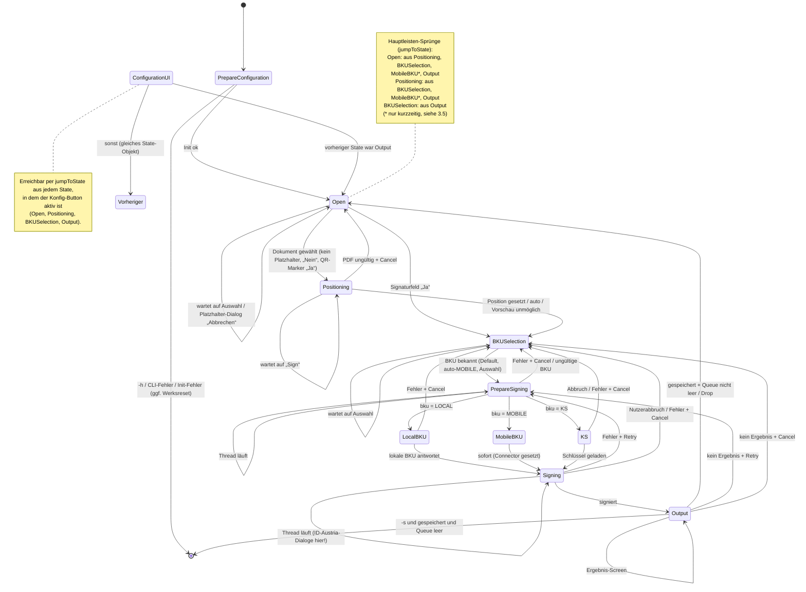

# 01 – Funktionsumfang und Ablauf der PDF-Over-GUI

> Analyse-Grundlage für einen plattformunabhängigen Klon (Desktop + iOS/Android) von PDF-Over.
> Referenzstand: PDF-Over `main`, Commit `c07c5ec` (2026-09-03), Version 4.4.10-SNAPSHOT.
> Scope dieses Dokuments: Nutzersicht der GUI – Features, Zustandsmaschine, Bildschirme, CLI, i18n, Plattform-Einordnung.
> **Nicht** im Scope (andere Dokumente): Inhalte der Einstellungs-Tabs (`composites/configuration/*`), A-Trust-Protokoll-Details (`ATrustParser`), PDF-AS-Interna.

## 0. Konventionen

**Pfad-Abkürzungen** (alle relativ zum Repo-Root von PDF-Over):

| Kürzel | steht für |
|---|---|
| `gui/` | `pdf-over-gui/src/main/java/at/asit/pdfover/gui/` |
| `res/` | `pdf-over-gui/src/main/resources/` |
| `commons/` | `pdf-over-commons/src/main/java/at/asit/pdfover/commons/` |
| `signer/` | `pdf-over-signer/src/main/java/at/asit/pdfover/signer/` |
| `pdfas:` | Repo PDF-AS 4.4.2 (`ref/pdf-as-4`) |

**Kennzeichnung der Aussagen:**

- **[V]** = im Code verifiziert (Fundstelle angegeben)
- **[I]** = Interpretation/Vermutung (aus Code abgeleitet, aber nicht ausgeführt bzw. abhängig von Framework-Verhalten)

**Kategorien für die Plattform-Einordnung** (Spalte „Kat.“):

- **K** = Kern (muss der Klon auf allen Plattformen können)
- **D** = Desktop-spezifisch (nur Windows/macOS/Linux sinnvoll)
- **M** = auf Mobile anders zu lösen (Funktion ja, aber andere UX/Technik)
- **X** = verzichtbar (Altlast, Debug, Workaround)

Es wurden keine Geheimnisse übernommen. Im Repo liegen Keystore-Dateien (`res/keystore.jks`, `pdf-over-gui/src/main/jnlp/keystore.ks`) und Zertifikate (`res/certificates/`); deren Inhalt ist hier nicht dokumentiert.

---

## 1. Architektur-Überblick der GUI (Kurzfassung)

1. **UI-Toolkit:** SWT (Eclipse) mit einem eingebetteten AWT/Swing-Panel für die PDF-Vorschau (`SWT_AWT.new_Frame`) [V] `gui/composites/PositioningComposite.java:88-101`.
2. **Ein Fenster** (`Shell`), oben eine **Hauptleiste** (Schritt-Anzeige), darunter ein **StackLayout**-Container, in dem immer genau ein „StateComposite“ sichtbar ist [V] `gui/MainWindow.java:242-321`.
3. **Workflow = Zustandsmaschine:** Jeder Schritt ist eine `State`-Klasse mit `run()`, `cleanUp()`, `updateMainWindowBehavior()` und `nextState()` [V] `gui/workflow/states/State.java:25-93`.
4. **Gemeinsamer Laufzeitzustand** liegt in `Status` (aktuelles Dokument, Warteschlange, Position, gewählte BKU, Signaturzustand …) [V] `gui/workflow/Status.java:32-52`.
5. **Konfiguration** = zwei Schichten: *persistent* (Datei `~/.pdf-over/PDF-Over.config`) und *Overlay* (CLI-Argumente, nur im RAM). Getter liefern Overlay vor Persistent [V] `gui/workflow/config/ConfigurationManager.java:52-56, 405-410, 644-646`.
6. **Event-Modell:** `run()` eines States wird bei jedem relevanten UI-Ereignis erneut aufgerufen („Re-Entry“). Ein State, der auf Eingabe wartet, setzt keinen Nachfolger und kehrt zurück; Composites rufen bei Eingabe `state.updateStateMachine()` → `Display.asyncExec(update)` [V] `gui/workflow/StateMachine.java:74-132`, `gui/workflow/states/State.java:74-77`.
7. **Lange Operationen** (PDF-AS prepare/sign, lokale BKU, A-Trust-Kommunikation) laufen in eigenen `Thread`s; nach Ende rufen sie `updateStateMachine()` [V] `gui/workflow/states/PrepareSigningState.java:192-196`, `SigningState.java:82-87`, `LocalBKUState.java:155-160`.
8. **ID-Austria-Dialoge** werden aus dem Signatur-Thread synchron in den UI-Thread gerufen (`Display.syncCall`) und laufen dort in einer **verschachtelten Event-Loop**, bis der Nutzer reagiert [V] `gui/workflow/states/MobileBKUState.java:264-273, 275-318`.

> **Empfehlung für den Klon [I]:** Das „Re-Entry-run()“-Muster ist faktisch ein Reducer über (State, Status, Ereignis). In einer Neuimplementierung sollte es als explizite, ereignisgetriebene State-Machine (z. B. XState-artig oder `enum`+`match`) modelliert werden; die verschachtelte Event-Loop der Mobile-Dialoge wird zu `async/await` auf UI-Ereignisse.

---

## 2. Feature-Inventar

Spalte „Kat.“ siehe Abschnitt 0. Spalte „Mobile“ beschreibt die vorgeschlagene Umsetzung auf iOS/Android [I].

### 2.1 Start & Initialisierung

| ID | Feature (Nutzersicht) | Details | Fundstelle | Kat. | Mobile |
|---|---|---|---|---|---|
| F-01 | Konfigurationsverzeichnis anlegen | `~/.pdf-over` wird beim Start angelegt, falls fehlend | [V] `gui/Main.java:40-44`, `commons/Constants.java:78` | K | App-Sandbox-Verzeichnis |
| F-02 | Erstinstallation der PDF-AS-Konfiguration | Fehlt Verzeichnis **oder** `PDF-Over.config`: leere `PDF-Over.config` anlegen, `cfg/PDFASConfig.zip` aus den Ressourcen nach `~/.pdf-over` entpacken (mit Zip-Slip-Schutz), `.version` mit App-Version schreiben; bei Fehler Verzeichnis löschen | [V] `gui/workflow/states/PrepareConfigurationState.java:149-168, 119-131, 133-147`; `gui/utils/Zipper.java:89-135` | K | Konfig als App-Asset mitliefern |
| F-03 | Upgrade der PDF-AS-Konfiguration | `.version` fehlt oder `< 4.4.6` (`MIN_PDF_AS_CONFIG_VERSION`): vorhandenes `cfg/` als `cfg_backup[N].zip` sichern und neu entpacken | [V] `PrepareConfigurationState.java:254-260, 210-240`; `commons/Constants.java:91-94`; Versionsvergleich `gui/utils/VersionComparator.java:26-65` (numerisch je Segment, `-SNAPSHOT` < Release) | K | bei App-Update migrieren |
| F-04 | Konfiguration laden + CLI-Overlay | Reihenfolge: `-c` auswerten → Datei laden → alle CLI-Argumente auswerten | [V] `PrepareConfigurationState.java:264-300` | K (CLI: D) | nur Datei/Settings |
| F-05 | Werksreset-Angebot bei Initialisierungsfehler | Dialog `error.Initialization` (Ja/Nein). Ja → `~/.pdf-over` nach `~/.pdf-over.old` verschieben (Fallback: löschen / beim Exit löschen); danach Programmende | [V] `PrepareConfigurationState.java:313-327`; `ConfigurationManager.java:69-106` | K | „Einstellungen zurücksetzen“ |
| F-06 | Update-Prüfung beim Start | Wenn `UPDATE_CHECK` ≠ false: Hintergrund-GET `https://updates.a-sit.at/pdf-over/Release.txt`; ist Version neuer → Dialog „New version available!“ (OK/Cancel) → öffnet `https://technology.a-sit.at/en/pdf-over/` | [V] `PrepareConfigurationState.java:303-304`; `gui/utils/UpdateCheckManager.java:50-104`; `commons/Constants.java:115-118` | D | entfällt (App Store) |
| F-07 | Fenstergröße merken, Fenster zentrieren | Default 600×780; `MAINWINDOW_SIZE` wird beim Schließen gespeichert; Zentrierung auf Primärmonitor | [V] `gui/MainWindow.java:202, 208-219, 223-235`; `commons/Constants.java:254-257` | D | entfällt |
| F-08 | Theme | `THEME=GEMPLUSH` (rosa) statt DEFAULT (blau) in Konfigdatei | [V] `commons/Constants.java:231-304` | X | – |
| F-09 | Debug-Crash-Schalter | `CRASH=startup` / `CRASH=config` in Konfigdatei löst absichtlich Fehler aus (Test der Fehlerdialoge) | [V] `ConfigurationManager.java:115-123`; `gui/composites/ConfigurationComposite.java:293-294` | X | – |

### 2.2 Dokument auswählen

| ID | Feature | Details | Fundstelle | Kat. | Mobile |
|---|---|---|---|---|---|
| F-10 | Drag & Drop-Zone | Gestrichelt umrandete, abgerundete Fläche; beim Hineinziehen farbliche Hervorhebung; akzeptiert **mehrere** Dateien | [V] `gui/composites/DataSourceSelectComposite.java:145-213, 97-115` | D | Share-Sheet / „Öffnen in“ / Android `ACTION_SEND(_MULTIPLE)` |
| F-11 | Dateiauswahl-Dialog | Button „Browse for PDF on your computer“; nativer Dialog, **Mehrfachauswahl**, Filter `*.pdf` / `*`; Startordner = zuletzt verwendeter Ordner (`LAST_SOURCE_DIRECTORY`, persistent) | [V] `DataSourceSelectComposite.java:55-68`; `gui/workflow/states/OpenState.java:123`; `ConfigurationManager.java:916-922` | K | System-Document-Picker (iOS `UIDocumentPicker`, Android `ACTION_OPEN_DOCUMENT` mit `EXTRA_ALLOW_MULTIPLE`) |
| F-12 | Nicht existierende Dateien ignorieren | Ausgewählte/abgelegte Pfade werden nur übernommen, wenn sie existieren | [V] `DataSourceSelectComposite.java:75-86` | K | – |
| F-13 | Dokument(e) per Kommandozeile / „Öffnen mit“ / „Senden an“ | siehe Abschnitt 5 | [V] `gui/cliarguments/ArgumentHandler.java:91-103` | D | Intent-Filter `application/pdf`, iOS Document Types |
| F-14 | Mehrere Dokumente = Warteschlange | Erstes Dokument → `status.document`, weitere → `status.pendingDocuments` (Batch, F-76) | [V] `OpenState.java:108-117`; `gui/cliarguments/InputDocumentArgument.java:56-60` | K | – |
| F-15 | PDF-Validierung | Beim Öffnen für Positionierung: Laden mit PDFBox; 0 Seiten oder Ladefehler → „This may not be a PDF file“, passwortgeschützt → „This PDF file is password protected…“; Dialog Retry/Cancel (Cancel → zurück zur Auswahl) | [V] `gui/workflow/states/PositioningState.java:72-92, 144-165` | K | – |
| F-16 | Hauptleiste „Öffnen“ | Im Auswahl-Screen: öffnet Dateidialog. In jedem anderen Schritt (sofern aktiv): zurück zum Auswahl-Screen, Dokument und Warteschlange werden verworfen (Ausnahme: aus dem Ergebnis-Screen wird das nächste Dokument der Warteschlange genommen) | [V] `gui/MainWindow.java:277-284`; `OpenState.java:82-97` | K | Zurück-/Neu-Button |

### 2.3 Signaturplatzhalter

| ID | Feature | Details | Fundstelle | Kat. | Mobile |
|---|---|---|---|---|---|
| F-20 | Leere Signaturfelder (AcroForm) erkennen | Nur wenn `USE_PLACEHOLDER_SEARCH` **und** `USE_FIELDS` aktiv. Gefundene leere Felder → Frage „A marker has been found … Do you want to use it?“ (Ja/Nein/Abbrechen). **Ja + 1 Feld**: Feld verwenden. **Ja + mehrere**: Auswahldialog (Combo). Gewählter Feldname wird als `signature_field_name` in `~/.pdf-over/cfg/advancedconfig.properties` geschrieben; Positionierungs-Screen wird **übersprungen** (direkt BKU-Auswahl). **Nein**: normaler Ablauf. **Abbrechen**: Dokument verworfen | [V] `OpenState.java:129-182, 239-252`; Feldsuche `pdfas:pdf-as-pdfbox-2/.../placeholder/SignatureFieldsAndPlaceHolderExtractor.java:18-29` | K | gleiche Logik, nativer Dialog/Sheet |
| F-21 | QR-Code-Platzhalter (PDF-AS-Marker) erkennen | Nur wenn `USE_PLACEHOLDER_SEARCH` **und** `USE_MARKER` (exklusiv zu Feldern). Nächster unbenutzter Marker → gleiche Ja/Nein/Abbrechen-Frage. **Ja**: Position (x, y, Seite) und `placeholderId` aus dem Marker; `searchForPlaceholderSignature=true`; Positionierungs-Screen wird übersprungen | [V] `OpenState.java:184-219`; `PrepareSigningState.java:145-146`; `signer/pdfas/PdfAs4Signer.java:99-104` | K | gleich |
| F-22 | Fehler bei der Platzhaltersuche | IO-Fehler werden still ignoriert, normaler Ablauf | [V] `OpenState.java:225-229` | K | – |
| F-23 | Feld-/Marker-Modus exklusiv | Setzen von `USE_FIELDS` deaktiviert `USE_MARKER` und umgekehrt | [V] `ConfigurationManager.java:866-882` | K | – |

### 2.4 Positionierung des Signaturblocks

| ID | Feature | Details | Fundstelle | Kat. | Mobile |
|---|---|---|---|---|---|
| F-30 | Seitenvorschau | Seite wird mit PDFBox gerendert (Auflösung: Bildschirmhöhe/Seitenhöhe), dann seitenverhältnistreu ins Panel eingepasst und zentriert | [V] `gui/composites/SignaturePanel.java:236-297, 302-323` | K | gleich (Pinch-Zoom ergänzen [I]) |
| F-31 | Live-Vorschau des Signaturblocks | Platzhalterbild wird von PDF-AS mit Beispielzertifikat (`res/example.cer`) generiert – mit konfiguriertem Profil, Logo, Notiz, Sprache, PDF/A-Flag, Logo-Größe (max. 120 mm, Workaround #117); Bild wird bei 288 dpi (72×4) erzeugt, daher Blockgröße in PDF-Punkten = Bildpixel / 4. Ohne Bild: rotes Rechteck 100×40 px | [V] `PositioningState.java:105-121`; `signer/pdfas/PdfAs4SignatureParameter.java:84-123`; `signer/pdfas/PdfAs4SignaturePlaceholder.java:14-78`; `SignaturePanel.java:174-183, 329-339` | K | gleich |
| F-32 | Startseite = letzte Seite | Beim Laden wird die letzte Seite angezeigt | [V] `PositioningComposite.java:133-138`; `SignaturePanel.java:148-157` | K | – |
| F-33 | Standardposition | Obere linke Ecke des Blocks bei x = 50 % Seitenbreite, y = 25 % Seitenhöhe (PDF-Koordinaten, Ursprung unten links, y = Oberkante) | [V] `SignaturePanel.java:290-296` | K | – |
| F-34 | Platzieren per Maus | Linke Maustaste: Block springt an Cursor (Oberkante links am Cursor; bei Klick auf den Block bleibt der Greifversatz erhalten); Ziehen verschiebt; Cursor „Hand“ über Block, „Move“ beim Ziehen | [V] `SignaturePanel.java:358-461` | K | Touch-Drag |
| F-35 | Begrenzung auf die Seite | x ∈ [0, Breite − Blockbreite], y ∈ [Blockhöhe, Seitenhöhe] | [V] `SignaturePanel.java:218-225` | K | – |
| F-36 | Seitennavigation | Vertikale Scrollbar (1 Wert = 1 Seite), Mausrad ±1 Seite (Shift ±5), Bild↑/Bild↓, Pos1/Ende; Anzeige „Page %d of %d“ | [V] `PositioningComposite.java:113, 136, 184-266, 270-295` | K | Swipe/Seitenleiste |
| F-37 | Feinjustierung per Tastatur | Pfeiltasten verschieben um 15 PDF-Punkte (`SIGNATURE_KEYBOARD_POSITIONING_OFFSET`) | [V] `PositioningComposite.java:214-239`; `commons/Constants.java:112` | D | – |
| F-38 | Neue Seite anhängen | Toggle „Create new Page“ / „Undo new Page“: zeigt leere weiße Seite in Größe der letzten Seite; Position bekommt Seitennummer `numPages+1` → PDF-AS hängt eine neue Seite an | [V] `PositioningComposite.java:103-109, 276-288`; `SignaturePanel.java:246-251, 269-277`; `pdfas:pdf-as-pdfbox-2/.../positioning/Positioning.java:106-112` | K | – |
| F-39 | Position übernehmen | Button „Sign“ (Default-Button) oder Enter → Position (x, y, Seite) wird gesetzt, weiter zur BKU-Auswahl. Button erst aktiv, wenn Dokument gerendert | [V] `PositioningComposite.java:78-80, 111, 119, 127-131, 210-212, 317-330` | K | – |
| F-40 | Gedrehte Seiten | Bei Rotation 90/270 werden Breite/Höhe vertauscht | [V] `SignaturePanel.java:262-265` | K | – |
| F-41 | Automatische Positionierung | Konfig `SIGNATURE_POSITION=auto` oder CLI `-a` → Positionierungs-Screen wird übersprungen, PDF-AS positioniert (`p:auto;x:auto;y:auto`) | [V] `PrepareConfigurationState.java:309`; `OpenState.java:93`; `PositioningState.java:167, 191-193`; `PdfAs4SignatureParameter.java:131-148` | K | – |
| F-42 | Unsichtbare Signatur | Profil `INVISIBLE` (oder CLI `-v`) → Position „auto“, Screen übersprungen (Ausnahme siehe B-03) | [V] `OpenState.java:93`; `PdfAs4SignatureParameter.java:156-164` | K | – |
| F-43 | Position bleibt bei Rücksprung | Wird „Positionierung“ erneut aufgerufen (Hauptleiste, nach Einstellungen), wird die vorherige manuelle Position wiederhergestellt; Platzhaltervorschau wird mit aktueller Konfiguration neu erzeugt | [V] `PositioningState.java:137-142, 123-129, 94-132` | K | – |
| F-44 | Fallback bei Vorschau-Fehler | Kann das Positionierungs-Composite nicht erzeugt werden („probably a mac“): Meldung `error.PositioningNotPossible`, automatische Positionierung | [V] `PositioningState.java:169-180` | X | – |

### 2.5 Auswahl der Signaturerstellungseinheit („BKU“)

| ID | Feature | Details | Fundstelle | Kat. | Mobile |
|---|---|---|---|---|---|
| F-50 | Auswahl-Screen | Zwei Bildflächen (ID-Austria-Logo, Kartenbild) mit Buttons „ID-A“ / „Card“, optional Button „Keystore“ | [V] `gui/composites/BKUSelectionComposite.java:80-127` | K | nur ID Austria (PKCS#12 entfällt seit 16.10.2026, ADR 0004 Nachtrag 11) |
| F-51 | Lokale BKU nur bei Erreichbarkeit | Hintergrund-Thread prüft alle 5 s (nicht erreichbar) bzw. 30 s (erreichbar) per TCP-Connect `127.0.0.1:3495`; „Card“-Button nur dann aktiv | [V] `gui/bku/LocalBKUConnector.java:44-59`; `BKUSelectionState.java:66, 80` | D | entfällt |
| F-52 | Keystore nur wenn aktiviert | Button nur, wenn `KEYSTORE_ENABLED` und Datei existiert | [V] `BKUSelectionState.java:53-59, 81`; `BKUSelectionComposite.java:61-72` | D/M | – (Mobile nur ID Austria, ADR 0004 Nachtrag 11; ursprünglich PKCS#12-Import) |
| F-53 | Standard-BKU überspringt Auswahl | Ist `BKU` (Konfig) bzw. `-b` gesetzt, wird beim Weg Öffnen/Positionieren → Signieren nicht gefragt | [V] `BKUSelectionState.java:68-77`; `PrepareConfigurationState.java:308`; `OpenState.java:84` | K | – |
| F-54 | Automatisch ID Austria | Ist weder lokale BKU erreichbar noch Keystore aktiv, wird ohne Rückfrage ID Austria verwendet (nur auf dem Weg von Öffnen/Positionieren) | [V] `BKUSelectionState.java:68-73` | K | Standard auf Mobile |
| F-55 | Erneute Auswahl erzwingen | Kommt man aus einem anderen Schritt (Fehler-Abbruch, Hauptleiste „Signatur“ im Ergebnis-Screen), wird die BKU zurückgesetzt und der Auswahl-Screen gezeigt | [V] `BKUSelectionState.java:74-76` | K | – |
| F-56 | Tastatur-Mnemonics | „ID-&A“, „&Card“/„&Karte“, „&Keystore“/„Key&Store“ | [V] `res/at/asit/pdfover/gui/messages.properties:93-95`, `messages_de.properties:89-91` | D | – |

### 2.6 Signieren

| ID | Feature | Details | Fundstelle | Kat. | Mobile |
|---|---|---|---|---|---|
| F-60 | Vorbereitung im Hintergrund | Warte-Screen „Signature creation in progress…“ mit Endlos-Fortschrittsbalken; PDF-AS `prepare` mit allen Parametern (Dokument, BKU, Position, Logo, Notiz, Platzhalter, Sprache, PDF/A, Profil, Logo-Größe); Fehler → `error.PrepareDocument` Retry/Cancel (Cancel → BKU-Auswahl) | [V] `gui/workflow/states/PrepareSigningState.java:127-152, 180-230`; `gui/composites/WaitingComposite.java:42-62` | K | – |
| F-61 | HTTP-Proxy | Host/Port/User/Passwort aus Konfig/CLI werden als JVM-System-Properties gesetzt; Proxy-Authentifizierung via `Authenticator` | [V] `PrepareSigningState.java:75-125`; `gui/utils/HttpClientUtils.java:7-9` | D | Systemproxy |
| F-62 | Lokale BKU (Bürgerkarte) | Vorab `NullOperationRequest` an `http://127.0.0.1:3495/http-security-layer-request`; Server-Header `trustDeskbasic`/`asignSecurityLayer` → Base64-Request-Modus; Fehler → `error.LocalBKU` (Hinweis auf lokale BKU, www.buergerkarte.at) Retry/Cancel | [V] `gui/workflow/states/LocalBKUState.java:68-69, 97-140, 149-180`; `commons/Constants.java:105` | D | entfällt |
| F-63 | ID Austria – Anmeldung | Maske Benutzername + Passwort, Checkbox „Remember“ (Tooltip: kein erneutes Abfragen bis Neustart). Passwort-Validierung 5–200 Zeichen. Benutzername wird bei „merken“ persistent gespeichert, das Passwort **nur im RAM** | [V] `gui/composites/mobilebku/MobileBKUEnterNumberComposite.java:50-82, 137-268`; `gui/bku/mobile/MobileBKUValidator.java:86-92`; `MobileBKUState.java:220-262`; `ConfigurationManager.java:456-466` | K | Passwort ggf. in Keychain/Keystore [I] |
| F-64 | ID Austria – App-Bestätigung | Screen „Please open the ID Austria app and confirm the signature.“ mit Vergleichswert; Long-Poll erkennt Abschluss automatisch; Buttons Cancel / Request SMS / FIDO2 | [V] `gui/composites/mobilebku/MobileBKUNeedsAppComposite.java:100-176`; `MobileBKUState.java:422-472`; `gui/bku/MobileBKUConnector.java:402-414` | K | App-Switch auf gleichem Gerät [I] |
| F-65 | ID Austria – QR-Code | Screen mit Vergleichswert + QR-Bild (per HTTP geladen, quadratisch skaliert); Long-Poll; Buttons Cancel / Request SMS / FIDO2 | [V] `gui/composites/mobilebku/MobileBKUQRComposite.java:101-232`; `MobileBKUState.java:356-420`; `MobileBKUConnector.java:389-401` | M | auf demselben Gerät sinnlos → App-Flow bevorzugen [I] |
| F-66 | ID Austria – SMS-TAN | Screen mit Vergleichswert + TAN-Feld; Validierung: nicht leer, nicht = Anfang des Vergleichswerts, max. 6 Zeichen; Live-Warnung ab 4 Zeichen | [V] `gui/composites/mobilebku/MobileBKUEnterTANComposite.java:50-72, 219-229`; `MobileBKUState.java:329-351` | K | SMS-Autofill (iOS `oneTimeCode`) [I] |
| F-67 | ID Austria – FIDO2/WebAuthn | Screen mit WebAuthn-/FIDO-Logo, Button „Begin authorization“ (startet automatisch beim Anzeigen); Origin `https://service.a-trust.at`; Buttons Cancel / Request SMS. Option „FIDO2 standardmäßig“ springt direkt zu FIDO2, sofern angeboten | [V] `gui/composites/mobilebku/MobileBKUFido2Composite.java:43-128`; `MobileBKUConnector.java:56, 338-341, 416-446` | M | siehe 7.3 (RP-ID-Problem) |
| F-68 | Signaturdaten anzeigen | Link „Show signature data“ (nur wenn A-Trust einen Link liefert) öffnet die URL im Standardbrowser | [V] `MobileBKUEnterTANComposite.java:90-93, 231-234`; `gui/utils/SWTUtils.java:259-279` | K | In-App-Browser |
| F-69 | A-Trust-Meldungen | Info-Seite → Info-Dialog (OK); behebbarer Fehler → „a-trust.at reports: …“ Retry/Cancel; nicht behebbar → OK, Abbruch; HTTP 407 / 413 / sonstige und Verbindungsfehler → nicht behebbare Meldung | [V] `MobileBKUConnector.java:345-366, 102-176`; `MobileBKUState.java:178-212` | K | – |
| F-70 | Keystore-Signatur | Keine eigene Maske, nur Dialoge: Datei fehlt → Retry/Cancel; Keystore-Passwort-Prompt (wenn nicht gespeichert), falsches Passwort → Meldung + erneut; Schlüssel-Passwort-Prompt; Alias fehlt → Retry/Cancel. Passwörter je nach `KEYSTORE_PASS_STORE_TYPE` auf Platte (`disk`), im RAM (`memory`) oder gar nicht (`none`) gemerkt | [V] `gui/workflow/states/KSState.java:72-190`; `ConfigurationManager.java:246-261, 347-365` | D/M | – (Mobile nur ID Austria, ADR 0004 Nachtrag 11; ursprünglich PKCS#12 mit Systemdialog) |
| F-71 | Signaturfehler | „Signature error“ (+ Socket-Meldung) bzw. „Operation aborted by signature server (%d):\n%s“ (Security-Layer-Fehlercode) → Retry (neu vorbereiten) / Cancel (BKU-Auswahl) | [V] `gui/workflow/states/SigningState.java:89-128` | K | – |
| F-72 | Abbruch durch Nutzer | Cancel in einem ID-Austria-Screen → still zurück zur BKU-Auswahl; gemerktes Passwort wird gelöscht (Benutzername bleibt) | [V] `SigningState.java:108-114`; `MobileBKUState.java:399-401, 455-457` | K | – |
| F-73 | Fenster schließen während ID-Austria-Dialog | gilt als Abbruch | [V] `MobileBKUState.java:270-271` | K | App-Hintergrund ≠ Abbruch [I] |

### 2.7 Ausgabe / Speichern

| ID | Feature | Details | Fundstelle | Kat. | Mobile |
|---|---|---|---|---|---|
| F-80 | Automatisches Speichern | Sofort nach erfolgreicher Signatur, ohne Nutzeraktion | [V] `gui/workflow/states/OutputState.java:49-75` | K | – |
| F-81 | Dateiname der signierten Datei | `<Basisname><Postfix>.<Erweiterung>`; Postfix Standard `_signed` (Konfig `SAVE_FILE_POSTFIX`) | [V] `gui/composites/OutputComposite.java:423-428, 291-300`; `commons/Constants.java:59`; `ConfigurationManager.java:142-146, 304` | K | – |
| F-82 | Ausgabeordner | Ist ein Ausgabeordner konfiguriert (Konfig `OUTPUT_FOLDER` oder `-o`) **und** existiert als Ordner → `<Ordner>/<Name>`; existiert er **nicht als Ordner**, wird der Wert **als vollständiger Dateipfad** benutzt; relativer Pfad → relativ zum Ordner der Quelldatei | [V] `OutputComposite.java:314-326, 364-366` | K | Android SAF-Ordner-URI / iOS „Sichern in Dateien“ |
| F-83 | Speichern-Dialog | Ohne Ausgabeordner (oder nach Fehlschlag): nativer Speichern-Dialog, Filter `*.pdf`/`*`, Startordner = Ordner der Quelldatei, Namensvorschlag nach F-81 | [V] `OutputComposite.java:327-341` | K | `ACTION_CREATE_DOCUMENT` / `UIDocumentPicker(export)` |
| F-84 | Überschreiben-Rückfrage | Existiert die Zieldatei: „File %s already exists, do you want to overwrite it?“ (OK/Cancel). Cancel = nicht gespeichert | [V] `OutputComposite.java:368-376` | K | – |
| F-85 | Schreibfehler | „Saving file %s failed: %s“ Retry/Cancel | [V] `OutputComposite.java:381-407` | K | – |
| F-86 | Manuelles Speichern | Bei nicht erfolgtem Speichern: Text „You can save the signed file“ + Button „Save“ (öffnet immer den Speichern-Dialog) | [V] `OutputComposite.java:161-180, 285-289, 345-349, 460-468` | K | Share/Export-Button |
| F-87 | Erfolgsmeldung + Öffnen | „Signature was successful“ und Link „You can open the signed file here.“ → öffnet die Datei mit der System-Standardanwendung; Fehler → Retry/Cancel. Sonderfall Linux + Java ≤ 8: statt Öffnen wird der Pfad angezeigt | [V] `OutputComposite.java:101-155, 434-453, 473-483` | K | QuickLook / `ACTION_VIEW` / Share |
| F-88 | Batch-Verarbeitung | Nach erfolgreichem Speichern und nicht-leerer Warteschlange: automatisch nächstes Dokument (Ergebnis-Screen wird übersprungen). Jedes Dokument durchläuft wieder Platzhalter/Positionierung/BKU (Standard-BKU überspringt Auswahl, gemerkte ID-Austria-Daten werden wiederverwendet) | [V] `OutputState.java:94-98`; `OpenState.java:82-97` | K | Mehrfachauswahl |
| F-89 | Weitere Dokumente auf Ergebnis-Screen ablegen | Drop auf den Ergebnis-Screen hängt Dateien (ohne Duplikate) an die Warteschlange; wenn zuletzt erfolgreich gespeichert → sofort weiter | [V] `OutputComposite.java:182-212`; `OutputState.java:139-151` | D | Share erneut |
| F-90 | Programmende nach Speichern (`-s`) | Nach erfolgreichem Speichern ohne weitere Dokumente beendet sich PDF-Over | [V] `OutputState.java:99-100`; `gui/cliarguments/SkipFinishArgument.java:40-45` | D | – |
| F-91 | Gleiches Dokument erneut signieren | Im Ergebnis-Screen sind „Positionierung“ und „Signatur“ in der Hauptleiste aktiv → erneutes Signieren der **Original**-Eingabedatei (mit neuer Position/BKU) | [V] `OutputState.java:126-137`; `PrepareSigningState.java:131` | K (nice-to-have) | – |
| F-92 | Mehrfachsignatur | Ein bereits signiertes PDF kann einfach wieder geöffnet und signiert werden; die GUI hat dafür **keine** Sonderlogik (Namensbildung ergibt z. B. `x_signed_signed.pdf`) | [I] (Code-Suche ohne Fund; Verhalten durch F-81) | K | – |

### 2.8 Rahmen, Navigation, Sonstiges

| ID | Feature | Details | Fundstelle | Kat. | Mobile |
|---|---|---|---|---|---|
| F-100 | Hauptleiste als Schritt-Anzeige | Konfig-Button + 4 pfeilförmige Schritte „Open“ → „Positioning“ → „Signing“ → „Finish“; Zustände *aktiv* (hinterlegt) und *klickbar* je Schritt (Tabelle 3.5). „Finish“ ist **nicht klickbar** (kein Listener) | [V] `gui/MainWindow.java:244-311, 353-381` | K | Stepper/Toolbar |
| F-101 | Einstellungen | Konfig-Button (nur wenn aktiv) → Tab-Ansicht (Simple, Advanced, Keystore [nur wenn aktiviert], FIDO2, About) mit „Save“/„Cancel“; Hauptleiste ausgeblendet; Fenstertitel zeigt Version + Java-Version; nach Save/Cancel zurück zum vorherigen Schritt (aus Ergebnis-Screen: zum Auswahl-Screen) | [V] `gui/composites/ConfigurationComposite.java:158-250`; `gui/workflow/states/ConfigurationUIState.java:62-119` | K | Settings-Screen |
| F-102 | Validierung beim Speichern der Einstellungen | Je Tab `validateSettings`; Fehler → Dialog Abort/Retry/Ignore (Ignore überspringt bis zum nächsten Prüfpunkt); Schreibfehler → Retry/Cancel | [V] `ConfigurationComposite.java:306-356` | K | – |
| F-103 | Sprache zur Laufzeit | Nach Rückkehr aus den Einstellungen werden alle Texte neu geladen | [V] `ConfigurationUIState.java:88-96, 124-126`; `MainWindow.java:173-195` | K | Systemsprache |
| F-104 | macOS-Anwendungsmenü | „About PDF-Over“ (Dialog mit Version), „Preferences…“ (nur wenn Konfig-Button aktiv), „Hide“, „Quit“ | [V] `MainWindow.java:203-207, 327-348`; `gui/osx/CocoaUIEnhancer.java:150-252` | D | – |
| F-105 | Konfiguration beim Schließen speichern | Fenstergröße und alle persistenten Werte (u. a. letzter Ordner, gemerkter Benutzername) werden beim Schließen des Fensters geschrieben | [V] `MainWindow.java:223-235`; `ConfigurationManager.java:280-385` | K | bei Änderung speichern |
| F-106 | Unerwartete Fehler | Exception in einem State → „Unexpected Error“ → Programmende; Fehler außerhalb → Swing-Dialog „Error occured …“ | [V] `gui/workflow/StateMachine.java:79-88`; `gui/Main.java:69-79` | K | – |
| F-107 | Lokalisierung DE/EN | Siehe Abschnitt 6 | | K | – |
| F-108 | Kommandozeilen-Hilfe | `-h` / `-?` / `--help` | siehe 5 | D | – |
| F-109 | Logging | logback, Logdatei vermutlich in `~/.pdf-over` [I] | `res/logback.xml` | X | OS-Logging |

---

## 3. Zustandsmaschine

### 3.1 Mechanik (für die Neuimplementierung wesentlich)

- **Start:** `StateMachine(args)` setzt `PrepareConfigurationState` als aktuellen State; `start()` ruft `update()` und danach die SWT-Event-Loop bis das Fenster geschlossen wird [V] `gui/workflow/StateMachine.java:51-56, 239-262`.
- **`update()`-Schleife** [V] `StateMachine.java:74-121`:
  1. `current.run()` – Exception → Dialog `error.Unexpected` → `exit()`.
  2. Wenn Fenster existiert: `current.updateMainWindowBehavior()` → `mainWindow.applyBehavior()` → Layout.
  3. `next = current.nextState()`; `next == current` → Schleife verlassen (State wartet auf Ereignis); `next == null` → Programmende; sonst `status.setCurrentState(next)` und weiter mit 1.
- **Nachfolger:** Jeder neue State hat initial `nextState = this` (wartet), `setNextState(x)` setzt den Übergang [V] `State.java:38-59`.
- **Externe Sprünge:** Hauptleisten-Buttons rufen `jumpToState(new XState)` → setzt State und `invokeUpdate()` (asynchron) [V] `StateMachine.java:66-69, 126-132`.
- **Verzögertes Aufräumen:** `Status.setCurrentState(new)` ruft `cleanUp()` auf dem **vorletzten** State (wenn dieser weder der aktuelle noch der neue ist). Dadurch lebt das Composite des direkt vorherigen States noch – das erlaubt `ConfigurationUIState`, zum **selben Objekt** des vorherigen States zurückzukehren [V] `gui/workflow/Status.java:62-74`; `ConfigurationUIState.java:91-95`.
- **Composites werden lazy erzeugt** (erstes `display()` erzeugt auch das Hauptfenster) [V] `StateMachine.java:149-191`.
- **Programmende:** `exit()` setzt Flag und `dispose()`t die Shell [V] `StateMachine.java:220-225`.

### 3.2 Laufzeitzustand `Status`

| Feld | Bedeutung | gesetzt in | zurückgesetzt in |
|---|---|---|---|
| `document: File` | aktuelles Eingabe-PDF | `InputDocumentArgument`, `OpenState` | `OpenState` (außer nach Output → nächstes aus Queue) |
| `pendingDocuments: Queue<File>` | Batch-Warteschlange | CLI, Auswahl, Drop auf Ergebnis | `OpenState` (außer nach Output) |
| `signaturePosition` | `null` = Nutzer muss positionieren; `SignaturePosition()` = auto; `(x,y,page)` = manuell | `PrepareConfigurationState`, `OpenState`, `PositioningState` | `OpenState`, `PositioningState` |
| `bku: BKUs` | `LOCAL` / `MOBILE` / `KS` / `NONE` | Konfig/CLI-Default, `BKUSelectionState` | `OpenState` (→ Default), `BKUSelectionState` (→ NONE) |
| `signingState` | PDF-AS-Vorbereitungsergebnis (+ Connector, SL-Antwort) | `PrepareSigningState` | – |
| `signResult` | signiertes Dokument | `SigningState` | `OutputState.cleanUp` |
| `searchForPlaceholderSignature`, `placeholderId` | Platzhalter-Modus | `OpenState` | **nie** explizit (siehe B-04) |
| `behavior` | Hauptleisten-Zustand | jeder State | – |

Quelle [V] `gui/workflow/Status.java:34-52`; Zuweisungen in den jeweiligen States (Abschnitt 3.3).

### 3.3 Zustandsdiagramm



### 3.4 Übergangstabelle

| Von | Bedingung / Ereignis | Nach | Fundstelle [V] |
|---|---|---|---|
| PrepareConfiguration | Init ok | Open | `PrepareConfigurationState.java:311` |
| PrepareConfiguration | `-h`, CLI-Fehler (`error.CmdLineArgs`/`error.FileNotExist`) | Ende | `PrepareConfigurationState.java:100-106, 264-300`; `HelpArgument.java:90` |
| PrepareConfiguration | sonstige Exception → `error.Initialization` (Ja = Werksreset) | Ende | `PrepareConfigurationState.java:313-327` |
| Open | keine Auswahl | (wartet) | `OpenState.java:118-121` |
| Open | Signaturfeld gefunden, „Ja“ (1 Feld oder Feld im Auswahldialog gewählt) | BKUSelection | `OpenState.java:152-169` |
| Open | Feldauswahldialog abgebrochen | erneut Ja/Nein/Abbrechen-Frage | `OpenState.java:165-171` |
| Open | Platzhalter-Frage „Abbrechen“ | (wartet, Dokument verworfen) | `OpenState.java:176-179, 214-217` |
| Open | sonst | Positioning | `OpenState.java:232` |
| Positioning | PDF nicht ladbar → Retry | Positioning (erneut) | `PositioningState.java:155-159` |
| Positioning | PDF nicht ladbar → Cancel | Open | `PositioningState.java:160-162` |
| Positioning | Composite-Fehler | BKUSelection (auto) | `PositioningState.java:171-179` |
| Positioning | `signaturePosition` gesetzt (auto/Platzhalter) | BKUSelection | `PositioningState.java:191-193` |
| Positioning | Nutzer bestätigt Position | BKUSelection | `PositioningState.java:184-188` |
| BKUSelection | `bku ≠ NONE` | PrepareSigning | `BKUSelectionState.java:78-92` |
| PrepareSigning | Fehler → Retry / Cancel | PrepareSigning / BKUSelection | `PrepareSigningState.java:198-210` |
| PrepareSigning | LOCAL / MOBILE / KS / sonst | LocalBKU / MobileBKU / KS / BKUSelection | `PrepareSigningState.java:215-229` |
| LocalBKU | Antwort ok | Signing | `LocalBKUState.java:179` |
| LocalBKU | Fehler → Retry / Cancel | LocalBKU / BKUSelection | `LocalBKUState.java:163-176` |
| MobileBKU | immer | Signing | `MobileBKUState.java:519-535` |
| KS | Erfolg / Abbruch / Fehler | Signing / BKUSelection / KS (Retry) | `KSState.java:72-190` |
| Signing | Erfolg | Output | `SigningState.java:130` |
| Signing | `UserCancelledException` (inkl. `IllegalStateException`-Ursache) | BKUSelection | `SigningState.java:103-114` |
| Signing | Fehler → Retry / Cancel | PrepareSigning / BKUSelection | `SigningState.java:119-127` |
| Output | `signResult == null` → Retry / Cancel | PrepareSigning / BKUSelection | `OutputState.java:81-90` |
| Output | gespeichert und Queue nicht leer | Open | `OutputState.java:94-98` |
| Output | gespeichert, `-s` | Ende | `OutputState.java:99-100` |
| Output | Dateien abgelegt und gespeichert | Open | `OutputState.java:139-151` |
| ConfigurationUI | Save/Cancel, vorher Output | Open | `ConfigurationUIState.java:92-93` |
| ConfigurationUI | Save/Cancel, sonst | vorheriger State (Objekt) | `ConfigurationUIState.java:94-95` |
| ConfigurationUI | Init-Fehler → `error.ConfigInitialization` Ja / Nein | Werksreset + Ende / Unexpected Error + Ende | `ConfigurationUIState.java:69-86` |

### 3.5 Hauptleisten-Verhalten je State

„A“ = aktiv (hinterlegt, Schritt erreicht), „E“ = klickbar. Leere Zelle = weder noch. `reset()` setzt alles auf false und die Leiste sichtbar [V] `gui/MainWindowBehavior.java:93-99`.

| State | Config | Open | Positioning | Signing | Finish | Leiste | Fundstelle [V] |
|---|---|---|---|---|---|---|---|
| PrepareConfiguration | | | | | | (kein Update) | `PrepareConfigurationState.java:345-348` |
| Open | E | A E | | | | sichtbar | `OpenState.java:275-281` |
| Positioning | E | A E | A | | | sichtbar | `PositioningState.java:210-217` |
| BKUSelection | E | A E | A E | A | | sichtbar | `BKUSelectionState.java:108-117` |
| PrepareSigning | | A | A | A | | sichtbar | `PrepareSigningState.java:247-253` |
| LocalBKU / KS / Signing | | A | A | A | | sichtbar | `LocalBKUState.java:198-204`, `KSState.java:207-214`, `SigningState.java:145-154` |
| MobileBKU | | A E | A E | A | | sichtbar | `MobileBKUState.java:557-567` |
| Output | E | A E | A E | A E | A | sichtbar | `OutputState.java:126-137` |
| ConfigurationUI | (aus) | unverändert | unverändert | unverändert | unverändert | **ausgeblendet** | `ConfigurationUIState.java:114-119` |

**Wichtig [V]:** `MobileBKUState` setzt sofort `SigningState` als Nachfolger; da `update()` die Schleife fortsetzt, gilt während **aller** ID-Austria-Dialoge das Verhalten von `SigningState` (nichts klickbar). Abbruch ist nur über die „Cancel“-Buttons der Dialoge möglich (`StateMachine.java:96-118`, `MobileBKUState.java:534`).

Klicklogik der Buttons [V] `gui/MainWindow.java:253-311`:

| Button | Aktion |
|---|---|
| Config | `jumpToState(new ConfigurationUIState)` (SWT liefert deaktivierten Canvas-Buttons keine Mausereignisse [I]) |
| Open | wenn nicht E → nichts; wenn aktueller State `OpenState` → Dateidialog; sonst `jumpToState(new OpenState)` |
| Positioning | wenn E → `jumpToState(new PositioningState)` |
| Signing | wenn E → `jumpToState(new BKUSelectionState)` |
| Finish | **keine Aktion** (reine Statusanzeige) |

---

## 4. Bildschirme und Dialoge

Alle Texte als i18n-Key (EN-Text in Klammern zur Orientierung). Layout-Angaben stammen aus SWT-`FormAttachment(prozent, offset)`.

### 4.0 Hauptfenster

```
+---------------------------------------------------------------------+
| [⚙] [  Open  >][> Positioning >][>  Signing  >][>  Finish  ]        |  Hauptleiste, Höhe 60 px (inkl. 10 px Rand oben)
+---------------------------------------------------------------------+
|                                                                     |
|                 Container (StackLayout, 10 px Rand)                 |
|                 genau ein Screen aus 4.1 – 4.9                      |
|                                                                     |
+---------------------------------------------------------------------+
```

- Titel `PDF-Over`, Icon `res/icons/icon.png`, Default-Größe 600×780 [V] `MainWindow.java:200-240`; `commons/Constants.java:254-260`.
- Config-Button: 50 px breit, Bild `img/config.png` bzw. `img/config_disabled.png` [V] `MainWindow.java:253-267`.
- Schritt-Buttons: Open 0–27 %, Positioning 27–54 %, Signing 54–81 %, Finish 81–100 % der Restbreite; Pfeilform mit 10 px Spitze (`SplitFactor`); Texte `common.open`, `main.position`, `main.signature`, `main.done`; Tooltip = Text [V] `MainWindow.java:269-311`; `gui/controls/MainBarButton.java:50`; `MainBarStartButton.java:99-134`, `MainBarMiddleButton.java:39-83`, `MainBarEndButton.java:43-78`.
- Farben (Theme DEFAULT): aktiv Verlauf `#6BA5D9`→`#B4CDEC`, inaktiv `#D4E7F1`, Text aktiv+klickbar schwarz, sonst `#404040`; Schriftgröße 12 [V] `commons/Constants.java:263-316`; `MainBarButton.java:197-205, 300-331`.

### 4.1 Dokumentauswahl – `DataSourceSelectComposite`

```
+---------------------------------------------------------------+
|  ╭ ─ ─ ─ ─ ─ ─ ─ ─ ─ ─ ─ ─ ─ ─ ─ ─ ─ ─ ─ ─ ─ ─ ─ ─ ─ ─ ─ ╮  |  30 px Rand, gestrichelt 3 px,
|  ┆                                                         ┆  |  Radius 10, Farbe #B4CDEC
|  ┆              Drag document here       (14 pt)           ┆  |
|  ┆                    or...              (12 pt)           ┆  |
|  ┆        [ Browse for PDF on your computer ]              ┆  |
|  ┆                                                         ┆  |
|  ╰ ─ ─ ─ ─ ─ ─ ─ ─ ─ ─ ─ ─ ─ ─ ─ ─ ─ ─ ─ ─ ─ ─ ─ ─ ─ ─ ─ ╯  |
+---------------------------------------------------------------+
```

| Element | Typ | i18n-Key | Verhalten |
|---|---|---|---|
| Drop-Fläche | Composite mit Paint | – | Drag-Enter mit Dateien: Hintergrund `#B4CDEC`, Rand `#6BA5D9`; Drag-Leave: zurück; Drop: alle Pfade übernehmen [V] `DataSourceSelectComposite.java:170-213, 97-115` |
| Überschrift | Label 14 pt | `dataSourceSelection.DropLabel` (Drag document here) | – |
| Unterzeile | Label 12 pt | `dataSourceSelection.DropLabel2` (or...) | – |
| Durchsuchen | Button | `dataSourceSelection.browse` (&Browse for PDF on your computer) | Dateidialog F-11 |

Validierung: nur Existenz der Dateien; PDF-Prüfung erst in der Positionierung (F-15). Nach Auswahl `state.updateStateMachine()` [V] `DataSourceSelectComposite.java:85`.

### 4.2 Platzhalter-Dialoge

1. **Frage** (native MessageBox, Icon Frage, Buttons Ja/Nein/Abbrechen): Titel `dataSourceSelection.usePlaceholderTitle` (Info), Text `dataSourceSelection.usePlaceholderText` [V] `OpenState.java:145-151, 191-197`.
2. **Feldauswahl** `PlaceholderSelectionGui` (modal, feste Größe 290×195, absolute Positionierung) [V] `gui/PlaceholderSelectionGui.java:95-132`:
   - Label `positioning.placeholder` (Please select a signature placeholder from the list below:)
   - Combo mit Feldnamen (erster vorausgewählt; Combo ist **editierbar** – freie Eingabe ergibt Index −1 = Abbruch [I])
   - Buttons „Ok“ / „Cancel“ – **hartkodiert englisch**, Fenstertitel hartkodiert „Info“ [V] `PlaceholderSelectionGui.java:98, 115, 126`.
   - Rückgabe: Index oder −1.

### 4.3 Positionierung – `PositioningComposite` + `SignaturePanel`

```
+---------------------------------------------------------------+
| +-----------------------------------------------------------+^|
| |                                                           | |
| |            gerenderte PDF-Seite (zentriert, fit)          |█|  vertikale Scrollbar = Seitenwahl
| |                                                           | |
| |        +--------------------+                             | |
| |        |  Signaturblock-    |  (Vorschaubild, Rahmen      | |
| |        |  Vorschau          |   #6BA5D9)                  | |
| |        +--------------------+                             | |
| +-----------------------------------------------------------+v|
|        Page 3 of 3          [ Create new Page ] [  Sign  ]    |  Bottom-Bar
+---------------------------------------------------------------+
```

| Element | Typ | i18n-Key | Verhalten |
|---|---|---|---|
| Vorschau | AWT-Panel in SWT (`SWT.EMBEDDED`) | `common.working` (Working..., solange kein Bild) | F-30…F-35, F-40 [V] `PositioningComposite.java:88-101`; `SignaturePanel.java:302-341` |
| Scrollbar | vertikal | – | Werte: Auswahl=Seite, min 1, max `numPages+1` (bzw. `+2` bei neuer Seite) [V] `PositioningComposite.java:136, 281, 287, 113` |
| Seitenanzeige | Label | `positioning.page` (Page %d of %d) | [V] `PositioningComposite.java:290` |
| Neue Seite | Toggle-Button | `positioning.newPage` / `positioning.removeNewPage` | F-38 |
| Signieren | Push-Button, Default-Button | `positioning.sign` (&Sign) | F-39 |

**Tastatur/Maus** [V] `PositioningComposite.java:184-266`: PgDn/PgUp (±1, begrenzt), End/Home, Enter = Position übernehmen, Pfeile ±15 pt (↑ = y größer = nach oben), Mausrad ±1 (Shift ±5); Linux-Workaround gegen doppelte Wheel-Events.

**Koordinatensysteme** (für exakte Reimplementierung) [V] `SignaturePanel.java:63-99`:
- `PAGE_ABS`: PDF-Punkte, Ursprung unten links (Format für PDF-AS `x:…;y:…`, y = **Oberkante** des Blocks).
- `PAGE_REL`: PDF-Punkte, Ursprung oben links.
- `IMAGE`: Pixel des gerenderten Seitenbilds (`pageToImageScale = Bildschirmhöhe / Seitenhöhe`).
- `SCREEN_REL`/`SCREEN_ABS`: Panel-Pixel (`imageToScreenScale` = min(Panel/Bild) je Achse; Offset für Zentrierung).
- Ergebnis: `SignaturePosition(x, y, page)` mit `page = numPages+1` für „neue Seite“; PDF-AS-String `p:<n>;x:<x>;y:<y>` (`p:new` nur bei `page < 1`) bzw. `p:auto;x:auto;y:auto` [V] `PdfAs4SignatureParameter.java:131-148`.

### 4.4 BKU-Auswahl – `BKUSelectionComposite`

```
+---------------------------------------------------------------+
|                                                               |
|          +-----------+        +-----------+                   |   Bilder (ClickableCanvas,
|          | ID Austria|        |   Karte   |                   |   Hand-Cursor), oben bei ~40 %
|          |   Logo    |        |   Bild    |                   |
|          +-----------+        +-----------+                   |
|          [   ID-A    ]        [   Card    ]                   |
|                               [ Keystore  ]   (optional)      |
+---------------------------------------------------------------+
```

| Element | i18n-Key | Verhalten |
|---|---|---|
| ID-Austria-Bild (`img/id_austria.png`) | – | Mausklick → MOBILE [V] `BKUSelectionComposite.java:85-90` |
| Kartenbild (`img/karte.png`) | – | Mausklick → LOCAL; **wird aber immer deaktiviert** (siehe B-01) [V] `BKUSelectionComposite.java:52-55, 92-97` |
| Button ID-A | `bku_selection.mobile` (ID-&A) | → MOBILE |
| Button Card | `bku_selection.card` (&Card) | → LOCAL; aktiv nur bei erreichbarer lokaler BKU |
| Button Keystore | `bku_selection.ks` (&Keystore) | → KS; nur sichtbar wenn Keystore aktiviert & Datei existiert |

### 4.5 Warten – `WaitingComposite`

Zentriertes Label `waiting.message` (Signature creation in progress...) über einem 200 px breiten Endlos-Fortschrittsbalken [V] `gui/composites/WaitingComposite.java:42-62`. Sichtbar in PrepareSigning, während lokaler BKU/Keystore/Signing (bleibt als Top-Control stehen) und zwischen den ID-Austria-Dialogen.

### 4.6 ID-Austria-Screens

Alle Screens: zentrierter Kasten 400×240 (QR/App: 400×280, FIDO2: 400×265) mit 3 px Rahmen `#6BA5D9`, Radius 10; links ID-Austria-Logo 90×90 [V] z. B. `MobileBKUEnterNumberComposite.java:141-170`.

**Dispatcher (Reihenfolge der Auswertung jeder A-Trust-Antwort)** [V] `gui/bku/MobileBKUConnector.java:332-447`:

1. Weder Fehler- noch Login-Block → Login war erfolgreich → Credentials ggf. merken.
2. „FIDO2 standardmäßig“ aktiv und FIDO2-Link vorhanden (einmalig) → FIDO2.
3. Auto-Skip-Block → Formular automatisch absenden.
4. Interstitial → Info-Dialog (OK) → weiter.
5. Fehlerblock → Passwort vergessen; behebbar: Retry/Cancel, sonst OK → Abbruch.
6. Login-Block → 4.6.1 (nur falls Benutzer **oder** Passwort fehlt).
7. SMS-TAN-Block → 4.6.2.
8. QR-Block → 4.6.3 (+ Long-Poll).
9. App-2FA-Block → 4.6.4 (+ Long-Poll).
10. FIDO2-Block → 4.6.5.

Endlosschleifen-Schutz: max. 50 Redirects in Folge [V] `MobileBKUConnector.java:103-172`.

#### 4.6.1 Anmeldung – `MobileBKUEnterNumberComposite`

```
+------------------------------------------------+
|                               [x] Remember     |
| [ID-A]                                         |
| [Logo]      Username: [_____________________]  |
|             Password: [*********************]  |
|                                                |
| This service is provided by A-Trust  [Cancel] [OK] |
+------------------------------------------------+
```

| Element | i18n-Key | Verhalten / Validierung |
|---|---|---|
| Benutzername | `mobileBKU.number` (Username:) | Vorbelegung mit gemerktem/CLI-Wert; Fokus → alles markieren [V] `MobileBKUEnterNumberComposite.java:156-163`; `MobileBKUState.java:286-289` |
| Passwort | `mobileBKU.password` (Password:) | Passwortfeld; Länge 5–200, sonst `exception.PasswordTooShort/Long` in der Meldungszeile + Fokus [V] `MobileBKUEnterNumberComposite.java:57-74`; `MobileBKUValidator.java:86-92` |
| Merken | `mobileBKU.rememberPassword` (Re&member), Tooltip `mobileBKU.rememberPasswordNote` | Zustand aus `MOBILE_REMEMBER_PASSWORD`; Deaktivieren löscht gemerkten Benutzer + Passwort; „Cancel“ kann Merken nicht aktivieren [V] `MobileBKUState.java:251-262, 299` |
| Meldungszeile | – | Default `mobileBKU.aTrustDisclaimer`, sonst A-Trust-Fehlertext [V] `MobileBKUState.java:281-284` |
| OK (Default-Button) | `common.Ok` | deaktiviert sich nach Klick (Doppelklickschutz) [V] `MobileBKUEnterNumberComposite.java:53-69, 196-197` |
| Cancel | `common.Cancel` | → Abbruch → A-Trust „Button_Cancel“ [V] `MobileBKUConnector.java:374-376` |

Fokus beim Anzeigen: Benutzername leer → Benutzername, sonst Passwort [V] `MobileBKUEnterNumberComposite.java:196-203`.
Hinweis: Benutzername wird in der UI **nicht** normalisiert, nur beim Speichern in der Konfiguration und bei `-n` (`+43…`-Normalisierung, sonst unverändert = ID-Austria-Benutzername) [V] `MobileBKUValidator.java:37-78`; `ConfigurationDataInMemory.java:74-80`.

#### 4.6.2 SMS-TAN – `MobileBKUEnterTANComposite`

| Element | i18n-Key | Verhalten |
|---|---|---|
| Link | `mobileBKU.show` (<a>Show signature data</a>), Tooltip `mobileBKU.show_tooltip` | nur sichtbar, wenn URI vorhanden; öffnet Browser |
| Vergleichswert | `tanEnter.ReferenceValue` (Reference value:) + Wert | – |
| TAN-Feld | `tanEnter.TAN` (TAN:) | Enter = bestätigen; Live-Warnung `error.EnteredReferenceValue` ab > 3 Zeichen, wenn Vergleichswert damit beginnt |
| Meldungszeile | `error.Title`: + Fehler | – |
| OK (Default) / Cancel / FIDO2 (`tanEnter.FIDO2`) | | FIDO2 nur sichtbar wenn WebAuthn verfügbar, aktiv wenn angeboten |

Validierung [V] `MobileBKUEnterTANComposite.java:50-72`: trim; leer → `error.NoTan`; Vergleichswert beginnt mit TAN → `error.EnteredReferenceValue`; Länge > 6 → `error.TanTooLong`.

#### 4.6.3 QR-Code – `MobileBKUQRComposite`

Vergleichswert, Label `tanEnter.QR` (QR code:), QR-Bild (per HTTP-GET geladen; Fehler → `error.FailedToLoadQRCode`), Link „Signaturdaten“, Buttons Cancel / `tanEnter.SMS` (Request &SMS, aktiv wenn angeboten) / FIDO2 (sichtbar wenn verfügbar). Fertig bei: Klick oder Long-Poll-Signal „gescannt“ (→ Seite neu laden) [V] `MobileBKUQRComposite.java:76-81, 101-130, 152-215`; `MobileBKUState.java:356-420`.

#### 4.6.4 App-Bestätigung – `MobileBKUNeedsAppComposite`

Vergleichswert, Text `tanEnter.FP` (Please open the ID Austria app\nand confirm the signature.), Link, Buttons Cancel / SMS / FIDO2; Fehlerzeile wird nie befüllt (TODO) [V] `MobileBKUNeedsAppComposite.java:100-176`; `MobileBKUState.java:429`.

#### 4.6.5 FIDO2 – `MobileBKUFido2Composite`

WebAuthn-Logo oben (187×50), FIDO-Logo unten links (81×50), großer Button `mobileBKU.authorize` (Begin authorization) bzw. `common.unavailable`; Start automatisch beim Anzeigen; während des Vorgangs Text `common.working` und deaktiviert; Fehler (außer Nutzerabbruch) → Button wieder aktiv; Buttons Cancel / SMS; Link [V] `MobileBKUFido2Composite.java:54-128`.

### 4.7 Keystore-Dialoge

`PasswordInputDialog` (modal, zentriert über Hauptfenster; Label, Passwortfeld, OK/Cancel; OK = Default) [V] `gui/controls/InputDialog.java:93-153`; `PasswordInputDialog.java:32-35`.

| Schritt | Titel / Text | Folge |
|---|---|---|
| Keystore-Datei fehlt | `error.KeyStoreFileNotExist` (Retry/Cancel) | Retry erneut, Cancel → BKU-Auswahl |
| Keystore-Passwort | Titel `keystore_config.KeystoreStorePass`, Prompt `keystore.KeystoreStorePassEntry` | Cancel → BKU-Auswahl; falsch → `error.KeyStoreStorePass` (OK) und erneut |
| Schlüssel-Passwort | Titel `keystore_config.KeystoreKeyPass`, Prompt `keystore.KeystoreKeyPassEntry` | wie oben mit `error.KeyStoreKeyPass` |
| Alias fehlt | `error.KeyStoreAliasExist` (Retry/Cancel) | Retry erneut |
| sonstiger Ladefehler | `error.KeyStore` (Retry/Cancel) | Retry = alles von vorne |

Quelle [V] `KSState.java:79-186`.

### 4.8 Ergebnis – `OutputComposite`

```
+---------------------------------------------------------------+
|                                                               |
|                 Signature was successful        (14 pt, ~40 %)|
|          You can open the signed file here.     (Link, 12 pt) |
|                       [  Save  ]                (nur bei Fehl-|
|                                                  schlag)      |
+---------------------------------------------------------------+
```

| Element | i18n-Key | Verhalten |
|---|---|---|
| Erfolgstext | `output.success_message` | immer |
| Link/Text | `output.link_open_message` (gespeichert) bzw. `output.link_save_message` (nicht gespeichert) | Link öffnet Datei (F-87) |
| Speichern | `common.Save` | nur sichtbar, wenn Speichern fehlgeschlagen/abgebrochen (F-86) |
| ganze Fläche | Drop-Ziel | F-89 |

Ablauf `saveDocument()` [V] `OutputComposite.java:308-351`: Name bilden → Ausgabeordner prüfen (F-82) bzw. Dialog (F-83) → `saveResultAsFile` mit Überschreiben-Frage (F-84) und Retry (F-85) → Erfolg/Fehlschlag → Button/Texte aktualisieren.
Hinweis: `~/.pdf-over/tmp` wird angelegt und übergeben, aber nicht benutzt [V] `OutputState.java:57-65`; `OutputComposite.java:78, 254-256`.

### 4.9 Einstellungen – `ConfigurationComposite` (nur Rahmen)

TabFolder (Schrift 12 pt) mit Tabs `config.Simple`, `config.Advanced`, `config.Keystore` (dynamisch an Index 2, wenn Keystore aktiviert), `config.FIDO2`, `config.About` (mit App-Namen); jeder Tab in einem ScrolledComposite; unten rechts `common.Save`, daneben `common.Cancel`. Titel während der Anzeige: `PDF-Over v<Version> [<Java-Vendor> Java <Version>]` [V] `ConfigurationComposite.java:158-250, 258-285, 388-398`. Inhalte der Tabs: separates Dokument.

### 4.10 Dialog-Katalog

Fehlerdialoge (`ErrorDialog`) haben immer Titel `error.Title` (Error) und Fehler-Icon [V] `gui/controls/ErrorDialog.java:32-35`. Button-Sets: OK, OK_CANCEL, RETRY_CANCEL, ABORT_RETRY_IGNORE, YES_NO [V] `gui/controls/Dialog.java:33-113`.

| Key(s) | Buttons | Auslöser | Folge | Fundstelle [V] |
|---|---|---|---|---|
| `error.Unexpected` | OK | Exception in `State.run()` | Ende | `StateMachine.java:79-88` |
| `error.CmdLineArgs` + Detail | OK | ungültiges CLI-Argument | Ende | `PrepareConfigurationState.java:266-273, 292-299` |
| `error.FileNotExist` | OK | `-i`/`-e`-Datei fehlt | Ende | `PrepareConfigurationState.java:286-291` |
| `error.Initialization` | Ja/Nein | Init-Fehler | Ja = Werksreset; Ende | `PrepareConfigurationState.java:313-327` |
| `error.ConfigInitialization` | Ja/Nein | Einstellungs-Screen-Fehler | Ja = Reset + Ende; Nein = Unexpected + Ende | `ConfigurationUIState.java:69-86` |
| `version_check.UpdateTitle`/`UpdateText` | OK/Cancel (Info) | neuere Version | OK öffnet Download-Seite | `UpdateCheckManager.java:57-66` |
| `dataSourceSelection.usePlaceholder*` | Ja/Nein/Abbrechen | Platzhalter gefunden | 4.2 | `OpenState.java:145-151` |
| `error.PDFPwdProtected` / `error.MayNotBeAPDF` / `error.IOError` | Retry/Cancel | PDF nicht ladbar | Retry erneut / Cancel → Auswahl | `PositioningState.java:84-89, 150-163` |
| `error.PositioningNotPossible` | OK | Vorschau-Fehler | Auto-Position | `PositioningState.java:171-179` |
| `error.PrepareDocument` | Retry/Cancel | PDF-AS prepare | – | `PrepareSigningState.java:198-210` |
| `error.LocalBKU` | Retry/Cancel | lokale BKU nicht erreichbar | – | `LocalBKUState.java:163-176` |
| Keystore-Dialoge | siehe 4.7 | | | `KSState.java` |
| `common.info` + A-Trust-Text | OK (Info) | Interstitial | weiter | `MobileBKUState.java:178-186` |
| `atrusterror.message` | Retry/Cancel bzw. OK | A-Trust-Fehler | Retry zurück / Abbruch | `MobileBKUState.java:192-212` |
| `error.ProxyAuthRequired`, `atrusterror.http_413`, `atrusterror.http_generic`, `error.FailedToConnect` (eingebettet in `atrusterror.message`) | OK | HTTP-/Netzwerkfehler A-Trust | Abbruch | `MobileBKUConnector.java:80-83, 124-129, 169` |
| `error.Signatur` (+ Socket-Text) / `error.SLError` | Retry/Cancel | Signaturfehler | Retry → Prepare / Cancel → BKU | `SigningState.java:89-128` |
| `error.Signatur` | Retry/Cancel | kein Ergebnis im Output | dito | `OutputState.java:81-90` |
| `common.warning` + `output.file_ask_overwrite` | OK/Cancel (Frage) | Datei existiert | Cancel = nicht gespeichert | `OutputComposite.java:368-376` |
| `output.save_failed` | Retry/Cancel | Schreibfehler | – | `OutputComposite.java:388-406` |
| `error.FailedToOpenDocument` | Retry/Cancel | Öffnen fehlgeschlagen | – | `OutputComposite.java:146-153` |
| Validierungsfehler Einstellungen | Abort/Retry/Ignore | Speichern Einstellungen | – | `ConfigurationComposite.java:309-325` |
| `error.FailedToSaveSettings` | Retry/Cancel | Konfig-Datei nicht schreibbar | – | `ConfigurationComposite.java:342-355` |
| `main.about` | OK (Info) | macOS-Menü | – | `MainWindow.java:336-341` |
| Hilfe-Text | OK (Info) | `-h` | Ende | `HelpArgument.java:79-90` |

---

## 5. Kommandozeile

### 5.1 Parsing-Algorithmus [V]

1. **Pass 1** nur mit `-c` registriert: unbekannte Tokens werden übersprungen [V] `PrepareConfigurationState.java:88-89, 264-274`; `ArgumentHandler.java:91-103`.
2. Konfigurationsdatei laden [V] `PrepareConfigurationState.java:277`.
3. **Pass 2** mit allen Argumenten (Reihenfolge der Registrierung bestimmt die Hilfe-Ausgabe) [V] `PrepareConfigurationState.java:65-86, 280-300`.
4. Token ist eine bekannte Option → Handler konsumiert ggf. den Folgewert. **Unbekannter Token → wird wie `-i <token>` behandelt** (dadurch funktionieren `PDF-Over.exe "%1"`, „Senden an“ und mehrere Dateien) [V] `ArgumentHandler.java:93-101`.
5. Fehlt der Wert einer wertpflichtigen Option → `InitializationException` → Fehlerdialog + Ende. Werte werden nicht auf führendes `-` geprüft [V] z. B. `OutputFolderArgument.java:43-65`.
6. Overlay-Werte werden **nicht** in die Konfigurationsdatei geschrieben (Speichern nutzt die `*Persistent`-Getter) [V] `ConfigurationManager.java:280-385`.

### 5.2 Optionen

| Option | Wert | Semantik | Validierung | Fundstelle [V] |
|---|---|---|---|---|
| `-h`, `-?`, `--help` | – | Hilfe aller Optionen (Text pro Satz umgebrochen) auf stdout und – falls bereits ein SWT-Display existiert – als MessageBox; danach Ende | – | `HelpArgument.java:40-93` |
| `-i <datei>` | Pfad | 1. Vorkommen → aktuelles Dokument, weitere → Warteschlange | muss existieren → sonst `error.FileNotExist` | `InputDocumentArgument.java:34-72` |
| `<datei>` (ohne Option) | Pfad | wie `-i` | wie `-i` | `ArgumentHandler.java:96-100` |
| `-o <ordner\|datei>` | Pfad | Overlay Ausgabeordner; ist kein Ordner → Zieldatei (F-82) | keine (Prüfung auskommentiert) | `OutputFolderArgument.java:31-66` |
| `-b <BKU>` | `LOCAL`, `MOBILE`, `KS`, `NONE` (case-sensitive) | Overlay Standard-BKU; `NONE` → persistente Einstellung gilt | `BKUs.valueOf` | `BKUArgument.java:29-62`; `ConfigurationManager.java:405-410`; `commons/BKUs.java:22-34` |
| `-n <nummer\|benutzer>` | String | Overlay ID-Austria-Benutzer; Telefonnummern werden zu `+<CC><Nummer>` normalisiert (`0…` → `+43…`, `00` → `+`; A-Trust-Testnummern `10301…` unverändert) | – | `PhoneNumberArgument.java:32-64`; `MobileBKUValidator.java:37-78` |
| `-p <passwort>` | String | Overlay ID-Austria-Passwort (nur RAM) | Länge 5–200 | `PasswordArgument.java:32-62` |
| `-ks <datei>` | Pfad | Overlay Keystore-Datei **und** Keystore aktiviert | Datei muss existieren | `KeystoreFileArgument.java:34-67` |
| `-kstype <typ>` | z. B. `PKCS12`, `JKS`, `JCEKS` | Overlay Keystore-Typ (Java `KeyStore.getInstance`) | keine | `KeystoreTypeArgument.java:30-58`; `gui/keystore/KeystoreUtils.java:13-14` |
| `-kspass <pw>` | String | Overlay Keystore-(Store-)Passwort | keine | `KeystoreStorePassArgument.java:31-59` |
| `-ksalias <alias>` | String | Overlay Schlüssel-Alias | keine | `KeystoreAliasArgument.java:31-59` |
| `-kskeypass <pw>` | String | Overlay Schlüssel-Passwort | keine | `KeystoreKeyPassArgument.java:31-59` |
| `-proxy <host>` | String | Overlay Proxy-Host | keine | `ProxyHostArgument.java:31-59` |
| `-proxyport <port>` | int | Overlay Proxy-Port | 1–65535 | `ProxyPortArgument.java:32-66` |
| `-proxyuser <user>` | String | Overlay Proxy-Benutzer | keine | `ProxyUserArgument.java:31-59` |
| `-proxypass <pw>` | String | Overlay Proxy-Passwort | keine | `ProxyPassArgument.java:31-59` |
| `-e <bild>` | Pfad | Overlay Signaturlogo | Datei muss existieren; ungültiges Bild wird **still** verworfen | `EmblemArgument.java:34-68`; `ConfigurationManager.java:494-509`; `ConfigurationDataInMemory.java:48-69` |
| `-a` | Flag | automatische Positionierung | – | `AutomaticPositioningArgument.java:27-45` |
| `-s` | Flag | Ergebnis-Screen überspringen + Ende nach Speichern | – | `SkipFinishArgument.java:27-45` |
| `-c <datei>` | Dateiname | alternative Konfigurationsdatei, **relativ zu `~/.pdf-over`** | – | `ConfigFileArgument.java:31-59`; `ConfigurationManager.java:108-114, 387-394` |
| `-v <wert>` | beliebig | erzwingt unsichtbare Signatur (globales Flag); **Wert wird ignoriert**, aber konsumiert | Wert muss vorhanden sein | `InvisibleProfile.java:33-62`; `PdfAs4SignatureParameter.java:48, 161-164` |

### 5.3 Wechselwirkungen und Eigenheiten

- `-n` + `-p` (oder gemerkte Credentials) → Anmeldemaske entfällt vollständig; nur der zweite Faktor bleibt [V] `MobileBKUConnector.java:367-372`.
- `-b MOBILE -a -s -o <ordner> -n … -p … <dateien…>` ergibt einen weitgehend unbeaufsichtigten Batch [I] (Platzhalter-Fragen erscheinen trotzdem, wenn aktiviert).
- `-ks` aktiviert den Keystore auch ohne Einstellungen; per `-kspass/-kskeypass` übergebene Passwörter werden bei Speicherart `disk` **nicht** auf Platte geschrieben, wenn die Datei per CLI überschrieben wurde (nur Overlay) [V] `KSState.java:119-129, 168-176`.
- `-c` mit nicht existierender Datei → Ladefehler → Dialog `error.Initialization` mit Werksreset-Angebot (die Existenzprüfung beim Start nutzt den Standardnamen) [V] `PrepareConfigurationState.java:249-252, 92-98, 313-327`.
- `-o <datei>` im Batch → alle Ergebnisse auf dieselbe Datei, jeweils mit Überschreiben-Frage [I] aus `OutputComposite.java:318-326`.
- Hilfetexte von `-kspass` und `-kskeypass` sind in beiden Sprachen **vertauscht** (Code korrekt) [V] `messages.properties:63-64` vs. `KeystoreStorePassArgument.java:32`.
- Unbekannte Option wie `-x` → wird als Datei interpretiert → `error.FileNotExist` [V] `ArgumentHandler.java:96-100`; `InputDocumentArgument.java:52-54`.

### 5.4 Betriebssystem-Integration (Dateiübergabe)

| Plattform | Mechanismus | Fundstelle |
|---|---|---|
| Windows | Registry: `.pdf\OpenWithProgids` → `PDF-Over.pdf`, `shell\open\command = "PDF-Over.exe" "%1"`, `Applications\PDF-Over.exe\SupportedTypes .pdf`; Verknüpfungen Desktop, Startmenü und **„Senden an“**; zusätzlich Konsolen-Launcher `PDF-Over-cli.exe` | [V] `res/installer-windows/PDF-Over.aip:775-790`; `pdf-over-gui/pom.xml:423-449` |
| macOS | App-Bundle per Platypus, „Accept dropped files“, UTI `com.adobe.pdf` (Dateien landen als Skript-Argumente [I]); Start mit `-XstartOnFirstThread`; kein SWT-`OpenDocument`-Handler im Code (Code-Suche ohne Fund) | [V] `release-instructions/release-Readme.md:100-116`; `res/scripts/pdf-over_mac.sh:1-4` |
| Linux | Desktop-Verknüpfung (IzPack) ohne Datei-Platzhalter, Skript reicht `"$@"` durch; `GDK_BACKEND=x11,wayland` | [V] `res/izpack-linux/unix_shortcutSpec.xml:11-30`; `res/scripts/pdf-over_linux.sh:1-3` |

---

## 6. Internationalisierung

### 6.1 Befund [V]

| Aspekt | Befund | Fundstelle |
|---|---|---|
| Sprachen | Deutsch, Englisch (`SUPPORTED_LOCALES = {GERMAN, ENGLISH}`) | `commons/Constants.java:75` |
| Dateien | `messages.properties` (Basis = **Englisch**), `messages_de.properties`, `messages_en.properties` = **Symlink** auf `messages.properties` | `res/at/asit/pdfover/gui/` |
| Bundle | `at.asit.pdfover.gui.messages` via `ResourceBundle` (Fallback-Kette `_de` → Basis) | `commons/Messages.java:35, 65-84` |
| Default-Sprache | Systemsprache, wenn de/en; **sonst Deutsch** | `commons/Messages.java:48-55` |
| Fehlender Key | Anzeige `!key!` | `commons/Messages.java:111-113` |
| Formatierung | `String.format` mit `%s`/`%d` (keine Positionsindizes, kein `%%`) | `commons/Messages.java:116-118` |
| Encoding | UTF-8 (keine `\u`-Escapes, 112 DE-Werte mit Nicht-ASCII); Java-8-Hack konvertiert ISO-8859-1→UTF-8 | `commons/Messages.java:105-107` |
| Umschaltung | Sprache aus Konfig `LOCALE`; setzt `Locale.setDefault` + `Messages.setLocale`; Texte werden per `reloadResources()` neu gesetzt | `ConfigurationManager.java:664-679`; `MainWindow.java:173-195` |
| Signatursprache | getrennt von UI-Sprache (`SIGNLOCALE`), steuert PDF-AS-Profil (`_DE`/`_EN`) | `ConfigurationManager.java:681-694`; `PdfAs4SignatureParameter.java:156-185` |

### 6.2 Zahlen (per Skript ausgezählt)

| | EN (Basis) | DE |
|---|---|---|
| Zeilen | 274 | 271 |
| eindeutige Keys | 272 | 268 (+1 Duplikat) |
| nur in dieser Datei | `PlaceholderSelectionGui.lblNewLabel.text`, `PlaceholderSelectionGui.shlInfo.text`, `argument.help.vis`, `argument.invalid.vis`, `error.ConfigInitialization` | `tanEnter.APPTAN` |
| Werte mit `&` (Mnemonic) | 29 | 27 |
| Werte mit `%s`/`%d` | 23 | 23 (Platzhalter in allen gemeinsamen Keys konsistent) |
| Werte mit `<a>` (SWT-Link-Markup) | 11 | 10 |
| Werte mit `\n` | 15 | 16 |

**Key-Struktur** (Präfix = Bereich): `advanced_config` 42, `error` 42, `argument` 39, `simple_config` 22, `config` 21, `keystore_config` 19, `common` 18, `mobileBKU` 11, `tanEnter` 8, `main` 7, `exception` 6, `positioning` 6, `dataSourceSelection` 5, `output` 5, `BKU` 4, `bku_selection` 3, `atrusterror` 3, `keystore` 2, `version_check` 2, `PlaceholderSelectionGui` 2, je 1: `AdvancedConfigurationComposite`, `BKUSelectionComposite`, `TrustedSocketFactory`, `waiting`, `waiting_for_app`.

**Nutzung:** 231 Keys werden als String-Literal referenziert; 13 werden dynamisch zusammengesetzt (`"BKU." + name` ×4, `"simple_config." + Profile` ×4, `"config.UpdateStatus." + Status` ×5) [V] `gui/composites/configuration/AdvancedConfigurationComposite.java:177, 344, 376`; `SimpleConfigurationComposite.java:685`; `AboutComposite.java:97`. Rund **28 Keys scheinen ungenutzt** (z. B. `error.Details`, `error.Retry`, `error.PDFProtected`, `error.SaveOutputFolder`, `mobileBKU.wrong_tan`, `mobileBKU.tan_tries_exceeded`, `tanEnter.tries`, `tanEnter.try`, `waiting_for_app.message`, `positioning.signature`, `advanced_config.SigPHTransparency*`) [I] (Literal-Suche).

**Fehler in den Übersetzungen [V]:**
- `messages_de.properties:141-142` definiert `error.Initialization` **zweimal**; die zweite Zeile ist inhaltlich der Text für `error.ConfigInitialization`. Folge: Deutsch zeigt beim Initialisierungsfehler den Text des Einstellungs-Fehlers, und `error.ConfigInitialization` fällt auf Englisch zurück.
- Tippfehler im DE-Text („Wir bittem un Verzeihung“) – nur kosmetisch.
- Hartkodierte englische Texte in `PlaceholderSelectionGui` (Titel „Info“, „Ok“, „Cancel“) [V] `gui/PlaceholderSelectionGui.java:98, 115, 126`; „File location: “ in `OutputComposite.java:478`.

### 6.3 Wiederverwendbarkeit

Direkt wiederverwendbar **mit einem kleinen Konvertierungsschritt** [I]:

1. Java-Properties-Syntax parsen (`\:` 60×, `\!` 31×, `\n`, `\\`; keine Fortsetzungszeilen).
2. `&` (Mnemonic) entfernen oder in plattformspezifische Zugriffstasten wandeln (macOS/Mobile: entfernen).
3. `%s`/`%d` in benannte oder ICU-Platzhalter wandeln (`{0}`…); die Reihenfolge ist in EN und DE identisch.
4. `<a>…</a>` als Link-Markup interpretieren (Rich-Text/Link-Komponente).
5. DE-Duplikat korrigieren, fehlende Keys ergänzen (`argument.help.vis`, `error.ConfigInitialization` …), ungenutzte Keys aussortieren.
6. Zielformat z. B. JSON (i18next), ARB (Flutter) oder Fluent – Key-Namen können 1:1 übernommen werden.

---

## 7. Plattform-Einordnung

### 7.1 Übersicht

| Bereich | Kern (alle Plattformen) | Desktop-spezifisch | Mobile anders | verzichtbar |
|---|---|---|---|---|
| Start | Konfig-Init, Migration, Werksreset | Update-Check, Fenstergröße, CLI | Sandbox-Speicher | Theme, CRASH-Schalter |
| Dokument | Auswahl (Mehrfach), Validierung, Warteschlange | Drag&Drop, „Öffnen mit“, „Senden an“, Hauptleisten-Dateidialog | Document Picker, Share-Target, Intents | – |
| Platzhalter | Signaturfelder, QR-Marker, Auswahl | – | Sheet statt Dialog | – |
| Positionierung | Vorschau, Drag, Seiten, neue Seite, Auto, unsichtbar | Pfeiltasten, Mausrad, PgUp/PgDn | Touch, Swipe, Zoom | Mac-Fallback |
| BKU | ID Austria | Lokale BKU (localhost:3495), Keystore | nur ID Austria (ADR 0004 Nachtrag 11; ursprünglich PKCS#12 statt JKS/JCEKS) | – |
| ID Austria | Login, App-Bestätigung, SMS-TAN, Vergleichswert, Signaturdaten-Link, Fehlermeldungen | – | QR (gleiches Gerät), FIDO2 (RP-ID), Long-Poll im Hintergrund | – |
| Ausgabe | Auto-Speichern, Postfix, Überschreiben, Öffnen, Batch | Ausgabeordner als Pfad, `-s` | Speichern-/Export-Dialog, Share-Sheet | Linux/Java-8-Sonderfall |
| Rahmen | Schrittanzeige, Einstellungen, Fehlerdialoge, i18n | macOS-Menü, Mnemonics, Proxy | Stepper, Systemproxy | – |

### 7.2 Desktop-Hinweise [I]

- Ein „kleiner Download ohne große Installation“ verträgt sich mit einem nativen Webview-Ansatz oder einem nativen UI-Toolkit; entscheidend sind native **Datei-Dialoge**, **Drag&Drop von Dateien**, **Dateizuordnung** (Windows Registry, macOS `CFBundleDocumentTypes`, Linux `.desktop` mit `%F`) und **Single-Instance + Weiterleitung der Argumente** (heute startet jede Übergabe eine eigene Instanz [I]).
- Lokale BKU benötigt plain-HTTP auf `127.0.0.1:3495` – in Webview-/Browser-Kontexten ist das wegen Mixed-Content/CORS problematisch; der HTTP-Client muss im nativen Teil laufen.

### 7.3 Mobile-Hinweise [I]

- **Dokument-Eingang:** Share-Sheet/Intent `ACTION_SEND`/`ACTION_VIEW` mit `application/pdf`; iOS Document Types + „Öffnen in“. Mehrere Dateien → Warteschlange (F-88).
- **Ausgabe:** Kein freier Dateisystemzugriff. Statt Ausgabeordner: Android SAF (`ACTION_CREATE_DOCUMENT` bzw. persistierte Ordner-URI via `ACTION_OPEN_DOCUMENT_TREE`), iOS `UIDocumentPicker` (Export) oder Share-Sheet. Überschreiben-Rückfrage übernimmt teilweise das System.
- **Öffnen nach Signatur:** QuickLook / `ACTION_VIEW` / Share.
- **Lokale BKU:** entfällt.
- **Keystore:** entfällt auf Mobilgeräten (Entscheidung des Auftraggebers 16.10.2026, ADR 0004 Nachtrag 11: nur ID Austria). Ursprüngliche Einschätzung: nur PKCS#12 realistisch (JKS/JCEKS sind Java-Formate); Datei-Import + Passwortdialog.
- **ID Austria auf dem gleichen Gerät:** QR-Code-Scan ist sinnlos; App-Bestätigung (App-Wechsel zur ID-Austria-App und zurück) und SMS-TAN sind die naheliegenden Wege. Long-Poll muss App-Wechsel/Hintergrund überstehen; App-Hintergrund darf **nicht** als Abbruch gelten (Unterschied zu F-73).
- **FIDO2:** Desktop nutzt eine native WebAuthn-Bibliothek mit frei gesetztem Origin `https://service.a-trust.at` [V] `MobileBKUFido2Composite.java:61`. Auf iOS/Android dürfen Apps Passkeys/FIDO2 nur für RP-IDs nutzen, die per Associated Domains/Digital Asset Links mit der App verknüpft sind – für `a-trust.at` ist das ohne Mitwirkung von A-Trust vermutlich **nicht möglich**; Alternative: FIDO2-Schritt im System-Browser (ASWebAuthenticationSession/Custom Tabs) auf der A-Trust-Seite durchführen. Gleiches Problem gilt für eine reine Web-/PWA-Variante (Origin + CORS).
- **Positionierung:** Touch-Drag, Pinch-Zoom, Seitenwechsel per Swipe; Pfeiltasten/Mausrad entfallen.

---

## 8. Auffälligkeiten, Bugs und Inkonsistenzen

Für den Klon ist jeweils zu entscheiden: nachbauen oder korrigieren.

| ID | Befund | Fundstelle | Status |
|---|---|---|---|
| B-01 | Kartenbild im BKU-Screen ist immer deaktiviert (`cc_karte.setEnabled(false)` statt `state`) → nur der Button funktioniert | `BKUSelectionComposite.java:52-55` | [V] |
| B-02 | „Finish“-Schritt hat keinen Klick-Handler | `MainWindow.java:307-311` | [V] |
| B-03 | Profil `INVISIBLE`: beim **ersten** Dokument nach dem Start wird der Positionierungs-Screen trotzdem gezeigt (Init prüft nur Auto-Position, `OpenState` prüft das Profil erst ab dem 2. Durchlauf) | `PrepareConfigurationState.java:309` vs. `OpenState.java:82-93` | [V] Code, Wirkung [I] |
| B-04 | `searchForPlaceholderSignature` wird nie zurückgesetzt und bei „Ja + genau 1 Signaturfeld“ nicht gesetzt → Wert vom Vordokument wirkt nach | `OpenState.java:154-157, 166`; `gui/workflow/Status.java:51-52` | [V] Code, Wirkung [I] |
| B-05 | Gewählter Signaturfeldname wird dauerhaft in `cfg/advancedconfig.properties` geschrieben und nie entfernt → wirkt vermutlich auf alle späteren Signaturen | `OpenState.java:66, 239-252` | [V] Code, Wirkung [I] |
| B-06 | Abbrechen der Platzhalter-Frage bei per CLI übergebenem Dokument: kein Auswahl-Screen erzeugt, „Open“-Button in der Hauptleiste ruft `openFileDialog()` auf `null`-Composite → nichts passiert (nur Umweg über Einstellungen) | `OpenState.java:176-179, 257-260`; `MainWindow.java:279-280` | [I] |
| B-07 | `-v` ignoriert seinen Wert (`-v false` macht ebenfalls unsichtbar) und setzt ein globales statisches Flag | `InvisibleProfile.java:47-51` | [V] |
| B-08 | Hilfetexte `-kspass`/`-kskeypass` vertauscht | `messages.properties:63-64`, `messages_de.properties` analog | [V] |
| B-09 | DE: `error.Initialization` doppelt, `error.ConfigInitialization` fehlt | `messages_de.properties:141-142` | [V] |
| B-10 | Dateiname ohne Erweiterung → Ergebnis endet auf `.` (`name_signed.`) | `OutputComposite.java:423-428` | [V] Code, Wirkung [I] |
| B-11 | `PasswordInputDialog` setzt ein **statisches** Flag, wodurch danach jeder `InputDialog` ein Passwortfeld ist | `gui/controls/PasswordInputDialog.java:34`; `InputDialog.java:43, 126` | [V] |
| B-12 | `MobileBKUState.threadException` wird nirgends gesetzt (toter Code) | `MobileBKUState.java:65, 526-529` | [V] |
| B-13 | Bei `-s` wird die Konfiguration (letzter Ordner, gemerkter Benutzer) vermutlich nicht gespeichert, da `dispose()` kein Close-Event auslöst | `StateMachine.java:220-225`; `MainWindow.java:223-235` | [I] |
| B-14 | Speichern-Button nach Fehlschlag setzt den Batch nicht fort; Weiterarbeiten nur per „Open“ (nimmt nächstes Dokument) oder Drop | `OutputComposite.java:173-179`; `OpenState.java:86-87` | [V] |
| B-15 | `IllegalStateException` irgendwo in der Ursachenkette wird als Nutzerabbruch behandelt („legacy hack“) → echte Fehler können verschluckt werden | `SigningState.java:103-106` | [V] |
| B-16 | Ressourcen-Altlast: Konstante `RES_IMG_MOBILE` zeigt auf `img/id_austria.png`; `img/handy.png` und `img/pdf-over-icon*.png` werden im Code nicht referenziert | `commons/Constants.java:349-352` | [V] (kosmetisch, Code-Suche) |

---

## 9. Offene Fragen

1. Soll der Klon die CLI 1:1 übernehmen (inkl. Quirks wie „unbekanntes Token = Datei“, `-v <wert>`), oder eine bereinigte, aber kompatible Variante anbieten?
2. Lokale BKU (Security Layer 1.2 über `localhost:3495`): Wird sie noch benötigt (welche Produkte sind am Markt), oder genügt ID Austria + PKCS#12?
3. FIDO2 auf Mobile: Gibt es eine Möglichkeit mit A-Trust (Associated Domains / Asset Links) oder muss der FIDO2-Schritt im System-Browser laufen?
4. Darf das ID-Austria-Passwort auf Mobile im sicheren Speicher (Keychain/Keystore) persistiert werden, oder gilt weiter „nur bis Neustart“?
5. Soll die Platzhalter-Feldwahl (B-05) pro Signatur statt dauerhaft in der PDF-AS-Konfiguration gelten?
6. Sollen Bugs B-01…B-16 korrigiert werden (Empfehlung: ja, außer wo Nutzer Verhalten erwarten, z. B. Dateinamensschema)?
7. Wie werden Konfigurationsdateien zwischen Original und Klon migriert (gleiches Format `PDF-Over.config` und `~/.pdf-over`)?
8. Single-Instance-Verhalten: Sollen per „Öffnen mit“ übergebene Dateien in eine laufende Instanz eingereiht werden (heute vermutlich neue Instanz)?
