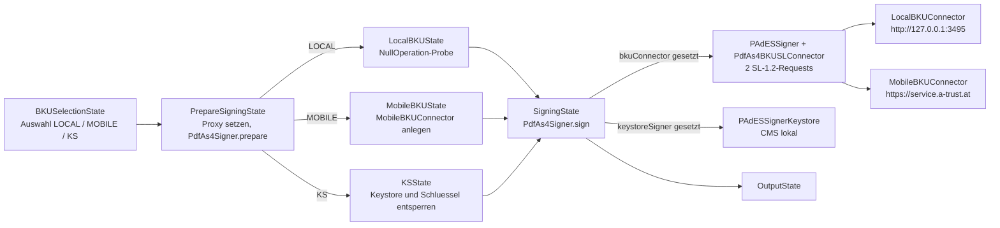
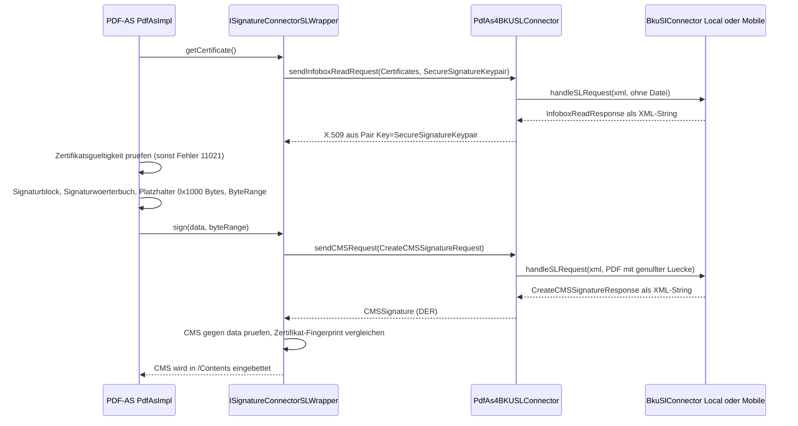
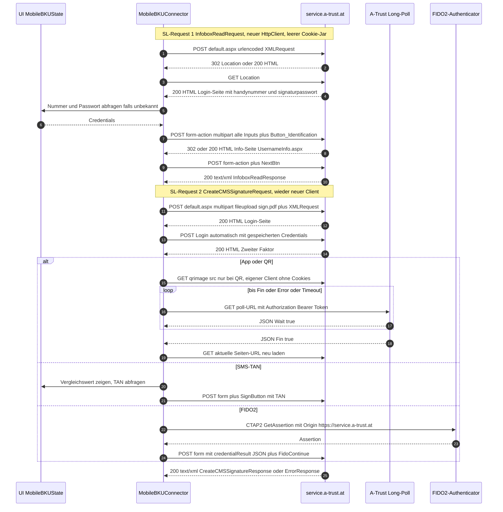
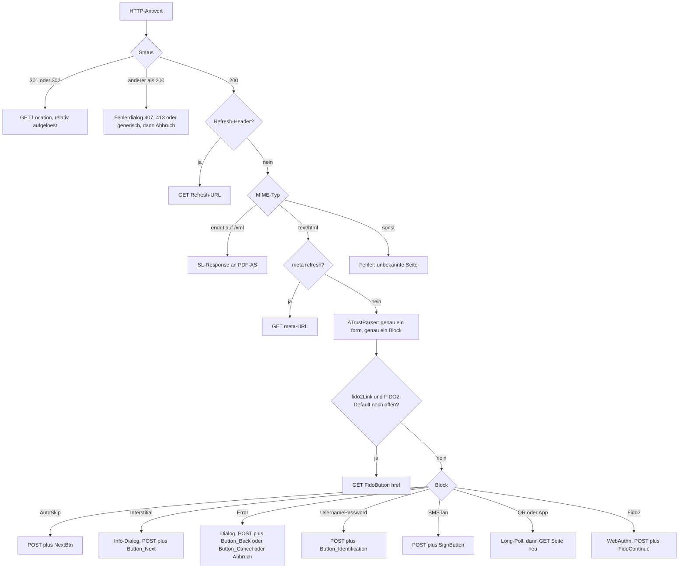
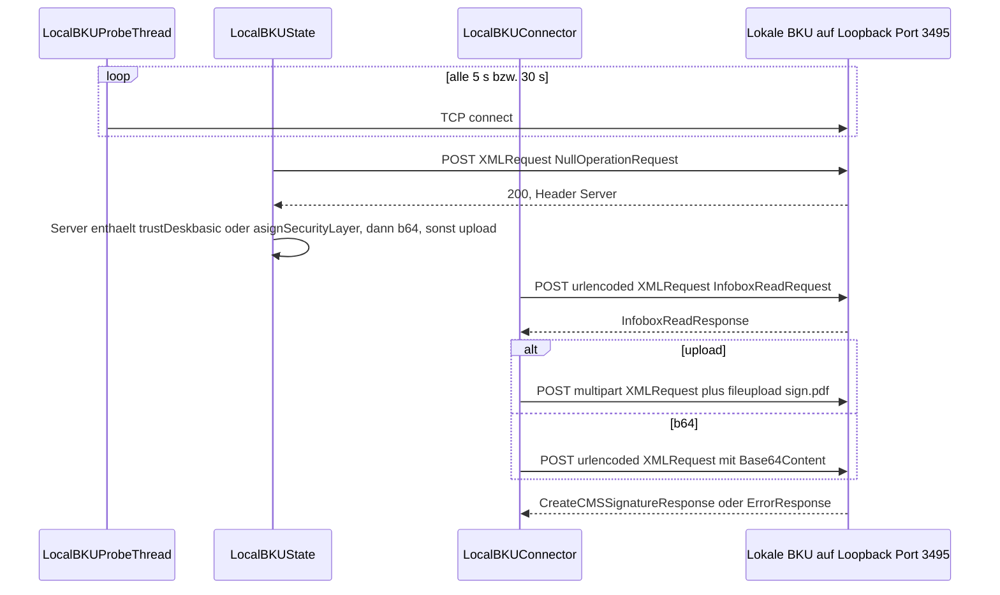

# 02 – Signatur-Backends: Protokoll-Spezifikation

Analyse-Grundlage für einen PDF-Over-Klon ohne Java. Gegenstand: alle Wege, über die PDF-Over eine Signatur erzeugt – ID Austria / A-Trust ("Mobile BKU"), lokale Bürgerkartenumgebung ("Local BKU") und Keystore-Datei ("KS") – sowie die gemeinsame Security-Layer-1.2-Schicht (SL 1.2) aus PDF-AS.

| | |
|---|---|
| Referenzstand PDF-Over | `main`, Commit `c07c5ec` (2026-09-03), Version 4.4.10-SNAPSHOT |
| Referenzstand PDF-AS | 4.4.2 |
| Konfiguration | von PDF-Over mitgelieferte PDF-AS-Konfiguration (`cfg/config.properties`, `cfg/profiles/*`) |
| Erstellt | 2026-10-14 |

---

## 0. Legende, Pfad-Kürzel, Lesehilfe

### 0.1 Belegstufen

| Kürzel | Bedeutung |
|---|---|
| **[V]** | Im Quellcode verifiziert, mit Fundstelle `Datei:Zeile`. |
| **[L]** | Standardverhalten einer verwendeten Bibliothek (Apache HttpClient 5.5.1 / commons-httpclient 3, JAXB, jsoup 1.19.1, PDFBox 2, IAIK). Steht nicht im Projektcode, sondern folgt aus dem Bibliotheks-Default. Vor der Reimplementierung per Netzwerkmitschnitt prüfen. |
| **[E]** | Empirisch geprüft am 2026-10-14, ausschließlich mit lesenden Zugriffen (HTTP `OPTIONS`/`GET` ohne Nutzdaten, TLS-Handshake). Es wurden keine SL-Requests und keine Formulare an A-Trust gesendet. |
| **[A]** | Annahme oder Interpretation, nicht belegt. Vor Umsetzung klären (siehe Kapitel 9). |

### 0.2 Pfad-Kürzel

Alle Fundstellen sind relativ zum jeweiligen Repository-Wurzelverzeichnis.

| Kürzel | Repository | Pfad |
|---|---|---|
| `GUI/` | PDF-Over | `pdf-over-gui/src/main/java/at/asit/pdfover/gui/` |
| `SIG/` | PDF-Over | `pdf-over-signer/src/main/java/at/asit/pdfover/signer/` |
| `COM/` | PDF-Over | `pdf-over-commons/src/main/java/at/asit/pdfover/commons/` |
| `RES/` | PDF-Over | `pdf-over-gui/src/main/resources/` |
| `PAS-SL/` | PDF-AS | `pdf-as-lib/src/main/java/at/gv/egiz/sl/` |
| `PAS-LIB/` | PDF-AS | `pdf-as-lib/src/main/java/at/gv/egiz/pdfas/lib/` |
| `PAS-COMMON/` | PDF-AS | `pdf-as-common/src/main/java/at/gv/egiz/pdfas/common/` |
| `PAS-PADES/` | PDF-AS | `signature-standards/sigs-pades/src/main/java/at/gv/egiz/pdfas/sigs/pades/` |
| `PAS-PDFBOX/` | PDF-AS | `pdf-as-pdfbox-2/src/main/java/at/gv/egiz/pdfas/lib/impl/signing/pdfbox2/` |
| `PAS-WEB/` | PDF-AS | `pdf-as-web/src/main/` |
| `CFG/` | PDF-AS-Konfiguration aus PDF-Over (`PDFASConfig.zip`, entpackt) | `cfg/` |

Beispiel: `GUI/bku/MobileBKUConnector.java:201` steht für `pdf-over-gui/src/main/java/at/asit/pdfover/gui/bku/MobileBKUConnector.java`, Zeile 201.

---

## 1. Überblick: Architektur der Signatur-Backends

### 1.1 Komponenten

| Rolle | Klasse | Fundstelle |
|---|---|---|
| Backend-Auswahl (Enum) | `BKUs { LOCAL, MOBILE, KS, NONE }` | `COM/BKUs.java:22-34` [V] |
| Schnittstelle zum Transport eines SL-Requests | `BkuSlConnector.handleSLRequest(PdfAs4SLRequest) : String` | `SIG/BkuSlConnector.java:25-33` [V] |
| SL-Request-Container (XML-String + optional Datei-Bytes) | `PdfAs4SLRequest { xmlRequest, signatureData }` | `SIG/pdfas/PdfAs4SLRequest.java:24-45` [V] |
| Adapter PDF-AS ↔ PDF-Over (JAXB-Marshalling, Fehlerabbildung) | `PdfAs4BKUSLConnector extends BaseSLConnector` | `SIG/pdfas/PdfAs4BKUSLConnector.java:45-161` [V] |
| ID-Austria-/A-Trust-Transport | `MobileBKUConnector implements BkuSlConnector` | `GUI/bku/MobileBKUConnector.java:52` [V] |
| Lokale-BKU-Transport | `LocalBKUConnector implements BkuSlConnector` | `GUI/bku/LocalBKUConnector.java:42` [V] |
| Keystore-Signer (ohne SL, lokal in PDF-AS) | `PAdESSignerKeystore implements IPlainSigner` | `PAS-PADES/PAdESSignerKeystore.java:73` [V] |
| SL-basierter Signer | `PAdESSigner(ISLConnector)`, intern `ISignatureConnectorSLWrapper` | `PAS-PADES/PAdESSigner.java:39-41` [V] |
| Signer-Auswahl zur Laufzeit | `PdfAs4Signer.sign()` | `SIG/pdfas/PdfAs4Signer.java:130-139` [V] |

### 1.2 Zustandsfluss in PDF-Over



Fundstellen [V]: Dispatch `GUI/workflow/states/PrepareSigningState.java:215-229`; Connector-Zuweisung Mobile `GUI/workflow/states/MobileBKUState.java:523-524`, Local `GUI/workflow/states/LocalBKUState.java:161`, Keystore `GUI/workflow/states/KSState.java:178`; Signer-Auswahl `SIG/pdfas/PdfAs4Signer.java:130-139`.

### 1.3 Backend-Auswahl (BKUSelectionState)

- Lokale BKU gilt als verfügbar, wenn ein Hintergrund-Thread eine TCP-Verbindung zu `127.0.0.1:3495` aufbauen kann. Details in Abschnitt 4.1. Fundstelle: `GUI/workflow/states/BKUSelectionState.java:66` [V].
- Keystore gilt als verfügbar, wenn er in der Konfiguration aktiviert ist (`KEYSTORE_ENABLED`) und die Datei existiert. Fundstelle: `GUI/workflow/states/BKUSelectionState.java:53-59` [V].
- Kommt der Ablauf aus `OpenState`/`PositioningState` und ist weder lokale BKU noch Keystore verfügbar, wird ohne Rückfrage `MOBILE` gewählt. Fundstelle: `GUI/workflow/states/BKUSelectionState.java:68-73` [V].
- Sonst wird die Default-BKU aus der Konfiguration (`BKU=`) übernommen oder ein Auswahldialog angezeigt. Fundstellen: `GUI/workflow/states/OpenState.java:84`, `GUI/workflow/states/BKUSelectionState.java:78-91` [V].
- Der Karten-Button wird nur aktiviert, wenn die lokale BKU erreichbar ist. Das Kartenbild (`cc_karte`) wird dabei immer deaktiviert – vermutlich ein Bug. Fundstelle: `GUI/composites/BKUSelectionComposite.java:52-55` [V].
- Der Keystore-Button wird nur bei aktiviertem Keystore erzeugt. Fundstelle: `GUI/composites/BKUSelectionComposite.java:61-72` [V].

---

## 2. Gemeinsame Schicht: Security Layer 1.2 (beantwortet Frage 2)

### 2.1 Kurzantwort: Was wird gesendet?

1. **Kein reiner Hash.** Gesendet wird ein **SL-1.2-`CreateCMSSignatureRequest`** (`Structure="detached"`). Er enthält oder referenziert das **komplette vorbereitete PDF** – inklusive inkrementellem Update, Signaturwörterbuch und Signaturfeld-Appearance. Im Bereich des `/Contents`-Platzhalters sind die Bytes durch `0x00` ersetzt. Ein `ExcludedByteRange` beschreibt diese Lücke. Die Signaturerstellungseinheit (A-Trust-Server bzw. lokale BKU) berechnet den Hash selbst und liefert eine **detached CMS-`SignedData`** zurück. Fundstellen [V]: `PAS-SL/util/BaseSLConnector.java:85-162`, `PAS-COMMON/utils/PDFUtils.java:72-97`, `SIG/pdfas/PdfAs4BKUSLConnector.java:113-119`. Die README bestätigt das: "the PDF document to be signed is sent to the company A-Trust" (`Readme.md:25`) [V].
2. **Vorher** stellt PDF-AS einen **`InfoboxReadRequest`** (Infobox `Certificates`, Schlüssel `SecureSignatureKeypair`), um das Signaturzertifikat zu erhalten. PDF-AS braucht es für den sichtbaren Signaturblock (Name, Aussteller, Seriennummer) und für die spätere Prüfung. Fundstellen [V]: `PAS-LIB/impl/PdfAsImpl.java:170-171`, `PAS-SL/util/ISignatureConnectorSLWrapper.java:66-90`, `PAS-SL/util/BaseSLConnector.java:71-83`.
3. **SL 2.0 wird von PDF-Over nicht verwendet.** PDF-AS enthält zwar `SL20Connector`, aber nur PDF-AS Web nutzt ihn. Seine Methoden `sendInfoboxReadRequest`/`sendCMSRequest` liefern `null` (`PAS-SL/../sl20/SL20Connector.java:81-93`) [V]. In PDF-Over gibt es keine Referenz auf `sl20` [V, grep]. SL 2.0 benötigt laut PDF-AS-Web-Doku einen eigenen Keystore zum Signieren und Verschlüsseln der Kommandos (`doc/PDFAS4_WebDokumentation.docx`, Abschnitt "Security Layer 2.0", Parameter `sl20.keystore.*`) [V].

### 2.2 Ablauf in PDF-AS (für alle SL-Backends gleich)



Fundstellen [V]: Gültigkeit `PAS-LIB/impl/PdfAsImpl.java:272-286`; Platzhaltergröße `PAS-PDFBOX/PADESPDFBOXSigner.java:206` mit Default `0x1000` bei `:582-597` (Konfigurationsschlüssel `signatureSize`, `PAS-LIB/api/IConfigurationConstants.java:114`); Signieren `PAS-PDFBOX/PdfboxSignerWrapper.java:62-75`; Prüfung `PAS-SL/util/ISignatureConnectorSLWrapper.java:100-123`; Filter/SubFilter `Adobe.PPKLite` / `ETSI.CAdES.detached` (`PAS-PADES/PAdESSigner.java:56-62`, `PAS-PADES/PAdESConstants.java:4-5`, gesetzt in `PAS-PDFBOX/PADESPDFBOXSigner.java:155-156`).

**Konsequenz für die Reimplementierung [A]:** Zwei SL-Round-Trips sind nötig, solange der sichtbare Signaturblock Zertifikatsdaten enthält. Der Klon muss zwischen beiden Requests das PDF-Update bauen. Danach darf sich am PDF nichts mehr ändern, denn der Hash wird über genau diese Bytes gebildet.

### 2.3 Byte-Range, Lücke und "blackOut"

- PDFBox ruft `SignatureInterface.sign(InputStream)` mit der **Konkatenation der durch `/ByteRange` abgedeckten Bytes** auf [L]. PDF-AS liest die ByteRange aus diesen Daten (Suche nach `/ByteRange [` von hinten) aus. Fundstellen [V]: `PAS-PDFBOX/PdfboxSignerWrapper.java:62-64`, `PAS-COMMON/utils/PDFUtils.java:151-186`.
- `blackOutSignature(data, byteRange)` erzeugt ein Array der Länge `byteRange[2]+byteRange[3]` (Länge der Gesamtdatei), füllt es mit `0x00` und kopiert die abgedeckten Bytes an ihre Offsets. Ergebnis: das **vollständige PDF, in dem die Lücke (`/Contents`-Hexstring inklusive `<` `>`, [L] PDFBox) genullt ist**. Fundstelle: `PAS-COMMON/utils/PDFUtils.java:72-97` [V].
- `buildExcludeRange(byteRange)`: `From = byteRange[0] + byteRange[1]`, `To = byteRange[2] - 1` (inklusiv). Fundstelle: `PAS-COMMON/utils/PDFUtils.java:53-70` [V].
- Prüfung der Antwort: Die CMS wird gegen die **konkatenierten** Bytes verifiziert (`signedData.setContent(input)`). Fundstelle: `PAS-LIB/util/SignatureUtils.java:26-55` [V].

Formel für den Klon:

```
gesamt   = PDF nach inkrementellem Update (inkl. /Contents <00…00>)
br       = [0, a, b, len(gesamt)-b]      a = Offset von '<', b = Offset nach '>'
upload   = gesamt mit Bytes [a .. b-1] := 0x00
From     = a
To       = b - 1
hash(BKU)= H(gesamt[0..a-1] || gesamt[b..end])
```

### 2.4 `InfoboxReadRequest` – exakte Struktur

Erzeugt in `PAS-SL/util/BaseSLConnector.java:71-83` [V], serialisiert mit JAXB: formatiert, UTF-8 (`PAS-SL/util/SLMarschaller.java:114-119`) [V]. Namespace: `http://www.buergerkarte.at/namespaces/securitylayer/1.2#` (`pdf-as-lib/src/main/java/at/gv/egiz/sl/schema/package-info.java`) [V]. Root-QName: `InfoboxReadRequest` (`.../sl/schema/ObjectFactory.java:102`) [V].

```xml
<?xml version="1.0" encoding="UTF-8" standalone="yes"?>
<sl:InfoboxReadRequest xmlns:sl="http://www.buergerkarte.at/namespaces/securitylayer/1.2#">
    <sl:InfoboxIdentifier>Certificates</sl:InfoboxIdentifier>
    <sl:AssocArrayParameters>
        <sl:ReadValue Key="SecureSignatureKeypair"/>
    </sl:AssocArrayParameters>
</sl:InfoboxReadRequest>
```

Hinweise:
- Elementreihenfolge laut `propOrder`: `InfoboxIdentifier`, `BinaryFileParameters`, `AssocArrayParameters`, `BoxSpecificParameters` (`.../sl/schema/InfoboxReadRequestType.java:67-83`) [V]. `ReadValue@Key` ist ein Attribut (`.../sl/schema/InfoboxReadParamsAssocArrayType.java:397-399`) [V].
- **Präfixe:** JAXB vergibt die Präfixe selbst, es gibt keinen `NamespacePrefixMapper` [V, grep]. Weil der JAXB-Kontext auch `xmldsig#` kennt, deklariert JAXB-RI vermutlich beide Namespaces am Root-Element, mit generierten Präfixen wie `ns2` [L/A]. Das `standalone="yes"` ist JAXB-Default [L]. Für den Klon gilt: namespace-korrektes XML mit beliebigem Präfix verwenden, `sl:` empfohlen. Der handgeschriebene NullOperationRequest von PDF-Over nutzt ebenfalls `sl:` (`GUI/workflow/states/LocalBKUState.java:68-69`) [V].

**Antwort (erwartet):**

```xml
<sl:InfoboxReadResponse xmlns:sl="http://www.buergerkarte.at/namespaces/securitylayer/1.2#">
  <sl:AssocArrayData>
    <sl:Pair Key="SecureSignatureKeypair">
      <sl:Base64Content>{X.509-Zertifikat, DER, Base64}</sl:Base64Content>
    </sl:Pair>
  </sl:AssocArrayData>
</sl:InfoboxReadResponse>
```

Parsing [V]: `AssocArrayData/Pair` iterieren und den ersten Eintrag mit `Key == "SecureSignatureKeypair"` nehmen. `Base64Content` als DER-X.509 dekodieren (`PAS-SL/util/ISignatureConnectorSLWrapper.java:75-85`). Fehlt das Paar, ist `certificate == null` und PDF-AS scheitert später [A]. Typen: `.../sl/schema/InfoboxReadResponseType.java:67-70`, `InfoboxReadDataAssocArrayType.java:75-79`, `InfoboxAssocArrayPairType.java:59-64` (`extends Base64XMLContentType`, das `Base64Content` bzw. `XMLContent` enthält, `Base64XMLContentType.java:72-74`).

### 2.5 `CreateCMSSignatureRequest` – exakte Struktur

Erzeugt in `PAS-SL/util/BaseSLConnector.java:85-162` [V]. Root-QName `CreateCMSSignatureRequest` (`.../sl/schema/ObjectFactory.java:114`) [V].

**Variante "upload" (Mobile BKU immer, lokale BKU meistens):**

```xml
<?xml version="1.0" encoding="UTF-8" standalone="yes"?>
<sl:CreateCMSSignatureRequest xmlns:sl="http://www.buergerkarte.at/namespaces/securitylayer/1.2#"
                              Structure="detached">
    <sl:KeyboxIdentifier>SecureSignatureKeypair</sl:KeyboxIdentifier>
    <sl:DataObject>
        <sl:MetaInfo>
            <sl:MimeType>application/pdf</sl:MimeType>
        </sl:MetaInfo>
        <sl:Content Reference="formdata:fileupload"/>
        <sl:ExcludedByteRange>
            <sl:From>{a}</sl:From>
            <sl:To>{b-1}</sl:To>
        </sl:ExcludedByteRange>
    </sl:DataObject>
</sl:CreateCMSSignatureRequest>
```

Die Datei selbst wird als Multipart-Teil `fileupload` mitgeschickt (Abschnitte 3.3 und 4.3).

**Variante "b64" (lokale BKU, wenn der `Server`-Header `trustDeskbasic` oder `asignSecurityLayer` enthält):**

```xml
        <sl:Content>
            <sl:Base64Content>{Base64(upload)}</sl:Base64Content>
        </sl:Content>
```

| Feld | Wert | Fundstelle [V] |
|---|---|---|
| `@Structure` | `detached` (Pflicht) | `BaseSLConnector.java:60, 136`; `CreateCMSSignatureRequestType.java:85-86` |
| `@PAdESCompatibility` | nur wenn `sig_obj.PAdESCompatibility=true` oder (`sig_obj.CheckPAdESCompatibility=true` und Whitelist passt); in der von PDF-Over gelieferten Konfiguration **nicht gesetzt**, das Attribut fehlt daher | `BaseSLConnector.java:141-158`; `IConfigurationConstants.java:130-131`; grep `PAdES` in `CFG/*.properties`: keine Treffer |
| `KeyboxIdentifier` | `SecureSignatureKeypair` | `BaseSLConnector.java:55, 134` |
| Reihenfolge in `DataObject` | `MetaInfo`, `Content`, `ExcludedByteRange` | `CMSDataObjectOptionalMetaType.java:63-78` |
| `MetaInfo/MimeType` | `application/pdf` (`Description` nicht gesetzt) | `BaseSLConnector.java:57, 103-104`; `MetaInfoType.java:74-78` |
| `Content@Reference` | `formdata:fileupload` (upload) | `BaseSLConnector.java:111-115`; `Base64OptRefContentType.java:64-66` |
| `Content/Base64Content` | Base64 des genullten Gesamt-PDF (b64) | `BaseSLConnector.java:97, 109-110`; `Base64ContentType.java:69-70` |
| `ExcludedByteRange/From`, `/To` | `unsignedLong`, inklusiv | `BaseSLConnector.java:121-129`; `ExcludedByteRangeType.java:69-74` |
| Upload-Inhalt | `blackOutSignature(signatureData, byteRange)`; der Upload wird erst im PDF-Over-Adapter genullt | `SIG/pdfas/PdfAs4BKUSLConnector.java:115-117` |
| Transaktions-ID | PDF-AS setzt eine UUID (`SIG/pdfas/PdfAs4Signer.java:96-97`), PDF-Over-Connectoren **senden sie nicht** (anders als PDF-AS' eigener `BKUSLConnector`, Feld `TransactionId_`, `PAS-SL/util/BKUSLConnector.java:140-145`) | – |

Die Upload-/b64-Umschaltung erfolgt über `sl.request.type` = `upload` | `b64` (`PAS-LIB/api/IConfigurationConstants.java:107-109`). Gesetzt wird sie in `SIG/pdfas/PdfAs4Signer.java:125-128` aus `state.useBase64Request`.

### 2.6 Antworten und Fehler

**Erfolg:**

```xml
<sl:CreateCMSSignatureResponse xmlns:sl="http://www.buergerkarte.at/namespaces/securitylayer/1.2#">
  <sl:CMSSignature>{CMS ContentInfo(SignedData), DER, Base64}</sl:CMSSignature>
</sl:CreateCMSSignatureResponse>
```

Fundstelle: `.../sl/schema/CreateCMSSignatureResponseType.java:65-66` [V].

**Fehler (beide Requests):**

```xml
<sl:ErrorResponse xmlns:sl="http://www.buergerkarte.at/namespaces/securitylayer/1.2#">
  <sl:ErrorCode>{int}</sl:ErrorCode>
  <sl:Info>{Text}</sl:Info>
</sl:ErrorResponse>
```

Fundstelle: `.../sl/schema/ErrorResponseType.java:61-70` [V].

Verarbeitung im Adapter (`SIG/pdfas/PdfAs4BKUSLConnector.java`) [V]:

| Ergebnis | Reaktion | Zeilen |
|---|---|---|
| JAXB-Root `InfoboxReadResponse` / `CreateCMSSignatureResponse` | Rückgabe an PDF-AS | 95-96, 148-152 |
| JAXB-Root `ErrorResponse` | `SLPdfAsException(ErrorCode, Info)` | 97-100, 153-157 |
| Antwort `null` | `PDFIOException("error.pdf.io.04")` bzw. `"error.pdf.io.05"` | 91-93, 144-146 |
| Unmarshal-Fehler (`JAXBException`) | `PDFIOException("error.pdf.io.03")`; die Regex-Rettung `generateLegacySLException` aus `BKUSLConnector` wird **nicht** verwendet | 81-82, 134-135 |
| `UserCancelledException` vom Transport | `SLPdfAsException(6001, "Vorgang durch den Benutzer abgebrochen.")` | 87-89, 140-142 |
| Root-Cause `IllegalStateException` | wird als Benutzerabbruch behandelt (kommentiert als "legacy hack") | 76-77, 129-130 |

Weiterverarbeitung [V]:
- `PdfAs4Signer`: Root-Cause `SLPdfAsException` mit Code **6000 oder 6001** wird zu `UserCancelledException`, d. h. stiller Abbruch zurück zur BKU-Auswahl (`SIG/pdfas/PdfAs4Signer.java:162-173`).
- `SigningState`: andere `SLPdfAsException` zeigen den Text `error.SLError` = "Vorgang vom Signaturserver abgebrochen (%d):\n%s" (`GUI/workflow/states/SigningState.java:98-100`; `RES/at/asit/pdfover/gui/messages_de.properties:165`). Ist der Root-Cause eine `SocketException`, wird deren Text angehängt (`SigningState.java:96-97`). Dialog mit "Wiederholen" führt zu `PrepareSigningState` (neues PDF-Update), "Abbrechen" zu `BKUSelectionState` (`SigningState.java:119-127`).
- Nach erfolgreicher CMS-Antwort prüft PDF-AS: genau ein `SignerInfo`, kryptographisch gültig (`PAS-LIB/util/SignatureUtils.java:34-55`), und **SHA-Fingerprint des CMS-Signer-Zertifikats == Zertifikat aus InfoboxRead**, sonst `PdfAsSignatureException("Certificates missmatch!")` (`PAS-SL/util/ISignatureConnectorSLWrapper.java:119-123`).

SL-Fehlercodes außer 6000/6001 wertet PDF-Over nicht aus. Laut SL-1.2-Spezifikation steht 6000 für Abbruch durch den Bürger und 6001 für Timeout [A, aus der SL-Spezifikation, nicht im Code belegt].

### 2.7 Transportvarianten je Backend

| Backend | 1. Request (InfoboxRead) | 2. Request (CMS) | Fundstelle [V] |
|---|---|---|---|
| Mobile BKU (A-Trust) | `application/x-www-form-urlencoded; charset=UTF-8`, Feld `XMLRequest` | immer **upload**: multipart mit `fileupload` (PDF) und `XMLRequest` | `GUI/workflow/states/MobileBKUState.java:524`; `GUI/bku/MobileBKUConnector.java:200-213` |
| Lokale BKU, Standard (z. B. MOCCA [A]) | urlencoded `XMLRequest` | **upload**: multipart `XMLRequest` + `fileupload` | `GUI/workflow/states/LocalBKUState.java:63, 113-118`; `GUI/bku/LocalBKUConnector.java:86-99` |
| Lokale BKU, `Server` enthält `trustDeskbasic` oder `asignSecurityLayer` | urlencoded `XMLRequest` | **b64**: urlencoded `XMLRequest` mit eingebettetem `Base64Content` | `GUI/workflow/states/LocalBKUState.java:114-115` |
| Keystore | – (kein SL) | – (CMS lokal) | `SIG/pdfas/PdfAs4Signer.java:134-135` |

---

## 3. ID Austria / A-Trust ("Mobile BKU") (beantwortet Frage 1)

### 3.1 Endpunkte und Konstanten

| Zweck | Wert | Fundstelle |
|---|---|---|
| Produktiv-Endpunkt (genutzt) | `https://service.a-trust.at/mobile/https-security-layer-request/default.aspx` | `COM/Constants.java:108` [V] |
| Test-Endpunkt (definiert, **nirgends verwendet**) | `https://hs-abnahme.a-trust.at/mobile/https-security-layer-request/default.aspx` | `COM/Constants.java:109`; grep: keine weitere Referenz [V] |
| Veralteter Endpunkt in der PDF-AS-Konfiguration (von PDF-Over **nicht** genutzt, weil PDF-Over den eigenen Connector verwendet) | `mobile.sign.url=https://www.handy-signatur.at/mobile/https-security-layer-request/default.aspx` | `CFG/config.properties:33` [V] |
| WebAuthn-Origin (hart codiert) | `https://service.a-trust.at` | `GUI/composites/mobilebku/MobileBKUFido2Composite.java:61` [V] |
| Test-Nummernpräfix | `10301` (A-Trust-Testnummern, werden nicht normalisiert) | `GUI/bku/mobile/MobileBKUValidator.java:35-37, 66-69` [V] |

Server-Eigenschaften [E]: `Server: Microsoft-IIS/10.0` (ASP.NET WebForms, `.aspx`). `GET default.aspx` ohne Request liefert `302 Location: /mobile/https-security-layer-request/InvalidRequest.aspx`. `Strict-Transport-Security: max-age=0`. TLS 1.2 mit `ECDHE-RSA-AES256-GCM-SHA384`, Serverzertifikat von DigiCert (`DigiCert Global G2 TLS RSA SHA256 2020 CA1`).

### 3.2 HTTP-Client-Konfiguration

| Aspekt | Verhalten | Beleg |
|---|---|---|
| Bibliothek | Apache HttpClient 5.5.1 | `pom.xml:211-213` [V] |
| Builder | `HttpClients.custom().useSystemProperties()` | `GUI/utils/HttpClientUtils.java:7-9` [V] |
| Redirects (Hauptdialog) | **automatisches Folgen deaktiviert** (`disableRedirectHandling()`), manuelle Behandlung siehe 3.4 | `GUI/bku/MobileBKUConnector.java:74` [V] |
| Client-Lebensdauer / Cookies | **ein neuer Client pro SL-Request** (try-with-resources). Damit gibt es einen eigenen, leeren Cookie-Jar je `handleSLRequest`; InfoboxRead und CMS laufen in getrennten A-Trust-Sitzungen | `GUI/bku/MobileBKUConnector.java:74`; Cookie-Store [L: HttpClient 5 legt bei aktivem Cookie-Management einen `BasicCookieStore` an] |
| Long-Poll-Client | separater Client, **keine gemeinsamen Cookies**, Redirects automatisch [L] | `GUI/bku/MobileBKUConnector.java:248` [V] |
| QR-Bild-Client | separater Client je Bild, **keine Cookies** | `GUI/workflow/states/MobileBKUState.java:358-361` [V] |
| Explizite Header | **keine**, außer `Authorization: Bearer …` beim Long-Poll | `GUI/bku/MobileBKUConnector.java:305`; grep `addHeader`/`setHeader` [V] |
| User-Agent | nicht gesetzt, daher `http.agent`-Property oder Default `Apache-HttpClient/5.5.1 (Java/21…)` | [L] |
| Timeouts | nicht konfiguriert (kein `RequestConfig`) | grep [V]; tatsächliche Werte sind HttpClient-Defaults [L] |
| Proxy | über System-Properties `http(s).proxyHost/Port/User/Password` (gesetzt in `PrepareSigningState`) und `java.net.Authenticator` für Proxy-Authentifizierung | `GUI/workflow/states/PrepareSigningState.java:76-125` [V]; Auswertung durch `useSystemProperties` [L] |
| TLS | JRE-Default-Truststore, kein Pinning (Kapitel 6) | [V/L] |

### 3.3 HTTP-Requests im Detail

Hauptschleife: `handleSLRequest` sendet den Initial-Request und wiederholt dann `sendHTTPRequest` → `presentResponseToUserAndReturnNextRequest`, bis eine Antwort mit XML-Content-Type kommt. Fundstelle: `GUI/bku/MobileBKUConnector.java:72-89` [V].

| ID | Auslöser | Methode | URL | Body / Content-Type | Besondere Header | Cookies | Fundstelle [V] |
|---|---|---|---|---|---|---|---|
| **R1a** | SL-Request **ohne** Datei (InfoboxRead) | POST | `MOBILE_BKU_URL` | `application/x-www-form-urlencoded; charset=UTF-8`, ein Feld `XMLRequest=<xml>` | – | Jar neu und leer | `MobileBKUConnector.java:200-211, 450-456` |
| **R1b** | SL-Request **mit** Datei (CMS, upload) | POST | `MOBILE_BKU_URL` | `multipart/form-data`. **Teil 1**: `name="fileupload"; filename="sign.pdf"`, `Content-Type: application/pdf`, Rohbytes (genulltes PDF). **Teil 2**: `name="XMLRequest"`, `Content-Type: text/plain; charset=UTF-8` | – | Jar neu und leer | `MobileBKUConnector.java:199-206` |
| **R2** | Antwort 301/302 | GET | `Location`, relativ aufgelöst gegen die URI des **auslösenden** Requests | – (auch nach POST wird GET verwendet) | – | Jar | `MobileBKUConnector.java:116-122, 178-181` |
| **R3** | 200 mit HTTP-Header `Refresh` | GET | URL aus `Refresh` | – | – | Jar | `MobileBKUConnector.java:132-136, 186-194` |
| **R4** | 200 `text/html` mit `<meta http-equiv="refresh">` (Attributwert ohne Groß-/Kleinschreibung) und nichtleerem `content` | GET | URL aus `content` | – | – | Jar | `MobileBKUConnector.java:155-162` |
| **R5** | Formular-Submit (alle Blöcke außer Links) | POST | `form@action`, absolut aufgelöst | `multipart/form-data`, **alle** `<input>` mit nichtleerem `name` außer `type=submit`, als `text/plain; charset=UTF-8` (Reihenfolge undefiniert, `HashMap`), dazu genau **ein** "geklickter" Submit-Button `name=value` | – | Jar | `MobileBKUConnector.java:215-243`; Feldsammlung `ATrustParser.java:313-324` |
| **R6** | Wechsel auf FIDO2 bzw. SMS | GET | `href` von `#FidoButton` bzw. `#SmsButton` (absolut) | – | – | Jar | `MobileBKUConnector.java:338-341, 384, 396-397, 409-410, 420`; `ATrustParser.java:327-328` |
| **R7** | Long-Poll meldet "fertig", Fehler oder Timeout | GET | `baseUri()` des aktuellen HTML-Dokuments (Neuladen) | – | – | Jar | `MobileBKUConnector.java:387, 399, 412` |
| **R8** | QR-Seite | GET | `#qrimage@src` (absolut) | – | – | **keine** (eigener Client) | `GUI/workflow/states/MobileBKUState.java:356-365`; `ATrustParser.java:185` |
| **R9** | QR- oder App-Seite, parallel | GET (wiederholt) | aus `qrpoll("URL", "TOKEN")` | – | `Authorization: Bearer TOKEN` | **keine** (eigener Client) | `MobileBKUConnector.java:246-325`; `ATrustParser.java:52-77` |
| **R10** | Benutzer klickt "Signaturdaten anzeigen" | (System-Browser) | `#LinkList a[href*="ShowSigobj.aspx"]` | – | – | Browser ohne Session-Cookies | `ATrustParser.java:326`; `GUI/utils/SWTUtils.java:259-270` |
| **Ende** | 200 und MIME-Typ endet auf `/xml` | – | – | Body = SL-Response-XML, wird unverändert an PDF-AS gegeben | – | – | `ATrustParser.java:365-366`; `MobileBKUConnector.java:77-80` |

Schlussfolgerung [A]: Weil QR-Bild (R8), Long-Poll (R9) und "Signaturdaten anzeigen" (R10) ohne Session-Cookies funktionieren müssen, autorisieren diese URLs offenbar selbst (Token im URL bzw. Bearer-Token). Per Mitschnitt verifizieren.

**Initial-Formular "XMLRequest":** A-Trust nimmt das klassische SL-HTTPS-Binding (Formularfeld `XMLRequest`) entgegen. PDF-Over schickt **keine** weiteren SL-Binding-Parameter (`DataURL`, `RedirectURL`, `StylesheetURL`, `locale` …) [V: `MobileBKUConnector.java:200-213`]. Damit liefert A-Trust die SL-Antwort am Ende direkt als HTTP-Response.

### 3.4 Redirect-, Refresh- und Antwortbehandlung (Reihenfolge exakt)

Ablauf von `sendHTTPRequest` (`GUI/bku/MobileBKUConnector.java:102-173`) [V]:

1. **Endlosschleifen-Schutz**: Liegt ein Request weniger als 2 s nach dem Fensterbeginn, wird ein Zähler erhöht, sonst wird das Fenster neu gestartet. Bei Zähler ≥ 50 bricht der Ablauf mit `IOException("Infinite loop protection triggered")` ab. Der Zähler ist Instanzzustand und gilt über beide SL-Requests. Zeilen 91-110, 172.
2. Request ausführen.
3. Status **301 oder 302**: `Location` lesen (fehlt er: `IOException`), neuen GET bauen, weiter mit Schritt 1. **303, 307 und 308 werden nicht als Redirect behandelt** und landen im Fehlerzweig. Zeilen 116-122.
4. Status **≠ 200**: 407 → `error.ProxyAuthRequired`; 413 → `atrusterror.http_413` ("Dateigröße des PDF-Dokuments überschreitet Grenzwert"); sonst `atrusterror.http_generic` (Code und Reason). Jeweils als `UserDisplayedError`, siehe 3.11. Zeilen 124-130.
5. Header **`Refresh`** vorhanden: als GET folgen. Zeilen 132-136.
6. Body mit dem Charset aus `Content-Type` lesen. Zeilen 142-145. (Fehlt ein Charset, greift der Bibliotheks-Default [L]; der Klon sollte UTF-8 annehmen [A].)
7. MIME `text/html` (exakter Vergleich): mit jsoup parsen (Base-URI = Request-URI). Bei `meta[http-equiv="refresh"i]` mit nichtleerem `content` folgen, sonst `ATrustParser.Parse(document)`. Zeilen 147-163.
8. Sonst `ATrustParser.Parse(uri, mime, body)`: Endet der MIME-Typ auf `/xml`, ist das die **SL-Antwort**. Jeder andere Typ führt zu `IllegalArgumentException("Unknown A-Trust page reached?")`. Zeilen 165; `ATrustParser.java:353-370`.
9. `ClientProtocolException` → `UserDisplayedError(error.FailedToConnect)`. Zeilen 167-170.

**Refresh-Syntax** (Header und Meta) [V, `MobileBKUConnector.java:188`]. Der Java-Quelltext lautet `"^\\s*[0-9\\.]+\\s*;\\s*(?:[uU][rR][lL]\s*=\s*)(.+)$"`. Die beiden `\s` im URL-Teil haben nur **einen** Backslash; ab Java 15 ist `\s` ein String-Escape für ein Leerzeichen (U+0020). Der tatsächlich wirksame Regex ist daher:

```
^\s*[0-9.]+\s*;\s*(?:[uU][rR][lL] *= *)(.+)$
```

`URL=` ist Pflicht. Anführungszeichen um die URL werden nicht entfernt. Passt der Wert nicht: `IOException("Got invalid Refresh header …")`.

### 3.5 HTML-Parser (`ATrustParser`) – exakte Regeln

Generische Seitenauswertung (`GUI/bku/mobile/ATrustParser.java:294-340`) [V]:

1. Die Seite muss **genau ein** `<form>` enthalten, sonst `IllegalArgumentException` (298-302).
2. `formTarget = form.absUrl("action")` (305-311).
3. `formOptions`: für jedes `input` im Formular mit nichtleerem `name` und `type` ≠ `submit` (Groß-/Kleinschreibung egal) wird `name → value` übernommen (313-324). Das umfasst Hidden-Felder wie ASP.NET-`__VIEWSTATE` [A]. Checkboxen werden unabhängig vom `checked`-Zustand übernommen [V, Verhalten], `select` und `textarea` gar nicht [V].
4. Optionale Links (`absUrl("href")`, ungültig → `null`) (261-272, 326-328):
   - `signatureDataLink` = `#LinkList a[href*="ShowSigobj.aspx"]`
   - `smsTanLink` = `#SmsButton`
   - `fido2Link` = `#FidoButton`
5. Alle acht Top-Level-Block-Parser werden versucht. **Genau einer** muss greifen, sonst `IllegalArgumentException("Unknown A-Trust page reached?")` (241-259, 330-339).

**Top-Level-Blöcke** (Erkennung, Daten, Aktion). Die Aktionsspalte beschreibt `presentResponseToUserAndReturnNextRequest` (`GUI/bku/MobileBKUConnector.java:332-448`) [V].

| Block | Erkennung (exakt) | Extrahierte Daten | Aktion → nächster Request | Fundstellen [V] |
|---|---|---|---|---|
| `AutoSkipBlock` | `baseUri` enthält `/tanAppInfo.aspx` oder `/UsernameInfo.aspx` | – | R5 mit Submit `#NextBtn`, ohne Benutzerinteraktion | Parser 80-89; Aktion 343-345 |
| `InterstitialBlock` | `baseUri` enthält `/ExpiresInfo.aspx` | Meldung = `#Label2.ownText()` | Info-Dialog (OK), dann R5 mit `#Button_Next`. Abbruch im Dialog → `UserCancelledException` | 91-102; 346-349; Dialog `MobileBKUState.java:178-186` |
| `ErrorBlock` | letztes Pfadsegment beginnt mit `/error` **und** endet auf `.aspx`, **oder** ist genau `/SessionClosed.aspx` | `isRecoverable` = `#Button_Back` existiert; `requiresResponse` = `#Button_Cancel` existiert; Text = `#Label1.ownText().trim()` + optional `"\n"` + `#LabelDetail.ownText().trim()` | Passwort löschen (Session-Speicher und `credentials`). Wiederherstellbar: Dialog "Wiederholen/Abbrechen", bei Wiederholen R5 mit `#Button_Back`. Sonst Dialog OK und Abbruch. Bei Abbruch und `requiresResponse`: R5 mit `#Button_Cancel` (Schleife läuft weiter, A-Trust antwortet dann vermutlich mit SL-`ErrorResponse` [A]), sonst `UserCancelledException` | 104-136; 350-366 |
| `UsernamePasswordBlock` | `#handynummer` existiert | Feldname Benutzer = `#handynummer@name`, Feldname Passwort = `#signaturpasswort@name` (beide Pflicht) | Credentials bekannt: sofort einsetzen. Sonst UI-Dialog (Schleife, bis beide gesetzt). Dann R5 mit `#Button_Identification`. Abbruch → R5 mit `#Button_Cancel` | 138-154; 367-377 |
| `SMSTanBlock` | `#input_tan` existiert | TAN-Feldname = `#input_tan@name`; Vergleichswert = `#vergleichswert.ownText()` | UI-TAN-Dialog, dann R5 mit `#SignButton`. "FIDO2" → R6 auf `fido2Link`. Abbruch → `UserCancelledException` (kein Cancel an A-Trust) | 156-172; 378-388 |
| `QRCodeBlock` | `#qrimage` existiert | Vergleichswert = `#vergleichswert.ownText()`; QR-URL = `#qrimage@abs:src`; Poll-Info aus `#jsLongPoll script` | QR laden (R8), UI anzeigen, Long-Poll starten (R9). Poll fertig → R7 (Seite neu laden). "SMS" → R6 `smsTanLink`; "FIDO2" → R6 `fido2Link`. Abbruch → Passwort löschen, `UserCancelledException` | 174-190; 389-401 |
| `WaitingForApp2FABlock` | mindestens eines von `#smartphoneAnimation`, `#biometricimage`, `.ida-signtype #SignType` | Vergleichswert `#vergleichswert`; Poll-Info aus `#jsLongPoll script` | wie QR, nur ohne Bild (App-Push / Biometrie) | 192-203; 402-414 |
| `Fido2Block` | `#fidoBlock` existiert | Options-JSON = `#credentialOptions@value`; Ergebnis-Feldname = `#credentialResult@name` | WebAuthn-Assertion holen (3.8), Ergebnis-JSON in das Ergebnis-Feld schreiben, R5 mit `#FidoContinue`. "SMS" → R6 `smsTanLink`. Abbruch → `UserCancelledException` | 205-217; 415-446 |

Querschnittsregeln in `presentResponse…` (in dieser Reihenfolge) [V]:

1. Enthält die Seite **weder** `ErrorBlock` **noch** `UsernamePasswordBlock` und sind Benutzername und Passwort gesetzt, gilt das als erfolgreiche Anmeldung. Die Credentials werden dann gemerkt, falls das eingeschaltet ist (333-336, siehe 3.9).
2. Ist "FIDO2 standardmäßig" aktiv (`FIDO2_DEFAULT=true` **und** `WebAuthN.isAvailable()`) und hat die Seite einen `fido2Link`, wird **einmalig** R6 auf den FIDO-Link ausgeführt, noch vor der Block-Behandlung (56, 338-341).
3. Danach folgen die Blöcke in der Reihenfolge AutoSkip → Interstitial → Error → Username/Password → SMS-TAN → QR → App → FIDO2 (343-446).

Submit-Button-Semantik (`buildFormSubmit`, 215-243) [V]: Der per CSS-Selektor angegebene Button wird nur übernommen, wenn er ein `<input type="submit">` mit nichtleerem `name` ist. Andernfalls wird ohne Button-Feld gesendet und nur eine Warnung geloggt.

### 3.6 Long-Polling-Protokoll (QR und App)

Poll-Info-Extraktion (`ATrustParser.java:52-77`) [V]: Text des ersten `<script>` in `#jsLongPoll`. Darin ab `qrpoll("` die URL bis zum Trenner `", "`, danach das Token bis `");`. Die URL wird relativ zur Dokument-Base-URI aufgelöst. Das Muster ist also exakt:

```
qrpoll("{relative-oder-absolute-URL}", "{TOKEN}");
```

Poll-Schleife (`GUI/bku/MobileBKUConnector.java:254-300`) [V]:

| Schritt | Verhalten |
|---|---|
| Request | `GET {URL}` mit `Authorization: Bearer {TOKEN}`, sofort erneut nach jeder Antwort ("long poll"; die Haltedauer bestimmt der Server [A]) |
| Antwort | JSON-Objekt, ausgewertet mit `getBoolean` in der Reihenfolge `Fin`, `Wait`, `Error` |
| `Fin == true` | Signal "fertig" (UI kehrt zurück, Seite wird neu geladen, R7), dann 500 ms Pause |
| `Wait == true` | sofort nächster Poll |
| `Error == true` | ebenfalls Signal "fertig"; das Neuladen zeigt den Fehler, so macht es laut Code-Kommentar auch A-Trust selbst (273) |
| Weder noch | Warnung loggen, **Poll-Schleife beenden**; die UI wartet weiter auf eine Benutzeraktion |
| JSON-Parse-Fehler oder fehlender Schlüssel (`getBoolean` wirft) | wie "sonstige Exception": 10 s schlafen, dann Signal "fertig" |
| `NoHttpResponseException` | weiter pollen. Sind seit Thread-Start ≥ 300 s vergangen ("a-trust timeout is 5 minutes"), Signal "fertig" (Neuladen zeigt das Timeout) |
| Beenden | `close()` setzt `done`, bricht den laufenden Request ab (`abort()`), unterbricht den Thread, `join(1000)`, schließt den Client (310-323) |

Die UI wartet blockierend in `waitForQRCodeResult` bzw. `waitForApp2FA` auf Signal oder Button (`GUI/workflow/states/MobileBKUState.java:391-412, 447-468`) [V].

### 3.7 Zweige im Einzelnen

**a) Nummer/Benutzername + Passwort**
- Felder werden über die IDs `handynummer` und `signaturpasswort` gefunden. Gesendet werden ihre **`name`-Attribute** mit den Benutzerwerten, dazu alle übrigen Inputs und `Button_Identification` [V, 3.5].
- UI-Validierung: Passwortlänge 5 bis 200, sonst Fehlermeldung im Dialog (`GUI/bku/mobile/MobileBKUValidator.java:86-92`; `GUI/composites/mobilebku/MobileBKUEnterNumberComposite.java:57-80`) [V].
- Der Benutzername wird **unverändert** gesendet (`MobileBKUState.java:310`; `MobileBKUEnterNumberComposite.java:223-231`). Normalisiert wird nur beim Speichern (`ConfigurationDataInMemory.java:74-79`) und beim CLI-Parameter `-n` (`GUI/cliarguments/PhoneNumberArgument.java:50`) [V]. Normalisierungs-Regex nach Entfernen aller Whitespaces: `^((\+[\d]{2})|(00[\d]{2})|(0)|(10301))([1-9][\d]+)$`. `00xx` wird zu `+xx`, `0` zu `+43`, `10301…` bleibt unverändert. Passt der Regex nicht, bleibt der Wert unverändert (ID-Austria-Benutzername) (`MobileBKUValidator.java:37-78`) [V].
- Fehlermeldungen von A-Trust **auf** der Login-Seite werden nicht ausgelesen (`errorMessage = null`, `ATrustParser.java:152`) [V]. **Risiko** [A]: Würde A-Trust bei falschem Passwort wieder die Login-Seite statt einer `error*.aspx` liefern, schickte PDF-Over dieselben Credentials sofort erneut. Nur der Endlosschleifen-Schutz würde das bremsen. Der Klon sollte eine erkannte Fehlermeldung auf der Login-Seite auswerten und dann nicht automatisch neu senden.

**b) SMS-TAN**
- Vergleichswert `#vergleichswert` wird angezeigt. TAN-Validierung in der UI: nicht leer; darf **kein Präfix des Vergleichswerts** sein (`refVal.startsWith(tan)`); höchstens 6 Zeichen (`GUI/composites/mobilebku/MobileBKUEnterTANComposite.java:50-72`) [V].
- Submit mit `SignButton`. Ein TAN-Fehlertext von A-Trust wird nicht geparst (`ATrustParser.java:170`) [V].
- Java-Switch-Fallthrough: Wählt der Benutzer "FIDO2", obwohl `fido2Link == null`, fällt der Code in den SMSTAN-Zweig und sendet eine `null`-TAN (`MobileBKUConnector.java:383-386`) [V, Randfall; der Button ist dann deaktiviert, `MobileBKUState.java:337`].

**c) App / Push / Biometrie** ("WaitingForApp2FA")
- Erkennung siehe 3.5. Anzeige des Vergleichswerts; die Bestätigung erfolgt in der ID-Austria-App. Ende über Long-Poll und Neuladen (3.6).
- Wechsel auf SMS (`#SmsButton`) oder FIDO2 (`#FidoButton`) ist möglich, wenn die Links vorhanden sind (`MobileBKUState.java:422-434`) [V].

**d) QR-Code**
- Das QR-Bild wird **als Bild** von A-Trust geladen und **nicht** lokal aus Daten erzeugt (R8). Die Bytes gehen an SWT `ImageData`, das Format ist also eines, das SWT lesen kann, typischerweise PNG [A] (`GUI/composites/mobilebku/MobileBKUQRComposite.java:117-123`).
- Schlägt das Laden fehl, wird `qrCode = null` angezeigt und der Ablauf läuft weiter (`MobileBKUState.java:362-365`) [V].

**e) FIDO2 / WebAuthn** – siehe 3.8.

### 3.8 FIDO2/WebAuthn: Wie macht eine Desktop-App das?

**Ablauf [V]:**
1. `#credentialOptions@value` (JSON-String von A-Trust) geht unverändert an `WebAuthN.buildGetFromJSON(options).get("https://service.a-trust.at")` (`GUI/composites/mobilebku/MobileBKUFido2Composite.java:54-71`). Die Bibliothek ist `at.a-sit:webauthn-client-java:0.0.1` (`pdf-over-gui/pom.xml:71-75`). Der Vorgang startet automatisch, sobald der Dialog angezeigt wird (`MobileBKUFido2Composite.java:119`).
2. Die Assertion wird als JSON in das Formularfeld `#credentialResult@name` geschrieben und mit `#FidoContinue` gesendet (`GUI/bku/MobileBKUConnector.java:424-445`).

**Ergebnis-JSON (exakt nach Code, `MobileBKUConnector.java:426-444`) [V]:**

```json
{
  "id": "{credential.id – String wie von der Library geliefert}",
  "rawId": "{Base64(rawId)}",
  "type": "{credential.type, z. B. public-key}",
  "extensions": {},
  "response": {
    "authenticatorData": "{Base64(authenticatorData)}",
    "clientDataJson": "{Base64(clientDataJSON)}",
    "signature": "{Base64(signature)}",
    "userHandle": "{Base64(userHandle)}"
  }
}
```

- **Base64 = Standard-Alphabet mit Padding** (`java.util.Base64.getEncoder()`), **nicht** base64url (426) [V].
- Schlüssel `clientDataJson` mit kleinem "son" (genau so übernehmen) [V].
- `userHandle` ist JSON-`null`, wenn keiner geliefert wird (439-442) [V].
- `extensions` ist immer `{}` ("TODO fix extensions in library", 432) [V].
- Schlüsselreihenfolge undefiniert (org.json) [L].

**Wie die Bibliothek arbeitet [A, teilweise belegt]:**
- Sie nutzt **JNA** für native Aufrufe. Belege: `com.sun.jna.Platform` in `GUI/composites/configuration/Fido2ConfigurationComposite.java:10`; JNA-Signierskript für macOS `RES/installer-mac/sign-jni.sh:2-6`. Laut Bibliotheks-POM (`https://apps.egiz.gv.at/maven/at/a-sit/webauthn-client-java/0.0.1/webauthn-client-java-0.0.1.pom`) hängt sie von `jna`/`jna-platform 5.12.1`, `com.google.iot.cbor` und `public-suffix-list` ab. Daraus folgt: CBOR-Verarbeitung findet selbst statt, und die RP-ID wird vermutlich gegen die Origin geprüft wie im Browser [A].
- Unter **Linux und macOS** wird **libfido2** benötigt und muss vom Benutzer installiert werden. Sonst zeigt die UI `config.fido2.UnsupportedTryLibFido2` ("Für die Verwendung von FIDO2-Tokens wird benötigt: LibFido2") (`Fido2ConfigurationComposite.java:56-59, 70-75`; `RES/at/asit/pdfover/gui/messages_de.properties:121`) [V].
- Unter **Windows** ist keine Zusatzinstallation vorgesehen (Meldung "Ihr System unterstützt keine Authentifizierung mittels FIDO2-Token", wenn nicht verfügbar, `messages_de.properties:122`) [V]. Vermutlich nutzt die Bibliothek dort die Windows-WebAuthn-API (`webauthn.dll`). Diese erlaubt dem Aufrufer, `clientDataJSON` und damit die Origin selbst zu setzen, so wie Browser es tun. Roher HID-Zugriff auf FIDO-Geräte ist unter Windows ohne Admin-Rechte gesperrt [A].
- **Kernpunkt:** Eine Desktop-App kann nur deshalb eine für A-Trust gültige Assertion erzeugen, weil sie **die Origin frei wählt** (`https://service.a-trust.at`) und `clientDataJSON` selbst baut. Das geht nur mit **direktem CTAP2-Zugriff** (libfido2/HID) oder mit einer OS-API, die Client-Daten vom Aufrufer akzeptiert (Windows `webauthn.dll`). Ein eingebetteter oder externer Browser wird **nicht** verwendet [V: kein WebView/Browser im FIDO-Pfad].

**Reimplementierung nach WebAuthn-Standard [A]:**

```
opts           = JSON.parse(#credentialOptions.value)      // Format per Mitschnitt verifizieren
clientDataJSON = {"type":"webauthn.get",
                  "challenge": base64url(opts.challenge),
                  "origin":"https://service.a-trust.at",
                  "crossOrigin":false}
hash           = SHA-256(clientDataJSON)
assertion      = CTAP2 authenticatorGetAssertion(rpId = opts.rpId (sonst Host der Origin),
                   clientDataHash = hash, allowList = opts.allowCredentials,
                   options = {up:true, uv: gemäß opts.userVerification})
→ Ergebnis-JSON wie oben (Standard-Base64!)
```

Offene Punkte: genaues Format von `credentialOptions` (Challenge-Kodierung, `rpId`, `timeout`, `userVerification`) und welche Extensions A-Trust erwartet (Kapitel 9).

### 3.9 "Passwort speichern" und Lebenszyklus der Credentials

| Aspekt | Verhalten | Fundstelle [V] |
|---|---|---|
| Schalter | Checkbox "Passwort merken" im Login-Dialog; persistent als `MOBILE_REMEMBER_PASSWORD=true` | `GUI/composites/mobilebku/MobileBKUEnterNumberComposite.java:192-193, 127-128`; `COM/Constants.java:155`; `GUI/workflow/config/ConfigurationManager.java:134, 301-302` |
| Was wird gespeichert | **Nummer/Benutzername** persistent in `~/.pdf-over/PDF-Over.config` (`MOBILE_NUMBER`, normalisiert). **Passwort nur im Arbeitsspeicher** ("Overlay"), nie auf Platte ("this does not exist as a permanent config variable") | `GUI/workflow/states/MobileBKUState.java:230-236`; `ConfigurationManager.java:300, 456-467` |
| Zeitpunkt | nach erkannter erfolgreicher Anmeldung (erste Seite ohne Error- und ohne Login-Block) | `GUI/bku/MobileBKUConnector.java:333-336` |
| Vorbelegung | beim Anlegen des Connectors: Nummer aus Konfiguration, Passwort aus dem Speicher-Overlay | `MobileBKUConnector.java:57`; `MobileBKUState.java:225-228` |
| Wiederverwendung im 2. SL-Request | Die Credentials liegen im Feld `credentials` **derselben** Connector-Instanz. Beim zweiten SL-Request (neue A-Trust-Sitzung, neue Login-Seite) werden sie **automatisch** eingesetzt, auch ohne "Passwort merken" | `MobileBKUConnector.java:66, 369-372`; Instanz je Signaturvorgang `MobileBKUState.java:523` |
| Löschen | A-Trust-Fehlerseite (`credentials.password=null` und Overlay löschen); Abbruch im QR- oder App-Dialog; jeder Benutzerabbruch in `SigningState`; Abwählen der Checkbox löscht Nummer und Passwort | `MobileBKUConnector.java:352-353`; `MobileBKUState.java:400, 456, 251-262`; `SigningState.java:110-111` |
| CLI | `-n {Nummer}`, `-p {Passwort}` setzen die Overlays | `GUI/cliarguments/PhoneNumberArgument.java:33`, `PasswordArgument.java:33, 50` |

Empfehlung für den Klon [A]: dieselbe Semantik beibehalten. Ein persistentes Speichern des Passworts sollte, wenn überhaupt, nur im OS-Schlüsselbund erfolgen (Keychain, Credential Manager, Secret Service, Android Keystore).

### 3.10 Sequenzdiagramme

**Gesamtablauf eines Signaturvorgangs (typisch).** Die Reihenfolge der A-Trust-Seiten ist eine Annahme [A]; der Code behandelt sie generisch.



**Entscheidungslogik je empfangener HTTP-Antwort:**



### 3.11 Fehlerfälle (Mobile BKU)

| Situation | Erkennung | Verhalten in PDF-Over | Fundstelle [V] |
|---|---|---|---|
| Proxy verlangt Authentifizierung | HTTP 407 | Dialog `error.ProxyAuthRequired`, dann Benutzerabbruch (stiller Rücksprung zur BKU-Auswahl) | `MobileBKUConnector.java:126, 81-83`; `MobileBKUState.java:206-212` |
| PDF zu groß | HTTP 413 | Dialog `atrusterror.http_413`, Abbruch | `MobileBKUConnector.java:127`; `messages_de.properties:269` |
| Sonstiger HTTP-Status (auch 303/307/308) | ≠ 200, ≠ 301/302 | Dialog `atrusterror.http_generic` (Code und Reason), Abbruch | `MobileBKUConnector.java:128` |
| Verbindung fehlgeschlagen (Protokollfehler) | `ClientProtocolException` | Dialog `error.FailedToConnect`, Abbruch | `MobileBKUConnector.java:167-170` |
| DNS- oder Socket-Fehler | `IOException` | `SignatureException` → `SigningState`: Fehlerdialog mit Retry (neues PDF-Update) | `MobileBKUConnector.java:86-88`; `SigningState.java:89-127` |
| Redirect ohne `Location` | 301/302 ohne Header | `IOException` (wie oben) | `MobileBKUConnector.java:117-119` |
| Unerwartete Seite | ≠ 1 Formular, 0 oder > 1 Block, unbekannter Content-Type | `IllegalArgumentException` → `SignatureException` | `ATrustParser.java:298-302, 253-258, 368-369` |
| Endlosschleife | > 50 Requests im 2-s-Fenster | `IOException("Infinite loop protection triggered")` | `MobileBKUConnector.java:103-110, 172` |
| A-Trust-Fehlerseite | `/error*.aspx`, `/SessionClosed.aspx` | Text `#Label1` (+ `#LabelDetail`) als `atrusterror.message` ("a-trust.at meldet: …"); Retry über `Button_Back` | `ATrustParser.java:104-136`; `MobileBKUConnector.java:350-366`; `messages_de.properties:271` |
| Zertifikat läuft ab | `/ExpiresInfo.aspx` | Info-Dialog mit `#Label2`, dann weiter | `ATrustParser.java:97-99` |
| SL-Fehler | `ErrorResponse` | `error.SLError` (Code, Info); 6000/6001 als Benutzerabbruch | Abschnitt 2.6 |
| Poll-Fehler oder Timeout | `Error:true`, Exception, 300 s | Seite neu laden; der Fehler erscheint dann als A-Trust-Fehlerseite | Abschnitt 3.6 |
| FIDO2 nicht verfügbar | `WebAuthN.isAvailable()==false` | Button deaktiviert, Text "nicht verfügbar"; FIDO-Default wirkt nicht | `MobileBKUFido2Composite.java:104, 123`; `MobileBKUConnector.java:56` |
| WebAuthn-Fehler oder Abbruch am Token | Exception (außer `WebAuthNUserCancelled` nur Log) | Button wird wieder aktiv, Benutzer kann erneut versuchen, SMS wählen oder abbrechen | `MobileBKUFido2Composite.java:62-69` |
| Zertifikat abgelaufen oder noch nicht gültig | PDF-AS | `PDFASError(11021)` | `PAS-LIB/impl/PdfAsImpl.java:272-286` |
| CMS ungültig oder anderes Zertifikat | PDF-AS | `ERROR_SIG_INVALID_BKU_SIG` bzw. "Certificates missmatch!" | `PAS-LIB/util/SignatureUtils.java:35-44`; `PAS-SL/util/ISignatureConnectorSLWrapper.java:119-123` |

Hinweis zum Abbruchverhalten [V]: Jeder `UserDisplayedError` endet in `showUnrecoverableError`. Das wirft `UserCancelledException` (`MobileBKUState.java:206-212`). Der Adapter macht daraus SL-Code 6001 und PDF-AS daraus wieder einen Benutzerabbruch. **Nach einem HTTP-Fehlerdialog kehrt PDF-Over daher kommentarlos zur BKU-Auswahl zurück, ohne Retry-Angebot.**

### 3.12 Referenz-Pseudocode für den Klon (sprachneutral)

```
function handleSLRequest(xml, fileBytes?):
  http = newClient(cookieJar = new, followRedirects = false, proxy = config)
  req  = fileBytes ? multipartPOST(MOBILE_URL, [file("fileupload","sign.pdf","application/pdf",fileBytes),
                                             text("XMLRequest", xml, "text/plain; charset=UTF-8")])
                   : formPOST(MOBILE_URL, {XMLRequest: xml})               // urlencoded UTF-8
  loop:
    res = send(req)                                       // mit Loop-Guard 50 / 2 s
    if res.status in {301,302}: req = GET(resolve(req.url, res.Location)); continue
    if res.status != 200: fail(httpError(res.status))
    if res.header("Refresh"): req = GET(resolve(req.url, parseRefresh(...))); continue
    mime = res.contentType.mime
    if mime == "text/html":
      doc = parseHTML(res.body, base = req.url)
      if meta = doc.select('meta[http-equiv=refresh i]') and meta.content:
         req = GET(resolve(req.url, parseRefresh(meta.content))); continue
      page = classify(doc)                                // genau 1 form, genau 1 Block (Tabelle 3.5)
      req  = act(page)                                    // UI, Poll, WebAuthn → nächster Request
      continue
    if mime.endsWith("/xml"): return res.body             // SL-Response
    fail("unknown page")
```

---

## 4. Lokale BKU (beantwortet Frage 3)

### 4.1 Endpunkt und Erkennung

| Aspekt | Wert / Verhalten | Fundstelle |
|---|---|---|
| URL | `http://127.0.0.1:3495/http-security-layer-request` (nur HTTP, nur IPv4-Loopback) | `COM/Constants.java:105` [V] |
| Alternative laut PDF-AS-Konfiguration (von PDF-Over **nicht** genutzt) | `https://127.0.0.1:3496/https-security-layer-request` | `CFG/config.properties:22-25` [V] |
| Verfügbarkeitsprüfung | Daemon-Thread `LocalBKUProbeThread`, gestartet beim Laden der Klasse: `new Socket("127.0.0.1", 3495)`. Erfolg → verfügbar. Intervall **5 s**, solange nicht verfügbar, **30 s**, solange verfügbar. Keine HTTP-Prüfung | `GUI/bku/LocalBKUConnector.java:44-59` [V] |
| Nutzung in der UI | Karten-Button nur bei Verfügbarkeit aktiv | `BKUSelectionState.java:66, 80`; `BKUSelectionComposite.java:52-55` [V] |

### 4.2 Probe beim Signieren (NullOperation)

`LocalBKUState` sendet **vor** dem eigentlichen Signaturablauf einen NullOperationRequest (`GUI/workflow/states/LocalBKUState.java:98-127`) [V]:

```
POST http://127.0.0.1:3495/http-security-layer-request
Content-Type: application/x-www-form-urlencoded
User-Agent: PDF-Over v{Version}

XMLRequest=<?xml version="1.0" encoding="UTF-8"?><sl:NullOperationRequest xmlns:sl="http://www.buergerkarte.at/namespaces/securitylayer/1.2#"/>
```

(XML exakt aus `LocalBKUState.java:68-69`; User-Agent `COM/Constants.java:56` über `GUI/bku/BKUHelper.java:65-66`; Content-Type ist commons-httpclient-3-Default bei `addParameter` [L].)

- HTTP ≠ 200 → `HttpException(body)` → Dialog `error.LocalBKU` ("Bitte prüfen sie, ob Ihre lokale Bürgerkartenumgebung (BKU) läuft …") mit Retry/Cancel (`LocalBKUState.java:109-111, 163-176`; `messages_de.properties:153`) [V].
- HTTP 200 → Response-Header `server` lesen. Enthält er `trustDeskbasic` oder `asignSecurityLayer`, wird der **b64-Modus** gewählt, sonst **upload** (`LocalBKUState.java:113-118`) [V]. Die NullOperation-Antwort wird in `signatureResponse` abgelegt, aber nur als Marker "Probe erledigt" genutzt (`LocalBKUState.java:117, 155`) [V].

### 4.3 SL-Requests an die lokale BKU

`LocalBKUConnector.handleSLRequest` (`GUI/bku/LocalBKUConnector.java:81-117`) [V], HTTP-Client aus `BKUHelper.getHttpClient()`:

| Eigenschaft | Wert | Fundstelle |
|---|---|---|
| Bibliothek | commons-httpclient 3.x (`org.apache.commons.httpclient`) | `GUI/bku/BKUHelper.java:18-21` [V] |
| User-Agent | `PDF-Over v{APP_VERSION}` | `BKUHelper.java:65-66`; `COM/Constants.java:56` [V] |
| Cookie-Policy | `BROWSER_COMPATIBILITY` | `BKUHelper.java:69` [V] |
| Proxy | **keiner** (`getHttpClient()` → `useProxy=false`) | `BKUHelper.java:95-97` [V] |
| Ohne Datei (InfoboxRead; CMS im b64-Modus) | `application/x-www-form-urlencoded`, Feld `XMLRequest`. Kodierung ISO-8859-1 als HttpClient-3-Default [L]; unkritisch, weil das XML nur ASCII enthält (Base64) [A] | `LocalBKUConnector.java:87-88` [V] |
| Mit Datei (CMS im upload-Modus) | `multipart/form-data`. **Teil 1**: `XMLRequest` (StringPart, UTF-8). **Teil 2**: `fileupload` (FilePart, `filename="sign.pdf"`, Content-Type `application/octet-stream` [L]). Reihenfolge XMLRequest, dann Datei (umgekehrt zu Mobile) | `LocalBKUConnector.java:89-99`; Dateiname `GUI/utils/FileUploadSource.java:49-51` [V] |
| Antwort | Body als String. Bei ≠ 200: `HttpException(body)` → `SignatureException` | `LocalBKUConnector.java:102-116` [V] |
| Redirects | werden nicht gefolgt (POST) [L] | – |

Die SL-XML-Strukturen entsprechen Kapitel 2. Fehler kommen als `ErrorResponse` in der Antwort und werden über den Adapter abgebildet (2.6).

### 4.4 Sequenz lokale BKU



PIN-Eingabe, Kartenauswahl und Anzeige der Signaturdaten übernimmt die lokale BKU in ihrer eigenen Oberfläche; PDF-Over wartet nur auf die HTTP-Antwort [A, folgt aus dem Fehlen jeder UI-Logik im Connector].

---

## 5. Keystore-Signatur (beantwortet Frage 4)

### 5.1 Konfiguration

| Parameter (Konfigurationsdatei / CLI) | Bedeutung | Fundstelle [V] |
|---|---|---|
| `KEYSTORE_ENABLED` | Keystore-Option anbieten | `COM/Constants.java:167`; `ConfigurationManager.java:238-240` |
| `KEYSTORE_FILE` / `-ks` | Pfad | `COM/Constants.java:170`; `GUI/cliarguments/KeystoreFileArgument.java:35` |
| `KEYSTORE_TYPE` / `-kstype` | Java-KeyStore-Typ: UI-Auswahl **`PKCS12`** oder **`JCEKS`** (Beschriftung "JKS" wird auf `JCEKS` abgebildet) | `KeystoreConfigurationComposite.java:543-547` |
| Typ-Autoerkennung über Dateiendung | `.p12`, `.pkcs12`, `.pfx` → `PKCS12`; `.ks`, `.jks` → `JCEKS` | `KeystoreConfigurationComposite.java:335-351`; Dateifilter `:187` |
| `KEYSTORE_ALIAS` / `-ksalias` | Alias. Die UI füllt die Auswahl aus `ks.aliases()` und prüft `containsAlias` und `isKeyEntry` | `KeystoreConfigurationComposite.java:299-330, 520-523` |
| `KEYSTORE_PASS_STORE_TYPE` | `none` (jedes Mal fragen) / `memory` (Sitzung) / `disk` (**Klartext** in der Konfigurationsdatei) | `ConfigurationManager.java:246-261, 347-365`; `KeystoreConfigurationComposite.java:555-557` |
| `KEYSTORE_STOREPASS` / `-kspass` | Store-Passwort (nur bei `disk` persistent) | `ConfigurationManager.java:355-360` |
| `KEYSTORE_KEYPASS` / `-kskeypass` | Key-Passwort (nur bei `disk` persistent) | `ConfigurationManager.java:361-364` |

Hinweis: Fehlt `KEYSTORE_PASS_STORE_TYPE`, wird `disk` gewählt, sofern alte Passwörter gespeichert sind, sonst `memory` (`ConfigurationManager.java:247-255`) [V]. Im Repository liegen Keystore-Dateien für den Build bzw. das Signieren des JARs, nicht für die Laufzeit (`pdf-over-gui/src/main/resources/keystore.jks`, referenziert in `pdf-over-gui/pom.xml:466, 775`; `pdf-over-gui/src/main/jnlp/keystore.ks`). PDF-AS enthält Test-PKCS#12-Dateien unter `src/test/...`. Inhalte werden hier bewusst nicht wiedergegeben.

### 5.2 Ablauf `KSState`

`GUI/workflow/states/KSState.java:73-190` [V]:

1. Datei existiert nicht → Dialog `error.KeyStoreFileNotExist`, Retry oder zurück (80-89).
2. Store-Passwort: aus der Konfiguration, sonst Dialog. `KeystoreUtils.tryLoadKeystore(file, type, pass)` = `KeyStore.getInstance(type).load(stream, pass)`. Eine `IOException` mit Cause `UnrecoverableKeyException` gilt als falsches Passwort → Fehler und erneute Abfrage (92-116; `GUI/keystore/KeystoreUtils.java:13-27`).
3. Passwort je nach Speichertyp ablegen. `disk` nur, wenn die Datei der persistent konfigurierten entspricht, nicht bei CLI-Override (119-129).
4. Key-Passwort analog. `keyStore.getKey(alias, keyPass)`: `null` → Alias fehlt → Retry-Dialog; `UnrecoverableKeyException` → falsches Key-Passwort (132-166). Bei Retry wird derselbe Alias erneut versucht, eine Änderung ist nicht möglich [V, Verhalten].
5. `signingState.setKeystoreSigner(file, alias, storePass, keyPass, type)` (178). Erst hier entsteht `PAdESSignerKeystore`, der die Datei **erneut** lädt (`SIG/pdfas/PdfAs4SigningState.java:59-66`).

### 5.3 `PAdESSignerKeystore` – Laden und Signieren

**Laden** (`PAS-PADES/PAdESSignerKeystore.java:94-112, 219-296`) [V]:
- Erster Versuch mit dem Default-Provider. PDF-Over registriert IAIK beim Start (`GUI/Main.java:47`). Zweiter Versuch mit Provider `"SunJSSE"` ("IAIK Provider seems to have problem with some PKCS12 files") (78, 100-104).
- `ks.getEntry(alias, PasswordProtection(keyPass))` muss ein `PrivateKeyEntry` sein. Zertifikat = `entry.getCertificate()`, ersatzweise `chain[0]`. Fehlende Teile führen zu den Fehlern `error.pdf.sig.13` bis `error.pdf.sig.18` (219-257).

**CMS-Erzeugung** (`PAdESSignerKeystore.java:144-209`) [V]:

| Eigenschaft | Wert | Fundstelle [V] |
|---|---|---|
| Struktur | `ContentInfo(SignedData)`, **detached** (`SignedData.EXPLICIT`), Inhalt = konkatenierte ByteRange-Bytes | 161, 189-190 |
| Zertifikate im CMS | **nur das Signer-Zertifikat**, keine Kette | 162 |
| SignerIdentifier | `IssuerAndSerialNumber` | 154 |
| Signed Attributes (Default, da `PAdESCompatibility` nicht gesetzt) | 1. `mime-type` (OID `0.4.0.1733.2.1`, `UTF8String "application/pdf"`); 2. `contentType` = `id-data`; 3. `signingCertificate` (ESSCertID, wenn Digest SHA-1) bzw. `signingCertificateV2` (ESSCertIDv2 mit Digest-Algorithmus); 4. `signingTime` = jetzt | 166-180, 298-356 |
| Signed Attributes bei `sig_obj.PAdESCompatibility=true` | nur `contentType` und `signingCertificate(V2)` | 166-171, 358-367 |
| Selbstprüfung | `SignatureUtils.verifySignature(signature, input)` | 192-193 |
| Zeitstempel, OCSP/CRL | keine (nur Basis-Level) | [V: kein Code dafür im Signer]; dass sie auch anderswo fehlen [A] |
| Meta-Info "Signaturgerät" | `"JKS"` | 80, 149-152 |

**Algorithmenwahl** (`PAS-LIB/util/CertificateUtils.java:34-75`) [V]:

| Public-Key-Algorithmus | Bedingung | Signaturalgorithmus | Digest |
|---|---|---|---|
| RSA | – | `sha256WithRSAEncryption` (PKCS#1 v1.5) | SHA-256 |
| DSA | – | `dsaWithSHA256` | SHA-256 |
| EC / ECDSA | Feldgröße ≥ 512 (P-521) | `ecdsa-with-SHA512` | SHA-512 |
| EC / ECDSA | Feldgröße ≥ 256 (P-256, **auch P-384**) | `ecdsa-with-SHA256` | SHA-256 |
| EC / ECDSA | Feldgröße < 256 | `ecdsa-with-SHA1` | SHA-1 |
| andere (z. B. Ed25519, RSA-PSS-Key) | – | `NoSuchAlgorithmException` | – |

### 5.4 Hinweise für die Reimplementierung [A]

- **PKCS#12** muss vollständig unterstützt werden, also alte (RC2-40, 3DES/SHA-1) und neue (PBES2/AES-256, PBKDF2) Verschlüsselungen. Viele Nicht-Java-Bibliotheken können nur eine Variante.
- **JKS/JCEKS** sind Java-proprietär. Optionen: eigener Parser (JKS-Schlüsselschutz "Sun proprietary", JCEKS mit `PBEWithMD5AndTripleDES`) oder nur PKCS#12 unterstützen und den Benutzer auf `keytool -importkeystore` verweisen.
- Für ein bit-kompatibles CMS die Attribute und Algorithmen aus 5.3 übernehmen. Die Wahl SHA-256 auch für P-384 ist PDF-AS-Verhalten und sollte bewusst übernommen oder bewusst verbessert werden.
- Bei ECDSA (z. B. WebCrypto) liefert die Signatur oft `r||s` roh; für CMS muss sie nach DER (`SEQUENCE{r,s}`) umgewandelt werden.
- Passwörter nicht im Klartext speichern (PDF-Over `disk`-Modus), sondern im OS-Schlüsselbund.

---

## 6. TLS, Trust-Anker und Proxy (beantwortet Frage 5)

| Thema | Befund | Fundstelle |
|---|---|---|
| Eigene Trust-Anker | **keine wirksamen.** `RES/certificates/certificates.xml` listet A-Trust-nQual-01a, A-Trust-nQual-03, A-Trust-Root-05, COMODO RSA CA und IAIK TLS CA. Die Konstanten `RES_CERT_PATH`/`RES_CERT_LIST` werden aber **nirgends verwendet** (toter Code bzw. tote Ressourcen). Die A-Trust-Zertifikate sind zudem abgelaufen (2014, 2015, 2023) | `COM/Constants.java:366-370`; grep ohne weitere Treffer [V]; Gültigkeit per `openssl x509` [E] |
| Truststore | JRE-Default (`cacerts` des gebündelten Adoptium-JRE 21). PDF-Over erzwingt nur `javax.net.ssl.trustStoreType=jks` | `GUI/Main.java:50` [V]; `jre-bundles/OpenJDK21U-*` [V]; Auswertung über `useSystemProperties` [L] |
| Pinning | **keines** (kein `SSLContext`, `TrustManager` o. ä. im Code) | grep [V] |
| Hostname-Prüfung | Bibliotheks-Default (aktiv) | [L] |
| A-Trust-Serverzertifikat | `CN=service.a-trust.at`, ausgestellt von `DigiCert Global G2 TLS RSA SHA256 2020 CA1`, gültig bis 2027-02-17; TLS 1.2 ECDHE/AES-GCM. Funktioniert damit mit allen OS-Truststores und erfüllt iOS ATS | [E] |
| Lokale BKU | Klartext-HTTP auf `127.0.0.1` | `COM/Constants.java:105` [V] |
| Proxy-Konfiguration | `PROXY_HOST`, `PROXY_PORT`, `PROXY_USER`, `PROXY_PASS` bzw. CLI `-proxy`, `-proxyport`, `-proxyuser`, `-proxypass` | `COM/Constants.java:198-208`; `GUI/cliarguments/Proxy*Argument.java` [V] |
| Proxy-Anwendung | Erst in `PrepareSigningState` werden `http.proxyHost`, `https.proxyHost`, `…Port`, `…User`, `…Password` als System-Properties gesetzt, dazu ein `java.net.Authenticator`, der nur für `RequestorType.PROXY` mit passendem Host/Port antwortet | `GUI/workflow/states/PrepareSigningState.java:76-125` [V] |
| Proxy entfernen | Leeren in der UI löscht die System-Properties | `GUI/composites/configuration/AdvancedConfigurationComposite.java:576-610` [V] |
| Wirkung auf Mobile BKU | Haupt-, Poll- und QR-Client nutzen `useSystemProperties()` und damit Proxy und Proxy-Authentifizierung [L]. HTTP 407 → Fehlermeldung | `GUI/utils/HttpClientUtils.java:7-9` [V]; `MobileBKUConnector.java:126` [V] |
| Wirkung auf lokale BKU | **kein Proxy** (richtig für Loopback) | `GUI/bku/BKUHelper.java:95-97` [V] |
| `NO_PROXY` / PAC / Systemproxy | nicht implementiert; nur explizite Konfiguration bzw. JVM-Properties | [V: kein Code] |

Empfehlung [A]: Der Klon sollte den OS-Truststore verwenden und kein Pinning einführen, weil A-Trust die CA jederzeit wechseln kann. Proxy-Einstellungen sollte er aus dem System übernehmen (Windows WinHTTP/IE, macOS SystemConfiguration, `HTTPS_PROXY`/`NO_PROXY`), mit manuellem Override wie bei PDF-Over.

---

## 7. Bewertung je Zielplattform (beantwortet Frage 6)

### 7.1 Matrix

Legende: **ja** = machbar wie in PDF-Over; **bedingt** = mit Einschränkungen oder Zusatzaufwand; **nein** = ohne eigenen Server oder Sonderrechte nicht machbar.

| Fähigkeit | Desktop nativ (Win/macOS/Linux) | Web-App / PWA (nur Browser) | iOS nativ | Android nativ |
|---|---|---|---|---|
| A-Trust-Dialog per HTTP (Scraping wie PDF-Over) | ja | **nein** (CORS [E]) | ja | ja |
| Nummer/Benutzername + Passwort | ja | nur auf der A-Trust-Seite selbst (über Server-Binding) | ja | ja |
| SMS-TAN | ja | wie oben | ja | ja |
| App/Push (ID-Austria-App) | ja | wie oben | ja (App-Wechsel auf demselben Gerät; Neuladen beim Zurückkehren) | ja |
| QR-Code | ja | wie oben | bedingt (auf demselben Gerät kaum sinnvoll) | bedingt |
| FIDO2-Token | ja (Windows `webauthn.dll`, sonst libfido2/CTAP-HID) | nein (Origin-Bindung); nur auf der A-Trust-Seite selbst | **nein** über Plattform-API; **bedingt** über rohes CTAP2 per NFC/USB-C | **nein** über Plattform-API; **bedingt** über rohes CTAP2 per USB/NFC |
| Lokale BKU (127.0.0.1:3495) | ja | bedingt bis nein (CORS, Local Network Access, ungeklärt) | nein | nein |
| PKCS#12 | ja | ja (JS-Parser + WebCrypto) | ja | ja |
| JKS/JCEKS | bedingt (eigener Parser) | bedingt | bedingt | bedingt |
| Smartcard / PKCS#11 (kein PDF-Over-Feature, Karte nur über lokale BKU) | bedingt (neu, z. B. PKCS#11-Bindings) | nein | nein bzw. kaum | bedingt (Vendor-SDKs) |
| Proxy mit Authentifizierung | ja | Browser | System | System |

### 7.2 Begründungen

**Desktop nativ**
- HTTP-Dialog mit A-Trust: Keine CORS-Beschränkung, eigener Cookie-Jar, manuelle Redirects, HTML-Parser. Alles ist mit üblichen HTTP- und HTML-Bibliotheken machbar [A]. Bei WebView-basierten Frameworks (z. B. Tauri) muss das HTTP **im nativen Kern** laufen, nicht per `fetch()` in der WebView, sonst gilt dort CORS wie im Browser [A].
- FIDO2 [A]: Unter Windows über `webauthn.dll`; der Aufrufer liefert `clientDataJSON` und kann damit Origin `https://service.a-trust.at` setzen. Roher HID-Zugriff ohne Admin-Rechte ist gesperrt. Unter macOS und Linux reicht direktes CTAP2 über HID, entweder mit libfido2 oder einer eingebundenen CTAP-Implementierung (dann ohne Zusatzinstallation). Linux braucht Zugriff auf `hidraw`, auf aktuellen Distributionen meist über udev/`uaccess`. Die macOS-Plattform-API (AuthenticationServices) verlangt Associated Domains für die RP-ID oder das Browser-Entitlement und scheidet daher aus.
- Lokale BKU: einfacher HTTP-POST auf Loopback.

**Web-App / PWA (rein im Browser)**
- **CORS [E]:** `OPTIONS` mit `Origin: https://example.org` und `Access-Control-Request-Method: POST` auf `default.aspx` liefert `200` **ohne** `Access-Control-Allow-*`-Header. Auch `GET` mit Origin liefert keinen `Access-Control-Allow-Origin`. Browser-JavaScript kann A-Trust-Antworten daher **nicht lesen**. Zusätzlich gilt [A]: Manuelle Redirect-Kontrolle (`redirect: "manual"` liefert nur `opaqueredirect`), Lesen der Session-Cookies (`HttpOnly`, Drittanbieter-Cookies) und Senden von `Authorization`-Headern an A-Trust sind im Browser unmöglich. **Scraping wie PDF-Over scheidet aus.**
- Ausweg 1 – **SL-Web-Binding mit `DataURL`**: So arbeitet PDF-AS Web. Der Browser sendet per Top-Level-Formular `XMLRequest` und `DataURL` an A-Trust (`PAS-WEB/resources/template_sl.html:55-60`) [V]. Der Benutzer bedient die A-Trust-Seiten direkt; dort funktioniert auch FIDO2, weil die Origin echt ist. Die SL-Antwort geht als Parameter `XMLResponse` an die `DataURL` (`PAS-WEB/java/at/gv/egiz/pdfas/web/servlets/DataURLServlet.java:88`) [V]. **Dafür ist ein Server-Endpunkt nötig**, also keine reine PWA [A]. Dieser Server sieht nur SL-XML und Dokument, nicht die Credentials.
- Ausweg 2 – **eigener Relay-/Proxy-Server**, der das PDF-Over-Scraping serverseitig ausführt: technisch möglich, aber Benutzername, Passwort, TAN und FIDO-Assertion liefen dann über einen Dritt-Server. Aus Sicherheits-, Datenschutz- und vermutlich Nutzungsbedingungs-Sicht (A-Trust) **nicht empfehlenswert** [A]. FIDO2 ginge dort ohnehin nicht, weil das Browser-WebAuthn an die Origin der PWA gebunden ist.
- **FIDO2:** WebAuthn im Browser bindet `clientDataJSON.origin` an die eigene Origin, eine Assertion für die RP `a-trust.at` ist unmöglich [A, WebAuthn-Spezifikation].
- **Lokale BKU aus dem Browser** [A]: Aufrufe von einer HTTPS-Seite an `http://127.0.0.1` sind in Chromium und Firefox als "potentially trustworthy" zwar kein Mixed Content. Lesbar wäre die Antwort aber nur mit CORS-Headern der BKU, und Chromium verlangt bei neueren Versionen eine Local-Network-Access-Berechtigung. Ob MOCCA oder a.sign Client CORS senden, ist ungeklärt. Alternativ wieder Form-POST mit `DataURL` und damit wieder ein Server.
- **PKCS#12:** machbar mit JS- oder WASM-Parser und WebCrypto (RSASSA-PKCS1-v1_5, ECDSA; Rohsignatur nach DER umwandeln). Schlüssel liegen im JS-Speicher.

**iOS**
- HTTP-Dialog: URLSession (bzw. Dart/Rust-HTTP) ohne CORS, Cookies selbst verwalten. ATS ist erfüllt [E: TLS 1.2, ECDHE, AES-GCM].
- App-2FA auf demselben Gerät [A]: Der Benutzer wechselt in die ID-Austria-App, iOS suspendiert dabei den Long-Poll. Beim Zurückkehren einfach R7 (Seite neu laden) ausführen; das ist robust, weil PDF-Over nach jedem Poll-Signal ohnehin neu lädt.
- QR [A]: Den QR-Code auf demselben Gerät zu zeigen, auf dem die ID-Austria-App läuft, ist sinnlos. In der UI auf App/SMS/FIDO lenken.
- FIDO2 [A]: `ASAuthorizationSecurityKeyPublicKeyCredentialProvider` und WKWebView-WebAuthn verlangen Associated Domains für `a-trust.at`, das bekommt ein Dritt-Entwickler nicht. Das Browser-Entitlement (`com.apple.developer.web-browser.public-key-credential`) ist nur für Browser-Apps gedacht. SFSafariViewController/ASWebAuthenticationSession hätten zwar die echte Origin, aber die A-Trust-Sitzung (Cookies, POST mit PDF) lässt sich nicht hineinreichen und die SL-Antwort nicht abgreifen. **Einzige Option:** rohes CTAP2 über **NFC** (CoreNFC ISO 7816 mit FIDO-AID im Info.plist) oder USB-C/Lightning-Vendor-SDK, z. B. YubiKit. Damit ist `clientDataHash` frei wählbar, aber das ist auf bestimmte Token beschränkt.
- Lokale BKU: existiert auf iOS nicht.
- PKCS#12: `SecPKCS12Import` oder eigene Bibliothek, Import über die Dateien-App. Ob alle PKCS#12-Verschlüsselungen von `SecPKCS12Import` unterstützt werden, ist zu prüfen [A].
- Smartcard/PKCS#11: nicht praxisrelevant. Die frühere e-card-Bürgerkarte spielt für ID Austria keine Rolle mehr [A].

**Android**
- HTTP-Dialog: unproblematisch (OkHttp, HttpURLConnection, Dart/Rust).
- App-2FA: wie iOS. Hintergrundbeschränkungen sind milder, das Neuladen beim Zurückkehren sollte trotzdem implementiert werden [A].
- FIDO2 [A]: Die FIDO2-/Credential-Manager-API verlangt für Nicht-Browser-Apps eine Verknüpfung über Digital Asset Links (`assetlinks.json` auf `a-trust.at`). Das privilegierte API mit frei gesetzter Origin gibt es nur für freigeschaltete Browser. Android-WebView-WebAuthn (androidx.webkit) unterliegt denselben Regeln. **Option:** rohes CTAP2 über USB-Host-API bzw. NFC `IsoDep`, z. B. mit yubikit-android oder eigener CTAP-Implementierung. Damit ist `clientDataHash` frei, die Lösung funktioniert aber nur für Roaming-Token.
- Lokale BKU: existiert nicht.
- PKCS#12: machbar; Import in den AndroidKeyStore oder Parsen in der App.

### 7.3 Ableitungen für die Architektur [A]

1. Die Kernlogik (SL-1.2-XML, A-Trust-Dialog-Maschine nach Tabelle 3.5, Long-Poll, CMS für den Keystore) sollte **plattformneutral im nativen Kern** liegen und überall außer im Browser laufen.
2. FIDO2 braucht eine **plattformspezifische Abstraktion** "GetAssertion(origin, rpId, clientDataJSON, allowList)": Windows `webauthn.dll`; macOS/Linux CTAP-HID; Android/iOS CTAP über NFC/USB optional.
3. Eine reine PWA kann **keine ID-Austria-Signatur** wie PDF-Over erzeugen. Es bleiben das DataURL-Binding mit eigenem Server oder ein Web-Ziel mit Funktionsverzicht (nur PKCS#12).
4. Die lokale BKU ist ein reines Desktop-Feature.
5. Die Fragilität des Scrapings ist das Hauptrisiko. Die Seitenerkennung sollte deklarativ konfigurierbar sein (Selektoren und URL-Muster als Daten), damit A-Trust-Änderungen schnell nachgezogen werden können.

---

## 8. Kurzspezifikation: Konstanten für den Klon

| Konstante | Wert |
|---|---|
| SL-Namespace | `http://www.buergerkarte.at/namespaces/securitylayer/1.2#` |
| Infobox / Key | `Certificates` / `SecureSignatureKeypair` |
| Keybox | `SecureSignatureKeypair` |
| Structure | `detached` |
| MimeType | `application/pdf` |
| Upload-Referenz | `formdata:fileupload` |
| Formularfeld XML | `XMLRequest` |
| Formularfeld Datei | `fileupload`, Dateiname `sign.pdf` |
| Mobile-URL | `https://service.a-trust.at/mobile/https-security-layer-request/default.aspx` |
| Lokale URL | `http://127.0.0.1:3495/http-security-layer-request` |
| WebAuthn-Origin | `https://service.a-trust.at` |
| Platzhalter `/Contents` | 0x1000 = 4096 Bytes (Default PDF-AS) |
| Loop-Guard | 50 Requests im 2-s-Fenster |
| Poll-Timeout | 300 s; Fehler-Backoff 10 s; nach Signal 500 ms |
| Lokale-BKU-Probe | TCP, 5 s (nicht verfügbar) / 30 s (verfügbar) |
| A-Trust-Element-IDs | `handynummer`, `signaturpasswort`, `Button_Identification`, `Button_Cancel`, `Button_Back`, `Button_Next`, `NextBtn`, `input_tan`, `SignButton`, `vergleichswert`, `qrimage`, `jsLongPoll`, `smartphoneAnimation`, `biometricimage`, `.ida-signtype #SignType`, `fidoBlock`, `credentialOptions`, `credentialResult`, `FidoContinue`, `SmsButton`, `FidoButton`, `LinkList`, `Label1`, `LabelDetail`, `Label2` |
| A-Trust-URL-Muster | `/tanAppInfo.aspx`, `/UsernameInfo.aspx` (überspringen), `/ExpiresInfo.aspx` (Hinweis), `/error*.aspx`, `/SessionClosed.aspx` (Fehler), `ShowSigobj.aspx` (Signaturdaten) |

Ältere, ungenutzte Konstanten mit denselben IDs: `COM/Constants.java:372-380` (`LABEL_TAN`, `LABEL_SIGN_BTN`, `LABEL_PHONE_NUMBER`, `LABEL_SIGN_PASS`, `LABEL_BTN_IDF`) [V].

---

## 9. Offene Fragen

1. **Aktuelle A-Trust-HTML-Struktur:** Gelten alle IDs aus 3.5 und 8 noch, und welche Seitenfolge ergibt sich je Faktor? Klärung über einen HAR-Mitschnitt mit Testkonto, z. B. auf `hs-abnahme.a-trust.at` mit `10301…`-Testnummer, Zugang über A-Trust/A-SIT.
2. **2FA beim InfoboxRead:** Fordert A-Trust für den Zertifikats-Request schon den zweiten Faktor, oder nur Benutzername und Passwort? Davon hängt ab, ob der Benutzer pro Signatur ein- oder zweimal bestätigt.
3. **Format von `#credentialOptions`** (Challenge-Kodierung, `rpId`, `allowCredentials`, `userVerification`, Extensions wie `appid`) und ob A-Trust eine Assertion aus rohem CTAP2 (NFC/USB) akzeptiert.
4. **Größenlimit (HTTP 413)** bei A-Trust: konkreter Wert?
5. Unterstützt A-Trust eine **Hash-basierte** CMS-Anfrage (würde den Upload des ganzen PDFs vermeiden)? PDF-AS nutzt keine.
6. **Autorisierung ohne Cookies** bei QR-Bild, Long-Poll und `ShowSigobj.aspx`: Token im URL bestätigen.
7. **Nutzungsbedingungen und Stabilität:** Ist ein Dritt-Client, der die A-Trust-Webseiten automatisiert bedient, zulässig? Gibt es eine offizielle Schnittstelle (z. B. SL 2.0 für native Apps) für einen PDF-Over-Klon?
8. Liefern lokale BKUs (MOCCA, a.sign Client, trustDesk) **CORS-Header**? Welche lokalen BKUs sind überhaupt noch im Einsatz?
9. **XML-Präfixe:** Toleriert A-Trust beliebige Namespace-Präfixe? Zu erwarten ja; per Mitschnitt des JAXB-Outputs gegenprüfen.
10. **Testumgebung:** `MOBILE_BKU_URL_TEST` ist ungenutzt, und die FIDO-Origin ist auf Produktion fest verdrahtet. Wie testet A-SIT intern?
11. **HttpClient-Defaults** (User-Agent, Timeouts, `Accept-Encoding`): Erwartet A-Trust bestimmte Header? Bisher kein Hinweis.

---

## 10. Fundstellenindex (wichtigste Dateien)

| Datei | Inhalt |
|---|---|
| `GUI/bku/MobileBKUConnector.java` | A-Trust-Transport, Redirects, Formular-Submit, Long-Poll, FIDO-Ergebnis-JSON |
| `GUI/bku/mobile/ATrustParser.java` | HTML-Seitenklassifikation (IDs, URL-Muster), Poll-Info |
| `GUI/bku/mobile/MobileBKUValidator.java` | Nummern-Normalisierung, Passwortlänge |
| `GUI/workflow/states/MobileBKUState.java` | UI-Callbacks, Credentials-Speicherung, QR-Bild-Download |
| `GUI/composites/mobilebku/*.java` | TAN-Validierung, FIDO2-Aufruf mit Origin |
| `GUI/bku/LocalBKUConnector.java`, `GUI/bku/BKUHelper.java`, `GUI/workflow/states/LocalBKUState.java` | Lokale BKU: Probe, NullOperation, Requests |
| `GUI/workflow/states/KSState.java`, `GUI/keystore/KeystoreUtils.java`, `GUI/composites/configuration/KeystoreConfigurationComposite.java` | Keystore-Ablauf und -Konfiguration |
| `GUI/workflow/states/{BKUSelectionState,PrepareSigningState,SigningState}.java` | Auswahl, Proxy, Fehlerbehandlung |
| `SIG/pdfas/PdfAs4Signer.java`, `SIG/pdfas/PdfAs4BKUSLConnector.java`, `SIG/pdfas/PdfAs4SigningState.java` | PDF-AS-Anbindung, SL-Fehlerabbildung |
| `PAS-SL/util/BaseSLConnector.java`, `PAS-SL/util/ISignatureConnectorSLWrapper.java`, `PAS-SL/util/SLMarschaller.java`, `pdf-as-lib/src/main/java/at/gv/egiz/sl/schema/*` | SL-1.2-Requests, Antworten, XML-Schema |
| `PAS-COMMON/utils/PDFUtils.java`, `PAS-PDFBOX/PdfboxSignerWrapper.java`, `PAS-PDFBOX/PADESPDFBOXSigner.java` | ByteRange, blackOut, Platzhaltergröße |
| `PAS-PADES/PAdESSignerKeystore.java`, `PAS-LIB/util/CertificateUtils.java` | Keystore-CMS, Algorithmen, Attribute |
| `COM/Constants.java` | URLs, Konfigurationsschlüssel |
| `RES/certificates/certificates.xml` | ungenutzte Zertifikatsliste |
| `CFG/config.properties` | PDF-AS-BKU-URLs (von PDF-Over nicht genutzt) |

Externe Prüfungen [E] am 2026-10-14: `curl -X OPTIONS` und `GET` mit `Origin`-Header auf `https://service.a-trust.at/mobile/https-security-layer-request/default.aspx`; `openssl s_client` auf `service.a-trust.at:443`; POM `https://apps.egiz.gv.at/maven/at/a-sit/webauthn-client-java/0.0.1/webauthn-client-java-0.0.1.pom`.
