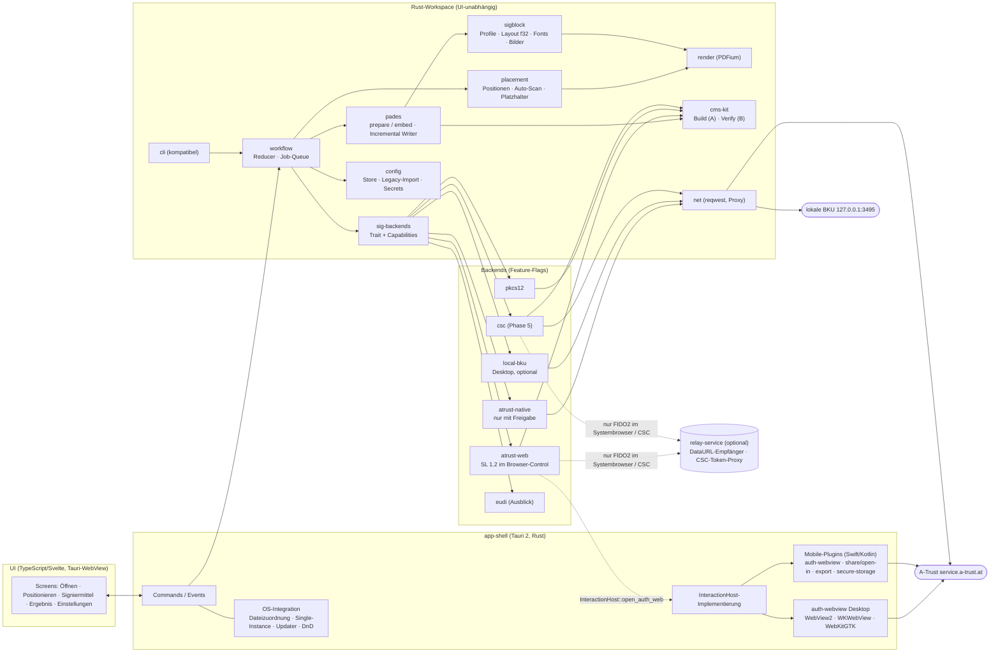
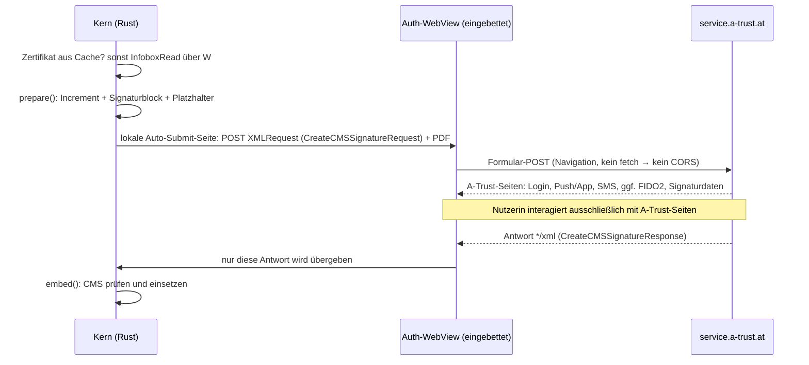

# Architektur- und Umsetzungsvorschlag „Time-to-Value“ für den PDF-Over-Klon

Stand: 2026-10-14 · Status: Entwurf zur Entscheidung · Blickwinkel: schnellster realistischer Weg zu einem produktiv nutzbaren Klon
Grundlagen: `docs/analyse/01–05`, `docs/recherche/01–03` (im Folgenden A01…A05, R01…R03). Kennzeichnung: **[I]** Interpretation/Bewertung, **[E]** Schätzwert, **[S-n]** wird in Spike n geklärt.

---

## 0. Kurzfassung

| Thema | Entscheidung |
|---|---|
| Stack | **Rust-Kern + Tauri 2** für alle fünf Plattformen, UI in TypeScript/Svelte, **PDFium** als einziger Renderer, PAdES-Engine auf **lopdf + RustCrypto** |
| A-Trust / ID Austria | **Standard ist Szenario (b) „Browser-Control“**: Die A-Trust-Seite läuft in einem eingebetteten WebView, der Klon nimmt nur die SL-1.2-Antwort entgegen. Das ist ohne Freigabe zulässig **und** weniger Arbeit als der native Flow. Szenario (a), der native Flow wie in PDF-Over, ist ein abschaltbares Feature, das erst mit schriftlicher Freigabe ausgeliefert wird. Mittelfristig kommen CSC und EUDI über dieselbe Backend-Schnittstelle dazu. |
| Inkremente | Wo 12 interne Alpha (Keystore), **Wo 19 öffentliche Desktop-Beta mit ID Austria**, Wo 28 Desktop 1.0 (Parität), Wo 38 Mobile 1.0 |
| Team / Aufwand | 2 Entwickler:innen + 0,3 FTE QA/DevOps, **≈ 20 PM** bis Mobile 1.0 (optionaler CSC-Ausbau +3 PM) |
| Größe | 8–15 MB je Desktop-Installer statt heute 80–95 MiB [E] |

---

## 1. Leitprinzipien für Time-to-Value

1. **Zuerst bauen, was rechtlich sicher ist, sofern es auch billiger ist.** Im Browser-Control-Weg übernimmt A-Trust alle Faktor-Dialoge: Login, App-Push, SMS, QR, FIDO2 (wo die Web-Engine es kann), Signaturdaten-Anzeige und den künftigen Wallet-Knopf. Die 8 Blocktypen, das Long-Polling und die ~6 Dialoge aus A02 §3.5–3.7 fallen weg. Der native Flow wird erst gebaut, wenn er erlaubt ist.
2. **Kein Eigenbau ohne Not.** Nicht in v1: PDF/A-Preflight (PDF-AS loggt ihn nur), PAdES-B-T/LT/LTA, JCEKS-Leser (stattdessen Konvertierungsanleitung `keytool -importkeystore`), PKCS#11, Web/PWA, Auto-Update auf Mobile (das übernehmen die Stores).
3. **PDF-AS wird als Datenquelle und als Test-Orakel genutzt, nicht als Code.** Die Profile aus `PDFASConfig.zip` (EUPL) werden unverändert eingelesen, die i18n-Texte konvertiert. Die 30 PDF-AS-Test-Suites (`pdf-as-tests/.../public_pdfbox2`) liefern die Golden Files.
4. **Je eine Kernsprache, ein Renderer und eine Shell.** Workflow-Zustand, PDF-Logik und Netz liegen in Rust. Die UI zeigt nur an. Fällt Tauri-Mobile durch, wird nur die Mobile-Shell ersetzt (Plan B Flutter); Kern und Reducer bleiben.
5. **Vertikale, auslieferbare Inkremente.** Jede Phase endet mit einem installierbaren Stand und geprüften Signaturen (DSS, pyHanko, Adobe).

---

## 2. Stack-Entscheidung

| Schicht | Wahl | Begründung | Verworfen |
|---|---|---|---|
| Kernsprache | **Rust** (stable, Edition 2024) | Rang 1 in R02. Alle Kategorien a–g sind permissiv abgedeckt, es gibt keinen GPL/AGPL-Zwang, der Kern läuft auf allen fünf Plattformen (später auch als WASM). Direkter FFI-Zugang für FIDO2 (`webauthn.dll`, libfido2). | Go (R02 Rang 2), TS, C++/PoDoFo, .NET, Dart: siehe unten |
| Shell Desktop | **Tauri 2.12** (WebView2 / WKWebView / WebKitGTK 4.1) | Matrixsieger R01 mit 84,2 Punkten. Auch in den Szenarien „Krypto/Integration-first“ (83,4) und „Klein“ (85,3) vorn. Distribution D=5 (Bundler und signierter Updater für alle Kanäle). Kleinste Installer. | Flutter-Desktop (Packaging D=3), Avalonia, Qt |
| Shell Mobile | **Tauri 2 Mobile + eigene Swift/Kotlin-Plugins**, Plan B **Flutter + flutter_rust_bridge** | Eine UI-Codebasis spart beim Mobile-Port 6–8 PW gegenüber einer zweiten UI [E]. Die Lücken (Share, Keychain, Auth-WebView) sind ohnehin Native-Plugins und in jedem Framework Eigenbau. Das Risiko „Mobile-Reife“ prüft Spike S5 vor Phase 4. | Flutter sofort für alles (gewinnt nur bei „Mobile-first“ mit 84,0 zu 82,8; das ist nicht unser Blickwinkel) |
| UI | **TypeScript + Svelte 5** (Vite) | Kleines Bundle, wenig Boilerplate. Die UI ist eine dünne View über Rust-Events. React wäre gleichwertig; das entscheidet der Skill des Teams. | – |
| PDF lesen/schreiben | **lopdf 0.45** (Parser, Objektmodell, Entschlüsselung) + **eigener Incremental-/Signatur-Writer**; `pdf-writer` 0.15 für Appearance- und CID-Font-Objekte | lopdf ist die beste permissive Basis (R02 §4.1a). Den Writer bauen wir selbst, weil Offsets, xref-Variante und ByteRange vollständig unter Kontrolle sein müssen (A03). `underskrift` (BSD-2) dient als Code-Vorlage, nicht als Abhängigkeit (jung, Ein-Personen-Projekt). | `pdf_oxide`, `oxidize-pdf` (jung), PDFsharp (AGPL ab 6.5), MuPDF/iText (AGPL) |
| Rendering | **PDFium** über `pdfium-render` 0.9 + `pdfium-binaries` | Ein Renderer für Seitenvorschau, Signaturblock-Vorschau, Raster-Scan (erzwungene Farben über `FPDF_COLORSCHEME` [S-4]) und Bildextraktion für QR-Platzhalter (`FPDFImageObj_GetBitmap`). Damit gibt es kein WebKitGTK/pdf.js-Risiko (R01 §7 Risiko 2), und Vorschau und Auto-Positionierung rechnen auf demselben Bild. | pdf.js (zweiter Renderer nötig, weil der Raster-Scan im Kern läuft), hayro (laut README experimentell) |
| Krypto | **RustCrypto** (`cms` 0.2.x, `x509-cert`, `der`, `spki`, `rsa`, `p256`/`p384`/`p521`, `sha2`), auf **eine Generation gepinnt**; `p12-keystore` 0.4; `keyring` für OS-Secret-Stores | `cms` unterstützt externen Digest und eigene Signed Attributes (Modell A), Modell B ist trivial selbst gebaut (R02 §5). Bis `cms` 0.3 stabil ist, wird eine Generation fest gepinnt. | `ring` allein (kein CMS), OpenSSL (Build-Aufwand auf iOS/Android) |
| HTTP | **reqwest 0.13** (rustls, `cookies`, `system-proxy`); `scraper` nur im optionalen `atrust-native` | Liest den System-Proxy unter Windows und macOS automatisch. Keine CORS-Probleme, weil der Code nativ läuft. | – |
| Weitere | `rxing` (QR, ZXing-nah), `skrifa` + `subsetter` (Fonts), `png`/`zune-jpeg`/`kamadak-exif`, `tracing`, `clap`, `directories`, `tokio` | alle MIT/Apache | – |

**Warum nicht die Alternativen (Kurzbegründung):**
- **Flutter + Rust-Core (83,0):** Das ist ebenfalls zweisprachig (Dart + Rust), Desktop-Packaging und Updates muss man selbst zusammenstellen (D=3 gegen 5), und die Governance von Flutter-Desktop liegt seit 05/2026 bei Canonical. Bei Desktop-first kostet das genau dort Zeit, wo der Nutzen zuerst entsteht. Flutter bleibt Plan B für die Mobile-Shell, weil Kern und Reducer in Rust wiederverwendbar sind.
- **Avalonia 12 (81,3):** Die .NET-Krypto ist stark, aber die PDF-Schicht müsste nach dem PDFsharp-Lizenzwechsel komplett selbst geschrieben werden. Mobile ist „experimental“, die Installer sind größer, Brainpool fehlt auf Apple. Die Rust-Crates (lopdf, RustCrypto, rxing) wären nicht nutzbar.
- **Go (`digitorus/pdfsign`):** Laut R02 der „schnellste Weg zu einem Signer“. Der Vorsprung betrifft aber nur das CMS-/Signierbaustein-Stück (≈ 2–3 PW [E]). Signaturblock, Profile, Platzhalter und Modell B sind ohnehin Eigenbau. Dazu kommt keine passende Shell: Wails v3 ist Beta, Mobile experimentell, und gomobile hat eine begrenzte Typoberfläche.
- **TypeScript (`@libpdf/core`, `@signpdf`):** Beta-Stand, keine Appearances, kein Modell B. Der A-Trust- und BKU-Verkehr müsste trotzdem nativ laufen.
- **K.O. laut R01:** Compose MP (JVM-Desktop), MAUI und React Native (kein Linux), Electron (kein Mobile, 80–150 MB), PWA (CORS, RP-Bindung, LNA).

---

## 3. Architektur

### 3.1 Komponenten



### 3.2 Crates und Verantwortlichkeiten

| Crate | Verantwortung | Wichtigste Schnittstelle |
|---|---|---|
| `workflow` | Expliziter, ereignisgetriebener Reducer als Ersatz für die 12-State-Maschine (A01 §3), Batch-Queue, Re-Entry aus den Einstellungen | `fn reduce(State, Event) -> (State, Vec<Effect>)` |
| `pades` | Zweiphasiges Signieren: `prepare` (Increment mit Platzhalter) → `embed` (CMS einsetzen, Längenprüfung) | `PreparedPdf`, `SignedPdf` |
| `sigblock` | PDF-AS-Profil-Engine (Properties, Include, Vererbung, OGNL-Teilmenge), Tabellenlayout in `f32`, Std-14-AFM, TTF-Subset, Logos | `fn build(profile, cert, opts) -> Appearance` |
| `placement` | Koordinatenräume, Klemmung, Auto-Positionierung (Raster-Scan), QR- und Feld-Platzhalter | `fn resolve(doc, request) -> Placement` |
| `render` | PDFium-Fassade: Seitenbitmaps, erzwungene Farben, Bild-XObjects | `fn page_bitmap(page, dpi, mode)` |
| `cms-kit` | SignedData bauen (Modell A), fremdes CMS prüfen (Modell B), ESSCertIDv2, Algorithmuswahl wie PDF-AS | `build_signed_data`, `verify_detached` |
| `sig-backends` | Trait, Capabilities, Implementierungen hinter Cargo-Features | `SignatureBackend` |
| `sl12` | SL-1.2-XML (InfoboxRead, CreateCMS, NullOperation, ErrorResponse 6000/6001) für `atrust-*` und `local-bku` | Builder/Parser |
| `config` | Neues Konfigurationsmodell (TOML, plattformüblicher Ort), Java-Properties-Parser, Import aus `~/.pdf-over`, Secrets über `keyring` | `Config`, `LegacyImport` |
| `app-shell` | Tauri-Commands, `InteractionHost`, Auth-WebView je OS, Datei-Events, Updater | Tauri IPC |
| `relay-service` | optional, separat betrieben (axum): DataURL-Empfänger für den Systembrowser-Weg, später CSC-Token-Proxy | HTTPS |

### 3.3 Capability-Modell der Backends

| Backend | Eingabe | Ausgabe | Interaktion | Server | Zertifikat vorab | Batch | Plattformen |
|---|---|---|---|---|---|---|---|
| `atrust-web` (b) | ganzes Dokument (ausgeschwärzt) | CMS | `EmbeddedWeb` (FIDO2 ggf. `SystemBrowser`) | keiner, für FIDO2 im Systembrowser DataURL-Relay | ja (InfoboxRead oder Zertifikats-Cache) | nein | alle |
| `atrust-native` (a) | ganzes Dokument | CMS | `NativeDialogs` | keiner | ja (InfoboxRead) | nein | alle |
| `pkcs12` | Digest | Rohsignatur | `None` (Passwort) | keiner | ja (lokal) | ja | alle |
| `local-bku` | ganzes Dokument | CMS | `None` (BKU-eigene UI) | keiner | ja | nein | Desktop |
| `csc` | Digest | Rohsignatur | `SystemBrowser` (OAuth2) | Token-Proxy (`client_secret`) | ja (`credentials/info`) | ja (`numSignatures`) | alle |
| `eudi` | offen (Dokument oder Hash) | offen | `SystemBrowser`/App2App | offen | offen | offen | Mobile zuerst |

Die PAdES-Vorbereitung ist nie an ein Backend gekoppelt. Der Kern fragt nur ab, ob der Signaturblock ein Zertifikat braucht und ob ein Digest oder das ganze Dokument zum Backend geht.

### 3.4 Code-Skizzen

```rust
// sig-backends
pub enum InputKind { FullDocument, Digest }
pub enum OutputKind { CmsSignedData, RawSignature }
pub enum Interaction { None, NativeDialogs, EmbeddedWeb, SystemBrowser }
pub enum ServerNeed { None, DataUrlReceiver, TokenProxy }

pub struct Capabilities {
    pub input: InputKind, pub output: OutputKind, pub interaction: Interaction,
    pub server: ServerNeed, pub certificate_first: bool, pub batch_max: u32,
    pub platforms: PlatformSet,
}

#[async_trait::async_trait]
pub trait SignatureBackend: Send + Sync {
    fn id(&self) -> BackendId;
    fn capabilities(&self) -> Capabilities;
    async fn available(&self) -> bool;                       // z. B. TCP-Probe 127.0.0.1:3495
    async fn certificate(&self, host: &dyn InteractionHost) -> Result<Certificate, SignError>;
    async fn sign(&self, req: SignRequest<'_>, host: &dyn InteractionHost)
        -> Result<SignResponse, SignError>;
}

pub enum SignRequest<'a> {
    Document { prepared: &'a PreparedPdf },                   // Modell B (SL)
    Digests  { items: &'a [DigestToSign], cert: &'a Certificate }, // Modell A, batchfähig
}
pub enum SignResponse {
    Cms(Vec<u8>),
    Raw { signatures: Vec<Vec<u8>>, cert: Certificate, chain: Vec<Certificate> },
}

// vom Host (Tauri-Shell bzw. Mobile-Plugin) implementiert – hält den Kern UI-frei
#[async_trait::async_trait]
pub trait InteractionHost: Send + Sync {
    async fn ask_secret(&self, p: SecretPrompt) -> Option<secrecy::SecretString>;
    async fn open_auth_web(&self, r: AuthWebRequest) -> Result<AuthWebResult, AuthWebError>;
    async fn open_system_browser(&self, url: url::Url, cb: CallbackSpec) -> Result<CallbackData, AuthWebError>;
    async fn dialog(&self, d: NativeDialog) -> DialogAnswer;   // nur atrust-native, Rückfragen
    fn progress(&self, p: Progress);
}

pub struct AuthWebRequest {
    pub endpoint: url::Url,              // https://service.a-trust.at/mobile/https-security-layer-request/default.aspx
    pub form: SlForm,                    // XMLRequest (+ fileupload | Base64Content), Darstellungsparameter
    pub capture: CaptureRule,            // "Antwort mit MIME */xml und SL-Namespace" – keine A-Trust-Seite wird gelesen
    pub keep_alive_in_background: bool,  // App-Wechsel zur App „ID Austria“ ist kein Abbruch
}
```

```rust
// pades – zweiphasig, nach dem Vorbild der ungenutzten PDF-AS-API startSign/finishSign
pub fn prepare(src: &mut dyn PdfSource, opts: &PrepareOptions) -> Result<PreparedPdf, PadesError>;
impl PreparedPdf {
    pub fn byte_range(&self) -> [u64; 4];
    pub fn digest(&self, alg: DigestAlg) -> Vec<u8>;                 // Modell A
    pub fn blackout_reader(&self) -> impl std::io::Read + '_;       // Modell B: ganzes PDF, Lücke = 0x00
    pub fn excluded_byte_range(&self) -> (u64, u64);                 // From/To inklusive
}
pub fn embed(p: PreparedPdf, cms: &[u8], expect: &Certificate) -> Result<SignedPdf, PadesError>;
// embed prüft: Länge ≤ Reserve, genau 1 SignerInfo, message-digest, Signatur, ESS-Zertifikat, Fingerprint
```

```ts
// UI-Seite: typisierte Tauri-Fassade, keine Fachlogik
export interface CoreApi {
  dispatch(e: UiEvent): Promise<void>;                        // Open, Place, ChooseBackend, Sign, Save …
  onState(cb: (s: ViewState) => void): Unsubscribe;
  pageImage(docId: string, page: number, dpi: number): string; // URL auf Custom-Protocol preview://
  blockPreview(profile: ProfileKey, note?: string): string;
}
```

### 3.5 Workflow-Reducer

Die impliziten PDF-Over-Regeln (verzögertes `cleanUp`, Rückkehr zum selben State-Objekt, verschachtelte Event-Loop) werden zu expliziten Zuständen: `Idle → DocumentLoaded{queue} → Placing → ChoosingBackend → Signing{backend, phase} → Output → (nächstes Dokument | Idle)`. `Settings` ist ein **Overlay** über dem aktuellen Zustand und kein eigener Zustand. Seiteneffekte (Rendern, HTTP, Dateien) laufen als `Effect` in Tokio-Tasks und melden sich als `Event` zurück. Damit lässt sich die Übergangstabelle aus A01 §3 direkt in Tabellentests übertragen.

---

## 4. A-Trust / ID Austria

### 4.1 Szenario (b) – ohne Freigabe (Standard, ab Beta)

Ablauf einer Signatur:



Technische Eckpunkte:
- **Transport ins WebView:** Eine lokal erzeugte Auto-Submit-Seite (Tauri-Custom-Protocol) sendet das Formular an A-Trust: `multipart/form-data` mit `XMLRequest` und der Datei `fileupload`, die per JS-`DataTransfer` gesetzt wird. Alternative ist `Base64Content` im XMLRequest (urlencoded), zwingend für Android `postUrl`. Welche Variante A-Trust akzeptiert, wo das 413-Limit liegt und ob Referer/Origin geprüft werden, klärt [S-1].
- **Antwort abgreifen ohne Parsen der A-Trust-Seiten:** WebView2 nutzt `WebResourceResponseReceived` mit `GetContent`, WebKitGTK `webkit_web_view_get_main_resource` und `get_data`. WKWebView und Android-WebView prüfen den MIME-Typ im Navigations-Delegate und lesen bei `*/xml` das Dokument mit `XMLSerializer` aus. In Tauri wird das über `WebviewWindowBuilder::with_webview` (native Handles) umgesetzt [I, S-1]. Gelesen wird ausschließlich die an den Client gerichtete SL-Antwort, also kein Formular und kein Seitentext.
- **Doppelte Anmeldung vermeiden:** PDF-Over startet je SL-Request eine neue A-Trust-Sitzung und meldet sich im zweiten Request automatisch neu an (A02 §3.9). Im Browser-Control würde die Nutzerin sich deshalb zweimal anmelden. Gegenmaßnahme ist ein **Zertifikats-Cache**: Das Signerzertifikat ist öffentlich und wird nach der ersten Signatur gespeichert. Damit genügt ab der zweiten Signatur ein einziger A-Trust-Durchlauf. Weicht das Zertifikat im CMS ab (Erneuerung, anderes Konto), wird das Ergebnis verworfen, der Block mit dem neuen Zertifikat neu gebaut und ein weiteres Mal bestätigt. Die UI bietet „Anderes Konto“ an. Ob Cookies im WebView den zweiten Login beim Erstlauf ersparen, prüft [S-1].
- **Sorgfalt:** Passwort-Autosave und Autofill im WebView sind abgeschaltet (A-Trust-Komponentenliste §3.1). Die Nummer wird nur über den offiziellen Parameter `telephonenumber` vorbelegt (`MOBILE_NUMBER`, CLI `-n`). `-p` und „Passwort merken“ wirken in (b) nicht, die CLI gibt dazu einen Hinweis aus.
- **Mobile:** Ein eigenes Plugin öffnet das Auth-WebView modal (WKWebView bzw. Android-WebView). Es bleibt beim Wechsel in die App „ID Austria“ erhalten, und das Long-Polling erledigt der JS-Code der A-Trust-Seite selbst. Ein Verlassen des Vordergrunds gilt nicht als Abbruch.

### 4.2 Szenario (a) – mit Freigabe (nativer Flow)

- Das Crate `atrust-native` portiert A02 §3.3–3.12 1:1: ein `reqwest`-Client pro SL-Request mit eigenem Cookie-Jar, manuelle Redirects (nur 301/302, als GET), Refresh-Header und meta refresh, genau ein Formular, die 8 Blocktypen per `scraper`, Long-Poll (Bearer, 300 s, 10 s Backoff), Loop-Guard und Zugangsdaten nur im RAM (`secrecy`/`zeroize`).
- Die Dialoge (Login, SMS-TAN, QR, App-Warten, FIDO2) sind eigene Svelte-Screens. Der Kern spricht sie über `InteractionHost::dialog` an.
- Das Feature ist als Cargo-Feature angelegt. Release-Builds enthalten es erst, wenn eine schriftliche Freigabe vorliegt; die Entscheidung fällt spätestens in Woche 16. Aufwand: **4 Wochen für 1 Person** inklusive nativem FIDO2 auf dem Desktop. Ohne Freigabe entfällt der Aufwand vollständig.

### 4.3 FIDO2 je Plattform

| Plattform | (a) mit Freigabe | (b) ohne Freigabe | v1-Zusage |
|---|---|---|---|
| Windows | `webauthn.dll` über das `windows`-Crate, `clientDataJSON` mit Origin `https://service.a-trust.at` | WebAuthn der A-Trust-Seite direkt in WebView2 (Chromium nutzt `webauthn.dll`) [S-6] | ja |
| macOS | libfido2 (mitgeliefert) oder `ctap-hid-fido2`, nur USB-Token | WKWebView hat kein WebAuthn für fremde RP. Daher Systembrowser mit lokaler Loopback-Startseite (Auto-Submit) und DataURL-Relay. Später optional die CEF-Runtime aus Tauri 3. | (a): ja; (b): Desktop 1.0, falls Relay betrieben wird |
| Linux | libfido2 (Systempaket), udev/`uaccess` | wie macOS (WebKitGTK-WebAuthn unsicher) | wie macOS |
| iOS | nicht in v1 (rohes CTAP2 über NFC braucht Entitlements und Vendor-SDK) | `ASWebAuthenticationSession` + Relay | v1.1 |
| Android | nicht in v1 | Custom Tabs/Auth Tab + Relay | v1.1 |

Als Alternative löst der CSC-Pfad FIDO2 auf allen Plattformen auf natürliche Weise (OAuth im Systembrowser).

### 4.4 Relay-Service (optional, klein)

- Der Relay-Service ist nur für den Systembrowser-Weg (FIDO2 außerhalb von Windows in (b)) und für CSC nötig.
- `POST /sl/{nonce}` ist die DataURL. Sie nimmt `XMLResponse` entgegen, hält sie höchstens 5 Minuten im RAM und antwortet A-Trust wie in den SL-Bindings vorgesehen. Die `RedirectURL` führt den Browser auf eine Loopback- bzw. App-Link-Seite „fertig“. Die App holt die Antwort per Long-Poll mit einem geheimen Token ab.
- Das PDF läuft nie über das Relay: Auf dem Desktop kommt die Auto-Submit-Seite von `127.0.0.1`, auf Mobile ist das noch zu klären [S-6].
- Aufwand ≈ 1,5 PW [E]. Datenschutz: Das CMS enthält das Zertifikat und damit den Namen. Nötig sind Datenschutzerklärung, Löschkonzept, kein Logging der Payloads und Hosting in der EU (R03 §8).

### 4.5 CSC und EUDI

- **CSC v1.4 (Phase 5, abhängig vom Vertrag):** Das Backend `csc` nutzt Modell A. Der Kern baut die SignedAttributes und das CMS selbst (`cms-kit`), A-Trust erhält nur Hashes. Batch läuft über `numSignatures`. Der Token-Proxy hält das `client_secret` und läuft im Relay-Service. Der Klon wird dabei zur Anzeigekomponente (WYSIWYS): Vor dem OAuth-Schritt zeigt er die Vorschau und den Hash an. Aufwand ≈ 3 PW + 1 PW Relay [E].
- **EUDI:** Kurzfristig ohne Eigenbau: In (b) werden die offiziellen Parameter `showwallet`/`usewallet` durchgereicht, damit gibt es den Wallet-Knopf „gratis“. Mittelfristig wird `csc` zu `GenericCscRssp` verallgemeinert (QTSP-getriebene QES nach POTENTIAL). Ein `eudi`-Backend (OpenID4VP) folgt erst, wenn die AT-Schnittstellen veröffentlicht sind (R03 Q13).

### 4.6 Sofort an A-Trust zu klären (Woche 1)

1. Darf der Klon die Seiten nativ befüllen (Q1)? Ist die Nutzung des SL-Endpoints durch Dritt-Clients im Browser-Control ausdrücklich erlaubt, gibt es Rate-Limits (Q2)?
2. Wird `Base64Content` akzeptiert, wo liegt das Upload-Limit, bleibt die Sitzung zwischen InfoboxRead und CMS erhalten?
3. Konditionen einer CSC-Partnerschaft für ein Open-Source-Projekt, PKCE/Public Client, Redirect auf App Links (Q4–Q6)?
4. Bereitschaft zu Associated Domains, Digital Asset Links oder `/.well-known/webauthn` für FIDO2 auf Mobile?

---

## 5. Plattform-Matrix

| Funktion | Windows | macOS | Linux | iOS | Android |
|---|---|---|---|---|---|
| Dokument öffnen | DnD, Dialog, „Öffnen mit“ (HKCU-ProgID), „Senden an“, CLI | DnD, Dialog, Open-With (`RunEvent::Opened`), CLI | DnD, Dialog, `.desktop` mit `MimeType=application/pdf;` + `%F`, CLI | Document Picker, „Öffnen in“/Share (Document Types) | SAF-Picker, Intents VIEW/SEND/SEND_MULTIPLE |
| Batch-Warteschlange | ja, plus Single-Instance-Weitergabe | ja | ja | Mehrfachauswahl | Mehrfachauswahl |
| Vorschau, Positionierung | Maus, Pfeile 15 pt, PgUp/PgDn, Rad | ebenso | ebenso | Touch-Drag, Pinch, Seitenwischen | ebenso |
| Auto-Position, Platzhalter, neue Seite, PDF/A, PDF/UA, verschlüsselte PDFs | Kern (überall gleich) | Kern | Kern | Kern | Kern |
| ID Austria (b) | WebView2-Fenster | WKWebView-Fenster | WebKitGTK-Fenster | WKWebView-Modal (Plugin) | WebView-Activity (Plugin) |
| ID Austria (a) | nativ | nativ | nativ | nativ (App/SMS) | nativ (App/SMS) |
| FIDO2 | siehe §4.3 | siehe §4.3 | siehe §4.3 | v1.1 | v1.1 |
| Lokale BKU | Plugin (optional) | Plugin | Plugin | – | – |
| PKCS#12 | Datei, Passwort in Credential Manager | Datei, Keychain | Datei, Secret Service (Fallback: nur RAM) | Import in Sandbox, Keychain | Import, Android-Keystore-verschlüsselt |
| Ausgabe | Ordner/Dialog, Postfix `_signed`, Überschreib-Rückfrage | ebenso | ebenso | Export in „Dateien“, Share | SAF CreateDocument, Share |
| Ergebnis öffnen | `opener` | `opener` | `xdg-open` | QuickLook | ACTION_VIEW |
| CLI | ja (+ Konsolen-Launcher) | ja | ja | – | – |
| Proxy | System + manuell | System + manuell | Env + manuell | System | System |
| Update | Tauri-Updater (optional MS Store) | Updater, notarisiert | Repo/Flathub/AppImage-Updater | App Store | Play Store |

**Mobile-Umfang v1:** ID Austria (b) bzw. (a), PKCS#12, alle Profile, Touch-Positionierung, Platzhalter, Auto-Position, PDF/A, Open-In/Share/Export. Bewusst nicht in v1: lokale BKU (es gibt keine), CLI, FIDO2 (v1.1), Proxy-UI, Update-Check. Mindest-OS iOS 16 und Android 12, passend zur App „ID Austria“. Große PDFs werden über Temp-Dateien und Streaming-Hash verarbeitet, nicht vollständig im RAM.

---

## 6. PDF-Engine-Plan

### 6.1 Incremental Writer (`pades`)
- **Eingabe:** Die Originalbytes bleiben unverändert der Präfix (Invariante, als Property-Test), lopdf parst sie nur. Das Increment beginnt mit CRLF und enthält nur neue bzw. geänderte Objekte: Signaturdictionary, Feld/Widget, Seite (`/Annots`), Katalog/AcroForm, XObjects, Fonts.
- **xref-Format wie PDFBox:** klassisch führt zu einer Tabelle mit `/Prev`; xref-Stream zu einem xref-Stream (`/W [1 3 0]`, Flate); Hybrid zu beidem. Object Streams werden nie geschrieben. `/ID[0]` bleibt, `/ID[1]` wird neu berechnet, `/Size` fortgeschrieben. Ob lopdfs `IncrementalDocument` das selbst korrekt erledigt, prüft [S-2]; falls nicht, schreiben wir die xref-Sektion selbst (≈ 400 LOC [E]).
- **Platzhalter:** Das Signaturdictionary wird selbst serialisiert, damit die Offsets exakt bekannt sind. `/Contents <00…>` hat eine feste Hex-Länge, `/ByteRange` ist auf 36 Zeichen gepolstert und wird nachträglich gepatcht. Ausgabe in Großbuchstaben-Hex, Rest mit `0` aufgefüllt. Die Reserve folgt dem Profil-Key `signatureSize` (Default 4096 wie PDF-AS). Ist die in [S-1] gemessene A-Trust-CMS-Größe größer als 50 % der Reserve, wird der Default angehoben. Das ist eine strukturell harmlose Abweichung.
- **Verschlüsselte PDFs:** nur ohne User-Passwort und mit der Rechteprüfung `(canModify && canModifyAnnotations) || canFillInForm`. Neue Strings und Streams werden verschlüsselt, `/Contents` nicht. Testfälle für RC4, AES-128 und AES-256 gehören zur Pflicht.
- **Sicherheit:** Die Ausgabe geht in eine Temp-Datei und wird atomar umbenannt. Das Original wird nie überschrieben.

### 6.2 Signaturfeld, AcroForm
Wir übernehmen die PDF-AS-Struktur aus A03: neues AcroForm direkt im Katalog (`/SigFlags 3`, `/DR`, `/DA`), Feld und Widget in einem Dictionary (`/F 132`, `/TU`), direkte `/Annots`. Sonderfall vorhandenes leeres Feld: Rect bleibt, AP wird ersetzt, `/F 4`, kein Umbenennen. Unsichtbar: `[0 0 0 0]` auf Seite 1. Den Fixup von `NeedAppearances` bilden wir nach, wenn [S-2] zeigt, dass Viewer ihn brauchen. Den Default-Feldnamen entscheidet der Auftraggeber (§12).

### 6.3 Signaturblock-Renderer (`sigblock`): PDF-AS-Profile werden wiederverwendet
- Die Konfiguration aus `PDFASConfig.zip` wird read-only im App-Bundle mitgeliefert (≈ 1 MB inkl. Fonts/Logos). Gelesen wird sie mit einem Java-Properties-Parser (ISO-8859-1, `\u`-Escapes, Wildcard-Includes) und schlüsselweiser Vererbung `parent`/`augments`.
- **OGNL-Teilmenge** als kleiner Interpreter: `${subject.X}`, `issuer.X`, `sn`, Ternary, Map-Zugriff, Listen-Literal-Trick. Unbekannte Ausdrücke sind ein harter Fehler im Test, damit nichts still falsch wird.
- **Layout in `f32`:** Spaltengewichte, gieriger Umbruch mit strikt-größer-Vergleich, Zeilenhöhe `size·n + 2p`, Bildbox mit `floor`, Java-`split`/`trim`-Semantik. Zielwerte aus A04: SMALL_DE 230×49 pt, AMTS 495×120 pt, Logo 33×34 bzw. 61×61 pt.
- **Fonts:** Std-14 nicht eingebettet mit AFM-Breiten (Adobe-Core14-AFM, frei weitergebbar). DejaVu als Type0/CIDFontType2-Subset (`subsetter`) mit `/W`, ToUnicode und CIDSet. Kein `arial.ttf`.
- **Bilder:** PNG mit Predictor 15 und SMask; EXIF-Ausrichtung (A04, auf Mobile auch HEIC, bewusste Erweiterung); Emblem-Cache wie bisher, aber im App-Cache-Verzeichnis.
- **Appearance:** Holder-Form `q 1 0 0 1 0 0 cm /FRM1 Do Q` + Inner-Form, BBox `[W+1 H+1]` (Quirk bewusst übernommen), Rotationsmatrix für 90/180/270°.
- Gelingt die Profiltreue in [S-3] nicht wirtschaftlich, ist der Fallback: Nur die 8 von PDF-Over genutzten Profil-IDs werden als fest kodierte Layouts nachgebaut. Dann gibt es keinen Import fremder Profile.

### 6.4 Vorschau
- **Seiten:** PDFium rendert die Seiten im Kern mit `dpi × devicePixelRatio`. Die UI bekommt WebP/PNG über das Custom-Protocol `preview://`, mit LRU-Cache und Vorab-Rendern der Nachbarseiten.
- **Signaturblock:** Er entsteht im selben Code-Pfad wie beim Signieren. Ein A4-Template-PDF mit Beispielzertifikat wird bei 288 dpi gerendert und zugeschnitten; Blockgröße = Pixel/4 (A04). Was die Vorschau zeigt, wird damit auch signiert.

### 6.5 Positionierung und Auto-Positionierung
- Koordinaten (PAGE_ABS/REL, IMAGE, SCREEN) und Klemmung rechnet `placement` und nicht die UI; die UI meldet nur Zeigerereignisse. Neue Seite = Seite `numPages+1` mit gleicher MediaBox und Rotation; bei schon signierten Dokumenten wird keine neue Seite angehängt (PDF-AS-Verhalten).
- **Auto-Positionierung:** Rendern bei 72 dpi mit Signalhintergrund RGB(152,254,52) und erzwungenen Pfad- und Textfarben (`FPDF_COLORSCHEME`). Gesucht wird die unterste belegte Zeile oberhalb von `f:80`, der Block kommt 20 pt darunter. Passt er nicht, folgt eine neue Seite. Abweichungen gegenüber dem Anti-Aliasing von Java2D werden mit ±2 pt Toleranz gegen die Golden Files geprüft.

### 6.6 Platzhalter
- **QR:** Content-Streams werden mit CTM-Verfolgung interpretiert. Durchsucht werden nur Bild-XObjects über `Do` (wie PDF-AS). Die Bitmap kommt über PDFium (alle Filter), dekodiert wird mit `rxing`, Payload `PDF-AS-POS;id=…;profile=…;type=…;key=…`. Daraus ergeben sich `x=floor`, `y=ceil(Oberkante)`, `w=ceil`. Modi STRICT/MODERATE/LENIENT/SORTED, verbrauchte Platzhalter über `/Location`.
- **Leere Signaturfelder:** Auswahl in einem nativen Dialog bzw. einer Liste auf Mobile, **gültig nur für diese Signatur** (B-05 behoben, nichts in `advancedconfig.properties`).

### 6.7 PDF/A und PDF/UA
- **PDF/A:** Erkennung über XMP `pdfaid:part`, `_PDFA`-Profil, eingebettete Caption-Schrift, Alphakanal entfernen, sRGB-OutputIntent (frei lizenziertes ICC-Profil), CIDSet nach Teil. Die PDF-AS-Lücke bei PDF/A-2 wird bewusst geschlossen (OutputIntent nur ergänzen, wenn keiner vorhanden ist). Einen Preflight im Produkt gibt es nicht; veraPDF läuft in der CI.
- **PDF/UA (Phase 3):** Bei vorhandenem StructTreeRoot werden ParentTree (`/Nums`/`/Kids`), `ParentTreeNextKey`, OBJR, `/StructParent` und `/Tabs /S` fortgeschrieben.

### 6.8 CMS (`cms-kit`)
- **Modell A (PKCS#12, später CSC):** SignedData v1, detached, nur das Signerzertifikat, IssuerAndSerialNumber. Signierte Attribute: content-type, ETSI-mime-type, signing-time, message-digest und signing-certificate-v2. Algorithmen wie PDF-AS (RSA sha256WithRSA; EC: Feld ≥ 512 → SHA-512, ≥ 256 → SHA-256; NULL-Parameter bei ECDSA). Ein Schalter „strikt Baseline-B“ (ohne signing-time) ist vorbereitet, aber standardmäßig aus.
- **Modell B (SL):** Geprüft wird wie in A03 §CMS: genau ein SignerInfo, message-digest gleich dem Hash der ByteRange, gültige Signatur, ESS-Zertifikat passt, Fingerprint gleich dem erwarteten Zertifikat (InfoboxRead oder Cache).

### 6.9 Grundsatz zu PDF-AS-Eigenheiten
Strukturgleichheit statt Byte-Gleichheit (A03). **Ausgabe-relevante Eigenheiten werden übernommen**: signing-time, mime-type, BBox +1, AMTS-Breite in Abhängigkeit von x. **Reine UI- und Konfigurationsfehler werden behoben**: B-05, `-v true`, vertauschte Hilfetexte, PROXY_PORT-Absturz. Jede Abweichung steht in einem Entscheidungslog und hat einen Test.

---

## 7. Konfiguration, Migration, CLI, i18n

- **Neue Konfiguration:** TOML am plattformüblichen Ort (`directories`: `%APPDATA%`, `~/Library/Application Support`, `$XDG_CONFIG_HOME`; Mobile: Sandbox). Die 31 Keys aus A05 werden 1:1 benannt übernommen, ihre Sonderregeln (UPDATE_CHECK nur `false`, MOBILE_REMEMBER_PASSWORD case-sensitiv, USE_FIELDS gewinnt über USE_MARKER, fehlende vs. leere SIGNATURE_NOTE) werden **beim Import** normalisiert. Danach gilt im neuen Format eine saubere Semantik.
- **Legacy-Import:** Beim ersten Start wird `~/.pdf-over/PDF-Over.config` erkannt und nach Rückfrage gelesen. Die Legacy-Datei wird nie verändert. Ist eine Datei nicht gültiges ISO-8859-1-Properties, wird vorher UTF-8 versucht (A05: manche Dateien wurden von Hand in UTF-8 editiert). Klartext-Secrets (KEYSTORE_STOREPASS/KEYPASS bei `disk`, PROXY_PASS) wandern nach Zustimmung in den OS-Schlüsselbund. Ohne Secret Service unter Linux gilt nur `memory`.
- **Profile:** Mitgeliefert ist die PDF-AS-Konfiguration 4.4.6 (read-only). Eigene Anpassungen aus `~/.pdf-over/cfg/` werden per Hash-Vergleich mit der Auslieferungsversion erkannt und als Benutzer-Overlay übernommen; nicht unterstützte Keys erzeugen eine Warnung. Die Emblem-Datei wird neu gecacht.
- **CLI:** Gleiche Optionen und Zwei-Phasen-Parsing (`-c` zuerst). Die skriptrelevanten Quirks bleiben erhalten: unbekanntes Token = Eingabedatei, `-o` als Datei oder Ordner, `-c` relativ zum Konfigurationsordner, `-v` konsumiert seinen Wert. Overlays werden nie persistiert. Unter Windows gibt es einen Konsolen-Launcher `…-cli.exe`. Neu und billig: `--headless` für PKCS#12-Batch ohne GUI (≈ 2 PT [E]).
- **i18n:** Ein Konverter übersetzt `messages*.properties` (Escapes, `&`-Mnemonics, `%s`/`%d`, `<a>`) in JSON mit ICU-MessageFormat und behält die Key-Namen. Dabei werden das DE-Duplikat und fehlende Keys korrigiert, ungenutzte Keys entfernt. Fallback DE wie bisher. Der Kern liefert Fehlercodes, die Texte stehen nur in der UI.

---

## 8. Qualitätssicherung

| Baustein | Inhalt |
|---|---|
| Testkorpus | v0 (Wo 4): 30 PDF-AS-Testdateien und Suites, die P1–P3-Proben aus A03, 70 eigene PDFs. v1 (Wo 28): ≈ 300 PDFs mit Klassik-, xref-Stream- und Hybrid-xref, kaputten xref, RC4/AES-128/AES-256, PDF/A-1b/2b/3b, PDF/UA, Mehrfachsignaturen, Rotation, CropBox-Offset, AcroForm mit `/Kids`, DocMDP, Behördenformulare. Lizenzen der Korpusdateien werden geprüft. |
| Golden Files | PDF-AS 4.4.2 läuft **nur in der CI** (Docker, Java ist hier Werkzeug, nicht Produkt) mit festem Test-PKCS#12 und den 30 Suite-Konfigurationen. Verglichen wird normalisiert: Präfix-Invariante, ByteRange/Contents-Regeln, Objektmengen und Dictionaries, Appearance-Token mit Float-Toleranz, Rect/BBox, ASN.1-Dump mit Maskierung (Zeit, Signaturwert), message-digest-Orakel und ein Pixelvergleich des Blockbereichs (PDFium, Toleranz). |
| Validatoren | Automatisch in der CI: EU DSS (Docker), pyHanko `validate`, poppler `pdfsig`, `qpdf --check`, veraPDF, `openssl cms`. Manuell bei jedem Release Candidate: Adobe Acrobat Reader (Checkliste mit 20 Dateien) und RTR-Prüfdienst (Web-Upload; SOAP, sobald Zugang besteht). |
| Backends | SL-1.2-XML gegen XSD. `atrust-web` als E2E im Testsystem `hs-abnahme` mit Testkonten (nightly, Achtung: CORS verhält sich anders als in Produktion). Pilot-Signaturen in Produktion ab der Beta. Lokale BKU über einen Mock-Server. |
| Fuzzing | `cargo-fuzz` für Parser, Incremental Writer, Properties-/OGNL-Parser, CMS-Parser, SL-XML und HTML (nur `atrust-native`). `proptest` für die Invarianten. Nightly 1 h je Ziel, Crash-Funde wandern ins Korpus. |
| UI/Workflow | Tabellentests des Reducers gegen die Übergangstabelle aus A01. Playwright gegen die Tauri-UI (WebDriver) für die Hauptpfade. |
| CI-Matrix | GitHub Actions: `windows-latest` (x64, arm64 cross), `macos-14` (arm64 + x64), `ubuntu-22.04/24.04` (x64, arm64), Android-Emulator (API 31/35), iOS-Simulator (iOS 16/18). Release-Pipeline mit Signierung und Notarisierung (S7). |

---

## 9. Distribution, Updates, Größen

| Plattform | Paket | Signierung | Update | Erwartete Größe [E] (heute) |
|---|---|---|---|---|
| Windows x64/arm64 | NSIS-EXE + MSI (per-user, ohne Admin), optional MSIX/Store | Microsoft Artifact Signing (Organisation in der EU) oder EV-Zertifikat | Tauri-Updater (signiertes Manifest, eigener Endpoint) | 10–14 MB; WebView2 ist ab Win10 1803 vorhanden (MSI 90,4 MiB) |
| macOS | DMG je Architektur (oder universal) | Developer ID + `notarytool` in der CI | Tauri-Updater | 10–13 MB je Arch, universal 18–24 MB (DMG 80,9/86,8 MiB) |
| Linux | `.deb`, `.rpm` (System-WebKitGTK 4.1), Flatpak (Flathub), AppImage | Repo-GPG, Flathub | Paketquelle/Flatpak, AppImage-Updater | deb/rpm 9–12 MB, Flatpak 10–15 MB + GNOME-Runtime (geteilt), AppImage 70–90 MB (Jar 95,2 MiB) |
| iOS | App Store / TestFlight | Apple | Store | 15–25 MB |
| Android | AAB (Play), APK je ABI | Play App Signing | Store | 12–20 MB je ABI |

Größentreiber sind die PDFium-Bibliothek (≈ 5–8 MB unkomprimiert), das Rust-Binary und die Ressourcen (≈ 1 MB). Ein eigener Update-Endpoint mit signiertem Manifest ersetzt das unsignierte `Release.txt`.

---

## 10. Phasenplan

**Team-Annahme:** 2 erfahrene Entwickler:innen in Vollzeit. Dev 1 hat den Schwerpunkt Rust/PDF/Krypto, Dev 2 Rust/TypeScript/Plattformen mit Swift/Kotlin-Grundlagen. Dazu 0,3 FTE QA/DevOps (CI, Signierung, Store-Abwicklung, Testkorpus). Nicht eingerechnet ist Product Ownership auf Auftraggeberseite: A-Trust-Kontakt, Pilotnutzer:innen, Zertifikate für Code-Signing, Testkonten. Rust-Erfahrung im Team ist Voraussetzung; ohne sie +20–30 % [E].

| Phase | Wochen | Umfang | Exit-Kriterien |
|---|---|---|---|
| **P0 Spikes & Fundament** | 1–4 (4) | Spikes S1–S4, S7. Workspace, CI-Gerüst, Korpus v0, PDF-AS-Golden-Generator in Docker. Anfrage an A-Trust (§4.6) geht in Woche 1 raus. | Go/No-Go zu S1–S4 und S7 als ADRs dokumentiert. Golden-Pipeline läuft. Stack bestätigt oder Fallback gewählt. |
| **P1 Kern-Alpha (Keystore)** | 5–12 (8) | `pades` (alle xref-Varianten), `sigblock` (SMALL/AMTS/BASE_LOGO/INVISIBLE, DE/EN, NOTE), `cms-kit` Modell A, `pkcs12`, Reducer, UI: Öffnen/DnD, Vorschau, Positionierung, Ausgabe, Basiseinstellungen, Legacy-Import v1 | Interne Alpha auf 3 Desktop-OS. Golden-Tests der 26 Nicht-PDF/A-Suites grün. Alle Keystore-Signaturen im Korpus von DSS und pyHanko gültig, Rest sauber abgelehnt. 10 Dateien in Adobe gültig. |
| **P2 Desktop-Beta ID Austria** | 13–19 (7) | `sl12`, `atrust-web` mit Auth-WebView auf 3 OS, Modell-B-Prüfung, Zertifikats-Cache, Batch, CLI, i18n, Proxy, signierte Installer, Beta-Update-Kanal. Parallel S5 (Mobile-Smoke) und S6 (FIDO2). | **Öffentliche Beta (Wo 19):** ≥ 50 echte ID-Austria-Signaturen von Pilotnutzer:innen auf 3 OS, geprüft mit RTR und DSS. Keine Blocker. Szenario a/b neu bewertet. |
| **P3 Desktop 1.0 (Parität)** | 20–28 (9) | QR- und Feld-Platzhalter, Auto-Position mit neuer Seite, PDF/A-1/2/3, PDF/UA, verschlüsselte PDFs, Rotation, Emblem-Pipeline, alle Einstellungs-Tabs, Dateizuordnung, Single-Instance, Keychain, `local-bku`-Plugin, FIDO2 laut S6, optional `atrust-native` (+4 Wo für 1 Person, falls Freigabe da), Fuzzing in der CI | Feature-Checkliste A01 §2: alle Punkte „Kern“ und „Desktop“ erledigt oder bewusst gestrichen. Korpus v1 (300 PDFs) grün. 0 bekannte Fehler, die Signaturen ungültig machen. Signierte/notarisierte 1.0 auf allen Kanälen. |
| **P4 Mobile 1.0** | 29–38 (10) | Tauri-Mobile-Builds, responsive Touch-UI, Plugins (Auth-WebView, Share/Open-In, Export, Secure Storage), PKCS#12-Import, Streaming für große PDFs, App-Lebenszyklus, Store-Compliance (Datenschutzangaben, Exportkontrolle, EUPL-Klärung) | ID-Austria-Signatur Ende-zu-Ende auf demselben Gerät mit App-Wechsel. Gerätematrix aus 12 Geräten (iOS 16+, Android 12+). Store-Freigabe erteilt. |
| P5 Ausbau (optional) | 39–44 (6) | `csc` + Relay/Token-Proxy (bei Vertrag), FIDO2 Mobile über Systembrowser, optional B-T-Zeitstempel, JCEKS-Leser bei Bedarf, EUDI-Vorbereitung | CSC-Batch-Pilot mit 10 Nutzer:innen. |

**Aufwand:** P0–P4 dauern 38 Wochen. Das sind 2 × 38 = 76 PW Entwicklung (≈ 17,5 PM) und 0,3 × 38 ≈ 11 PW QA/DevOps (≈ 2,6 PM), zusammen **≈ 20 PM**. Mit P5 kommen ≈ 3 PM dazu. Mit nativem Flow (a) sind es +1 PM, ohne Freigabe entfällt dieser Teil. Die Schätzung der Komponenten (≈ 72–93 PW inkl. 20 % Puffer) ist im Plan bereits enthalten. Der größte Einzelposten ist `sigblock` mit 8–10 PW.

**Früher Nutzen:** Ab Woche 12 können Keystore-Nutzer:innen intern signieren. Ab Woche 19 gibt es ID Austria auf allen Desktops, die für die meisten Nutzer:innen ausreicht, ab Woche 28 volle Desktop-Parität.

---

## 11. Risiken und Spikes

### 11.1 Top-Risiken

| # | Risiko | Gegenmaßnahme |
|---|---|---|
| R1 | Keine A-Trust-Freigabe für den nativen Flow; die Browser-Control-UX ist schlechter (doppelter Login, weniger Kontrolle) | (b) ist von Anfang an der Standard. Zertifikats-Cache, Vorbelegung über `telephonenumber`, Wallet-Parameter. (a) liegt fertig konzipiert als Feature bereit. CSC als zweite Säule. |
| R2 | A-Trust ändert Seiten oder Endpoint oder schränkt Dritt-Clients ein | In (b) hängt der Klon nur am SL-1.2-XML, nicht an Seitenstrukturen. Nightly-E2E gegen das Testsystem. Klärung von Q2 in Woche 1. CSC-Vertrag als Absicherung. |
| R3 | FIDO2 im Browser-Control auf macOS, Linux und Mobile nicht möglich | Windows über WebView2. Sonst Systembrowser + Relay (1,5 PW) oder FIDO2 ehrlich als „v1.1“ ausweisen. Mittelfristig CSC oder die CEF-Runtime aus Tauri 3. |
| R4 | Incremental Writer zerstört reale PDFs oder frühere Signaturen | Präfix-Invariante als Property-Test, Korpus mit 300 PDFs, Fuzzing, DSS/pyHanko/Adobe in der CI. Im Zweifel sauber ablehnen statt reparieren. Ausgabe nur über Temp-Datei. |
| R5 | Signaturblock weicht sichtbar von PDF-AS ab (f32, Umbruch, Fonts) | S3 früh. Golden-Tests mit Pixelvergleich. Dieselben Fonts und AFM. Fallback: fest kodierte 8 Profile. |
| R6 | CMS von A-Trust passt nicht in die Reserve (Kette), Fehler erst nach der Nutzerinteraktion | Größe in S1 messen. Reserve konfigurierbar und mit Sicherheitsfaktor. Längenprüfung vor dem Einsetzen mit verständlicher Meldung. |
| R7 | Tauri-Mobile ist zu unreif (Plugins, WebView-Lebenszyklus) | S5 vor P4. Kern und Reducer in Rust. Plan B: Flutter-Shell nur für Mobile über `flutter_rust_bridge` (+6–8 PW). |
| R8 | Junge Crates bzw. RustCrypto-Generationswechsel | Eine Generation pinnen und vendoren. `cms`-Nutzung hinter `cms-kit` kapseln. `underskrift` nur als Vorlage. `cargo-deny` für Lizenzen und Advisories. |
| R9 | Lizenz und Marken: EUPL im App Store, PDF-AS-Profile und Logos, „ID Austria“-Logo | Juristische Prüfung in P0. Klon unter EUPL-1.2. Eigener Name und eigenes Branding. Ist der Auftraggeber zugleich Rechteinhaber, ist eine Doppellizenz für Stores möglich. Amtliche Logos nur mit Zustimmung. |
| R10 | Code-Signing und Notarisierung verzögern die Releases | S7 in P0. Zertifikate über die Organisation des Auftraggebers. Secrets in der CI über HSM/Artifact Signing. |

### 11.2 Erste Spikes

| Spike | Dauer | Go/No-Go-Frage | Bei No-Go |
|---|---|---|---|
| **S1 A-Trust im Browser-Control** | 2 Wo | Lässt sich ein CreateCMSSignatureRequest mit PDF in WebView2, WKWebView und WebKitGTK an A-Trust senden, schließt die Nutzerin nur auf A-Trust-Seiten ab und kommt die XML-Antwort nativ zurück, und zwar mit höchstens 1 Login pro Folgesignatur? Nebenbei: CMS-Größe, Base64 vs. Upload, 413-Limit. | Systembrowser + Relay wird Pflicht (+2 PW). Gegebenenfalls Eskalation an A-Trust. |
| **S2 Incremental Writer auf lopdf** | 2 Wo | Sind ≥ 95 % von 50 Korpus-PDFs (alle xref-Varianten, AES-256, mehrfach signiert) nach dem Signieren gültig in DSS, pyHanko und Adobe, und bleiben die Originalbytes der Präfix? | Eigener xref-Writer oder Fork von `underskrift`/`oxidize-pdf` (+3–4 PW). |
| **S3 Signaturblock-Treue** | 1,5 Wo | Reproduziert die Profil-Engine SMALL_DE und AMTS_DE aus `config.properties` maßgleich (230×49, 495×120 pt, Logo 33×34/61×61) mit Pixel-Diff unter der Toleranz? | Fest kodierte Profile, kein Profil-Import. |
| **S4 Tauri + PDFium-Vorschau** | 1 Wo | Lädt und rendert PDFium im signierten Bundle auf 3 OS (eine A4-Seite < 150 ms), funktioniert `FPDF_COLORSCHEME` für den Raster-Scan, laufen DnD und Dateizuordnung? | pdf.js für die Vorschau und PDFium nur für den Scan, oder `hayro`. |
| **S5 Mobile-Smoke** | 1,5 Wo (in P2) | Öffnet eine Tauri-App auf iOS und Android ein PDF per Open-In, rendert sie über den Kern, öffnet ein Plugin-Auth-WebView gegen `hs-abnahme` und überlebt die Sitzung den Wechsel zur App „ID Austria“? | Flutter-Shell für Mobile (Plan B). |
| **S6 FIDO2** | 1,5 Wo (in P2) | (b): Funktioniert WebAuthn der A-Trust-Seite in WebView2? Trägt der Prototyp „Systembrowser + Loopback-Startseite + DataURL-Relay“ auf macOS? (a): Wird eine `webauthn.dll`/libfido2-Assertion mit Origin `service.a-trust.at` im Testsystem akzeptiert? | FIDO2 nur Windows in 1.0, Rest in v1.1 bzw. über CSC. |
| **S7 CI-Signierung** | 1 Wo | Entstehen signierte und notarisierte Artefakte für 3 Desktop-OS vollautomatisch in der CI? | Manueller Release-Schritt als Übergang; die Beta wird nicht verschoben. |

---

## 12. Entscheidungen, die der Auftraggeber treffen muss

1. Ist Szenario (b) als Standard akzeptiert? Wer stellt die Anfrage an A-Trust (Q1/Q2/CSC), und bis wann (Ziel: Woche 16)?
2. Darf ein kleiner Relay-Service betrieben werden (FIDO2 außerhalb von Windows, später CSC)? Wer übernimmt Betrieb und datenschutzrechtliche Verantwortung?
3. Gilt Kompatibilität vor Korrektur bei ausgaberelevanten PDF-AS-Eigenheiten? Default-Feldname (`PDF-AS Signatur<n>` oder ein eigener)?
4. Genügt PKCS#12 plus Konvertierungsanleitung statt JCEKS? Bleibt die lokale BKU nur optionales Plugin?
5. Name, Branding, Lizenz (EUPL-1.2) und Store-Präsenz (App Store, Play, MS Store, Flathub)? Welche Organisation signiert?
