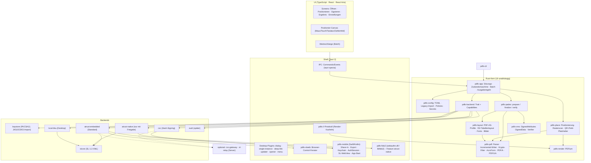
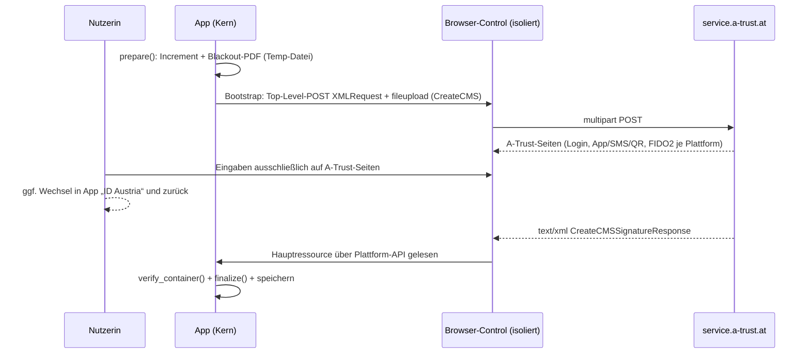

# Architektur- und Umsetzungsvorschlag: „Plattform & Nutzererlebnis zuerst“

**Gegenstand:** funktional gleichwertiger, nicht auf Java/JVM basierender Klon von PDF-Over (Arbeitstitel **PDF-Over NG**, Crate-Präfix `pdfo-`) für Windows, macOS, Linux, iOS und Android.
**Stand:** 2026-10-14. **Grundlage:** Analysen `docs/analyse/01–05` und Recherchen `docs/recherche/01–03`.
**Kennzeichnung:** [B] belegt in Analyse/Recherche · [E] eigene Einschätzung/Entscheidung · [S] Schätzung, im Spike zu messen.

---

## 0. Kurzfassung

1. **Stack:** Ein UI-unabhängiger **Rust-Kern** (PAdES-Engine, Backends, Workflow) in einer **Tauri-2-Shell** mit **TypeScript/React-UI und React Aria**. Die Vorschau rendert **PDFium im Kern**, nicht pdf.js. Plan B ist eine Flutter-Oberfläche über `flutter_rust_bridge` auf demselben Kern-API.
2. **Warum dieser Stack aus UX-Sicht:** Er ist der einzige Kandidat, der auf **allen fünf** Plattformen ein Browser-Control für A-Trust mitbringt. Das ist der Standardpfad, solange es keine A-Trust-Freigabe gibt. Dazu kommen die kleinsten Installer, ein offizieller **signierter Updater** und eine Toolchain für alle Store-Kanäle.
3. **A-Trust:** Ein Backend-Modell mit **Capabilities**. *Standard (Szenario B):* Die Originalseite von A-Trust läuft in einem isolierten Browser-Control. Die App startet nur den SL-1.2-Request und liest die abschließende SL-Antwort über Plattform-APIs. Die Seiten werden weder geparst noch befüllt. *Option (Szenario A):* der native PDF-Over-Flow, nur mit schriftlicher Freigabe und per Feature-Flag. *Zielpfad:* **CSC-Hash-Signing** mit echtem Batch über `numSignatures`. *Ausblick:* EUDI-Wallet.
4. **PAdES-Kern:** eigener Incremental Writer auf `lopdf`, Zwei-Phasen-Modell `prepare → sign → finalize` für **Modell A** (Rohsignatur über Hash) und **Modell B** (fertiges CMS über das ganze PDF), CMS-Builder und -Prüfer mit RustCrypto. Die Profile von PDF-AS werden im Originalformat wiederverwendet; das Layout rechnet in float32.
5. **UX-Kern:** Desktop mit Warteschlange, Drag & Drop, „Öffnen mit“, Single-Instance, Tastatur- und Zahlenfeld-Positionierung. Mobile mit Share-Sheet bzw. Intents, Touch-Positionierung mit Lupe, geführtem Wechsel zur App „ID Austria“ und Sitzungserhalt. Durchgängig Ziel WCAG 2.2 AA / EN 301 549.
6. **Aufwand:** Team aus 2 Entwickler:innen und 0,5 UX/Barrierefreiheit/QA. **1.0 nach 42 Wochen**, CSC danach in weiteren 6 Wochen, zusammen **≈ 28 PM**. Empfohlen sind zusätzlich 20 % Puffer.

---

## 1. Stack-Entscheidung

### 1.1 Entscheidung

| Schicht | Wahl | Kernbegründung |
|---|---|---|
| Kernsprache | **Rust** (Edition 2024, MSRV gepinnt) | Recherche 02, Platz 1: alle Kategorien sind mit permissiven Crates abgedeckt, ein Code läuft auf allen Zielen inklusive optional WASM [B] |
| PDF lesen/schreiben | `lopdf` 0.45 als Objektmodell und Parser, **eigener Incremental Writer** mit Offset-Protokoll; `pdf-writer` für Appearance-Streams | einzige permissive Basis mit xref-Streams, Object Streams und verschlüsseltem inkrementellem Speichern [B] |
| PDF rendern | **PDFium** über `pdfium-render` 0.9 und `pdfium-binaries` (alle 5 Plattformen); `hayro` als späterer reiner Rust-Ersatz | gleiche Darstellung überall; derselbe Renderer erledigt Vorschau, Auto-Positionierung (Rasterscan) und das Auslesen der QR-Platzhalterbilder [E] |
| Krypto | RustCrypto `cms`/`x509-cert`/`der`/`spki` in **einer** gepinnten Generation, `p12-keystore`, `p256`/`p384`, RSA über `ring` (Marvin-Advisory umgangen) | Modell A und B, CMS-Prüfung, PKCS#12 [B] |
| HTTP | `reqwest` 0.13 mit `rustls` + `ring`, `system-proxy`, Cookies; `scraper` nur im Backend für Szenario A | kein CORS, System-Proxy unter Windows und macOS [B] |
| Desktop-Shell | **Tauri 2.12** (WebView2 / WKWebView / WebKitGTK 4.1) | Matrix Platz 1 (84,2); Plugins für Dialog, Single-Instance, Deep-Link, Updater [B] |
| Mobile-Shell | **Tauri 2 Mobile** plus eigenes Plugin `pdfo-mobile` (Swift/Kotlin) | Share-In, Export, Keychain, Auth-Session und SL-WebView sind ohnehin nativer Code [E] |
| UI | **TypeScript + React 19 + React Aria Components**, Vite; Typen aus Rust per `tauri-specta` | React Aria normalisiert Maus, Touch und Tastatur (`useMove`, `usePress`), bietet barrierefreies Drag & Drop, i18n-Formatierung und Fokusmanagement auf allen Plattformen [E] |
| i18n | **Fluent** (`fluent-rs` im Kern und in der CLI, `@fluent/bundle` in der UI), gemeinsame `.ftl`-Dateien | eine Quelle für UI, CLI und Fehlermeldungen [E] |

### 1.2 Begründung gegen die Bewertungsmatrix (Recherche 01)

Die Basismatrix sieht Tauri 2 (84,2) knapp vor Flutter mit Rust-Kern (83,0), Flutter (82,0) und Avalonia (81,3). Im Szenario „Mobile-first“ gewinnt Flutter mit 84,0 zu 82,8 [B]. Aus Sicht „Plattform & UX zuerst“ fehlen der Matrix zwei Kriterien, die für dieses Produkt entscheiden:

- **W – Browser-Control auf allen 5 Plattformen.** Ohne A-Trust-Freigabe ist das *der* Signierweg. Tauri bringt die WebView auf jeder Plattform als Laufzeit mit, und über `with_webview` ist der native Zugriff möglich (Note 5). Flutter hat kein offizielles Linux-WebView, Windows nur über Community-Pakete (Note 3). Avalonia hat seit Version 12 eine Open-Source-WebView, Mobile ist aber „experimental“ (Note 3,5) [E].
- **A – Barrierefreiheit.** Web-Semantik wird über WebView2 auf UIA, über WKWebView auf AX und über die Android-WebView auf TalkBack abgebildet, unter Linux über WebKitGTK auf AT-SPI. Flutter ist auf Mobile stark, auf Linux schwächer. Avalonia bietet AT-SPI2. Noten: Tauri 4, Flutter 4, Avalonia 4 [E].

Für die **UX-Gewichtung** werden die Basisgewichte auf 80 skaliert (P16 N16 K12 G10 D8 X8 O6 L4), dazu kommen W10 und A10. Die Noten aus Recherche 01 bleiben unverändert:

| Kandidat | P | N | K | G | D | X | O | L | W | A | **Σ** |
|---|---|---|---|---|---|---|---|---|---|---|---|
| **Tauri 2 + Rust-Kern** | 4 | 4 | 4 | 4,5 | 5 | 4 | 4 | 5 | 5 | 4 | **85,4** |
| Flutter-UI + Rust-Kern | 5 | 4 | 4 | 4 | 3 | 4 | 4 | 5 | 3 | 4 | 80,4 |
| Avalonia 12 | 4 | 4 | 4,5 | 3,5 | 4 | 4 | 4 | 5 | 3,5 | 4 | 80,0 |
| Flutter (Dart-Kern) | 5 | 4 | 3 | 4 | 3 | 5 | 4 | 5 | 3 | 4 | 79,6 |

Der Vorsprung von Flutter auf Mobile (P = 5) wird bewusst in Kauf genommen. Die mobil kritischen Teile, also Share-Extension bzw. Intents, Dokument-Picker, Keychain, `ASWebAuthenticationSession`/Custom Tabs und das SL-WebView, sind in **beiden** Stacks nativer Plattformcode. Was bleibt, ist die Rendering-Qualität der Widgets. Dieses Risiko prüft Spike S3 mit einem Go/No-Go. Fällt S3 negativ aus, bekommt Mobile eine Flutter-UI über dasselbe `pdfo-app`-API (siehe §2.4). Der Kern bleibt dabei unverändert.

### 1.3 Verworfene Alternativen

| Alternative | Grund |
|---|---|
| Compose Multiplatform | Der Desktop bleibt JVM (K.O.) [B] |
| .NET MAUI, React Native | kein offizielles Linux (K.O.) [B] |
| Reine PWA | kein CORS bei A-Trust-Produktion, WebAuthn an die eigene RP gebunden, lokale BKU nicht erreichbar (K.O.) [B] |
| Electron (+ Capacitor) | 80–150 MB, verfehlt das Ziel „kleine Installation“; zwei Shells [B] |
| Avalonia 12 | beste .NET-Krypto, aber Mobile „experimental“, Installer self-contained deutlich größer; nach dem PDFsharp-Wechsel auf AGPL wäre die PDF-Schicht ohnehin Eigenbau [B] |
| Flutter mit Dart-Kern | Dart-CMS/PAdES zu jung (K = 3), kein Linux-WebView für Szenario B [B]/[E] |
| Fünf native UIs (WinUI/AppKit/GTK/SwiftUI/Compose) | theoretisch das beste Erlebnis, aber etwa dreifacher UI-Aufwand; mit 2 Personen nicht leistbar [E] |
| Go- oder TS-Kern | Go: Modell B fehlt, Mobile nur über gomobile. TS: Bibliotheken im Beta-Stadium, keine Appearances. Beides schwächer als Rust [B] |
| pdf.js als Vorschau | Leistung auf WebKitGTK und alten Android-WebViews ungewiss; ein zweiter Renderer wäre trotzdem nötig, weil die CLI die Auto-Positionierung headless rechnen muss. pdf.js inklusive Worker ist mit ≈ 2–3 MB nicht kleiner als PDFium (≈ 5–7 MB unkomprimiert, ≈ 2–3 MB komprimiert) [S] |

---

## 2. Architektur

### 2.1 Komponentendiagramm



### 2.2 Module und Verantwortlichkeiten

| Crate/Paket | Verantwortung | Wichtigste Schnittstelle |
|---|---|---|
| `pdfo-pdf` | Parsen (lopdf, Reparaturmodus), Incremental Writer (xref-Tabelle, xref-Stream, Hybrid; `/Prev`, `/Size`, `/ID[1]`), Verschlüsselung neuer Objekte ohne `/Contents`, AcroForm/Feld/Widget, neue Seite, PDF/UA-Strukturbaum | `IncrementalUpdate::write(&mut impl Write) -> Offsets` |
| `pdfo-cms` | SignedAttributes in PDF-AS-Reihenfolge (content-type, ETSI-mime-type, signing-time, message-digest, signing-certificate-v2), SignedData-Montage, Prüfung fremder CMS (genau ein SignerInfo, Digest, ESS-Zertifikat, Fingerprint) | `SignedAttrs::build`, `assemble`, `verify_container` |
| `pdfo-layout` | Profil-Engine (Java-Properties, Includes, Vererbung, OGNL-Teilmenge), Tabellenlayout in `f32`, AFM-/TTF-Metriken, Subsetting (`skrifa`/`subsetter`), Bild-Pipeline (EXIF, Alpha, SMask) | `render_block(&ProfileSpec, &CertInfo, &Overrides) -> Appearance` |
| `pdfo-place` | Koordinatenmodell (MediaBox/CropBox/Rotate), Klemmung, Auto-Position per Rasterscan, QR-Platzhalter (`rxing`), Signaturfelder | `auto_place`, `find_placeholders` |
| `pdfo-render` | Seiten- und Block-Rendering, Farbschema-Rendering für den Scan, Bildobjekte für QR | Trait `Renderer` (PDFium, später `hayro`) |
| `pdfo-pades` | Zwei-Phasen-Signatur, Reservegröße, Längenprüfung, Mehrfachsignatur/DocMDP-Prüfung | `prepare`, `finalize` |
| `pdfo-backend` + `backends/*` | Signatur-Backends mit Capabilities (§2.3) | Trait `SignatureBackend` |
| `pdfo-app` | ereignisgetriebene Zustandsmaschine pro Dokument, Batch-Controller, Ausgaberegeln (Postfix, Ordner, Überschreiben), Overlays | `Session::dispatch(Event) -> State` |
| `pdfo-config` | `config.toml` mit Schema-Version, Import von `~/.pdf-over`, Enterprise-Policies, Keychain | `Config::load_layered()` |
| `pdfo-cli` | kompatible CLI und neue Subcommands | Binary |
| `pdfo-tauri` + `ui/` | Shell, Commands, Events, Render-Protokoll, Plugins | generierte TS-Typen |
| `server/` (optional) | `csc-gateway` (Token-Tausch mit client_secret), `sl-relay` (DataURL-Empfänger) – zustandsarm, ohne Dokumentdaten | HTTP |

### 2.3 Capability-Modell der Backends

| Backend | Eingabe | Ausgabe | Interaktion | Server | Batch | Zertifikat vorab | Plattformen |
|---|---|---|---|---|---|---|---|
| `atrust-embedded` | ganzes PDF (Blackout) | CMS (Modell B) | Browser-Control | keiner | nein (1 Auslösung je Dokument) | InfoboxRead oder Cache | alle 5 |
| `atrust-embedded` + Relay | ganzes PDF | CMS | Systembrowser | `sl-relay` | nein | wie oben | alle 5 (für FIDO2) |
| `atrust-native` | ganzes PDF | CMS | native Dialoge | keiner | nein (Passwort im RAM) | InfoboxRead | alle 5 (FIDO2 nur Desktop) |
| `local-bku` | ganzes PDF | CMS | externe App | keiner | nein | InfoboxRead | Desktop |
| `keystore` | Hash | Rohsignatur (Modell A) | Passwort | keiner | ja | lokal | alle 5 |
| `csc` | Hash | Rohsignatur | Systembrowser (OAuth2) | `csc-gateway` (sofern A-Trust kein PKCE erlaubt) | **ja** (`numSignatures`) | `credentials/info` | alle 5 |
| `eudi` | Hash oder Dokument | Rohsignatur oder CMS | externe App (App-to-App, QR) | offen | offen | offen | Erweiterungspunkt |
| `pkcs11` (optional) | Hash | Rohsignatur | PIN | keiner | ja | Token | Desktop |

Die PAdES-Vorbereitung hängt **nicht** am Backend. Die UI liest nur Capabilities: Sie blendet zum Beispiel „Alle signieren“ ein, wenn `batch` gesetzt ist, und erklärt den Serverbedarf transparent.

### 2.4 Schnittstellen (Skizzen)

```rust
// pdfo-backend
pub enum Input { WholeDocument, Digest(DigestAlg) }
pub enum Output { CmsSignedData, RawSignature }
pub enum Interaction { None, Password, NativeDialogs, EmbeddedBrowser, SystemBrowser, ExternalApp }
pub enum ServerNeed { None, SlRelay, CscGateway }
pub struct Capabilities {
    pub input: Input, pub output: Output, pub interaction: Interaction,
    pub server: ServerNeed, pub batch_max: u32, pub cert_first: bool,
    pub fido2: Fido2Support, pub qualified: bool,
}

#[async_trait]
pub trait SignatureBackend: Send + Sync {
    fn id(&self) -> BackendId;
    fn capabilities(&self, p: &PlatformInfo) -> Capabilities;
    async fn certificate(&self, ui: &dyn Interact) -> Result<CertChain, BackendError>;
    async fn sign(&self, batch: SignBatch<'_>, ui: &dyn Interact)
        -> Result<Vec<SignResult>, BackendError>;
}
pub enum SignBatch<'a> { Documents(&'a [PreparedRef]), Digests(&'a [DigestToSign]) }
pub enum SignResult { Cms(Vec<u8>), Raw { sig: Vec<u8>, alg: SigAlg, chain: CertChain } }

// Rückkanal zur UI – Backends kennen keine UI-Technologie
#[async_trait]
pub trait Interact: Send + Sync {
    async fn ask(&self, r: InteractionRequest) -> Result<InteractionReply, Cancelled>;
    fn progress(&self, p: Progress);
}
pub enum InteractionRequest {
    EmbeddedBrowser { bootstrap: SlBootstrap, allow: OriginAllowlist },
    SystemBrowser { url: Url, callback: CallbackSpec },
    Password { purpose: PasswordPurpose },
    // nur Szenario A:
    AtrustLogin { user_hint: Option<String> }, SmsTan { reference: String },
    ShowQr { png: Vec<u8> }, WaitForApp { reference: Option<String> },
    Fido2Assertion { options_json: String },
}

// pdfo-pades – Zwei-Phasen-Modell (A und B)
pub fn prepare(job: &SignJob, cert: Option<&CertChain>) -> Result<Prepared, PadesError>;
impl Prepared {
    pub fn byte_range(&self) -> [u64; 4];
    pub fn digest(&self, alg: DigestAlg) -> Digest;               // Modell A, gestreamt
    pub fn blackout_stream(&self) -> impl Read + '_;              // Modell B (Upload)
    pub fn signed_attrs(&self, c: &CertChain, a: DigestAlg) -> SignedAttrs;
}
pub fn finalize(p: Prepared, cms_der: &[u8]) -> Result<SignedPdf, PadesError>; // Längenprüfung, Hex-Patch
```

```ts
// UI: reine Projektion des Kernzustands
type SessionState =
  | { kind: "idle" }
  | { kind: "placeholderChoice"; doc: DocInfo; fields: FieldInfo[]; qr: QrInfo[] }
  | { kind: "positioning"; doc: DocInfo; block: BlockInfo; pos: PagePos; hint?: AutoHint }
  | { kind: "chooseBackend"; options: BackendOption[] }        // inkl. Capabilities
  | { kind: "interaction"; request: InteractionRequest }
  | { kind: "working"; step: "prepare" | "sign" | "finalize" | "save"; pct?: number }
  | { kind: "done"; output: OutputInfo; next?: DocInfo }
  | { kind: "error"; code: string; retry: boolean };
interface Core {
  dispatch(e: UiEvent): Promise<void>;
  onState(cb: (s: SessionState) => void): () => void;
  tileUrl(doc: DocId, page: number, scale: number): string;   // pdfo://render/…
}
```

### 2.5 Zustandsmaschine

Die implizite Re-Entry-Logik von PDF-Over (verzögertes `cleanUp`, Rückkehr zum selben State-Objekt, verschachtelte Event-Loop für ID Austria) wird zu einem **expliziten Reducer in `pdfo-app`** [B, Analyse 01 §3]. Je Dokument gibt es eine `Session`, darüber einen `BatchController`. Einstellungen sind ein Overlay und keine eigene Zustandsstufe: Ändert sich das Profil während der Positionierung, wird nur die Blockvorschau neu berechnet. Das Wechseln in eine andere App ist auf Mobile ein **Lebenszyklus-Ereignis und kein Abbruch**. Der vorbereitete Zustand (Increment als Temp-Datei, Position, Backend) wird persistiert. Wird die App beendet, verliert die Nutzerin daher nur die laufende A-Trust-Sitzung, nicht ihre Positionierung.

---

## 3. Strategie für A-Trust und ID Austria

### 3.1 Grundsatz

Laut A-Trust-Doku dürfen Drittanwendungen die Seiten nicht parsen und nicht automatisch befüllen, sondern müssen einen Browser oder ein Browser-Control verwenden [B, Recherche 03 §3.2]. Deshalb ist **Szenario B der Standard ab Version 1.0**. Szenario A wird als abgeschottetes Backend gebaut, aber nur ausgeliefert, wenn eine **schriftliche Freigabe** vorliegt (Q1/Q2). Beide Szenarien teilen `slcore` (SL-1.2-XML, Fehlercodes, 6000/6001 als Abbruch) und den PAdES-Kern.

### 3.2 Szenario B (ohne Freigabe): A-Trust-Seite im Browser-Control



**Bootstrap:** Eine lokale Startseite (Custom Scheme `pdfo-sl://`) erzeugt das Formular mit `XMLRequest` und der Datei (`DataTransfer`) und schickt es als Top-Level-POST ab. Dabei entsteht kein CORS-Problem [B]. Wo die Plattform es kann, geht es auch direkt: WebView2 über `NavigateWithWebResourceRequest`, WKWebView über `load(URLRequest)` mit Body. Android `postUrl` kann nur urlencoded senden, daher dort die Startseite [B].

**Antwort lesen, ohne in die Seiten einzugreifen:** WebView2 `WebResourceResponseReceived` mit `GetContentAsync`; WebKitGTK `webkit_web_view_get_main_resource` und `get_data`; WKWebView `createWebArchiveData` oder `evaluateJavaScript` in einer isolierten `WKContentWorld`; Android `evaluateJavascript` nach `onPageFinished`, nur bei XML-Inhaltstyp [E, Spike S1]. Es wird ausschließlich das Dokument mit Wurzel `sl:*Response` gelesen. HTML-Seiten werden nie ausgewertet.

**Isolation:** eigene, nicht persistente Datenablage je Signatur; Navigation nur zu `https://service.a-trust.at/*` und `https://www.a-trust.at/mobile/*`, andere Links öffnen im Systembrowser; keine IPC-Brücke, keine DevTools im Release; Autofill und Passwortspeicher aus, wie A-Trust empfiehlt [B]. Die App zeigt eine eigene Kopfzeile mit Dokumentname, verifizierter Herkunft „service.a-trust.at“ (Schloss), „Abbrechen“ und „Signaturdaten in eigener Vorschau anzeigen“. Den Benutzernamen belegt nur der offiziell dokumentierte Parameter `telephonenumber` vor [B].

**UX-Problem: zwei SL-Requests.** PDF-AS braucht das Zertifikat vor dem Aufbau des sichtbaren Blocks, also erst InfoboxRead und dann CreateCMS [B]. Im Browser-Control hieße das, sich zweimal anzumelden. Gegenmaßnahmen:
1. **Sitzung weiterverwenden:** Dasselbe Browser-Control mit demselben Cookie-Speicher für beide Requests. Ob A-Trust dann erneut nach dem ersten Faktor fragt, klärt S1.
2. **Zertifikats-Cache:** Das öffentliche Zertifikat wird nach der ersten Signatur lokal gemerkt (nur mit Einwilligung, in den Einstellungen löschbar). Danach reicht **ein** Request. Passt der Fingerprint im zurückgelieferten CMS nicht, etwa nach einer Zertifikatserneuerung, wiederholt die App einmal mit dem neuen Zertifikat und erklärt den Grund.
3. Unsichtbare Signaturen kommen ohne Zertifikat aus; `/Name` entfällt dann.

**Batch:** Jedes Dokument braucht eine Bestätigung. Die UI kündigt das ehrlich an („5 Dokumente = 5 Bestätigungen in der App“) und führt die Nutzerin von Dokument zu Dokument. Echten Batch bringt CSC (§3.4).

**FIDO2 in Szenario B:** Unter Windows funktioniert es im WebView2 [B]. Unter WKWebView, Android-WebView und vermutlich WebKitGTK geht es nicht [B]. Dort gibt es den Knopf „Mit Sicherheitsschlüssel im Browser fortfahren“: Systembrowser bzw. `ASWebAuthenticationSession`/Custom Tabs mit `DataURL` → `sl-relay` und `RedirectURL` → App-Link. Das PDF geht direkt vom Browser an A-Trust: Auf dem Desktop liefert eine lokale Loopback-Startseite den Auto-Submit aus, auf Mobile wird das in S1 geprüft. Der Relay sieht nur die mit einem Einmal-Schlüssel des Clients verschlüsselte SL-Antwort und hält sie höchstens 5 Minuten. Dieser Modus ist **optional** und braucht einen Betreiber mit Datenschutzerklärung [B, Recherche 03 §9.2].

### 3.3 Szenario A (mit Freigabe): nativer Flow wie PDF-Over

- Backend `atrust-native`, nur gebaut mit Cargo-Feature `atrust-native` und per Laufzeit-Schalter aktiv. Ohne Freigabe gibt es kein Release mit diesem Feature.
- 1:1-Nachbau des Dispatchers (Reihenfolge FIDO2-Default, AutoSkip, Interstitial, Fehler, Login, SMS-TAN, QR, App-2FA, FIDO2), Redirect-Regeln, Long-Poll (300 s, Backoff 10 s), Loop-Guard [B, Analyse 02]. Die Selektoren liegen als versionierte Datendatei vor, damit Seitenänderungen ohne Codeänderung behoben werden können.
- Native Dialoge in Plattformoptik: Login mit „Benutzername merken“ (das Passwort bleibt nur im RAM), SMS-TAN mit Vergleichswert, QR groß und kontrastreich, App-Warten mit Countdown. Batch mit **einer** Anmeldung, wie im Original.
- FIDO2 nativ, nur auf dem Desktop: Windows `webauthn.dll` (die Origin wird über `WEBAUTHN_CLIENT_DATA` gesetzt), macOS/Linux `libfido2` statisch gelinkt (BSD-2) oder ein reines Rust-CTAP-HID. Linux braucht udev/uaccess, Flatpak `--device=all` [B].
- Pflichten: User-Agent `PIDA/<ver>`, damit A-Trust den Client erkennt; Canary-Tests gegen `hs-abnahme` nur in Abstimmung mit A-Trust.

### 3.4 CSC-Hash-Signing (Zielpfad, mittelfristig)

- Ablauf nach A-Trust-Beispielclient: OAuth2 `scope=service` → `credentials/info` → SignedAttributes selbst bauen → `scope=credential` mit `numSignatures=n` und Hashes → SAD → `signHash` [B, Recherche 03 §3.4]. Der Kern liefert dafür Modell A bereits ab Phase 1 (Keystore).
- `csc-gateway`: minimaler Dienst (Rust/axum), der `account_token` (HS256 mit SHA-256(client_secret)) ausstellt und den Token-Tausch übernimmt. **Keine Dokumente, keine Hashes**, denn `signHash` ruft die App direkt auf. Erlaubt A-Trust Public Clients mit PKCE (Q4), entfällt das Gateway.
- Redirects: Desktop über Loopback (RFC 8252), Mobile über `ASWebAuthenticationSession` mit https-Callback bzw. Auth Tab und App Link. FIDO2 funktioniert hier überall, weil die A-Trust-Seite im echten Browser läuft [B].
- **WYSIWYS:** Weil A-Trust nur Hashes sieht, wird die App zur Anzeigekomponente. Vor der Freigabe zeigt sie eine unveränderliche Vorschau genau der vorbereiteten Bytes, mit Dateiname, Seitenzahl und SHA-256 [B].
- UX-Gewinn: **ein** Login und **eine** Freigabe für n Dokumente, Datenschutz „nur Hash“. Das wird der empfohlene Standard, sobald der Vertrag steht.

### 3.5 EUDI-Ausblick

- Kurzfristig ohne Code: Das Browser-Control reicht die A-Trust-Parameter `showwallet`/`usewallet` durch [B]. So steht der EUDI-Fluss sofort bereit, sobald A-Trust ihn freischaltet.
- Mittelfristig: Backend `eudi` mit `Interaction::ExternalApp`, mobil über App-to-App, am Desktop über QR (Cross-Device), wallet- oder QTSP-getrieben (Pilot POTENTIAL). `csc` wird generisch für CSC v1 und v2 ausgelegt, weil die Durchführungsrechtsakte auf CSC verweisen [B].

### 3.6 FIDO2 je Plattform

| Plattform | Szenario A (nativ) | Szenario B (Browser-Control) | CSC |
|---|---|---|---|
| Windows | `webauthn.dll` ✓ | WebView2 ✓ (S4 verifiziert) | Systembrowser ✓ |
| macOS | `libfido2` (nur Security-Keys) ✓ | WKWebView ✗ → Systembrowser + Relay | `ASWebAuthenticationSession` ✓ |
| Linux | `libfido2`/hidraw ✓ | WebKitGTK unsicher → Systembrowser + Relay | Systembrowser + Loopback ✓ |
| iOS | ✗ (nur CTAP über NFC, außerhalb des Umfangs) | WKWebView ✗ → `ASWebAuthenticationSession` + Relay | ✓ |
| Android | ✗ | WebView ✗ → Custom Tabs + Relay | ✓ |

---

## 4. Plattform-Matrix und Mobile-Umfang

| Funktion | Windows | macOS | Linux | iOS | Android |
|---|---|---|---|---|---|
| Dokument-Eingang | Drag & Drop, Dialog, „Öffnen mit“, „Senden an“, CLI; Kontextmenü „Signieren“ über MSIX Package Identity | DnD auch aufs Dock-Icon, Apple-Event `RunEvent::Opened`, Dienste-Menü | DnD (über Portal in Flatpak), `.desktop` mit `MimeType=application/pdf` und `%F` | Share-Sheet / „Öffnen in“ (`CFBundleDocumentTypes`), Dateien-App, Picker | Intents `VIEW`/`SEND`/`SEND_MULTIPLE` (`content://`), SAF-Picker |
| Single-Instance + Warteschlange | ✓ (Plugin) | ✓ (Apple-Events) | ✓ (D-Bus/Plugin) | App-intern | App-intern |
| Vorschau | PDFium-Kacheln mit HiDPI, virtualisiert | dto. | dto. | dto., Pinch-Zoom | dto., Pinch-Zoom |
| Positionierung | Maus, Pfeile 15 pt, **Shift = 1 pt**, Strg = 50 pt, Bild↑/↓, Pos1/Ende, Mausrad (Shift: 5 Seiten), Zahlenfelder in mm/pt | dto. (⌘) | dto. | Ziehen mit Fingerversatz, Lupe, Haptik an Kanten und Vorschlag, VoiceOver „anpassbar“ | dto., TalkBack-Aktionen |
| Auto-Position / neue Seite / unsichtbar | ✓ | ✓ | ✓ | ✓ | ✓ |
| Platzhalter (QR, Felder) | ✓ | ✓ | ✓ | ✓ | ✓ |
| ID Austria Szenario B | WebView2 | WKWebView | WebKitGTK | WKWebView-Sheet + Hinweis „ID Austria öffnen“ (`at.gv.id-austria://`) | WebView-Activity + Hinweis |
| ID Austria Szenario A | ✓ inkl. FIDO2 | ✓ inkl. FIDO2 | ✓ inkl. FIDO2 | ✓ ohne FIDO2 | ✓ ohne FIDO2 |
| CSC | ✓ | ✓ | ✓ | ✓ | ✓ |
| Lokale BKU | ✓ | ✓ (MOCCA-Legacy) | ✓ | – | – |
| Keystore | PKCS#12; JKS/JCEKS-Import mit Konvertierung | dto. | dto. | PKCS#12-Import in die Sandbox, Passwort in Keychain (biometrisch) | dto., Android Keystore |
| Ausgabe | Ordner/Postfix/Überschreiben wie Original; „Im Ordner zeigen“ | dto. | dto. | „In Dateien sichern“, Teilen, in-place bei Security-Scoped URL | SAF `CREATE_DOCUMENT`, Teilen |
| Proxy | System + manueller Override | System + Override | Env/Override (PAC: GNOME/KDE-Einstellungen lesen, S4) | System | System |
| Updates | Tauri-Updater / Store / winget | Tauri-Updater | Flathub / AppImage-Updater / Repo | App Store | Play |
| CLI | ✓ (`pdfo-cli.exe` als Konsolenprogramm) | ✓ | ✓ | – | – |
| Mindest-OS [E] | Win 10 1809 (WebView2) | macOS 11 | WebKitGTK 4.1 (Ubuntu 22.04, Debian 12) | iOS 16 (wie App ID Austria) | Android 8 (API 26) |

**Mobile-Umfang 1.0 („voller Kernfluss“):** Öffnen per Share bzw. Intent und Picker, Vorschau, Touch-Positionierung, Auto-Position, neue Seite, Platzhalter, alle Profile (SMALL, AMTS, BASE_LOGO, INVISIBLE), Signaturhinweis, Bildmarke aus der Fotomediathek (HEIC über Plattform-Decoder, EXIF für alle Formate; das ist eine bewusste Abweichung vom Original), ID Austria in Szenario B (oder A), PKCS#12, Mehrfach-Share als Warteschlange, Sichern und Teilen. **Nicht auf Mobile:** lokale BKU, CLI, Proxy-Einstellungen, natives FIDO2. Auf Mobile kommt FIDO2 erst mit CSC oder Relay. QR-Code-Faktoren bleiben verfügbar (Tablet zeigt, Telefon scannt), die UI rät aber auf demselben Gerät zur App-Bestätigung.

**UX-Details, die über PDF-Over hinausgehen:**
- **Warteschlange als eigenes Panel:** Status je Datei, „gleiche Position für alle“, Wiederholen fehlgeschlagener Dateien, Abschlussbericht. Behebt B-14 [B].
- **Positionierung barrierefrei:** Live-Region meldet „Seite 3 von 5, 20 mm von links, 35 mm von unten“; Zahlenfelder sind die vollwertige Alternative zum Ziehen; „Automatisch platzieren“ steht immer bereit.
- **Vorhandene Signaturen** im Dokument werden angezeigt. DocMDP P=1 blockiert mit Erklärung; P=2 erlaubt nur Formularfelder. Gesperrte Felder werden erkannt. PDF-AS prüft das nicht [B].
- **Offline:** Vorschau, Positionierung, Keystore, lokale BKU und CLI funktionieren ohne Netz. Die UI hat eine strikte CSP (`default-src 'self'`) und lädt nichts aus Netz-Ressourcen; Fonts und Profile sind gebündelt. Fehlt die Verbindung zu A-Trust, bleibt das Dokument vorbereitet und es gibt „Erneut versuchen“.
- **Barrierefreiheit:** Ziel WCAG 2.2 AA / EN 301 549 Kap. 11. Unterstützt werden Forced Colors (Windows-Kontrastdesigns), reduzierte Bewegung, Dark Mode, 200 % Text, Zielgrößen von 44 pt bzw. 48 dp und Access-Keys nach Plattformkonvention (Konversion der `&`-Mnemonics). Für die A-Trust-Seiten im Browser-Control ist A-Trust verantwortlich; für Szenario A trägt der Klon die Verantwortung.

---

## 5. Plan für die PDF-Engine

**Incremental Writer (`pdfo-pdf`):** Das Original bleibt Byte für Byte als Präfix erhalten (Invariante, in jedem Test geprüft). Das Increment beginnt wie bei PDFBox mit CRLF. Das xref-Format folgt dem Original: Tabelle → Tabelle, Stream → Stream (`/W [1 3 0]`, Flate), Hybrid → beides mit `/XRefStm`; Object Streams werden nie geschrieben [B]. `/ID[0]` bleibt, `/ID[1]` wird neu berechnet. Verschlüsselte PDFs werden nur ohne User-Passwort signiert, Rechteprüfung wie `PdfBoxUtils` [B]. Neue Strings und Streams laufen mit dem vorhandenen Security Handler (RC4/AES-128/AES-256), `/Contents` bleibt unverschlüsselt. Ein **Reparaturmodus** verweigert lieber mit klarer Meldung, als ein ungültiges PDF zu schreiben. Für große PDFs auf Mobile gilt: Original per Memory-Map, Increment in eine Temp-Datei, Digest und Upload werden gestreamt. Das vermeidet die vier RAM-Kopien von PDF-AS [B].

**Signaturdictionary und Platzhalter:** Schlüsselreihenfolge und Werte wie in PDF-AS (`/Filter /Adobe.PPKLite`, `/SubFilter /ETSI.CAdES.detached`, `/M`, `/Name`, `/Reason`, `/Contents`, `/ByteRange` mit 36 Zeichen Leerzeichen-Padding) [B]. Die **Reserve** ist konfigurierbar: Keystore 4 KiB wie im Original, SL und CSC zunächst **16 KiB**, bis S1 reale A-Trust-CMS-Größen gemessen hat. Eine fehlgeschlagene Längenprüfung ist bei Modell B nicht wiederholbar, deshalb großzügig dimensionieren.

**CMS (`pdfo-cms`):** Modell A erzeugt exakt die PDF-AS-Attribute: signing-certificate-v2 mit issuerSerial; RSA mit PKCS#1 v1.5; EC ≥ 512 Bit Feldgröße → SHA-512, ≥ 256 → SHA-256; ECDSA-AlgorithmIdentifier mit NULL-Parametern [B]. Zusätzlich gibt es einen **Profilschalter „PAdES-Baseline strikt“** (ohne signing-time), der im Validator-Vergleich gegen DSS bewertet wird. Modell B prüft fremde CMS wie PDF-AS: genau ein SignerInfo, message-digest gleich dem ByteRange-Digest, gültige Signatur, ESS-Zertifikat passend, Fingerprint gleich InfoboxRead bzw. Cache [B].

**Signaturblock-Renderer (`pdfo-layout`) – PDF-AS-Profile wiederverwenden: ja.**
- Die 20 Profile werden im **Originalformat** gelesen: ISO-8859-1-Properties mit Wildcard-Includes, schlüsselweiser Vererbung über `parent`, `sig_obj.types.X=on`. Ein kleiner Interpreter deckt die verwendete **OGNL-Teilmenge** ab (`${…}`-Listen-Trick, Ternary, Map-Zugriff, `subject.X`, `issuer.X`, `sn`, `sbp`, `iui`) [B]. Intern entsteht daraus ein typisiertes `ProfileSpec`. Vorteile: identische Darstellung, Import angepasster Profile aus `~/.pdf-over/cfg`, Weiterbetrieb vorhandener Amtssignatur-Profile.
- Das Layout rechnet in **`f32`** mit den dokumentierten Regeln: Spaltengewichte, gieriger Umbruch mit strikt-größer-Vergleich, Zeilenhöhe = Größe × Zeilen + 2·p, Bildbox mit `floor`, erste Grundlinie bei top − p − size + |descent|. Die Ergebnisse müssen exakt stimmen: SMALL_DE 230×49 pt, mit Hinweis 230×82, AMTS 495×120, Demo-Logo 61×61 [B]. Das Python-float32-Modell aus Analyse 04 dient als zweites Orakel.
- Ausgabe: Holder- und Inner-Form, BBox `[W+1 H+1]`, Streams unkomprimiert, Standard-14 mit AFM-Daten (Adobe-AFM-Lizenz) und WinAnsi, TTF als Type0/CIDFontType2 mit Subset, `/W`, ToUnicode und CIDSet (für PDF/A-1) [B]. DejaVu-Fonts werden mitgeliefert, `arial.ttf` nicht [B]. Bildmarken werden verlustfrei mit SMask und Predictor 15 eingebettet; Marken-Logos ersetzt der Klon durch neutrale.
- Bekannte Abweichungen des Originals (CropBox-Offset ignoriert, AMTS-Breite hängt von x ab, Integer-`==` bei Platzhalter-IDs, 120-mm-Grenze nur in der Vorschau) werden in einem **Kompatibilitätsregister** einzeln entschieden. Vorschlag: korrigieren, aber jeweils mit Golden-Test, der die Abweichung dokumentiert.

**Vorschau:** Die Seitenkacheln rendert PDFium bei der Gerätepixeldichte, erst grob, dann scharf, mit einem LRU-Cache (mobil ≈ 64 MB). Der Block wird **aus dem echten Appearance-Objekt** als Mini-PDF gerendert, also exakt das, was später im Dokument steht. Den 288-dpi-Trick mit Pixel/4 von PDF-Over braucht es nicht mehr; die Maße kommen in Punkten direkt aus dem Layout.

**Positionierung und Auto-Platzierung:** Das Koordinatenmodell im Kern ist die einzige Quelle für die Positionierung. Es arbeitet mit PDF-Userspace, linker oberer Ecke als Bezug und Rotation 0/90/180/270. Der Rasterscan arbeitet wie PDF-AS: 72 dpi, Fußzeile 80, Abstand 20, Signalfarbe als Hintergrund. Alle Fill-, Stroke- und Textfarben werden per `FPDF_RenderPageBitmapWithColorScheme_Start` ersetzt [E]. Passt der Block nicht, wird eine neue Seite angehängt; bei bereits signierten Dokumenten kommt er auf die letzte Seite, jetzt mit sichtbarem Hinweis [B].

**Platzhalter:** QR-Codes werden über die PDFium-Bildobjekte samt CTM gefunden und mit `rxing` (HybridBinarizer wie ZXing) dekodiert. Das Format ist `PDF-AS-POS;id=;profile=;type=;key=`; unterstützt werden die Modi SORTED und MODERATE [B]. Für Signaturfelder gibt es eine Auswahl **je Signatur**; der Feldname wird nicht dauerhaft gespeichert (behebt B-05).

**PDF/A und PDF/UA:** Die Erkennung läuft über XMP `pdfaid`. Abweichend von PDF-AS werden **alle** PDF/A-Teile 1–3 gleich behandelt: eingebettete Fonts, kein Alpha bei Teil 1. Ein vorhandener OutputIntent **bleibt**, ein sRGB-Intent kommt nur hinzu, wenn keiner da ist. Der Preflight entfällt im Produkt; geprüft wird mit **veraPDF in der CI** [B: dort ist Java erlaubt]. Für PDF/UA ergänzt der Kern ParentTree, StructParent und OBJR fortschreibend.

---

## 6. Konfiguration, Migration, CLI, i18n

**Neue Konfiguration:** `config.toml` mit `schema_version` am plattformüblichen Ort (`%APPDATA%`, `~/Library/Application Support`, `$XDG_CONFIG_HOME`, App-Sandbox). Secrets liegen im OS-Schlüsselbund (Credential Manager, Keychain, Secret Service; ohne Secret Service nur im RAM, mit Hinweis). Für Unternehmen gibt es **Policies**, die nur gelesen werden: `%ProgramData%`, `/etc/pdfo/policy.toml`, macOS Managed Preferences. Damit lassen sich Update-Check, erlaubte Backends, Proxy und Profil fixieren.

**Migration aus `~/.pdf-over` (Desktop, einmalig, mit Dialog):**
1. Java-Properties-Parser, bit-kompatibel: ISO-8859-1, `\u`-Escapes, Fortsetzungszeilen, Heuristik für Dateien, die von Hand als UTF-8 gespeichert wurden.
2. Alle 31 Keys mit **exakten Lese-Regeln** übernehmen [B, Analyse 05 §1.5]: `UPDATE_CHECK` ist nur bei `false` aus, `MOBILE_REMEMBER_PASSWORD` wird case-sensitiv gelesen, `USE_FIELDS` gewinnt gegen `USE_MARKER`, `KEYSTORE_PASS_STORE_TYPE` wird automatisch migriert, fehlendes und leeres `SIGNATURE_NOTE` werden unterschieden. Jede Regel bekommt einen Testvektor.
3. Klartext-Secrets (`KEYSTORE_STOREPASS`, `KEYSTORE_KEYPASS`, `PROXY_PASS`) werden in den Schlüsselbund übernommen. Das Löschen aus der Legacy-Datei wird nur **angeboten**; die Legacy-Datei bleibt sonst unverändert.
4. `cfg/`-Profile per Hash mit den bekannten PDF-AS-4.4.x-Standards vergleichen; nur abweichende Profile werden als „Eigene Profile“ importiert. Bildmarke und `.emblem.png` werden übernommen. `signature_field_name` aus `advancedconfig.properties` wird verworfen und protokolliert.
5. Ein Bericht zeigt, was übernommen wurde und was nicht. Rückgängig machen ist möglich, weil nur neue Dateien entstehen.

**CLI (`pdfo-cli` und dieselbe Argumentlogik in der GUI für „Öffnen mit“):**
- **Kompatibel:** `-i -o -b -n -p -ks -kstype -kspass -ksalias -kskeypass -proxy -proxyport -proxyuser -proxypass -e -a -s -c -v -h`, zweiphasig (`-c` zuerst). Ein unbekanntes Token gilt als Datei. Overlays werden nie gespeichert [B]. `-v` konsumiert weiter einen Wert, warnt aber bei `-v false` (B-07). Die Hilfetexte sind korrigiert (B-08).
- **Neu:** `pdfo sign|verify|profiles|migrate|render-block`, `--json` für maschinenlesbare Ausgabe, definierte Exit-Codes, Globs und Ordner. `--kspass-stdin` und `--kspass-env` vermeiden Passwörter in der Prozessliste. `render-block` hilft bei QA und Profilpflege.
- A-Trust-Backends brauchen Interaktion: Die CLI übergibt dann an die laufende GUI (Single-Instance) oder öffnet das Signaturfenster. Keystore und lokale BKU laufen headless.

**i18n:** Die 272 Keys werden maschinell nach Fluent konvertiert. Dabei werden `%s`/`%d` zu benannten Argumenten, `&` zu Access-Keys, `<a>` zu Markup-Elementen; B-09 wird korrigiert. Zum Start gibt es DE und EN, die Fallback-Kette ist UI-Sprache → System → DE wie im Original [B]. Die Sprache des Signaturblocks (`SIGNLOCALE`) bleibt von der UI-Sprache getrennt. Datumsformate werden über eine Teilmenge von Javas `SimpleDateFormat` abgebildet, damit die Profile korrekt bleiben.

---

## 7. Qualitätssicherung

| Ebene | Inhalt |
|---|---|
| **Testkorpus** | ≥ 300 Dateien: PDF-AS-Testdateien und die Proben P1–P3, xref-Tabelle/Stream/Hybrid, Object Streams, kaputte xref, linearisiert, RC4/AES-128/AES-256, PDF/A-1b/2b/3b, PDF/UA, Rotation 90/180/270, CropBox-Offset, vorsignierte Dokumente (PDF-AS, Adobe), DocMDP, leere Felder, QR-Platzhalter, JBIG2/JPX-Scans, 2000 Seiten und 500 MB, behördliche Realdokumente (anonymisiert) |
| **Golden Files gegen PDF-AS** | Docker-Orakel mit PDF-AS 4.4.2 (Java nur in der CI), PKCS#12-Testzertifikat, feste Uhr. Normalisierter Vergleich: Präfix-Invariante, Objektmenge und Schlüssel, Appearance-Streams tokenweise gleich, Blockmaße **exakt**, ASN.1-Dump mit maskierter Zeit und Signatur, Pixel-Diff des Blocks bei 288 dpi unter Schwellwert |
| **Validatoren** | EU DSS (Docker), pyHanko, `pdfsig`, `qpdf --check`, veraPDF, `openssl cms -verify` und PDF-AS-Verify nächtlich; Adobe Acrobat Reader und RTR-Signaturprüfung manuell je Release; RTR-SOAP, sobald Zugang besteht (Q11) |
| **Eigenschaften und Fuzzing** | `proptest` für Layout gegen das float32-Orakel und die Koordinatentransformationen; `cargo-fuzz` für Parser, Writer-Round-Trip (Präfix, Re-Parse, ByteRange deckt alles außer `/Contents`), Properties, OGNL, CMS-Parser und QR; später OSS-Fuzz |
| **Backends** | SL-XML gegen Schema; Szenario A mit HAR-Fixtures und Canary gegen `hs-abnahme` nur mit A-Trust-Abstimmung; Szenario B manuell je Release mit Testkonten und einer echten ID-Austria-Signatur durch das Team |
| **UI und Barrierefreiheit** | Komponenten-Tests mit Playwright und axe-core; E2E mit `tauri-driver` (Windows/Linux), XCUITest/Espresso-Smoke auf Mobile; manuelles Screenreader-Protokoll mit NVDA, JAWS, VoiceOver (macOS/iOS), TalkBack und Orca; Usability-Tests mit 5–8 Personen je Beta |
| **Lieferkette** | `cargo-deny` (GPL/AGPL verboten), `cargo-audit`, npm-Lizenzprüfung, CycloneDX-SBOM, REUSE, reproduzierbare Builds als Ziel |
| **CI-Matrix** | Windows x64/arm64, macOS arm64/x64, Linux x64/arm64 (Ubuntu 22.04/24.04, Fedora), Android API 26/34/36 (Emulator, arm64/x86_64), iOS-Simulator und -Gerät (TestFlight); Kern-Tests auf allen Targets, Korpus und Validatoren nächtlich |

---

## 8. Distribution, Updates und Größen

| Kanal | Signierung | Updates | erwartete Größe [S] |
|---|---|---|---|
| Windows NSIS (per-user, ohne Admin) und MSI (Enterprise) | Authenticode über Microsoft Artifact Signing (Organisation in der EU zulässig) [B] | Tauri-Updater (Ed25519, nicht abschaltbar) [B]; per Policy deaktivierbar | Download ≈ 9–13 MB, installiert ≈ 22–28 MB (WebView2 vom System) |
| Microsoft Store (Win32-Listing bzw. MSIX), winget | Store bzw. Authenticode | Store / winget | wie oben |
| macOS DMG (universal), Developer ID, notarisiert | `notarytool` in der CI | Tauri-Updater | ≈ 18–25 MB (nur arm64: ≈ 10–14 MB) |
| Mac App Store (optional, später) | Apple | Store | Sandbox-Fragen: USB-Entitlement für FIDO2, Security-Scoped Bookmarks für den Ausgabeordner |
| Flathub (primär für Linux) | Flathub/OSTree | Flatpak | App ≈ 10–14 MB plus geteilte GNOME-Runtime |
| `.deb`/`.rpm` mit signiertem Repo | GPG | Paketmanager | ≈ 8–12 MB (webkit2gtk vom System) |
| AppImage | GPG + Tauri-Signatur | Tauri-Updater | ≈ 70–100 MB (bündelt WebKitGTK) |
| iOS App Store / TestFlight | Apple | Store | Download ≈ 12–18 MB |
| Google Play (AAB, ABI-Splits), optional F-Droid | Play App Signing | Store | Download ≈ 10–16 MB je ABI |

Zum Vergleich heute: MSI 90,4 MiB, DMG 80,9/86,8 MiB, Linux-JAR 95,2 MiB [B]. **Update-Manifest:** statisches, signiertes JSON auf einem eigenen Endpoint; es werden keine Kennungen übertragen und der Start wird nie blockiert. Die Semantik von `UPDATE_CHECK` bleibt erhalten. Zur **Schlüsselrotation** bleibt der Updater-Schlüssel offline gesichert, und ein Update, das mit dem alten Schlüssel signiert ist, liefert den neuen Public Key aus.

---

## 9. Phasenplan

**Team-Annahme [E]:** 2 Entwickler:innen in Vollzeit: **A** für Kern, PDF und Krypto (Rust), **B** für App, Plattform und UI (TS, Rust, Swift/Kotlin). Dazu **0,5 FTE UX/Barrierefreiheit/QA**. Rechtliche Klärung, A-Trust-Gespräche, Zertifikate und Store-Konten übernimmt der Auftraggeber; sie sind nicht eingerechnet.

| # | Phase | Wochen | Umfang | Exit-Kriterien |
|---|---|---|---|---|
| P0 | Spikes und Grundsatzentscheidungen | 4 | S1–S5 (§10), ADRs, CI-Grundgerüst, Anfragen an A-Trust (Q1/Q2/Q4) gestellt | alle Go/No-Go beantwortet, Stack bestätigt oder Plan B ausgelöst |
| P1 | PAdES-Kern und App-Gerüst | 10 | A: Writer (alle xref-Varianten, Verschlüsselung), Signaturdictionary, unsichtbare Signatur, CMS Modell A, Prüfer Modell B, PKCS#12, `pdfo sign`. B: `pdfo-app`-Reducer, Tauri-Desktop-Shell, PDFium-Vorschau, DnD, „Öffnen mit“, Single-Instance, Config und Migration | 200 Korpusdateien signiert und in DSS, pyHanko und Adobe gültig; Präfix-Invariante 100 %; Migration besteht alle 31 Key-Testvektoren |
| P2 | Signaturblock, Positionierung, Backends | 10 | A: Profil-Engine, f32-Layout, Fonts, Bilder, PDF/A, PDF/UA, QR- und Feld-Platzhalter, Rasterscan. B: `atrust-embedded`, `local-bku`, gegebenenfalls `atrust-native`, Positionier-UI, Einstellungen, Fluent, Grundlagen der Barrierefreiheit | alle 20 Profile golden-gleich (Maße exakt, Streams tokengleich); echte ID-Austria-Signatur über Szenario B auf allen 3 Desktops |
| P3 | Desktop-Beta | 4 | Batch-Panel, Ausgaberegeln, Policies, CLI-Kompatibilität, Usability-Test, Audit der Barrierefreiheit, Fehlerkatalog | öffentliche Beta auf Win/macOS/Linux; keine A11y-Fehler der Stufe A/AA in Kernflüssen; SUS ≥ 75 |
| P4 | Mobile | 8 | Plugin `pdfo-mobile` (Share/Intents, Export, Keychain, SL-WebView, App-Start), Touch-Positionierung, Lebenszyklus und Persistenz, Streaming für große PDFs | TestFlight und Play-Internal; Signatur mit der App ID Austria auf demselben Gerät; 50-MB-PDF ohne Abbruch auf einem Mittelklasse-Gerät; VoiceOver und TalkBack bedienbar |
| P5 | Härtung, Distribution, 1.0 | 6 | alle Store-Kanäle, Updater, Signierung, SBOM, Security-Review/Pentest des SL-Fensters, Dokumentation, Validator-Kampagne | 1.0 auf 5 Plattformen veröffentlicht; keine offenen Findings „hoch“ |
| P6 | CSC und echte Batch-Signatur (nach Partnervertrag) | 6 | Backend `csc`, `csc-gateway`, WYSIWYS-Ansicht, Mobile-Redirects, CSC-v2-Abstraktion | n Dokumente mit einer Freigabe auf allen 5 Plattformen; FIDO2 mobil über CSC |

**Summe:** 42 Wochen bis 1.0, 48 Wochen inklusive CSC. Bei 2,5 FTE sind das **≈ 24 PM bis 1.0 und ≈ 28 PM insgesamt**. Mit 20 % Puffer für A-Trust-Abhängigkeiten und reale PDF-Sonderfälle sind es ≈ 33 PM. P6 kann vorgezogen werden, sobald der Vertrag steht; B arbeitet dann parallel zu P4.

---

## 10. Top-Risiken und erste Spikes

| # | Risiko | Gegenmaßnahme |
|---|---|---|
| R1 | A-Trust lehnt auch das Auslesen der SL-Antwort im Browser-Control ab oder ändert das Verhalten; keine Freigabe für Szenario A | Schriftliche Klärung in P0 (Q1/Q2); Lesen nur über Plattform-APIs ohne Script-Injektion; Relay-Variante und CSC als Ausweich- und Zielpfad; Backends austauschbar |
| R2 | Doppelte Anmeldung (InfoboxRead + CreateCMS) verschlechtert die UX in Szenario B | Sitzung weiterverwenden (S1), Zertifikats-Cache, Fingerprint-Rückfall, CSC |
| R3 | FIDO2-Nutzer:innen auf macOS, Linux und Mobile ohne Weg in Szenario B | klare Führung; Windows funktioniert; optionaler Relay; CSC priorisieren; App-Bestätigung als Standardfaktor |
| R4 | Incremental Writer scheitert an realen, fehlerhaften PDFs und macht Vorsignaturen ungültig | Präfix-Invariante, Korpus ≥ 300, Fuzzing, Reparaturmodus mit Abbruch statt Risiko, DSS-Prüfung vorhandener Signaturen nach dem Signieren |
| R5 | Tauri Mobile ist unreif (Plugin-Lücken, WebView-Leistung) | eigenes natives Plugin, Go/No-Go in S3, Plan B Flutter-UI auf `pdfo-app` (≈ +6 Wochen) |
| R6 | Layout-Parität mit PDF-AS (float32, Java-Split, Fonts) | Golden Files und Python-Orakel ab P1; Kompatibilitätsregister |
| R7 | CMS-Reserve zu klein für A-Trust-Ketten | Messung in S1, Standard 16 KiB, Längenprüfung vor dem Upload, nicht erst danach |
| R8 | Lizenz und Marken (EUPL vs. App Store, Logos, Name) | juristische Prüfung in P0; neutrale Logos; `cargo-deny` |
| R9 | RustCrypto-Generationswechsel, junge Crates | eine Generation pinnen, Fassade `pdfo-cms`, Migrationsfenster in P5 |
| R10 | Wissen bei 2 Personen konzentriert | Pairing an Kernstellen, ADRs, Spezifikation aus den Analysen als lebende Testsuite |

| Spike | Dauer | Go/No-Go-Frage |
|---|---|---|
| **S1 A-Trust im Browser-Control** | 2 W | Lässt sich auf mindestens 4 von 5 Plattformen (iOS und Android müssen dabei sein) ein CreateCMS-Request mit PDF-Upload im Browser-Control starten, von der Nutzerin auf der Originalseite abschließen und die XML-Antwort über Plattform-APIs zuverlässig lesen? Bleibt die Sitzung zwischen InfoboxRead und CreateCMS erhalten? Wie groß ist das reale CMS? *No-Go:* Relay oder CSC wird zur Voraussetzung für 1.0. |
| **S2 Writer und CMS** | 2 W | Signiert der lopdf-basierte Writer 50 Korpusdateien (alle xref-Varianten, AES) mit PKCS#12 so, dass Adobe, DSS und pyHanko sie als gültig melden, ältere Signaturen gültig bleiben und keine Präfixverletzung auftritt (≥ 95 %)? *No-Go:* PoDoFo (MPL) als Writer-Backend evaluieren. |
| **S3 Tauri-Mobile-UX** | 2 W | Funktionieren Share-In, Touch-Positionierung mit 60 fps auf PDFium-Kacheln (Android-Mittelklasse und iPhone), Wechsel zur App ID Austria und zurück ohne Sitzungsverlust sowie VoiceOver/TalkBack? *No-Go:* 2 Wochen Gegenprobe mit Flutter und `flutter_rust_bridge`. |
| **S4 Desktop-Integration und FIDO2** | 1–2 W | „Öffnen mit“, Single-Instance, DnD und Proxy/PAC auf 3 Betriebssystemen; WebAuthn im WebView2 gegen A-Trust; nur falls Szenario A wahrscheinlich ist: `webauthn.dll`/libfido2-Assertion mit Origin `service.a-trust.at`. *No-Go:* FIDO2 am Desktop über den Systembrowser. |
| **S5 Build, Signierung, Auslieferung** | 1 W | Erzeugt die CI signierte und notarisierte Artefakte für alle Kanäle, und liegen die gemessenen Größen innerhalb von ±30 % der Ziele aus §8? *No-Go:* AppImage aufgeben, Flathub und deb/rpm als einzige Linux-Kanäle. |

**Nächste Schritte:** Freigabe dieses Vorschlags; parallel und sofort die Anfrage an A-Trust (Q1, Q2, Q4, Q6) und die juristische Prüfung (EUPL/Stores/Marken). Danach startet P0 mit S1 (B) und S2 (A).
