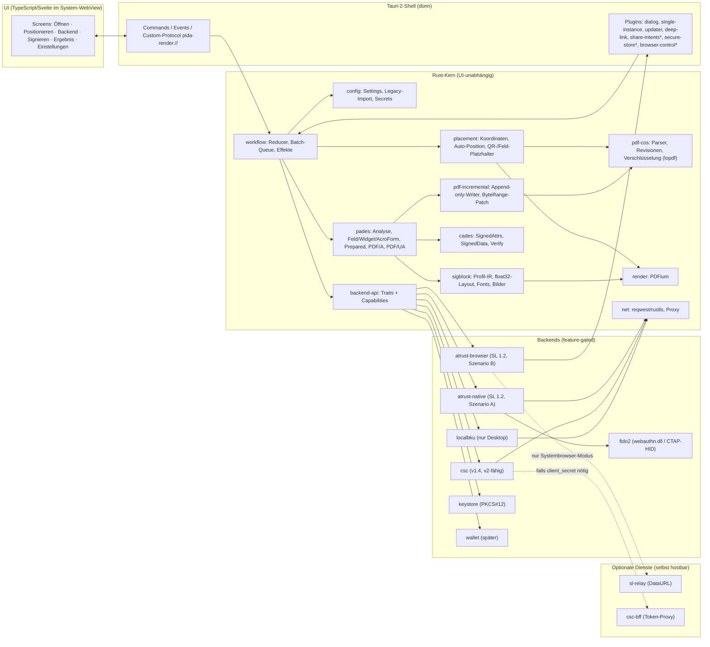

# PDF-Over-Klon: Architektur- und Umsetzungsvorschlag „Risiko zuerst“

Stand: 14.10.2026. Grundlage sind die Analysen `docs/analyse/01–05`, die Recherchen `docs/recherche/01–03` sowie der Referenzcode von PDF-Over (Commit c07c5ec) und PDF-AS 4.4.2.

Kennzeichnung:
- **[B]** belegt in Analyse oder Recherche
- **[A]** Annahme, die im genannten Spike geprüft wird
- **[E]** Entscheidung bzw. Empfehlung dieses Vorschlags

Arbeitstitel des Produkts: **„PDF-Over NG“**. Der endgültige Name hängt von der Markenklärung ab.

---

## 0. Kurzfassung

1. **Stack [E]:** Ein Rust-Kern enthält PAdES-Engine, Signatur-Backends und Workflow. Tauri 2 dient als dünne Shell für Desktop und Mobile, die Oberfläche ist in TypeScript/Svelte geschrieben. PDFium (über `pdfium-render`) ist auf allen Plattformen der einzige Renderer. Als Plan B kann die Shell gegen eine Flutter-UI mit `flutter_rust_bridge` getauscht werden. Der Kern bleibt dabei unverändert.
2. **A-Trust [E]:**
   - **Standardpfad ist Szenario B:** Die A-Trust-Seite läuft unverändert in einem Browser-Control. Die SL-Antwort wird nativ abgegriffen, Seiten werden weder geparst noch befüllt.
   - **Szenario A** (natives Scraping wie in PDF-Over) ist ein eigenes, per Feature-Flag geschaltetes Backend. Es wird nur mit schriftlicher Freigabe von A-Trust ausgeliefert.
   - **Szenario C** (CSC-Hash-Signing) ist der strategische Zielpfad für Mobile, FIDO2, Batch und Datenschutz. Voraussetzung ist ein Partnervertrag.
   - **EUDI-Wallet** wird zuerst über die vorhandenen SL-Parameter `showwallet`/`usewallet` angebunden, später über CSC v2 bzw. Wallet-Backends.
3. **Kern-Schnitt [E]:** Die PAdES-Vorbereitung kennt kein Backend. Jedes Backend deklariert Capabilities (Dokument oder Hash, CMS oder Rohsignatur, Interaktion, Server, Batch, Zertifikat vorab). SL, CSC, Keystore, lokale BKU und Wallet laufen so durch dieselbe Pipeline.
4. **PDF-Robustheit [E]:** Ein Append-only-Writer serialisiert Originalbytes nie neu. Vor dem Speichern werden Invarianten maschinell geprüft (Präfix, ByteRange, Vorsignaturen intakt). Was nicht sicher behandelbar ist, wird mit klarer Meldung abgelehnt.
5. **Gültigkeit [E]:** Testorakel-Kette aus PDF-AS-Golden-Files, EU DSS, pyHanko (mit Änderungsanalyse), qpdf, veraPDF und openssl; Adobe und RTR prüfen je Release von Hand.
6. **Reihenfolge [E]:** Vor jeder Feature-Arbeit laufen 6 Wochen lang 8 Spikes mit Go/No-Go-Fragen. Parallel läuft ein juristisch-organisatorischer Klärungspfad (A-Trust, RTR, Lizenz, Marken).
7. **Aufwand [A]:** Bei 2 Entwickler:innen sind es 50 Wochen bis Desktop 1.0, Mobile 1.0 und CSC. Das sind ≈ 26 PM inkl. Nebenrollen; mit 20 % Puffer liegt der Budgetrahmen bei ≈ 31 PM.

---

## 1. Stack-Entscheidung

### 1.1 Wahl je Schicht

| Schicht | Wahl [E] | Begründung aus Risikosicht |
|---|---|---|
| Kernsprache | Rust (stable, MSRV gepinnt) | Speichersicher bei feindlichen PDFs. Läuft auf allen 5 Zielen und als WASM für Werkzeuge. Direkter FFI-Zugang zu `webauthn.dll`/libfido2 [B recherche/01 §5.1]. |
| PDF-Objektmodell | `lopdf` 0.45 (MIT) als Parser und Objektmodell, dazu ein **eigener Append-only-Writer** | lopdf liest xref-Streams und Object Streams und entschlüsselt [B recherche/02]. `IncrementalDocument` verlangt aber exakte Deckung von Bytes und Modell. Darum schreibt der eigene Writer nur neue Objekte und den xref-Abschnitt. |
| CMS/X.509 | RustCrypto `cms`, `x509-cert`, `der`, `spki`, `const-oid`, **eine** Generation gepinnt (0.2/0.7), gekapselt im Crate `cades` | Der Generationswechsel (cms 0.3-rc vom 13.10.2026) ist so auf ein Crate begrenzt. SignedAttributes werden DER-genau selbst gebaut, um die volle Kontrolle über ESSCertIDv2 und die Attribut-Sortierung zu behalten. |
| Primitive | `rsa`, `p256`/`p384`/`ecdsa`, `sha2`; RSA wahlweise über `ring` | Das Marvin-Advisory betrifft das Entschlüsseln, nicht das lokale Signieren [B]. |
| Keystore | `p12-keystore` (PKCS#12). JCEKS über einen Konvertierungsassistenten; ein eigener Reader kommt optional später, als Clean-Room-Implementierung | Keine Bibliothek liest JCEKS [B]. Den OpenJDK-Code zu portieren wäre ein GPL-Risiko. |
| Rendering | PDFium über `pdfium-render` und `pdfium-binaries` (Desktop dynamisch, iOS statisch) | Vorschau, Rasterscan zur Auto-Positionierung, QR-Bilddekodierung und WYSIWYS-Ansicht nutzen **einen** Renderer und sind damit auf allen Plattformen gleich. |
| Fonts, Bilder, QR | `skrifa` + `subsetter`, AFM-Daten der Standard-14, `png`, `zune-jpeg`, `kamadak-exif`, `rxing` (ZXing-Port mit HybridBinarizer) | Alle permissiv lizenziert und reines Rust [B recherche/02 §6.2]. |
| Netz | `reqwest` 0.13 + `rustls` + `rustls-platform-verifier` | Nutzt den OS-Truststore; nötig in Behördennetzen mit TLS-Inspektion [A, S8]. Übernimmt den System-Proxy unter Windows/macOS [B]. |
| FIDO2 (nur Szenario A) | Windows: `webauthn.dll` über das `windows`-Crate. macOS/Linux: CTAP2-HID über das `authenticator`-Crate (MPL-2.0) oder `libfido2` per FFI; die Wahl fällt in S4 | Origin `https://service.a-trust.at` selbst gesetzt, wie in PDF-Over [B]. |
| Desktop-Shell | Tauri 2.12 (WebView2/WKWebView/WebKitGTK über wry) | Siehe 1.2. |
| Mobile-Shell | Tauri 2 Mobile mit eigenen Swift/Kotlin-Plugins: `browser-control`, `share-intents`, `secure-store` | Share- und Keychain-Plugins fehlen offiziell [B]. Sie sind klein und gut kapselbar. |
| UI | TypeScript + Svelte 5 (kleines Bundle), Kataloge im Fluent-Format | Die UI ist reiner Renderer für den `ViewState`. Sie ist dadurch austauschbar. |
| Optionale Dienste | Rust/axum: `sl-relay` (DataURL-Empfänger) und `csc-bff` (Token-Proxy) | Nur dort, wo kein Weg ohne Server existiert (§3). Selbst hostbar. |

### 1.2 Begründung gegen Matrix und Bibliotheksanalyse

**Tauri 2 (84,2) vor Flutter+Rust (83,0) und Flutter (82,0).** Der Matrixabstand ist klein [B recherche/01 §6]. Aus Risikosicht entscheiden drei Punkte, die die Matrix nur indirekt gewichtet:

1. **Das Browser-Control ist Teil des Stacks.** Für Szenario B, den wahrscheinlichsten Pflichtpfad, braucht man ein steuerbares WebView auf allen fünf Plattformen. wry bringt WebView2, WKWebView und WebKitGTK samt nativer Handles mit (`with_webview`). Flutter fehlt im Mainstream ein WebView-Plugin mit Linux-Unterstützung [A]; dort wäre das ein Eigenbau.
2. **Ein signierter Updater und alle Store- und Paketkanäle kommen aus einer Toolchain** (Kriterium D = 5) [B].
3. **Die kleinste Installation** (Vorgabe „keine große Installation“; Szenario „Klein“: Tauri 85,3) [B].

Flutters Stärke ist die Mobile-Reife (P = 5). Sie wird durch den Kern-Schnitt abgesichert: Scheitert Spike S5, wird nur die Mobile-Shell auf Flutter + `flutter_rust_bridge` umgestellt. Desktop und Kern bleiben. Deshalb steht **keine** Fachlogik in TypeScript.

**Verworfene Alternativen:**
- **Avalonia 12 (81,3):** Bestes Krypto-Fundament (.NET). Mobile gilt laut NuGet aber als „experimental“, die Installation ist größer, und auf Apple fehlt Brainpool [B]. Seit dem PDFsharp-Wechsel auf AGPL ab 6.5 [B] wäre auch dort die PDF-Schicht Eigenbau. Damit schrumpft der Vorteil auf CMS/X.509, und das deckt RustCrypto ebenfalls ab.
- **Go (`digitorus/pdfsign`):** Schnellster Weg zu einem Keystore-Signer. Es fehlen aber Modell B und ein UI-Ökosystem, Mobile ginge nur über gomobile. Das wäre ein dritter Sprachstack.
- **TypeScript-Kern (`@libpdf/core`, `@signpdf`):** Noch Beta, keine Appearances, Platzhaltersuche per String, Krypto im WebView-Kontext [B]. Abgelehnt.
- **PoDoFo (C++, MPL-Option):** Fachlich vollständig (Modell B, Deferred Signing). Für feindliche Eingaben ist ein C++-Parser aber ein Risiko, und der Build für 5 Plattformen ist teuer. Es bleibt als **Rückfalloption für den Writer**, falls S2 scheitert.
- **pdf.js statt PDFium:** Spart etwa 5 MB [A], führt aber einen zweiten Renderer neben dem Rasterscan ein. Dann wäre Vorschau ≠ Positionierung. Hinzu kommt das Leistungsrisiko mit WebKitGTK [B].
- **K.O.:** Compose MP (JVM-Desktop), MAUI (kein Linux), React Native (kein Linux), reine PWA (CORS, WebAuthn-RP, LNA) [B].

### 1.3 Reversibilitätsregeln [E]

- Kein Kern-Crate hängt von Tauri ab. Die Fassade `core-api` ist `uniffi`-tauglich und dient dem Flutter-Plan-B, der CLI und den Testwerkzeugen.
- Fremdbibliotheken sitzen hinter eigenen Grenzen: lopdf hinter `pdf-cos`, RustCrypto hinter `cades`, PDFium hinter dem Trait `Renderer`. Für den Renderer ist `hayro` als reiner Rust-Ersatz evaluierbar.
- `cargo-deny` erlaubt nur MIT, Apache-2.0, BSD-2/3, ISC, Zlib, MPL-2.0, Unicode-3.0 sowie OFL/Bitstream-Vera für Fonts. Eine GPL/AGPL-Abhängigkeit bricht den Build.

---

## 2. Architektur

### 2.1 Komponenten



Mit `*` markierte Plugins sind eigene Plugins (Swift/Kotlin bzw. Rust).

### 2.2 Module und Verantwortlichkeiten

| Crate/Paket | Verantwortung | Wichtigste Schnittstelle |
|---|---|---|
| `pdf-cos` | Lenientes Lesen. Erkennt Revisionen und den xref-Typ (Tabelle, Stream, Hybrid). Rechteprüfung wie `PdfBoxUtils`, Security-Handler für RC4/AES-128/AES-256 | `SourcePdf::open(bytes) -> DocReport` |
| `pdf-incremental` | Schreibt neue und geänderte Objekte, xref im passenden Format, `/Prev`, `/Size`, `/ID[1]`. Verschlüsselt neue Objekte außer `/Contents`. Erfasst Offsets und patcht die ByteRange | `IncrementBuilder` → `Increment { bytes, contents_range }` |
| `pades` | Analyse (Signaturen, DocMDP, Felder, PDF/A, PDF/UA). Signaturdictionary, Feld/Widget, AcroForm, neue Seite, PDF/A- und PDF/UA-Hooks, Zweiphasenmodell | `prepare() -> Prepared`, `finish_*()` |
| `cades` | SignedAttributes (CMS-Profile §5.8), SignedData bauen (Modell A), fremdes CMS prüfen (Modell B), Algorithmus-Politik wie PDF-AS | `SignedAttrsBuilder`, `verify_detached()` |
| `sigblock` | Profil-IR, Properties-Parser mit Includes und Vererbung, Ausdrucksauswerter (OGNL-Teilmenge), float32-Tabellenlayout, AFM/TTF, Emblem-Pipeline, Appearance-XObjects | `Appearance::build(profile, cert, opts)` |
| `placement` | Koordinatenräume, Klemmung, Rotation, Box-Logik. Auto-Positionierung per Rasterscan. QR-Platzhalter (CTM-Verfolgung + `rxing`), leere Signaturfelder | `Placement`, `auto_place()`, `find_placeholders()` |
| `render` | PDFium: Seitenkacheln, Forced-Color-Raster, Bild-XObject-Dekodierung | `trait Renderer` |
| `backend-api` | Traits, Capabilities, `InteractionBroker`, Fehlertaxonomie | §2.4 |
| `sl12` | SL-1.2-XML (InfoboxRead, CreateCMS, NullOperation), ErrorResponse, Codes 6000/6001 | gemeinsam für `atrust-*` und `localbku` |
| `workflow` | Expliziter Reducer statt impliziter Re-Entry-Semantik [B analyse/01]. Batch-Queue, Abbruchsemantik, Effekte | `reduce(state, event) -> (state, effects)` |
| `config` | Settings-Schema (versioniert), Import aus `~/.pdf-over`, Secrets über `keyring` bzw. Mobile-Plugin, Profil-Store | §6 |
| `apps/desktop`, `apps/mobile` | Tauri-Projekte, Plugins, Paketierung | – |
| `apps/cli` | Konsolen-Binary (Windows: eigenes Subsystem). Nutzt `workflow` headless | §6.3 |
| `services/sl-relay`, `services/csc-bff` | Optionale Dienste ohne Persistenz | §3 |
| `tools/golden`, `tools/corpus`, `fuzz/` | Golden-Generator (PDF-AS im Container), Normalisierer, Diff, Fuzz-Targets | §7 |

### 2.3 Capability-Modell

| Backend | Eingabe | Ausgabe | Zertifikat vorab | Interaktion | Server | Batch | Dokument verlässt Gerät | Plattformen |
|---|---|---|---|---|---|---|---|---|
| `atrust-browser` (B) | Dokument (geschwärzt) + ExcludedByteRange | CMS | ja: InfoboxRead oder Zertifikats-Cache | `EmbeddedWeb`, für FIDO2 außerhalb von Windows `SystemBrowser` | keiner; `sl-relay` nur im Systembrowser-Modus | nein (je Dokument eine Freigabe) | ja, an A-Trust | alle |
| `atrust-native` (A) | Dokument | CMS | ja | `NativeForms` (+ FIDO2 nativ auf Desktop) | keiner | nein | ja | alle; FIDO2 nur Desktop |
| `csc` (C) | Hash über SignedAttributes | Rohsignatur | ja (`credentials/info`) | `SystemBrowser` (OAuth2) | `csc-bff`, entfällt bei PKCE-Public-Client | ja (`numSignatures`) | nein | alle |
| `localbku` | Dokument | CMS | ja | `External` (BKU-eigene UI) | keiner | nein | nein | nur Desktop |
| `keystore` | Hash | Rohsignatur | ja | `Secret` (Passwort) | keiner | ja | nein | alle (Mobile per Import) |
| `wallet` (später) | Dokument oder Hash | CMS oder Rohsignatur | je nach Modell | `ExternalApp` | QTSP | offen | je nach Modell | Mobile zuerst |

Die Workflow-Schicht wählt anhand der Capabilities Pipeline-Modell A oder B, den Pflichthinweis zum Datenschutz („Dokument verlässt das Gerät“), die WYSIWYS-Bestätigung (Pflicht bei Hash-Eingabe) und die Batch-Strategie.

### 2.4 Schnittstellen-Skizzen

```rust
// backend-api
pub enum SignInput { Document, Digest { algs: &'static [DigestAlg] } }
pub enum SignOutput { Cms, RawSignature }
pub enum Interaction { None, Secret, EmbeddedWeb, SystemBrowser, NativeForms, External, ExternalApp }
pub enum ServerNeed { None, DataUrlRelay, TokenProxy }

pub struct Capabilities {
    pub input: SignInput,
    pub output: SignOutput,
    pub interaction: Interaction,
    pub server: ServerNeed,
    pub certificate_first: bool,
    pub max_batch: u16,                 // 1 = kein Batch
    pub document_leaves_device: bool,   // erzwingt Datenschutzhinweis
    pub qualification: Qualification,   // Qes | AdES | Unknown
    pub factors: FactorSet,             // App, Sms, Fido2, Card …
}

#[async_trait]
pub trait SignatureBackend: Send + Sync {
    fn id(&self) -> &'static str;
    /// None = auf dieser Plattform/Konfiguration nicht verfügbar
    fn capabilities(&self, env: &Environment) -> Option<Capabilities>;
    async fn open(&self, ctx: SessionContext, ui: Arc<dyn InteractionBroker>)
        -> Result<Box<dyn BackendSession>, BackendError>;
}

#[async_trait]
pub trait BackendSession: Send {
    async fn certificate(&mut self) -> Result<CertChain, BackendError>;
    async fn sign(&mut self, jobs: &[SignJob<'_>]) -> Result<Vec<SignResult>, BackendError>;
    async fn cancel(&mut self);
}

pub enum SignJob<'a> {
    Document { blacked_out: &'a [u8], excluded: ExcludedRange },   // Modell B
    Digest   { alg: DigestAlg, value: &'a [u8] },                  // Modell A
}
pub enum SignResult { Cms(Vec<u8>), Raw { alg: SignatureAlg, value: Vec<u8> } }

#[async_trait]
pub trait InteractionBroker: Send + Sync {
    async fn embedded_web(&self, req: WebRequest) -> Result<WebOutcome, Cancelled>;
    async fn system_browser(&self, start: Url, cb: CallbackSpec) -> Result<CallbackData, Cancelled>;
    async fn secret(&self, p: SecretPrompt) -> Result<Zeroizing<String>, Cancelled>;
    async fn native_form(&self, f: NativeForm) -> Result<FormAnswer, Cancelled>; // nur Szenario A
    fn progress(&self, p: Progress);
}

pub struct WebRequest {
    pub post_to: Url,                    // SL-Endpunkt
    pub fields: Vec<(String, FieldValue)>, // XMLRequest, ggf. telephonenumber, lang
    pub allow_hosts: Vec<Host>,          // Navigations-Allowlist
    pub capture: Capture,                // nur XML-Antwort am SL-Endpunkt
    pub ephemeral_storage: bool,
    pub webauthn_required: bool,
}
```

```rust
// pades – Zweiphasenmodell (Vorbild: ungenutzte startSign/finishSign-API von PDF-AS [B analyse/03])
pub fn analyze(src: &SourcePdf) -> Result<DocReport, PdfError>;
pub fn prepare(src: &SourcePdf, plan: &SignPlan, cert: &CertChain) -> Result<Prepared, PdfError>;
impl Prepared {
    pub fn excluded_range(&self) -> ExcludedRange;
    pub fn blacked_out(&self) -> &[u8];                                     // Modell B
    pub fn signed_attrs(&self, p: CmsProfile, alg: DigestAlg) -> SignedAttrs; // Modell A
    pub fn finish_cms(self, cms: &[u8], expect: &CertChain) -> Result<SignedPdf, FinishError>;
    pub fn finish_raw(self, a: SignedAttrs, s: RawSig, chain: &CertChain) -> Result<SignedPdf, FinishError>;
}
```

```ts
// UI ↔ Kern: Die UI hält keinen Fachzustand
export interface CoreBridge {
  dispatch(e: UiEvent): Promise<void>;
  onState(cb: (s: ViewState) => void): () => void;
  pageImageUrl(doc: DocId, page: number, scale: number): string; // pida-render://…
}
export type ViewState =
  | { step: 'open'; queue: DocInfo[] }
  | { step: 'position'; doc: DocInfo; page: number; block: BlockPreview; placement: Placement }
  | { step: 'backend'; options: BackendOption[]; privacyNotice?: PrivacyNotice }
  | { step: 'signing'; interaction: InteractionView }
  | { step: 'output'; result: OutputInfo; next?: DocInfo }
  | { step: 'settings'; returnTo: ViewState['step'] };
```

Die Mobile-Plugins in Swift/Kotlin implementieren dieselbe `embedded_web`- und `system_browser`-Semantik. Auf dem Desktop übernimmt das ein Rust-Modul auf Basis von wry bzw. nativen Handles.

### 2.5 Signierablauf und Invarianten

Ablauf: `analyze` → `SignPlan` (Profil, Position, Feld) → `certificate()` → `prepare` → `sign` → `finish_*` → **Selbstprüfung** → Schreiben.

Die Selbstprüfung erzwingt vor dem Speichern sechs Invarianten:

- **I1:** Das Original ist byte-identischer Präfix der Ausgabe.
- **I2:** Die ByteRange deckt die ganze Datei ab, außer den Hex-Ziffern von `/Contents`.
- **I3:** Das CMS hat genau einen SignerInfo. message-digest und Signatur sind gültig, signing-certificate(-v2) passt, und der Fingerprint ist gleich dem Vorab-Zertifikat (wie PDF-AS [B]).
- **I4:** Alle vorhandenen Signaturen verifizieren weiterhin (eigener Verifier).
- **I5:** Die Ausgabe ist mit `pdf-cos` und PDFium erneut parsebar.
- **I6:** Das Increment enthält nur erlaubte Änderungen: Katalog/AcroForm, Seite/Annots, neues Feld, Widget, Signaturdictionary, Fonts/XObjects, optional neue Seite und StructTree.

Verletzt die Ausgabe eine Invariante, wird nichts gespeichert. Der Fehlercode wird angezeigt.

---

## 3. A-Trust/ID Austria, CSC, EUDI, FIDO2

### 3.1 Szenario B (Standard, ohne Freigabe für den nativen Flow)

Die A-Trust-Doku verlangt „a local web browser or a browser control“ und verbietet das Parsen und automatische Befüllen der Seiten [B recherche/03 §3.2]. Der Ablauf ist deshalb:

1. Der Kern erzeugt den `InfoboxReadRequest`. Das Browser-Control lädt eine **lokale Startseite** über das Custom-Protocol der App. Sie sendet ein Formular mit `XMLRequest` (optional mit den dokumentierten Parametern `telephonenumber` und `lang`) automatisch an `https://service.a-trust.at/mobile/https-security-layer-request/default.aspx`.
2. Die Nutzerin bedient ausschließlich die A-Trust-Seiten: Login, App-Bestätigung, SMS, auf Windows auch FIDO2. Der Klon zeigt dazu nur eine Adresszeile mit Host und TLS-Status sowie „Abbrechen“.
3. Antwortet der SL-Endpunkt mit `text/xml`, wird der Inhalt **nativ** übernommen. Wie das geht, klärt S1:
   - WebView2: `WebResourceResponseReceived` und `GetContent`
   - WebKitGTK: Daten der Main-Resource
   - WKWebView und Android-WebView: Serialisierung nur des XML-Dokuments
4. Danach folgen Signaturblock und Increment. Der `CreateCMSSignatureRequest` läuft im selben Control, mit `Base64Content` oder als Upload über eine `DataTransfer`-Datei. Das prüft S1.
5. Das CMS wird geprüft (I3) und eingebettet.

**Compliance-Leitplanken [E].** Diese Regeln lässt der Auftraggeber zusätzlich von A-Trust schriftlich als „Browser-Control-konform“ bestätigen:
- Kein Lesen, Verändern oder Befüllen von A-Trust-HTML-Seiten. Keine Skriptinjektion, kein CSS, keine Overlays.
- Autofill und Passwortspeicher sind deaktiviert. Pro Signatursitzung gibt es einen flüchtigen Datenspeicher.
- Navigation nur zu `service.a-trust.at` und `www.a-trust.at` (bei Bedarf weitere A-Trust-Hosts). Fremde Links öffnet der Systembrowser.
- Das Browser-Control hat **keinen** IPC-Zugriff auf die App. Die Tauri-Capabilities werden keiner Remote-Origin gewährt.
- Der Link „Signaturdaten anzeigen“ (WYSIWYS-Anzeige von A-Trust) bleibt unangetastet.
- Batch bedeutet: nacheinander, mit je eigener Freigabe. Für echte Batches verweist A-Trust auf die Signatur-Box [B].

**Login-Anzahl.** PDF-Over wiederholt den Login für den zweiten SL-Request automatisch [B]. Im Browser-Control müsste die Nutzerin zweimal interagieren, falls die A-Trust-Session nicht erhalten bleibt. S1 misst das.

Gegenmaßnahme ist ein **Zertifikats-Cache** (Opt-in, nur das öffentliche Zertifikat, lokal):
- Ab der zweiten Signatur entfällt der InfoboxRead.
- Nach dem Signieren erzwingt I3 die Übereinstimmung mit dem Cache.
- Weicht das Zertifikat ab (z. B. nach einer Erneuerung), wird das Ergebnis verworfen und mit dem neuen Zertifikat neu signiert, denn Seriennummer und Aussteller stehen im Block.

**Mobile.** Das Plugin zeigt ein modales WKWebView bzw. Android-WebView. Der Wechsel in die App „ID Austria“ gilt nicht als Abbruch. Anders als in PDF-Over [B] bleibt das Control im Hintergrund erhalten; der Long-Poll der A-Trust-Seite läuft im Vordergrund weiter.

**Systembrowser-Modus** (nur für FIDO2 außerhalb von Windows):
- Die Startseite liegt auf einem Loopback-Server der App (Desktop) bzw. in der App (Mobile) und sendet das Formular mit `DataURL` und `RedirectURL`.
- Die Antwort geht per `DataURL` an den `sl-relay`. Die App holt sie mit einem Einmal-Token ab, nachdem `RedirectURL` (Loopback, Universal Link bzw. App Link) sie zurückgeholt hat.
- Der Relay sieht **nur** die XMLResponse (CMS mit Zertifikat), nie das Dokument.
- Er speichert nichts dauerhaft, hält Daten höchstens 10 min im RAM, löscht sie beim Abruf und protokolliert keine Nutzdaten. Er wird in der EU gehostet und ist selbst hostbar.
- Er ist kein Proxy für A-Trust-Seiten (das wäre unzulässig [B]), sondern nutzt den dokumentierten SL-Mechanismus.

### 3.2 Szenario A (mit schriftlicher Freigabe)

- `atrust-native` portiert die Spezifikation aus analyse/02:
  - neuer Client mit leerem Cookie-Jar je Request
  - 301/302 als GET, Refresh und meta refresh
  - genau ein Formular und acht Blocktypen in der Dispatcher-Reihenfolge
  - Long-Poll `qrpoll` (300 s, Backoff 10 s)
  - Loop-Guard
- Masken sind nativ in der UI (Login, TAN, QR, App, FIDO2). Das Passwort liegt nur im RAM (`Zeroizing`); persistent ist nur die Nummer [B].
- Ist eine Seite unbekannt, bricht der Connector mit Diagnosecode ab und bietet Szenario B an. Es wird nie geraten.
- Contract-Tests laufen gegen aufgezeichnete Fixtures aus dem Testsystem. Ein nächtlicher Drift-Lauf prüft gegen `hs-abnahme` [B].
- Die Freigabe muss konkret sein: Client-Name, User-Agent, Plattformen, Vorab-Information bei Seitenänderungen und Testkonten. Ohne sie bleibt das Feature `atrust-native` im Release-Build abgeschaltet.

### 3.3 Szenario C: CSC v1.4 (Zielpfad, mit Partnervertrag)

- Der OAuth2-Code-Flow läuft im Systembrowser: RFC 8252 mit Loopback auf dem Desktop, Universal bzw. App Links auf Mobile. FIDO2 funktioniert damit überall.
- `credentials/info` liefert die Kette, der Kern baut die SignedAttributes. `numSignatures` erlaubt einen **Batch mit einer Freigabe**, danach folgen SAD und `signHash` [B recherche/03 §3.4].
- Nur Hashes verlassen das Gerät; das ist datenschutzrechtlich der beste Pfad.
- `csc-bff` hält `client_secret` und `account_token`. Erlaubt A-Trust Public Clients mit PKCE (Q4), entfällt er.
- **WYSIWYS [E]:** Die Anzeigeverantwortung verschiebt sich zum Klon [B]. Deshalb gilt:
  - Bestätigungsansicht, die genau die Bytes von `Prepared` mit PDFium rendert (Signaturblock eingeschlossen)
  - Seitenzahl und SHA-256 werden angezeigt
  - Der Puffer ist zwischen Anzeige und Hash unveränderlich (Typsystem: `Prepared` ist nach `prepare` immutabel)
  - Bei Batch gibt es eine Liste mit Vorschau je Dokument
- Der Client abstrahiert CSC v1 und v2. Der EU-Wallet-Rahmen verweist auf die CSC-API [B].

### 3.4 EUDI-Wallet

1. **Stufe 1:** Die SL-iframe-Parameter `showwallet`/`usewallet` laufen durch Szenario B [B]. Dafür ist kein neuer Code nötig, nur ein Feature-Flag, sobald A-Trust produktiv ist.
2. **Stufe 2:** Ein generisches `csc`-Backend gegen QTSPs, bei dem die Wallet autorisiert (QTSP-getriebenes Modell aus dem Pilot POTENTIAL [B]).
3. **Stufe 3:** Wallet-getriebene QES über das Backend `wallet` mit `Interaction::ExternalApp`. Das Capability-Modell deckt beide möglichen Ausgaben ab, CMS und Rohsignatur.

Als Sandbox-Gegenstelle dient Valera [B].

### 3.5 FIDO2 je Plattform

| Plattform | Szenario B (Standard) | Szenario A (Freigabe) | Szenario C (CSC) |
|---|---|---|---|
| Windows | WebAuthn im WebView2-Control [A, S4] | `webauthn.dll` mit eigenem clientDataJSON [B] | Systembrowser |
| macOS | WKWebView ohne fremde RP [B], daher Systembrowser + `sl-relay`. Alternativ CEF-Runtime (Tauri 3) [A, S4] | CTAP2-HID (`authenticator`/libfido2) [B] | Systembrowser |
| Linux | WebKitGTK unsicher [B], daher Systembrowser + `sl-relay` | CTAP2-HID über hidraw (udev/uaccess) | Systembrowser |
| iOS | ASWebAuthenticationSession + `sl-relay` | nicht möglich (keine Associated Domains) [B] | ASWebAuthenticationSession |
| Android | Custom Tabs/Auth Tab + `sl-relay` | nicht möglich (keine Asset Links) [B] | Custom Tabs |

Ist der Relay nicht konfiguriert, wird FIDO2 auf diesen Plattformen als „nicht verfügbar“ angezeigt, und es wird auf die App-Bestätigung verwiesen. FIDO2 ist auch in PDF-Over nur optional [B].

### 3.6 Auswahl-Logik [E]

Die Reihenfolge ist: Standard-Backend aus den Einstellungen, sonst ID Austria. Innerhalb von ID Austria:

1. CSC, falls der Vertrag aktiv und das Backend konfiguriert ist
2. sonst `atrust-native`, falls der Build freigegeben ist
3. sonst `atrust-browser`

Die lokale BKU erscheint nur, wenn die TCP-Probe auf 127.0.0.1:3495 erfolgreich ist [B].

---

## 4. Plattform-Matrix und Mobile-Umfang

| Feature | Windows | macOS | Linux | iOS | Android |
|---|---|---|---|---|---|
| Dokument öffnen | DnD, Dialog, CLI, „Öffnen mit“/SendTo (Registry, per-user) | DnD, Dialog, UTI `com.adobe.pdf`, Apple-Events (`RunEvent::Opened`) | DnD, Dialog, `.desktop` mit `MimeType` und `%F` (neu) | Document Picker, „Öffnen in“ (CFBundleDocumentTypes) | SAF, Intents VIEW/SEND/SEND_MULTIPLE |
| Single-Instance + Queue | Plugin | Apple-Events | Plugin (D-Bus) | – | – |
| Ausgabe | Regeln aus PDF-Over (Postfix, Ordner bzw. Pfad, Überschreiben) | wie Win | wie Win | Exportieren (Picker) / Share-Sheet | SAF `CREATE_DOCUMENT` / Share |
| Positionieren | Maus, Tastatur (15 pt, PgUp/PgDn, Home/End), Rad | wie Win | wie Win | Touch-Drag, Pinch, Seitenwischen | wie iOS |
| Auto-Position, QR- und Feld-Platzhalter | ja | ja | ja | ja | ja |
| ID Austria B (Browser-Control) | WebView2 | WKWebView | WebKitGTK | modales WKWebView | modales WebView |
| ID Austria A (nativ) | ja (Freigabe) | ja | ja | ja | ja |
| CSC | ja | ja | ja | ja | ja |
| FIDO2 | siehe §3.5 | §3.5 | §3.5 | §3.5 | §3.5 |
| Lokale BKU | Plugin | Plugin | Plugin | – | – |
| PKCS#12 | Datei | Datei | Datei | Import in die Sandbox | Import in die Sandbox |
| JCEKS | Assistent (keytool-Konvertierung) | wie Win | wie Win | – | – |
| CLI | ja (+ Konsolen-Shim) | ja | ja | – | – |
| Secrets | Credential Manager | Keychain | Secret Service, sonst nur im Speicher | Keychain | Android Keystore |
| Proxy | System + manuell | System + manuell | Env + manuell | System | System |
| Updates | Tauri-Updater (signiert) / MSIX | Tauri-Updater | Paketquelle / Flathub | App Store | Play |
| Mindest-OS [A] | Win 10 1809 | macOS 11 | Ubuntu 22.04, Debian 12, Fedora 40 | iOS 16 | Android 9 (API 28) |

Zur Mindest-OS-Zeile: Die App „ID Austria“ verlangt iOS 16 und Android 12 [B]. Der Klon kann auf Android tiefer gehen, weil die Bestätigung auch auf einem zweiten Gerät erfolgen kann.

**Mobile 1.0 („Lite“) [E].** Enthalten sind:
- Öffnen per Share bzw. Picker
- Positionieren (Touch und Auto) und Platzhalter
- ID Austria über Szenario B mit App-Bestätigung
- Speichern bzw. Teilen
- PKCS#12-Import
- Einstellungsauswahl: Profil, Sprache, Hinweis, Logo

Nicht enthalten sind CLI, lokale BKU, JCEKS und Batch in v1. FIDO2 gibt es nur mit aktiviertem Relay oder über CSC. Der QR-Faktor ist auf demselben Gerät unpraktisch, bleibt aber auf der A-Trust-Seite verfügbar. Mobile-Builds unterstützen auch Tablets.

---

## 5. PDF-Engine-Plan

### 5.1 Eingangsanalyse und Annahmepolitik

| Klasse | Beispiele | Verhalten [E] |
|---|---|---|
| K1 regulär | xref-Tabelle, xref-Stream, Hybrid, ObjStm, linearisiert, bereits signiert | Increment im passenden Format: Tabelle → Tabelle, Stream → Stream (`/W [1 3 0]`, Flate), Hybrid → beides [B]. Nie ObjStm schreiben |
| K2 reparierbar | falsche xref-Offsets, Müll nach `%%EOF`, fehlendes EOL | „Reparatur-Increment“: vollständiger xref-Abschnitt über **alle** Objekte, Präfix unverändert. Hinweis an die Nutzerin; Validatoren prüfen das im Korpus |
| K3 verschlüsselt | RC4/AES ohne User-Passwort | Rechte wie PDF-AS [B]. Neue Objekte werden mit dem vorhandenen Handler verschlüsselt, `/Contents` des Signaturdictionarys nicht (ISO 32000-2 §7.6.2 [A, S2]) |
| K4 eingeschränkt | DocMDP P=2/3, `/Lock` am Feld, Seed Values | P=2: keine neue Seite, nur Feld- und Signaturänderungen. `/Lock` und Seed Values werden respektiert oder mit Warnung behandelt (PDF-AS prüft das nicht [B]) |
| K5 abgelehnt | DocMDP P=1, User-Passwort, zerstörte Objekte im benötigten Pfad, 0 Seiten | Klare Fehlermeldung. „Neu schreiben“ wird nur angeboten, wenn **keine** Signatur vorhanden ist, und nur mit Zustimmung |

Auf bereits signierten Dokumenten wird keine neue Seite angelegt. Anders als PDF-AS, das stillschweigend auf die letzte Seite ausweicht [B], gibt es dafür eine **sichtbare Meldung**. Überlappt der Block vorhandene Widgets, warnt der Klon.

### 5.2 Incremental Writer

- Ein Increment beginnt wie bei PDF-AS mit CRLF [B].
- `/ID[0]` bleibt, `/ID[1]` wird neu berechnet. `/Size` und `/Prev` werden korrekt fortgeschrieben.
- Für `/Contents` wird ein Platzhalter mit fester Breite reserviert. Die ByteRange wird nach dem Serialisieren mit Leerzeichen-Padding gepatcht [B].
- Reserve:
  - Modell B (SL/CSC): **16 KiB** statt 4 KiB [E], weil Kettengröße und B-T-Erweiterung offen sind [B]. S3 misst reale A-Trust-CMS.
  - Modell A: berechnet plus Sicherheitszuschlag.
  - Ist das CMS zu groß, wird abgebrochen, bevor etwas geschrieben wird.
- Streaming bzw. Dateipuffer für große Dateien. Ziel: RAM ≤ 3 × Dokumentgröße. PDF-AS hält das Dokument mehrfach im RAM [B].
- Uhrzeit-Plausibilisierung: `/M` und signing-time werden mit dem HTTP-`Date` von A-Trust verglichen. Abweichungen über 5 min erzeugen eine Warnung.

### 5.3 Signaturfeld, Widget, AcroForm

Die Strukturen folgen analyse/03:
- `/Type /Sig`, `/Filter /Adobe.PPKLite`, `/SubFilter /ETSI.CAdES.detached`, `/M`, `/Name`, `/Reason`
- AcroForm im Katalog mit `/SigFlags 3`
- Widget `/F 132`
- Rename auf `PDF-AS Signatur<n>`
- vorhandenes leeres Feld: Rect bleibt, `/F 4`

Bewusste Abweichungen [E]:
- Der Feldname gilt **pro Signatur** und wird nicht in die Konfiguration persistiert (B-05).
- Die PDFBox-Fixups (`/NeedAppearances` → Regenerieren der Appearances) werden **nicht** pauschal nachgebildet. Fremde Felder bleiben unverändert, damit die Änderungsanalyse von Validatoren stabil bleibt (I6).

### 5.4 Signaturblock-Renderer

- **Wiederverwendung der PDF-AS-Profile [E]:**
  - Ein Build-Zeit-Konverter (`tools/profile-convert`) liest `PDFASConfig.zip`: Java-Properties ISO-8859-1, Wildcard-Includes, schlüsselweise Vererbung über parent/augments [B].
  - Er erzeugt eine typisierte Profil-IR (JSON, in die Binary eingebettet).
  - Benutzerdefinierte Profile aus `~/.pdf-over/cfg` laufen zur Laufzeit durch denselben Konverter.
  - Ausdrücke `${…}` werden von einem kleinen Auswerter für genau die belegte OGNL-Teilmenge interpretiert (Feldzugriffe `subject.X`/`issuer.X`/`sn`/`sbp`/`iui`, Ternary, Null-Vergleich, Listen-Literal-Trick). Unbekanntes wird abgelehnt, nicht geraten.
- **Layout in `f32` mit Java-Semantik [B analyse/04]:**
  - Spaltengewichte, gieriger Umbruch mit strikt-größer-Vergleich, Java-`split`/`trim`-Semantik
  - `floor` bei Bildern, Grundlinie `top−p−size+|descent|`, Rahmen 0.1 pt
  - Holder- und Inner-Form, BBox `[W+1 H+1]`
  - Rotation 90/180/270
  - Ziel: Blockgrößen bitgleich zu den Rechenbeispielen in analyse/04 (SMALL_DE 230×49, AMTS 495×120, Logo 61×61)
- **Fonts:** Standard-14 nicht eingebettet (WinAnsi, AFM) wie PDF-AS. DejaVu wird als Type0/CIDFontType2-Subset mit `/W`, ToUnicode und CIDToGIDMap eingebettet, CIDSet nur bei PDF/A-1. `arial.ttf` wird nicht ausgeliefert [B].
- **Farbräume [E]:** Text, Linien und Hintergrund in DeviceGray, Logos als ICCBased (sRGB eingebettet). Der Block ist damit unabhängig vom OutputIntent PDF/A-konform. Die PDF-AS-Praxis, OutputIntents durch sRGB zu **ersetzen** [B], entfällt; das kann CMYK-PDF/A-Dokumente beschädigen.
- **Emblem:** EXIF auch außerhalb von JPEG (HEIC von Mobile), Verkleinerung auf ≤ 480×600 px, verlustfreie Einbettung, SMask außer bei PDF/A-1. Der Cache liegt im Konfigurationsordner.
- **Bewusst korrigierte Abweichungen** (Vorschau = Ergebnis):
  - Die AMTS-Breite hängt bei manueller Position nicht mehr von x ab.
  - CropBox-Offset wird berücksichtigt.
  - Platzhalter-IDs > 127 funktionieren (der Integer-==-Fehler entfällt).
  - Die 120-mm-Logo-Grenze gilt in Vorschau **und** Signatur.

  Ein Schalter `compat.pdfas_quirks` existiert nur für Golden-Tests.

### 5.5 Vorschau und Positionierung

- Der Kern rendert Kacheln mit PDFium in Geräte-DPI und liefert sie über das Custom-Protocol als Bild. Die Blockvorschau entsteht **mit demselben Code wie die Signatur**: Appearance in ein Mini-PDF, dann PDFium.
- Alle Koordinatentransformationen (PAGE_ABS/REL, IMAGE, SCREEN, Rotation, Boxen) liegen in `placement`. Die UI rechnet nicht.
- **Auto-Positionierung** nach PDF-AS-Semantik [B]:
  - Raster mit 72 dpi, Fußzeile 80 pt, Abstand 20 pt
  - Farbersetzung über PDFiums Forced-Color-Rendering (`FPDF_RenderPageBitmapWithColorScheme_Start`) [A, S7]
  - Gegenprobe über die Objekt-Bounding-Boxes von PDFium
  - Passt der Block nicht, kommt eine neue Seite (nur bei unsignierten Dokumenten)

### 5.6 Platzhalter

- **QR-Platzhalter:**
  - Content-Streams werden mit CTM-Verfolgung interpretiert. Bild-XObjects (zusätzlich Form-XObjects hinter einem Flag) dekodiert PDFium, `rxing` erkennt den QR-Code.
  - Payload `PDF-AS-POS;id=…;profile=…;type=…;key=…` [B].
  - Modi STRICT/MODERATE/LENIENT/SORTED; die Belegung wird über `/Location` markiert.
  - Position: x = floor, y = ceil, w = ceil, die Höhe wird ignoriert [B].
- **Leere Signaturfelder:** Auswahlliste nativ bzw. als Sheet auf Mobile; die Appearance wird ins vorhandene Rect skaliert.

### 5.7 PDF/A und PDF/UA

- **PDF/A:**
  - Erkennung über XMP `pdfaid:part`/`conformance`.
  - Teile 1, 2 und 3 werden behandelt (die PDF-AS-Lücke bei PDF/A-2 wird geschlossen [B]): alle Fonts eingebettet, kein Alpha bei Teil 1, Widget mit Print-Flag, keine `NeedAppearances`.
  - Fehlt ein OutputIntent, wird sRGB **ergänzt**; vorhandene bleiben.
  - Ein Laufzeit-Preflight entfällt (PDF-AS loggt nur [B]). Stattdessen prüft ein „Increment-Preflight“ im Kern die selbst erzeugten Objekte. veraPDF läuft in der CI (Java nur als Testwerkzeug).
- **PDF/UA:** Bei vorhandenem StructTree werden StructParent, das Form-Element mit OBJR, ParentTree (`/Nums` oder `/Kids`) und ParentTreeNextKey fortgeschrieben. `/TU` erhält den Blocktext.

### 5.8 CMS-Profile und Verifikation

- `pdfas-compat`: content-type, mime-type, signing-time, message-digest, signing-certificate-v2. ECDSA mit NULL-Parametern; RSA PKCS#1 v1.5; Hash-Wahl wie PDF-AS (P-384 → SHA-256) [B].
- `pades-b-b`: ohne mime-type und signing-time, entspricht PDF-AS `PAdESCompatibility=true` [B].
- **Default [E]:** `pades-b-b`, sofern S3 Akzeptanz in DSS, RTR und Adobe zeigt; sonst `pdfas-compat`.
- Für SL testet S3, ob A-Trust das Attribut `PAdESCompatibility="true"` am CreateCMS-Request beachtet.
- B-T/B-LT/B-LTA sind über `x509-tsp`/`x509-ocsp` vorbereitet, aber kein v1-Umfang. Ein TSA-Vertrag ist offen.

---

## 6. Konfiguration, Migration, CLI, i18n

### 6.1 Konfiguration

- Neues, versioniertes Schema (TOML) an plattformüblichen Orten: `%APPDATA%`, `~/Library/Application Support`, `$XDG_CONFIG_HOME`, App-Sandbox.
- Die Profile sind schreibgeschützt eingebettet. Eigene Profile liegen als Overlay daneben.
- Secrets liegen nur im OS-Keystore. Fehlt der Secret Service, werden sie nur im Speicher gehalten. Das ID-Austria-Passwort wird **nie** persistiert [B]; in Szenario B sieht der Klon es ohnehin nicht.
- Optional für Unternehmen und Behörden: verwaltete Richtlinien (Windows-Registry-Policy, macOS-Profile, iOS Managed App Config, Android Restrictions) für Standard-Backend, Update-Check und Proxy.

### 6.2 Migration aus `~/.pdf-over`

- Beim ersten Start gibt es einen einmaligen Import-Assistenten. Er liest `PDF-Over.config` (Java-Properties ISO-8859-1 mit `\u`-Escapes, tolerant gegenüber händisch in UTF-8 editierten Dateien [B]).
- Alle 31 Keys werden mit ihrer **exakten** Lese-Semantik übernommen und als Tabellentests aus analyse/05 abgesichert:
  - `UPDATE_CHECK` ist nur bei `false` aus.
  - `MOBILE_REMEMBER_PASSWORD` ist case-sensitiv.
  - `USE_FIELDS` hat Vorrang vor `USE_MARKER`.
  - Bei `SIGNATURE_NOTE` unterscheiden sich „fehlt“ und „leer“.
  - `KEYSTORE_PASS_STORE_TYPE` wird migriert.
- Klartext-Passwörter (`KEYSTORE_STOREPASS`/`KEYPASS`, `PROXY_PASS`) wandern nach Zustimmung in den Keychain. Die Altdatei wird **nicht** verändert; ein Knopf „Klartext entfernen“ ist optional.
- Geänderte PDF-AS-Profile in `cfg/` werden per Prüfsumme gegen die Auslieferungsstände erkannt und über den Konverter angeboten.
- Embleme werden übernommen.
- Der Import ist idempotent und schreibt ein Protokoll.

### 6.3 CLI

- Kompatibel zu allen Optionen aus analyse/01: `-i -o -b -n -p -ks -kstype -kspass -ksalias -kskeypass -proxy* -e -a -s -c -v -h`.
- Es gibt zwei Durchläufe (`-c` zuerst), und ein unbekanntes Token gilt als Eingabedatei (nötig für „Öffnen mit“/SendTo).
- Overlays werden nie persistiert.
- Bewusste Korrekturen:
  - `-v` wertet `true`/`false` aus (B-07); der Wert wird für alte Skripte weiterhin konsumiert.
  - Die Hilfetexte sind korrigiert (B-08).
  - Eine fehlende `-c`-Datei ergibt eine Fehlermeldung statt eines Factory-Resets.
  - `-p` wird in Szenario B mit Warnung ignoriert (das Passwort gehört auf die A-Trust-Seite). `-n` füllt den dokumentierten Parameter `telephonenumber` vor.
- Neu: `pida sign --backend keystore --headless` für nicht-interaktive Batches mit PKCS#12. Unter Windows sorgt eine Konsolen-Shim-EXE für die Ausgabe von `-h` [B].

### 6.4 i18n

- Ein Konverter übersetzt `messages*.properties` nach Fluent (`.ftl`): Escapes, `&`-Mnemonics, `%s`/`%d` → benannte Platzhalter, `<a>` → Markup-Token. Die Keys bleiben für die Nachverfolgbarkeit erhalten.
- Der DE-Fehler (Duplikat bzw. fehlender Key, B-09) wird behoben.
- Sprachen sind DE und EN, Fallback DE wie im Original [B]. Der Kern liefert Fehlercodes mit Parametern; übersetzt wird in der UI.
- Die Barrierefreiheit wird nach EN 301 549 / WCAG 2.1 AA geprüft; das ist relevant, falls die Anwendung im öffentlichen Bereich eingesetzt wird.

---

## 7. Qualitätssicherung

### 7.1 Testkorpus (≥ 450 Dateien, nur öffentliche oder synthetische Inhalte, keine Personendaten)

| Klasse | Inhalt | Anzahl [A] |
|---|---|---|
| C1 PDF-AS | 55 PDFs aus dem Referenzbaum. Darin enthalten sind 30 Test-Suites in `pdf-as-tests/.../public_pdfbox2` (Positionierung, Profile, PDF/A, „bereits signiert“) mit `config.properties`, davon 26 mit Referenzbild `example_ref.png`, sowie `test.p12` | 55 |
| C2 Behörde | öffentlich abrufbare Behörden-PDFs: Formulare, Kundmachungen, amtssignierte Musterbescheide | 100 |
| C3 Struktur | per qpdf/pikepdf/pyHanko generiert: PDF 1.3–2.0, Tabelle/Stream/Hybrid, ObjStm, linearisiert, Revisionshistorie | 80 |
| C4 Verschlüsselung | RC4-40/128, AES-128, AES-256 (R6), Rechtekombinationen, mit und ohne User-Passwort | 30 |
| C5 Signiert | 1–5 Signaturen (PDF-AS, Adobe, DSS, pyHanko), DocMDP P1/2/3, `/Lock`, Seed Values, DSS/VRI | 50 |
| C6 PDF/A, PDF/UA | 1b, 2b, 2u, 3b, 3u, CMYK-OutputIntent, PDF/UA mit `/Nums` bzw. `/Kids` | 40 |
| C7 Geometrie | Rotation 0/90/180/270, CropBox ≠ MediaBox, UserUnit, Sonderformate, Inhalt bis zum Rand | 40 |
| C8 Defekt | Defekt-Suites von pdf.js, PDFium und qpdf, abgeschnittene Dateien, falsche Offsets | 50+ |
| C9 Groß | 100–200 MB, 2000 Seiten, bildlastig | 10 |

### 7.2 Golden Files gegen PDF-AS

- PDF-AS 4.4.2 läuft im CI-Container (`pdf-as-cli`, Java nur im Test). Es signiert mit einem Test-PKCS#12 alle Kombinationen aus Profil × Sprache × Hinweis × PDF/A × Rotation × Platzhalter.
- Der Vergleich ist **strukturgleich, nicht bytegleich** [B]:
  - Objektmengen und Keys
  - Appearance-Tokenstrom mit Zahlentoleranz 1e-3
  - Rect und BBox exakt
  - ASN.1-Dump des CMS mit Maskierung (Zeit, Signaturwert)
  - Pixel-Diff des Blocks mit PDFium bei 288 dpi (≤ 0,5 % abweichende Pixel)
  - Auto-Position: gleiche Seite, |Δy| ≤ 1 pt
- Die 26 `example_ref.png` sind ein zusätzliches visuelles Orakel.

### 7.3 Validatoren und Orakel

| Orakel | Prüft | Einsatz |
|---|---|---|
| EU DSS (gepinnte Version, REST, LOTL-Cache) | Integrität, Format (PAdES-BASELINE-B?), Kette und QES-Status mit EUTL | CI, jede Ausgabe |
| pyHanko `validate` + Diff-Analyse | Integrität und **Änderungsniveau** früherer Signaturen (Ziel: ≤ FORM_FILLING) | CI, jede Ausgabe |
| qpdf `--check`, poppler `pdfsig` | Struktur, zweiter Parser | CI |
| openssl `cms -verify` über die ByteRange-Daten | CMS unabhängig von eigener Verifikation | CI |
| veraPDF (PDF/A-1/2/3, PDF/UA) | Kein Konformitätsverlust gegenüber der Eingabe | CI, Klasse C6 |
| PDF-AS `verify` | Gegenprüfung mit der Referenzimplementierung | CI |
| Adobe Acrobat Reader (Windows/macOS) | „Unterschrift gültig“, keine Änderungswarnungen, Darstellung | manuell, je Release, 20 Referenzdokumente |
| RTR signaturpruefung.gv.at | Gültigkeit, keine Hinweise 8850–8852 (visuelle Änderungen) [B] | manuell je Release; SOAP-Schnittstelle nach Zugangsklärung (Q11) |
| Eigene Invarianten I1–I6 | §2.5 | Property-Tests |

### 7.4 Fuzzing und Property-Tests

- `cargo-fuzz` mit Targets für COS-Parser, xref-Reparatur, Writer-Roundtrip (signieren, neu parsen, I1–I5), CMS-Parser, SL-XML, Properties-Parser, Profil-Ausdrücke und A-Trust-HTML (nur Szenario A).
- Seeds kommen aus C1–C8. Vor einem Release laufen 24 h je Target, nachts kurze Läufe. Eine Bewerbung bei OSS-Fuzz ist optional.
- `proptest` für Layout-Arithmetik und Koordinatentransformationen.
- Differentialtests: eigener CMS-Verifier gegen openssl, Seitenzahl und Objekte gegen qpdf und PDFium.

### 7.5 Ende-zu-Ende

- Desktop-UI über tauri-driver/WebDriver, Mobile über XCUITest/Espresso für die Plugins.
- A-Trust-E2E läuft nachts gegen `hs-abnahme` mit Testkonten des Auftraggebers. Testsystem und Produktion unterscheiden sich (z. B. CORS) [B]. Deshalb gibt es vor jedem Release einen manuellen Produktionslauf mit echten Konten.

### 7.6 CI-Matrix

| Plattform | Varianten |
|---|---|
| Windows | windows-2022: x64 + arm64 (Cross) |
| macOS | macos-14: arm64 + x64 (Universal) |
| Linux | Ubuntu 22.04/24.04: x64 + arm64; Fedora-Container für rpm; Flatpak-Builder |
| iOS | Simulator- und Gerätebuild |
| Android | Emulator API 28/31/35 |

Querschnitt in jeder Pipeline:
- Sicherheit und Lizenzen: `cargo-deny` (Lizenzen und Advisories), `cargo-audit`, `cargo-vet`, SBOM (CycloneDX)
- reproduzierbare Release-Builds
- Validator-Container (DSS, pyHanko, veraPDF, PDF-AS)

### 7.7 Abnahmekriterien Desktop 1.0 [E]

1. 100 % der akzeptierten Korpusdateien erfüllen I1–I6. DSS und pyHanko melden „intakt und gültig“, frühere Signaturen haben Änderungsniveau ≤ FORM_FILLING.
2. 0 Abstürze oder Hänger im Korpus. Jede Ablehnung trägt einen dokumentierten Fehlercode.
3. Signaturblock: Größen exakt wie PDF-AS (±0,01 pt) für alle ausgelieferten Profile, Pixel-Diff ≤ 0,5 %.
4. Auto-Position: ≥ 95 % der Seiten mit |Δy| ≤ 1 pt, 100 % mit ≤ 5 pt.
5. veraPDF: keine Regression bei PDF/A- und PDF/UA-Eingaben.
6. RTR und Adobe: 20 Referenzdokumente gültig, auch bei Mehrfachsignatur.
7. ID Austria Ende-zu-Ende auf allen drei Desktop-OS in Produktion, ≥ 95 % Erfolg in 30 Läufen.
8. Leistung: 10 MB PDF in < 3 s ohne A-Trust-Interaktion, RAM ≤ 3 × Dokumentgröße.
9. Externes Security-Review ohne offene Critical- oder High-Befunde.

---

## 8. Distribution und Updates

| Plattform | Format | Signierung | Update | Größe [A, Schätzung] |
|---|---|---|---|---|
| Windows x64/arm64 | NSIS bzw. MSI (per-user, ohne Admin), optional MSIX/Store | Microsoft Artifact Signing (Organisation in der EU zulässig [B]) | Tauri-Updater mit Ed25519-Manifest | 10–15 MB; WebView2 ist vorinstalliert |
| macOS | DMG (Universal) | Developer ID, Hardened Runtime, `notarytool` in der CI | Tauri-Updater | 18–25 MB |
| Linux | deb, rpm, Flatpak (Flathub), AppImage nur sekundär | GPG-Repo, Flathub | Paketquelle bzw. Flathub | 9–12 MB (+ webkit2gtk-4.1 des Systems); Flatpak ≈ 12 MB + gemeinsame GNOME-Runtime; AppImage 70–90 MB |
| iOS | App Store, TestFlight | App Store Connect | Store | 15–25 MB |
| Android | AAB (Play), optional F-Droid und APK | Play App Signing | Store | 12–18 MB je ABI |

Zum Vergleich: heute 80–95 MiB je Plattform [B].

Weitere Punkte:
- Das Update-Manifest ist signiert und liegt auf einem eigenen Endpunkt. Den alten Hinweis über `Release.txt` kann man parallel weiter bedienen [B].
- Der Update-Check nutzt den Proxy und ist abschaltbar (Richtlinie).
- Es gibt keine Telemetrie. Absturzberichte sind nur lokal bzw. per Opt-in-Export möglich.
- Die Exportkontrolle für Apple ist anzugeben (Kryptografie nur für Signatur und Authentifizierung) [A].

---

## 9. Phasenplan

**Team-Annahme [A]:**
- 2 Vollzeit-Entwickler:innen:
  - **A** – Rust, PDF und Krypto
  - **B** – Rust und TypeScript, Plattformen und Mobile, Swift/Kotlin-Grundlagen
- Nebenrollen:
  - UX ≈ 1 PM
  - Recht und Datenschutz ≈ 0,5 PM
  - Release/DevOps ≈ 1 PM
  - externes Security-Review ≈ 0,5 PM-Äquivalent
- Der Auftraggeber stellt Testkonten, die Kontakte zu A-Trust und RTR sowie die Code-Signing-Identitäten.
- 1 PM ≈ 4,33 Wochen.

| Phase | Wochen | Umfang | Exit-Kriterium |
|---|---|---|---|
| P0 Klärung & Spikes | W1–6 (6) | Spikes S1–S8 (§10.2). Klärungspfad T0: A-Trust Q1/Q2/Q4/Q6 und Bestätigung der Szenario-B-Regeln, RTR-SOAP-Zugang, EUPL/App-Store-Gutachten, Marken | Gate G0: Go/No-Go je Spike dokumentiert; Default-Szenario, Stack (oder Plan B), Mobile-Umfang und CMS-Profil-Default entschieden |
| P1 PAdES-Kern headless | W7–16 (10) | `pdf-cos`, `pdf-incremental`, `pades`, `cades`, `keystore`, Basisprofile im `sigblock` (SMALL, AMTS, INVISIBLE, BASE_LOGO), Entwickler-CLI, Golden- und Validator-CI, Fuzzing | Korpus ≥ 300 Dateien; Kriterien 1–3 aus §7.7 für Keystore-Signaturen; dreifache Mehrfachsignatur intakt; 8 h Fuzzing je Target ohne Befund |
| P2 Desktop-MVP | W17–28 (12) | Tauri-Shell, `workflow`, alle Screens, Vorschau, Positionierung, Auto und Platzhalter, `atrust-browser` auf 3 Desktop-OS, FIDO2-Weg nach S4, `localbku`-Plugin, Konfigurationsimport, CLI, i18n, PDF/A und PDF/UA vollständig | ID-Austria-E2E in Produktion auf 3 OS; ≥ 90 % des Feature-Inventars aus analyse/01 (ohne Mobile-Spezifika); RTR und Adobe auf 20 Referenzdokumenten |
| P3 Härtung & Desktop-Release | W29–34 (6) | Signierung und Notarisierung in der CI, Updater, Pakete, Security-Review, Barrierefreiheits-Audit, geschlossene Beta mit Behörden-PDFs, Datenschutzerklärung | Abnahme §7.7 vollständig; Desktop 1.0 veröffentlicht |
| P4 Mobile 1.0 | W35–44 (10) | Plugins `browser-control`, `share-intents` und `secure-store`, Touch-UI, Lebenszyklus, PKCS#12-Import, Store-Einreichung | Store-Freigabe iOS und Android; E2E auf demselben Gerät mit der App „ID Austria“ ≥ 95 % in 20 Läufen; 50-MB-PDF ohne OOM |
| P5 CSC & EUDI (bedingt durch Vertrag) | W45–50 (6) | `csc` (v1.4, v2-fähig), ggf. `csc-bff`, WYSIWYS-Ansicht, Batch, Flag `usewallet` | CSC-Signatur Test und Produktion gültig (DSS, RTR); Batch mit 10 Dokumenten bei einer Freigabe |
| Option A (bei Freigabe) | +4 (eine Person, in P2/P3 einschiebbar) | `atrust-native`, nativer FIDO2-Weg, Contract- und Drift-Tests | Parität zu PDF-Over-Dialogen; Fallback auf B bei unbekannter Seite getestet |

**Gesamt:**
- Entwicklung: 50 Wochen × 2 Personen = 100 PW ≈ 23 PM
- Nebenrollen: ≈ 3 PM
- **Summe ≈ 26 PM**
- Empfohlener Budgetrahmen mit 20 % Puffer ≈ 31 PM; Option A kostet zusätzlich ≈ 1 PM
- Ohne P5: ≈ 23 PM

Kürzungsreihenfolge bei Verzug: JCEKS, lokale BKU, Mobile-Batch, PDF/UA-Feinheiten. Die Abnahmekriterien zur Signaturgültigkeit werden **nicht** gekürzt.

---

## 10. Risiken, Gegenmaßnahmen, Spikes

### 10.1 Top-Risiken

| # | Risiko | Gegenmaßnahme |
|---|---|---|
| R1 | Keine Freigabe für den nativen Flow; auch Szenario B könnte von A-Trust anders ausgelegt werden | Szenario B als Standard mit dokumentierten Leitplanken (§3.1) und schriftlicher Bestätigung in T0. Szenario A nur per Feature-Flag. CSC-Verhandlung früh starten |
| R2 | A-Trust ändert Seiten oder kündigt SL 1.2 ab | B ist unabhängig von der Seitenstruktur. Nächtlicher E2E-Lauf gegen `hs-abnahme`. CSC und Wallet als strategischer Ausweg. Backends sind austauschbar |
| R3 | Signaturen werden von DSS, Adobe oder RTR beanstandet (Format, signing-time, Änderungsniveau) | S3 vorab; Validator-Kette bei jedem Build; CMS-Profil wählbar; manuelle RTR- und Adobe-Abnahme je Release |
| R4 | Increment beschädigt Vorsignaturen oder scheitert an realen Behörden-PDFs | Append-only-Writer, Invarianten I1–I6 vor dem Speichern, pyHanko-Änderungsanalyse, Annahmepolitik K1–K5, Fuzzing; PoDoFo als Rückfall (S2) |
| R5 | Verschlüsselte PDFs: `/Contents` wird mitverschlüsselt, oder der Handler weicht ab | Klasse C4 im Korpus, Adobe- und DSS-Gegenprobe; im Zweifel ablehnen statt defekt signieren |
| R6 | FIDO2 nicht überall möglich | Plattformweise Wege (§3.5), Relay optional, sonst App-Bestätigung; FIDO2 war auch in PDF-Over nur optional |
| R7 | Mobile-Lebenszyklus (App-Wechsel, Long-Poll, Speicher) und Reife von Tauri Mobile | S5; Mobile Lite; Plan B Flutter-Shell auf demselben Kern |
| R8 | WYSIWYS-Verantwortung im CSC-Pfad | Unveränderlicher Puffer, Rendern genau der signierten Bytes, Hash-Anzeige, explizite Bestätigung |
| R9 | Datenschutz: ganzes PDF an A-Trust; eigene Dienste machen den Herausgeber verantwortlich | Pflichthinweis vor dem ersten Upload (Capability `document_leaves_device`); Relay ohne Persistenz und Dokument; DSFA; keine Telemetrie |
| R10 | EUPL vs. App-Store-Bedingungen, Marken (ID-Austria-Logo, Amtssignatur-Bildmarke) | Gutachten in T0. Falls der Auftraggeber Rechteinhaber ist: Doppellizenz für Store-Builds, CLA bzw. DCO mit Lizenzgewährung für Beiträge, eigene EULA in App Store Connect. Marken nur nach Klärung, sonst neutrale Grafiken |
| R11 | Lieferkette, Update-Kanal und WebView-Angriffsfläche eines Signaturwerkzeugs | Signierte Updates, `cargo-vet`/`cargo-deny`, SBOM, strikte CSP; Browser-Control ohne IPC; PDFium auf dem Desktop optional in einem Hilfsprozess |
| R12 | Unternehmensnetze (PAC, Proxy-Authentifizierung, TLS-Inspektion) | `rustls-platform-verifier`, System-Proxy plus manuelle Konfiguration, Beta in einem Behördennetz; PAC in P3 nach Bedarf |
| R13 | CMS größer als die Reserve (A-Trust-Kette) | 16 KiB Reserve, Messung in S3, Vorabprüfung vor dem Schreiben |
| R14 | Aufwand unterschätzt (PDF-AS-Äquivalent) | Spikes zuerst, feste Kürzungsreihenfolge, 20 % Puffer, Gate G0 mit Neuplanung |

### 10.2 Erste Spikes (W1–6)

| Spike | Dauer, Person | Go/No-Go-Frage | Bei No-Go |
|---|---|---|---|
| S1 A-Trust im Browser-Control (Desktop) | 2 W, B | Lässt sich eine ID-Austria-Signatur (InfoboxRead + CreateCMS) in WebView2, WKWebView und WebKitGTK über die **unveränderte** A-Trust-Seite durchführen, die SL-Antwort nativ ohne Eingriff in HTML-Seiten abgreifen, das PDF als Base64 oder per Upload übergeben (Grenze ≥ 20 MB), mit ≤ 2 Interaktionen pro Signatur? | Systembrowser + `sl-relay` als Standard; CSC priorisieren |
| S2 Incremental Writer | 2 W, A | Erzeugt der Append-only-Writer auf lopdf-Basis auf ≥ 150 Korpusdateien (inkl. Stream/Hybrid, RC4/AES, dreifach signiert) Ausgaben, die DSS, pyHanko (≤ FORM_FILLING), qpdf und Adobe zu ≥ 98 % akzeptieren, wobei der Rest sauber abgelehnt wird? | Eigener COS-Parser oder PoDoFo (MPL) über FFI für den Writer |
| S3 CMS & Validierung | 1 W, A | Wie groß ist ein reales A-Trust-CMS und welche Attribute hat es? Wirkt `PAdESCompatibility="true"`? Wie stufen DSS, RTR und Adobe `pdfas-compat` gegenüber `pades-b-b` ein? | CMS-Profil `pdfas-compat` als Default; Reserve anpassen |
| S4 FIDO2 | 1 W, B | Gibt es auf jeder Desktop-Plattform mindestens einen zulässigen FIDO2-Weg ohne Adminrechte (WebView2-WebAuthn; Systembrowser + Relay; für A: `webauthn.dll`/CTAP-HID)? | FIDO2 nur unter Windows bzw. per CSC; App-Bestätigung empfehlen |
| S5 Mobile | 2 W, B | Schließt eine Signatur auf iOS und Android mit modalem WebView, Wechsel in die App „ID Austria“ und Rückkehr ab, ohne Abbruch und mit XML-Abgriff, in einem Tauri-Mobile-Plugin? | Mobile-Shell auf Flutter oder Mobile erst mit CSC |
| S6 Signaturblock-Golden | 2 W, A | Reproduziert der f32-Renderer SIGNATURBLOCK_SMALL_DE/EN (+NOTE/PDFA) und AMTS maßgleich (Größe exakt, Pixel-Diff ≤ 0,5 %) gegenüber PDF-AS 4.4.2 und den `example_ref.png`? | Profil-Engine vereinfachen; Abweichungen dokumentieren und beim Auftraggeber abnehmen lassen |
| S7 Rendering & Auto-Position | 1 W, A | Läuft PDFium auf allen 5 Zielen (Größe, statisches iOS-Linking), und trifft das Forced-Color-Raster die PDF-AS-Position auf ≥ 95 % der Korpusseiten auf ±1 pt? | Objekt-Bounding-Box-Verfahren oder hayro; pdf.js nur für die Vorschau |
| S8 Release-Pipeline | 1 W, B | Lassen sich signierte bzw. notarisierte Builds für alle 5 Ziele aus der CI erzeugen, mit Desktop-Installern ≤ 25 MB (ohne AppImage)? | Manuelle Signierung als Übergang; Paketformate reduzieren |

---

## 11. Entscheidungen für den Auftraggeber (bis Gate G0)

1. **A-Trust:**
   - Anfrage zu Freigabe des nativen Flows (Q1)
   - Bestätigung der Szenario-B-Leitplanken
   - CSC-Partnerschaft und PKCE (Q4)
   - gewerbliche Nutzung (Q6)
   - Testkonten
2. **Betrieb optionaler Dienste:** Darf ein `sl-relay` bzw. `csc-bff` in der EU betrieben werden? Das entscheidet über FIDO2 außerhalb von Windows.
3. **Lizenz und Marken:** EUPL-1.2 für den Klon; Store-Strategie; Nutzung von PDF-AS-Profilen, Logos und Bildmarken.
4. **Kompatibilität:** PDF-AS-Quirks nur im Golden-Modus (Empfehlung) oder als Produktverhalten? CMS-Profil-Default nach S3.
5. **Mobile-Umfang:** „Lite“ (Empfehlung) oder Parität.
6. **JCEKS und lokale BKU:** Priorität (Empfehlung: niedrig bzw. optionales Plugin).
